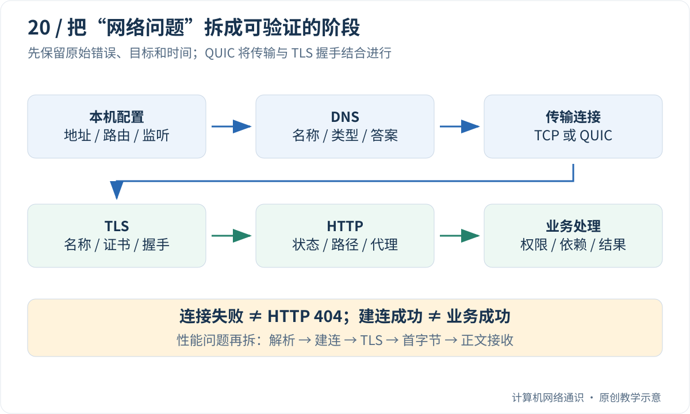

在互联网业务运维中，无论是开发人员、测试工程师还是系统架构师，几乎每天都会听到这样的反馈：

- “开发环境的数据库连不上了！”
- “第三方支付接口偶尔超时，到底是谁的问题？”
- “网站今天打开特别慢，是机房带宽打满了，还是代码死锁了？”

面对这些模糊的抱怨，业余的排查往往充斥着玄学与盲目：随手刷新几次页面、胡乱修改几个配置，或者病急乱投医地重启路由器甚至重启整台服务器。

**网络协议栈是全世界最精确、最严谨的确定性系统。任何一次网络不通或延迟飙升，在操作系统的物理层、链路层、路由层、传输层或应用层中，都留下了铁一般的确凿证据！**

本文将把整个《计算机网络通识》专栏的前述知识熔于一炉，建立起一套**自底向上、层层递进、逻辑闭环的工业级分层网络排障法典**，并掌握利用 `ip`、`ss`、`dig`、`curl` 以及 `tcpdump` 精准定位故障根因的硬核抓手。

## Table of contents

## 第一章：排障的核心哲学——自底向上的证据链法则

在网络排障中，必须恪守一条至高准则：**严禁跳跃假设，必须建立不可推翻的证据链！**

许多人一遇到“网页打不开”，就立刻去怀疑 Nginx 配置或数据库慢查。然而，如果底层网线松了、或者网卡由于 DHCP 故障根本没拿到合法 IP，上层所有的排查动作纯属浪费时间。



> **自底向上的四阶推进法典**：
>
> ```text
> [第一阶段: L1~L3 物理层与网络层] ──> 网卡 UP 吗？IP 合法吗？ARP 有响应吗？网关能 Ping 通吗？
>                │
>                ▼ (基础通路正常)
> [第二阶段: L4 传输层连通性]      ──> 目标端口开启监听了吗？是握手超时还是被 RST 拒绝？
>                │
>                ▼ (端口可达)
> [第三阶段: L7 命名与安全握手]    ──> DNS 解析正确吗？证书过期了吗？SNI 匹配吗？
>                │
>                ▼ (安全信道已通)
> [第四阶段: L7 业务应用层]        ──> 是 TTFB 首字节慢 (后端慢查)，还是 Content 传输慢 (网络带宽)？
> ```

---

## 第二章：阶段一——L1 到 L3：物理链路、IP 寻址与路由排查

### 1. 检查物理网卡与本地 IP 状态

排查的第一步，永远是在本机终端执行：

```bash
ip addr show
```

- **检查网卡状态**：网卡接口是否处于 `<BROADCAST,MULTICAST,UP,LOWER_UP>` 状态？若没有 `UP`，说明网线松脱或物理网卡驱动被禁用；
- **排查 APIPA 故障地址**：如果发现分配的 IP 是 **`169.254.X.X`**，我们在第 3 篇推导过：这代表你的电脑开启了自动获取 IP，但局域网的 **DHCP 服务器完全没有响应**，属于底层连通故障！

### 2. 检查二层局域网与 ARP 邻居表

```bash
ip neigh show
# 或 arp -an
```

- 查看网关 IP 对应的条目状态是 `REACHABLE`（可达）还是 `FAILED`（失败）；
- 若状态为 `FAILED`，说明底层交换机 VLAN 划分隔离错误，或者局域网物理信道中断，ARP 请求根本没有收到应答。

### 3. 检查默认网关与跨网路由

```bash
ip route show
```

- 检查是否存在 `default via <网关IP> dev eth0` 默认路由；
- **`ping` 探测网关连通性**：
  ```bash
  ping -c 4 192.168.1.1
  ```
  如果连局域网默认网关都 ping 不通，说明数据包连你的房间都出不去！

### 4. 跨网路由追踪：`traceroute`

如果能通网关，但上不了公网：

```bash
traceroute -n 8.8.8.8
```

我们在第 4 篇中推导过：`traceroute` 利用递增的 TTL 探测沿途路由器。
审视输出在哪一个跳数（Hop）开始全部变成 `* * *` 并彻底中断，即可瞬间断定：**故障发生在家庭网关、运营商接入层（CGNAT），还是跨省骨干网线路上！**

---

## 第三章：阶段二——L4 传输层：端口可用性与连接状态排查

网络层通了，说明道路已经铺平。接下来必须确认：**目标服务器上的目标程序是否在正确监听端口？**

### 1. 区分两类截然不同的连接失败信息

在客户端尝试连接远端端口（如通过 `curl` 或写代码连接）时，必须精准区分两种底层报错：

#### 报错 A：`Connection refused`（连接被拒绝）

- **底层物理真相**：网络链路完全畅通！你的 SYN 数据包安全抵达了目标服务器。
- **根本原因**：**目标服务器的操作系统核对端口表，发现该端口上根本没有任何进程在调用 `listen()` 监听！** 服务器内核立刻遵循 TCP 规范，主动回送了一个 `RST=1` 的复位报文打回请求！
- **诊断**：**目标服务进程崩溃宕机了，或者端口号写错了！** 此时去查网络连通性毫无意义，必须去服务端检查进程是否存活！

#### 报错 B：`Connection timed out`（连接超时）

- **底层物理真相**：客户端发出了 SYN 握手报文，但如泥牛入海，没有收到任何回复，经过多次指数退避重传后最终超时死锁；
- **根本原因**：**数据包在路上被物理丢弃了！** 极大概率是**服务端的网络防火墙（iptables / 云安全组）**配置了拦截策略，将外部入站的 SYN 报文静默丢弃（DROP）！

### 2. 端口探测利器：`nc`（netcat）

在没有安装复杂工具时，使用 `nc` 进行零入侵探测：

```bash
# -z: 仅探测端口连通性，不发送任何业务数据
# -v: 详细输出模式
# -w 3: 超时时间设为 3 秒
nc -zv -w 3 192.168.1.50 3306
```

### 3. 本地连接状态全盘透视：`ss` 命令

在排查高并发服务器时，坚决抛弃老旧低效的 `netstat`，使用直接读取 Linux 内核 Netlink 机制的 **`ss`** 命令：

```bash
# -t: TCP
# -u: UDP
# -l: 仅列出处于 LISTEN 监听态的端口
# -n: 不解析服务名，纯数字显示端口
# -p: 打印监听该端口的进程名与 PID
ss -tulnp
```

#### 检查连接状态堆积：

```bash
ss -ant | awk '{print $1}' | sort | uniq -c
```

- 若发现上万个 **`TIME_WAIT`**：我们在第 10 篇讲过，这属于主动关闭方的正常现象，检查是否缺乏长连接连接池，确认是否开启了 `SO_REUSEADDR`；
- 若发现大量 **`CLOSE_WAIT`**：**立刻拉响警报！** 被动方应用程序漏写了 `close()` 或卡死在死锁中，抓取堆栈后紧急止血！

---

## 第四章：阶段三——L7 命名与安全信任排查

### 1. 独立排查 DNS 解析：`dig`

不要直接用 `ping domain` 猜结果，使用 `dig` 剥离系统缓存干扰：

```bash
# 直接指定使用 8.8.8.8 权威公共 DNS 查询域名
dig @8.8.8.8 api.github.com +trace
```

- 查看返回的 `status`：
  - `NXDOMAIN`：域名不存在或已过期；
  - `SERVFAIL`：权威服务器配置错误或拒绝解析；
  - `NOERROR`：解析成功，比对 `ANSWER SECTION` 返回的 IP 是否属于合法 CDN 或目标服务器。

### 2. 独立排查 TLS 安全握手：`openssl s_client`

当遇到浏览器弹窗报警数字证书问题时，使用 OpenSSL 命令行工具直接在终端模拟完整的 TLS 握手：

```bash
openssl s_client -connect example.com:443 -servername example.com
```

- `-servername`：在握手中传入 **SNI（服务器名称指示）**，防止单 IP 多证书虚拟主机返回错误证书；
- **审视证书链（Certificate Chain）**：检查从叶子证书、中间 CA 到根证书是否完整；
- **检查有效时间（Validity）**：查看 `Not After` 字段，确认证书是否已经过期失效。

---

## 第五章：阶段四——L7 业务应用性能拆解与抓包核武器

当一个接口“访问很慢”，耗时达到了 3 秒。**这 3 秒钟到底是在哪一个环节被消耗掉的？**

### 1. 用 `curl` 模板将一次请求切出“七大微观耗时”

Linux 下的 `curl` 提供了一个极其强悍的性能格式化探测模板。编写配置文件 `curl-format.txt`：

```text
\n
       DNS 域名解析耗时:  %{time_namelookup} s\n
       TCP 三次握手耗时:  %{time_connect} s\n
       TLS 安全握手耗时:  %{time_appconnect} s\n
       客户端发包前就绪:  %{time_pretransfer} s\n
   ⭐️ 服务端首字节响应 (TTFB): %{time_starttransfer} s\n
─────────────────────────────────────────────\n
       整场事务全流程总耗时: %{time_total} s\n
\n
```

执行高精度探测：

```bash
curl -w "@curl-format.txt" -o /dev/null -s "https://api.example.com/data"
```

控制台会瞬间输出极其震撼的物理微观耗时切片：

```text
       DNS 域名解析耗时:  0.021 s
       TCP 三次握手耗时:  0.052 s
       TLS 安全握手耗时:  0.114 s
       客户端发包前就绪:  0.115 s
   ⭐️ 服务端首字节响应 (TTFB): 2.850 s
─────────────────────────────────────────────
       整场事务全流程总耗时: 2.855 s
```

> **法医般的定责结论**：
>
> 看这一串数据：DNS 只花了 21ms，网络连接和 TLS 加密总共只花了 115ms！
> **而从发完请求到收到第一个字节，`time_starttransfer`（TTFB，Time to First Byte）竟然整整花了 2.85 秒！**
>
> **结论**：**网络链路极其通畅纯净！彻底洗清网络工程师的嫌疑！问题百分之百出在后端服务器的业务代码上——数据库发生了严重的慢查询全表扫描，或者业务代码陷入了锁争用！**

### 2. 终极真相核武器：`tcpdump`

当所有的命令输出依然无法解释某些偶发性丢包或神秘中断时，必须祭出终极武器——**在网卡上抓取底层真实流动的数据包！**

```bash
# -i eth0: 监听网卡
# -nn: 强制以纯数字形式显示 IP 与端口，不进行任何反向 DNS 查询 (极大提升抓包吞吐)
# -s 0: 抓取完整报文，不截断
# -w dump.pcap: 将原始报文流落盘保存为 pcap 格式，供后续 Wireshark 深度可视化分析
sudo tcpdump -i eth0 -nn -s 0 -w trace.pcap "tcp and port 443"
```

将生成的 `trace.pcap` 拖入 Wireshark 中：
三次握手的每一个序列号、每一次滑动窗口的满容通告、每一次快速重传的重复 ACK 以及四次挥手的断开，全部以纳秒级精度的物理时序展现在你面前，没有任何网络 Bug 能够逃过这双眼睛！

---

## 总结与专栏全局承接

在本篇《计算机网络通识（二十）》中，我们完成了从纯理论走向工业实战的方法论升华：

1. **证据链法则**：确立了自底向上推进的严密排障法典，坚决杜绝无脑重启与跳跃假设；
2. **底层物理通路**：掌握了 `ip addr` 排查网卡 UP 与 DHCP 故障、`ip neigh` 审视 ARP 连通性以及 `traceroute` 逐跳定位断点路由器的方法；
3. **传输层真伪**：深刻区分了 `Connection refused`（服务未起回送 RST）与 `Connection timed out`（网络丢包或防火墙静默丢弃）的本质鸿沟，推导了 `ss` 命令排查 `TIME_WAIT` 与 `CLOSE_WAIT` 堆积的抓手；
4. **性能切片手术刀**：利用 `curl` 模板将一次请求细分切片为 6 个阶段，彻底掌握了利用 TTFB（首字节时间）精准定责“是网络慢还是后端业务慢”的终极技能。

在攻克了网络连通与全链路排障之后，我们迎来整个《计算机网络通识》专栏的**最后一篇压轴大作**：

- 当一个用户在网站登录成功之后，面对本质完全“无状态”的 HTTP 协议，**服务器究竟是如何跨越多次独立的请求，安全、持久地记住“你已经登录成功”的？**
- **Cookie**、**Session** 和现代分布式的 **JWT Token** 究竟经历了怎样的架构演进？
- 所谓的 `HttpOnly`、`SameSite` 是如何防范跨站脚本攻击（XSS）与跨站请求伪造（CSRF）的？

让我们正式迈向专栏的终章压轴篇：**[《Cookie 与 Session：网站是怎样记住你已经登录的？》](/blog/posts/understanding-cookies-and-sessions/)**！
