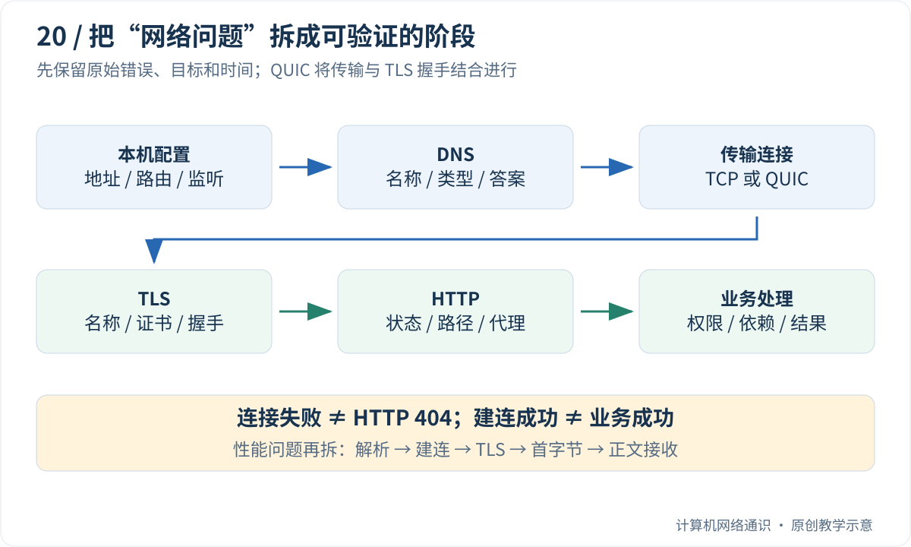

遇到“网页打不开”，最容易想到的动作是重启、换 DNS、清缓存、关开 VPN。但一次改了好几项，即使恢复了，也不知道原来哪里出了问题。

本篇从你能看到的错误开始，给出可以照着做的观察顺序。先用浏览器和少量只读命令缩小范围，再决定是否需要抓包。没有学会整个系列，也可以从下面的分支表开始。

## Table of contents

## 先学会把一句“打不开”改写成事实

比较两种描述：

```text
模糊：网络坏了。
具体：这台 Windows 电脑在家中 Wi-Fi 下，访问某个 HTTPS 页面，
     等了约 10 秒后显示连接超时；同站首页可以打开。
```

后一种描述说明了设备、网络、目标、耗时、错误和对照条件。它没有急着猜原因，却已经把“整台电脑完全断网”与“某个资源或路径异常”区分开了。

**证据** 是实际观察，例如状态码、错误文字和返回地址。**假设** 是待验证的解释，例如“这个入口的后端没有回应”。排障就是用下一次有针对性的观察支持或排除假设，而不是把熟悉的错误词当结论。

## 第一次排查，先走这四步

### 第一步：保存错误，而不是马上改设置

记下失败时间、访问的完整路径和原始提示。URL 中若有密码、令牌或个人信息，不要公开原样粘贴。截取错误文字时，也要留意截图里是否有敏感信息。

### 第二步：确定范围

在同一设备、同一网络上，比较该站首页和出问题的页面；再比较另一个已知可访问的网站。只改一个目标，观察失败是局限在一个路径、一个网站，还是更广。

换手机热点是一种有用对照，但会同时改变出口、DNS、地址族和网络策略。它能说明“换环境有影响”，不能直接锁定是哪一项导致变化。

### 第三步：看已经走到了哪一层

| 看到的现象          | 优先检查                           | 不必马上做的事         |
| ------------------- | ---------------------------------- | ---------------------- |
| 提示名称无法解析    | 域名拼写、解析路径与结果           | 先去改 TCP 窗口        |
| 连接超时或拒绝      | 地址、端口、路由、监听及过滤       | 直接判定网页文件不存在 |
| 证书警告            | 域名、时间、证书链与代理           | 跳过验证后宣布修好     |
| 明确 HTTP 404       | 请求路径、响应来源与站点路由       | 把它当作根本没连上     |
| HTTP 200 但页面异常 | 正文、页面其他请求、脚本和业务结果 | 仅凭 200 宣布一切正常  |

### 第四步：为下一次观察写一个具体问题

例如：“失败时能否得到 DNS 地址？”“TCP 443 是否建立成功？”“404 是网关还是应用返回的？”每个问题对应一类工具。不要一次运行十条不理解的命令，再从最显眼的红字猜根因。

## 浏览器里能看见什么？

在 Chrome 或 Edge 中按 `F12`，选择“网络 / Network”，再重现一次失败。点击相应请求，查看状态、远端地址、请求与响应字段，以及 Timing 时间信息。

列表中一张网页可能产生很多请求。主文档成功，不代表图片、脚本、登录接口都成功。找出与你观察到的现象对应的那一行，再分析它，避免把统计上报失败当成主页面打不开的原因。

如果显示来自缓存，这次可能没有走完整网络流程。先记录当前结果，再考虑禁用 HTTP 缓存重试；不要把开发者工具的缓存开关当成清掉 DNS、连接池和所有应用状态的总开关。

## Windows 上先读懂两条最小命令

打开 PowerShell。第一条查名称，第二条尝试 TCP 端口：

```powershell
Resolve-DnsName example.com -Type A
Test-NetConnection example.com -Port 443
```

第一条主要看是否返回地址或具体错误；第二条主要看 `RemoteAddress` 与 `TcpTestSucceeded`。后者为 `True` 表示该次 TCP 建连测试成功，不表示证书验证、HTTP 或登录也成功。为 `False` 则需要继续区分超时、拒绝和环境限制。

`example.com` 是演示名称。排查自己的问题时应换成自己的实际目标和端口，不能用“另一个网站能连”替代目标证据。若没有 PowerShell 的相关命令，可以先用浏览器观察；Linux 下的对应检查在后文列出，不要求所有系统执行同一命令。

## 两个完整小案例，练习根据证据缩小范围

### 案例 A：新文章链接返回 404

假设首页能开，新文章明确返回 404。浏览器已经拿到 HTTP 回应，说明这一次不是完全没有网络返回。先比较链接是否漏掉站点部署前缀，例如本站的 `/blog/`，再检查大小写、文件发布状态和站点路由。

如果修正路径后立即得到预期文章，这组证据支持“原链接路径错误”。它不支持“原来 DNS 坏了”，因为你没有改变 DNS，也没有观察到解析失败。这个案例是方法演示，不是正在报告本站故障。

### 案例 B：已查到地址，但 TCP 测试超时

已有地址说明名称查询取得了结果；它不保证这个地址就是预期入口，也不保证路径可达。接下来核对实际地址、端口、代理和地址族。如果服务由你管理，再检查服务是否监听以及边界规则。

不能只凭超时判断“服务器关机”，因为请求可能没到、回应可能回不来、过滤可能不回应。合适的结论应当是“在这些条件下，未能在期限内建立到这个端点的 TCP 连接”。它比猜一个未经验证的根因更有用。

下面把这些步骤按层展开。图是帮助选择下一项检查的地图；已有明确证据时，可以直接进入相关阶段，不需要每次把所有命令从头跑一遍。

## 第一步不是执行命令，而是定义现象

先写下这几项：

| 信息                           | 为什么需要                                 |
| :----------------------------- | :----------------------------------------- |
| 完整目标域名、端口、路径和协议 | 相同域名的不同接口可能有不同问题           |
| 发生时间与时区                 | 便于对齐客户端、代理和服务器日志           |
| 原始错误和耗时                 | “超时”“拒绝”“404”指向不同阶段              |
| 影响范围                       | 一台设备、一个网络、一个用户，还是所有请求 |
| 代理、VPN、IPv4/IPv6、缓存状态 | 它们会改变实际路径与目标                   |
| 最近一次相关变化               | 配置、发布、证书和网络切换可作为待验证假设 |

保存日志时去掉令牌、Cookie 和个人数据。完整 URL 也可能携带敏感查询参数，应保留结构和必要信息，而不是无条件复制全部内容。

“换手机网络好了”提供了一组对照，但同时可能改变 DNS、IPv6、出口、代理和缓存。它能缩小范围，却不能直接证明原运营商某台路由器有问题。

## 先画一条请求路径



对于普通 HTTPS over TCP，可以按本机配置 → DNS → TCP → TLS → HTTP → 应用逐步定位。HTTP/3 使用 QUIC，传输与加密握手关系不同；经过代理时还要区分代理入口与最终目标。

这是一张排查地图，不是规定你每次必须从第一格重新开始。如果已经拿到明确的 HTTP 404，就已经有理由把注意力放在 HTTP 路径和服务路由上。

## 本机地址、路由和监听是否符合预期？

Windows PowerShell 的基础观察可以从这里开始：

```powershell
Get-NetIPConfiguration
Get-NetRoute -AddressFamily IPv4 |
  Select-Object DestinationPrefix, NextHop, InterfaceAlias, RouteMetric
Get-NetTCPConnection -State Listen
```

Linux 可对应查看：

```bash
ip addr
ip route
ss -ltn
```

这些命令只观察本机。重点是网卡是否有预期地址、目标是否匹配正确路由、VPN 是否改变了路径，以及服务是否只监听回环地址。

不要仅仅因为看到一条 `0.0.0.0/0` 就认为所有目标都会经过它，更具体的路由或策略可以优先。也不要把“程序已经启动”当成“程序已在目标地址和端口监听”。

排查 IPv6 时使用相应地址族命令。只检查 IPv4 路由，却让浏览器实际访问 AAAA 地址，会出现证据与真实路径不一致的问题。

## DNS：返回了什么，而不只是能不能查询？

记录查询的名称、类型、响应码、返回地址和 TTL。必要时核对 CNAME 链及所用解析器。Windows 可以使用 `Resolve-DnsName`，具备 BIND 工具的环境可以使用 `dig`。

同一个域名在不同网络返回不同地址，可能是正常的调度结果。浏览器还可能使用自己的 DNS 或 DoH 路径，因此命令行解析成功不保证浏览器使用了同一结果。

如果要隔离 DNS 与后续阶段，可在获得**已确认的目标 IP** 后使用 curl 的 `--resolve 主机名:端口:IP` 做对照。它能保留 URL 主机名、Host 与 HTTPS 验证名称；直接把 HTTPS URL 改成 IP 则可能引入证书名称或虚拟主机问题。不要随意使用来源不明的 IP 作为诊断目标。

缓存清理会改变现场。先保存原始答案与时间，再决定是否需要清理；“清缓存后好了”不能单独解释原来的故障原因。

## 连接：拒绝和超时不是同一个证据

| 现象         | 能支持的判断                     | 仍不能直接确定                     |
| :----------- | :------------------------------- | :--------------------------------- |
| 明确连接拒绝 | 某处主动拒绝或重置了这次建立尝试 | 一定是目标应用亲自拒绝             |
| 连接超时     | 在期限内未完成建立               | 丢在客户端、路径、防火墙还是服务端 |
| TCP 连接成功 | 传输层入口可以建立连接           | TLS、HTTP 或业务一定成功           |
| ping 无回应  | 没收到预期 ICMP 响应             | TCP 或 QUIC 一定也不可用           |

`Test-NetConnection example.com -Port 443` 可以观察相应 TCP 建连能力。它不能测试 UDP 上的 HTTP/3，也不验证完整 HTTPS 请求。

traceroute 中间某跳没有回应，可能只是设备不回复探测或限速。尤其当后续目标仍可达时，不能把某个 `*` 直接认定为转发中断。路径还可能不对称、随流量哈希变化。

## TLS 和 HTTP：把安全失败与服务响应分开

证书名称不匹配、链不受信任或版本不兼容，都可能在 HTTP 请求获得有效响应之前发生。此时需要核对目标名称、时间、信任配置和代理路径；跳过证书验证只是改了实验条件，不是修复。

如果拿到了 401、403 或 404，说明某个 HTTP 响应者已经回答。进一步确定它来自 CDN、网关还是源站，再检查身份、权限、路径和路由配置。

502、503、504 也需要结合生成响应的组件解释。入口返回 503 可能是过载、维护或没有可用后端；不能只凭状态码断言某一个进程崩溃。

curl 默认不会仅因 HTTP 404 就把传输命令视为失败。自动化检查应同时读状态码，或按需要选择 `--fail-with-body` 等选项；不要只检查退出码便宣布接口健康。选项支持和语义见 [curl 官方手册](https://curl.se/docs/manpage.html)。

## 可选实验：本机比较 404 与连接建立失败

保存为 `diagnose_layers.py`，按[Python 准备说明](/blog/posts/understanding-ports-and-sockets/#可选编程实验的准备怎样运行本系列的-python-代码)运行。示例先在本机启动一个小服务：访问 `/ok` 返回成功，其他路径返回 404。随后再尝试连接一个仅绑定、没有监听的本地端口。

运行前先预测：404 那次会不会得到 HTTP 正文？连接建立失败那次会不会出现 HTTP 状态码？答案分别是“本例会收到 missing 正文”和“得不到 HTTP 响应”。代码只是把这一区别变成可观察输出。

下面程序创建一个只在回环地址提供服务的教学 HTTP 服务，再访问一个没有监听的本地 Socket 端口。不需要关闭防火墙，不连接外部网站。

```python
import socket
from contextlib import closing
from http.client import HTTPConnection
from http.server import BaseHTTPRequestHandler, ThreadingHTTPServer
from threading import Thread


class Handler(BaseHTTPRequestHandler):
    def do_GET(self):
        status, body = (200, b"ok") if self.path == "/ok" else (404, b"missing")
        self.send_response(status)
        self.send_header("Content-Length", str(len(body)))
        self.end_headers()
        self.wfile.write(body)

    def log_message(self, *args):
        pass


server = ThreadingHTTPServer(("127.0.0.1", 0), Handler)
worker = Thread(target=server.serve_forever, daemon=True)
worker.start()
try:
    for path in ["/ok", "/missing"]:
        with closing(HTTPConnection(*server.server_address, timeout=2)) as client:
            client.request("GET", path)
            response = client.getresponse()
            print(path, response.status, response.read())
finally:
    server.shutdown()
    server.server_close()
    worker.join()

with socket.socket(socket.AF_INET, socket.SOCK_STREAM) as not_listening:
    not_listening.bind(("127.0.0.1", 0))
    try:
        with socket.create_connection(not_listening.getsockname(), timeout=2):
            print("unexpected connection")
    except OSError as error:
        print("tcp-connect failed:", type(error).__name__)
```

本次 Windows 环境运行得到以下输出；其他系统在最后一步也可能立即报告 `ConnectionRefusedError`：

```text
/ok 200 b'ok'
/missing 404 b'missing'
tcp-connect failed: TimeoutError
```

最后一行的异常类型受平台行为影响，应记录自己的实际结果。前两次都成功进行了 HTTP 交互，只是目标路径的应用结果不同；最后一次则没有得到 HTTP 响应。这个实验帮助建立分层概念，不模拟真实网络中的丢包位置和超时。

## 很慢：先把总时间拆开

Windows 可以由读者在自己的环境执行以下单行命令；Linux/macOS 将 `curl.exe` 改为 `curl`，将 `NUL` 改为 `/dev/null`：

```powershell
curl.exe -sS -o NUL --connect-timeout 5 --max-time 15 -w "ip=%{remote_ip} code=%{http_code} dns=%{time_namelookup} connect=%{time_connect} tls=%{time_appconnect} first=%{time_starttransfer} total=%{time_total}\n" https://example.com/
```

这些时间主要是从请求开始累计到不同阶段的时间点，不能直接全部相加。对于一次直接、新建、没有重定向的 HTTPS over TCP 请求，可以用相邻时间点差值近似拆分阶段。

例如下面是**人为构造的教学数据**，不是 example.com 的实测：

```text
dns=0.020 connect=0.050 tls=0.090 first=0.210 total=0.250
```

它对应约 20 ms 解析、30 ms TCP 建连、40 ms TLS、120 ms 从 TLS 完成到首字节、40 ms 接收剩余响应。首字节前的 120 ms 包含请求传输、网络和服务端处理等因素，不能全部归为服务器 CPU 时间。

连接复用、代理、重定向、缓存和 HTTP/3 都会改变解释方式。如果没有先记录这些条件，阶段差值很容易被赋予错误含义。一次请求也不足以估计稳定性能，更不能拿几个样本声称得到可靠的 p99。

## 进阶：什么时候需要抓包与系统跟踪？

当应用日志不足以区分连接建立、重传、零窗口和异常关闭时，再针对一个明确目标进行抓包或系统观测。先确定捕获接口、地址族、过滤条件与时间范围，并理解本机卸载可能改变看到的分段或校验和表现。

[Wireshark 的 TCP 分析说明](https://www.wireshark.org/docs/wsug_html_chunked/ChAdvTCPAnalysis.html)可以帮助解释自动标记。[Brendan Gregg 的 TCP Tracepoints](https://www.brendangregg.com/blog/2018-03-22/tcp-tracepoints.html)则展示了从内核事件观察状态变化和重传的路径；具体探针能力要以运行内核和工具为准。

工具越深入，越需要明确问题。不要先收集海量输出，再期待从里面偶然看出原因。一个具体问题，例如“这次失败是否发生在 TLS 之前”，会自然决定需要哪类证据。

## 留下一份别人能复核的结论

排查结束时，把结论写成“在什么条件下观察到什么，因此支持什么判断，还不能排除什么”，而不是只留下“网络有问题”。

例如：在同一客户端、关闭应用缓存且使用同一目标地址时，TCP 建连成功，TLS 验证成功，网关稳定返回 504；源站日志未出现相应请求。下一步应检查网关到源站的路径与请求转发，而不是继续更换客户端 DNS。

这仍然不是最终根因，但已经把问题缩小到可行动的范围。整个系列的知识，到这里都变成了定位边界的工具：地址与路由解释去哪里，端口与连接解释交给谁，TLS 解释信任，HTTP 解释交互，代理与隧道解释路径中还有谁。

## 读完后，用自己的话试着解释

TCP 443 测试成功，但浏览器提示证书名称不匹配。下一步应优先改 DNS、关闭防火墙，还是核对目标名称与证书？

<details>
<summary>展开参考答案</summary>
<div class="mt-4 leading-7">先核对实际目标名称、证书覆盖范围、代理与相关入口配置。TCP 成功只证明该次传输连接建立，不能代替 TLS 身份检查。不要先关闭验证来掩盖问题。</div>
</details>

上一篇：[NAT 穿透专题](/blog/posts/how-nat-traversal-works/)

下一篇：[Cookie 与 Session：网站是怎样记住你已经登录的？](/blog/posts/understanding-cookies-and-sessions/)

回看：[打开网页时的网络全景](/blog/posts/what-happens-when-you-open-a-webpage/)

[浏览完整网络专栏](/blog/series/计算机网络通识/)

## 参考与延伸阅读

- [Brendan Gregg：TCP Tracepoints](https://www.brendangregg.com/blog/2018-03-22/tcp-tracepoints.html)——有明确问题的系统级观测。
- [curl 官方手册](https://curl.se/docs/manpage.html)——计时、连接期限、地址固定与错误处理选项。
- [Wireshark：TCP Analysis](https://www.wireshark.org/docs/wsug_html_chunked/ChAdvTCPAnalysis.html)——抓包分析的含义。
- [Linux ss(8)](https://man7.org/linux/man-pages/man8/ss.8.html)——本机 Socket 状态观察。
- [Microsoft Test-NetConnection](https://learn.microsoft.com/en-us/powershell/module/nettcpip/test-netconnection)——Windows 连接诊断接口。
