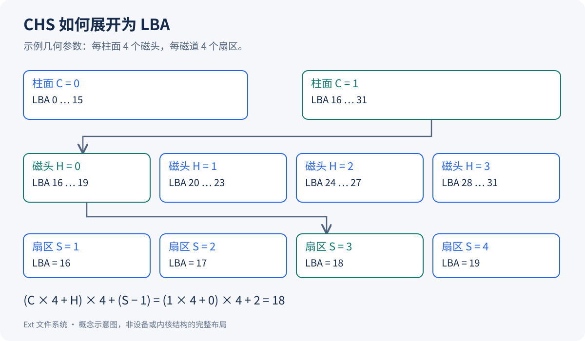
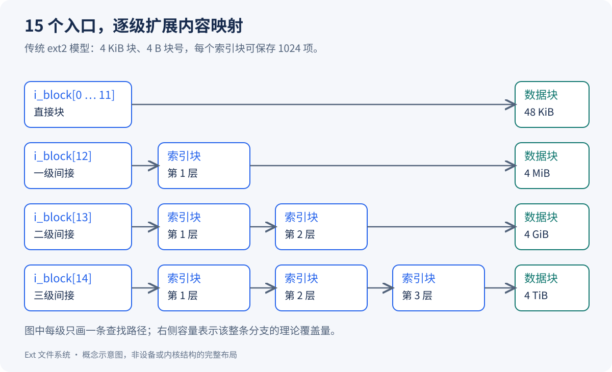
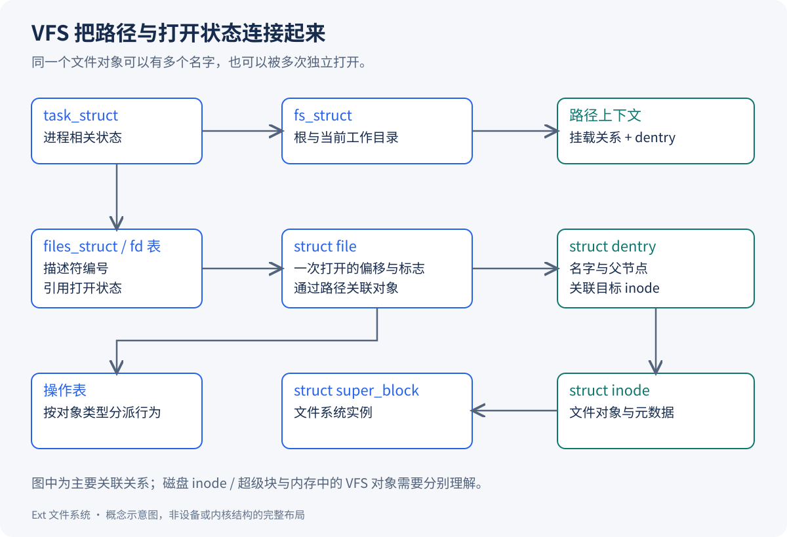

一个文件可以有两个名字，删除其中一个名字后，另一个仍然能打开它；磁盘明明还有剩余空间，却可能无法再创建文件；把一个文件系统挂到目录上，目录里原来的文件又像是“消失”了。

这些现象都在提醒我们：**文件系统不仅负责保存字节，还负责组织空间、建立名字与对象的关系，并把这些关系接到进程能够访问的路径上。**

上一篇[基础 I/O](/blog/posts/linux-basic-io/)主要从进程出发，解释 `FILE`、fd、重定向和缓冲区。本篇转到磁盘与文件系统视角：先找到存储位置，再理解文件对象，最后沿路径把对象交给进程。

理解这条路径，需要把三类信息分开：设备用地址定位存储，文件系统用 inode 描述对象，目录用名字组织访问入口。接下来沿这三个层次展开，最后用一个普通文件制作 ext4 镜像，把格式化、挂载和持久保存串起来。文中的配图是概念示意；涉及 CHS 和传统 ext2 的部分，会明确它们与现代设备、ext4 的区别。

## Table of contents

## 先认识保存字节的硬件

### 从一块硬盘到一间机房

文件系统的下方是存储设备。无论文件来自个人电脑还是远程服务器，都需要某种介质在进程结束后继续保存数据。

硬盘是外部存储设备，服务器可以装多块硬盘；多台服务器安装到机柜中，机柜再组织成机房。计算能力之外，机房还需要供电、散热、网络与运维设施。对于程序来说，持久数据最终仍要经过存储设备，而不是永远留在进程内存中。

机械硬盘依靠运动部件定位数据，随机访问延迟通常远高于内存，适合承担较大容量的持久存储。这里的“外部”是相对于 CPU、主存的体系结构角色，并不表示硬盘一定放在机箱外。

机械结构影响的是访问成本，而非文件接口的形式。风扇、光驱也可能包含运动部件，硬盘的特殊之处在于用磁头和旋转盘片读写数据。没有旋转盘片的 SSD 同样可以作为文件系统的底层设备。

### 盘片、主轴、磁头和传动臂

机械硬盘内部可以先看成四部分：

| 部件             | 作用               | 直观理解               |
| ---------------- | ------------------ | ---------------------- |
| 盘片 platter     | 磁性介质承载数据   | 像可以记录信息的“纸面” |
| 主轴和电机       | 带动盘片旋转       | 让目标位置经过磁头下方 |
| 磁头 head        | 读取或改变磁性记录 | 像读写数据的“笔”       |
| 传动臂与执行机构 | 沿半径方向移动磁头 | 选择要访问的磁道       |

“纸”和“笔”只是类比：工作时磁头通常以极小间隙飞行在盘面上方，并不是像笔一样压着盘片摩擦。执行机构利用永久磁铁与线圈产生的作用力移动磁头；记录数据则依赖磁性介质的状态。硬盘的磁记录与光盘的光学读写是不同机制。

常见单执行器机械硬盘中，多盘片一起旋转，成组磁头随传动臂共同移动。于是访问一次数据，主要包含选定磁道的 **寻道**、等待目标扇区转过来的 **旋转等待**，以及实际传输。不同盘面的磁头共同移动，让相同半径处的磁道形成了“柱面”这一组织概念。

### 磁道、柱面和扇区

- **磁道 track**：一个盘面上某个半径位置的一圈记录轨迹。
- **柱面 cylinder**：不同盘面上、相同半径位置的磁道所组成的集合，是一种几何组织概念。
- **扇区 sector**：磁道上的一个数据记录单元。它是环形磁道的一段，不应把图中的整个扇形楔子都当作同一个扇区。
- **磁头号**：在传统模型中，用来选择对应的盘面。

传统示意图把磁道画成同心圆，传统 CHS 编号中柱面从 0 开始编号，扇区号从 1 开始。旧设备的磁头停靠区也常被画在内圈；现代设备可能采用其他卸载和停靠设计，不必把这张图当作所有硬盘的精确机械布局。

内圈扇区画出来更小，并不意味着能保存的字节更少。在同一种扇区格式下，每个逻辑扇区向主机提供固定的数据字节数；图形面积不能直接当作容量。实际硬盘可以按区域改变每磁道的扇区数，所以“所有磁道扇区数相同”属于下面的简化 CHS 模型。

### 逻辑扇区与物理扇区为什么可能不同

下面的地址换算采用 **512 B 扇区、4 KiB 文件系统块**。实际设备要区分逻辑扇区和物理扇区：例如 512e 对外呈现 512 B 逻辑扇区，内部使用 4096 B 物理扇区；4Kn 的逻辑与物理扇区均为 4096 B。参见 [Seagate 对 Advanced Format 的说明](https://www.seagate.com/blog/advanced-format-4k-sector-hard-drives-master-ti/)。

因此，用户调用 `write(fd, buf, 1)` 完全可以请求写入一个字节。底层可能需要缓存、合并或读改写，但不能把设备粒度误读为“应用每次只能读写 512 字节的整数倍”。

## CHS 和 LBA：三维坐标怎样变成一个编号

### 用三个坐标定位一个扇区

在固定几何参数的简化模型里，一个扇区由三个坐标确定：

```text
C：第几个柱面
H：该柱面中选择哪个磁头 / 盘面
S：该磁道上的第几个扇区
```

这就是 CHS：Cylinder、Head、Sector。设一共有 `Nc` 个柱面、`Nh` 个磁头，每磁道有 `Ns` 个扇区，每扇区 `B` 字节，则模型中的总容量为：

$$
\text{容量}=N_c\times N_h\times N_s\times B
$$

坐标的编码位数曾直接限制可寻址容量。按柱面 10 位、磁头 8 位、扇区 6 位，并注意扇区号从 1 开始，理论可表示：

$$
1024\times256\times63\times512
=8\,455\,716\,864\ \text{B}
=8064\ \text{MiB}
\approx8.46\ \text{GB}
$$

这里不能把 `2^6` 个取值全部算作 64 个扇区，因为扇区编号 0 不用于这个模型。这是特定历史编码的上限，实际旧接口还可能有额外限制；它不是现代硬盘或 LBA 的容量上限。这里用 MiB 表示二进制容量单位，用 GB 表示十进制容量单位。

### 把磁盘想象成数组

磁带可以沿长度依次编号，磁盘也可以把多个盘面上的扇区排成一个线性序列。用数组表示，这相当于把三维下标展开成一维下标：

```text
一个磁道：sector[Ns]                  一维
一个柱面：sector[Nh][Ns]              二维
整个磁盘：sector[Nc][Nh][Ns]          三维
全部展开：sector[Nc * Nh * Ns]        一维
```

展开时先排列同一柱面内各磁头对应的磁道，再排列下一个柱面。不要直接把“先整个盘面、再下一个盘面”的随意展开顺序，与下面这套 CHS 公式混用。

展开后的下标叫 **LBA，Logical Block Address**。在本节它以逻辑扇区为单位，从 0 开始编号。名称里的 block 并不自动等同于后面文件系统的 4 KiB 块。



### CHS 转 LBA

前面完整柱面占据 `C × Nh × Ns` 个扇区，当前柱面内前面的磁道占据 `H × Ns` 个扇区，当前磁道内还要跳过 `S - 1` 个扇区：

$$
\mathrm{LBA}=(C\times N_h+H)\times N_s+(S-1)
$$

其中 `C`、`H` 从 0 开始，`S` 从 1 开始。

### LBA 转 CHS

反过来，用整除确定完整的柱面数，用余数确定柱面内的位置：

$$
C=\left\lfloor\frac{L}{N_hN_s}\right\rfloor
$$

$$
H=\left\lfloor\frac{L\bmod(N_hN_s)}{N_s}\right\rfloor,
\qquad S=(L\bmod N_s)+1
$$

例如令 `Nh = 4`、`Ns = 4`，把 `LBA = 18` 转回 CHS：

1. 一个柱面有 `4 × 4 = 16` 个扇区，`18 // 16 = 1`，所以 `C = 1`。
2. 柱面内偏移是 `18 % 16 = 2`，`2 // 4 = 0`，所以 `H = 0`。
3. 磁道内偏移是 `18 % 4 = 2`，扇区号为 `S = 3`。
4. 回代：`(1 × 4 + 0) × 4 + (3 - 1) = 18`。

可以用这个完整 Python 程序检查来回换算，保存为 `chs_lba.py`：

```python
CYLINDERS, HEADS, SECTORS = 8, 4, 4


def chs_to_lba(c, h, s):
    if not (0 <= c < CYLINDERS and 0 <= h < HEADS and 1 <= s <= SECTORS):
        raise ValueError("CHS out of range")
    return (c * HEADS + h) * SECTORS + s - 1


def lba_to_chs(lba):
    if not (0 <= lba < CYLINDERS * HEADS * SECTORS):
        raise ValueError("LBA out of range")
    c, rest = divmod(lba, HEADS * SECTORS)
    h, offset = divmod(rest, SECTORS)
    return c, h, offset + 1


for lba in range(CYLINDERS * HEADS * SECTORS):
    assert chs_to_lba(*lba_to_chs(lba)) == lba
print(lba_to_chs(18))  # (1, 0, 3)
```

采用 LBA 后，主机可以把设备视为按编号访问的存储空间：主机给出读写命令、LBA、数量和数据，设备负责实际定位。这个抽象仍然有价值，但现代 LBA 到物理介质的映射包含固件管理、坏块重映射等机制；对 SSD 更涉及闪存映射。现代设备不一定能还原出一组具有真实几何意义的 CHS 坐标。

## 扇区、块、分区、格式化，各管哪一层

### 为什么还需要文件系统块？

如果每一小段存储都单独管理，索引和分配会非常零碎。文件系统将空间组织成块，便于分配、缓存和合并 I/O。块是文件系统重要的管理粒度，并不是用户 API 可读取字节数的下限。

对于 512 B 逻辑扇区与 4 KiB 文件系统块：

$$
4\ \text{KiB}/512\ \text{B}=8
$$

也就是一个文件系统块覆盖 8 个逻辑扇区。如果文件系统位于从整盘 LBA `P` 开始的分区，文件系统块号为 `b`，块内扇区偏移为 `n`：

$$
\text{整盘 LBA}=P+8b+n,\qquad0\le n<8
$$

反过来，在该分区范围内：

$$
b=\left\lfloor\frac{L-P}{8}\right\rfloor,
\qquad n=(L-P)\bmod8
$$

直接使用 `LBA / 8` 或 `块号 × 8`，隐含了“起点相同”的前提。比如分区起点 `P = 2048`，文件系统第 3 块的起始整盘 LBA 是 `2072`，不是 24。

### 分区：先划定空间范围

分区是在块设备上划定的一段逻辑地址范围，并通过分区表记录。图中的 `MBR → Partition 1/2/3/4` 是传统 MBR 布局示意；现代机器也常见 GPT。

历史工具曾用起止柱面描述分区边界。现代分区主要按 LBA 描述，常考虑物理扇区和其他存储层的对齐，不要求必须以一个物理柱面为最小单位。

Windows 的盘符可以帮助初学者联想不同卷，但盘符并不严格等于物理分区。Linux 则用挂载把文件系统接入目录树；一个文件系统也可以位于整个设备、逻辑卷或普通镜像文件上。

### 格式化：建立管理结构

分区回答“这段空间归谁”，格式化回答“这段空间内部怎样组织”。

对 Ext 系列来说，创建文件系统需要确定块大小、inode 配置和功能特性，并写入超级块、组描述信息、位图、inode 表等初始结构。以后才有办法区分空闲空间、记录文件属性、查找内容。

因此，**分区、格式化和挂载是三个动作**：划定范围、初始化组织方式、接入可访问路径。格式化不是简单写一个“ext4”标签，也不等同于把每个字节都清零。

本篇实验只格式化新建的普通镜像文件。不要把示例中的镜像路径替换成已有磁盘或分区设备名。

### 为什么先学 ext2，再谈 ext3 和 ext4？

| 文件系统 | 主要变化                                                        |
| -------- | --------------------------------------------------------------- |
| ext2     | 用块组、inode、目录和传统块映射解释基本组织方式                 |
| ext3     | 在继承相关布局的基础上引入日志，改善崩溃后的恢复过程            |
| ext4     | 延续这些概念，同时发展 extent、延迟分配、校验和、灵活块组等机制 |

比如分配新块时，需要同时更新位图、inode 和目录等信息。中途掉电可能留下不一致的状态，日志机制通过事务记录帮助恢复。日志不是文件内容备份，也不等于每次写入立即持久化；具体保证取决于模式和同步操作。扩展阅读见 [ext4 日志说明](https://docs.kernel.org/filesystems/ext4/journal.html)。

下面以传统 ext2 布局建立模型，再指出不能直接套用到全部 ext4 特性的地方。

## inode：保存文件对象的元数据

### 先读懂 ls 和 stat

`ls -l` 常见输出包含：类型和权限、硬链接数、所有者、所属组、大小、最后修改时间、名字。名字来自目录项；其余大部分信息由目标对象的 inode 提供。

```bash
ls -li example.txt
stat example.txt
```

`-i` 用来显示 inode 号。`stat` 还能看到设备号、分配块数、建议 I/O 大小和多个时间戳。

例如，一个 654 字节的文件可能显示 `Blocks: 8`、`IO Block: 4096`。这里 Linux `stat` 的 `Blocks` 通常按 **512 B 单位**报告已分配空间，因此 `8 × 512 = 4096 B`，不能解释成“分配了八个 4 KiB 块”。`IO Block` 也不应脱离具体接口直接当成物理扇区大小。

文件逻辑长度与实际分配量并不总相等：空文件可能没有内容块，稀疏文件可以有很长的逻辑长度却只分配少量数据块，元数据本身也需要空间。

### inode 中究竟存了什么

传统磁盘 inode 的字段体现了文件系统需要回答的问题：谁拥有这个对象、它有多大、内容在哪里、还有多少名字引用它。

| 字段或字段组                       | 保存的信息                                           |
| ---------------------------------- | ---------------------------------------------------- |
| `i_mode`                           | 文件类型和权限                                       |
| `i_uid`、`i_gid` 及高位扩展        | 所有者、所属组的数值 ID                              |
| `i_size` 及相关扩展                | 文件逻辑大小                                         |
| `i_atime`、`i_mtime`、`i_ctime`    | 访问、内容修改、状态变化时间                         |
| `i_dtime`                          | 删除时间相关记录                                     |
| `i_links_count`                    | 指向对象的硬链接计数                                 |
| `i_blocks`                         | 已分配存储量，传统格式以 512 B 单位计数              |
| `i_flags`                          | inode 的行为或格式标志                               |
| `i_block[15]`                      | 内容定位区域，传统 ext2 用于块指针                   |
| `i_generation`                     | 文件版本标识等用途，例如配合 NFS                     |
| `i_file_acl`、`i_dir_acl` 等       | 扩展属性/历史 ACL 字段；实际含义受版本和文件类型影响 |
| `osd1`、`osd2`、碎片相关及保留字段 | 操作系统相关扩展、历史设计与格式扩展空间             |

`__le16`、`__le32` 表示磁盘格式中的小端整数，说明这是一种序列化布局。不要把磁盘中的块号当作进程可直接解引用的内存指针。

还有两个容易忽略的细节：

1. **文件名不保存在普通 inode 的名字字段里**，而是在目录项中与 inode 号关联。
2. 磁盘 inode 记录自身不一定再存一份“我的编号”。inode 号可以由它在整个 inode 空间中的位置确定；内存中的 VFS inode 会记录 `i_ino` 等信息。

inode 在同一个文件系统内部编号，通常从 1 开始；它不是全系统永久唯一 ID。区分正在使用的文件身份，常同时比较设备号与 inode 号，删除后的 inode 号还可能被重新分配。

### inode 多大，能创建多少个？

传统 ext2 常见 128 B inode，现代 Ext 文件系统也常见 256 B。同一个文件系统的 inode 表按其配置的固定记录大小组织；一个很大的普通文件，并不会仅仅因为内容变多，就把它那条 inode 记录无限放大。额外索引块、扩展属性等可以在别处保存。

以 4 KiB 块、128 B inode 为例，一个 inode 表块可以容纳 `4096 / 128 = 32` 条记录；若 inode 为 256 B，则是 16 条。

inode 数量通常在创建文件系统时按配置建立。于是会出现“还有数据空间，但 inode 用完了”的情况。可以分别检查：

```bash
df -h .
df -i .
```

前者看空间，后者看 inode 使用量。不能把 inode 配额想成每创建一个文件就随意扩大的一张表；文件系统扩容等操作可能改变总量，但那是另外的管理过程。相关创建选项见 [mke2fs(8)](https://man7.org/linux/man-pages/man8/mke2fs.8.html)。

## 块组：把一个文件系统拆成可管理的小区域

### 从磁盘一直放大到一个块组

如果整个文件系统只维护一处巨大的分配区域，相关元数据与内容可能相距很远。Ext 用块组缩小管理范围：每组记录本地资源的使用情况，再由全局结构把这些组连接起来。


传统布局可以概括成：

```text
块设备
└── 分区或其他承载范围
    └── Ext 文件系统
        ├── 块组 0
        ├── 块组 1
        ├── ……
        └── 最后一个块组
```

块组拥有相似的管理组成，最后一组可能不满。分配器还会尽量保持相关 inode 与数据的局部性，减少机械硬盘上的寻道等成本。但 **文件的数据不保证全部放在其 inode 所在的那一组**。

### 起始 1 KiB、MBR 和超级块不要混淆

一些布局图会把文件系统开头标为 Boot Block。这个标签容易与整盘引导区混淆，实际位置需要分别计算：

- 整盘的 MBR 位于磁盘起始位置，传统结构包含引导代码和分区表。
- Ext 文件系统相对于自身起点，保留前 1024 B 作为起始空间。
- 主超级块从文件系统起点偏移 1024 B 处开始；块为 1 KiB 时它位于块 1，块为 4 KiB 时则落在块 0 内部。

这不是“所有文件系统都必须有不可修改的 1 KiB 启动块”的通用规定，也不意味着分区表位于每个 Ext 文件系统的起始区域。具体布局见 [内核文档中的块组布局](https://docs.kernel.org/filesystems/ext4/blockgroup.html)。

### 超级块：描述整个文件系统

超级块回答的是“这个文件系统整体是什么样的”，不只是当前块组的情况。传统 `ext2_super_block` 的主要字段可分为以下几类：

| 字段类别     | 典型字段                                                                       | 用途                         |
| ------------ | ------------------------------------------------------------------------------ | ---------------------------- |
| 总量与空闲量 | `s_inodes_count`、`s_blocks_count`、`s_free_*`                                 | 文件系统规模和剩余资源       |
| 保留资源     | `s_r_blocks_count`、`s_def_resuid`、`s_def_resgid`                             | 保留块及可使用者             |
| 布局参数     | `s_first_data_block`、`s_log_block_size`、`s_inode_size`                       | 解释块号与 inode 记录        |
| 每组规模     | `s_blocks_per_group`、`s_inodes_per_group`                                     | 将全局编号换算为组内位置     |
| 状态与检查   | `s_magic`、`s_state`、`s_errors`、挂载/写入/检查时间与次数                     | 识别格式、管理一致性与维护   |
| 版本与功能   | `s_rev_level`、`s_feature_compat`、`s_feature_incompat`、`s_feature_ro_compat` | 判断实现能否安全读写         |
| 文件系统身份 | `s_uuid`、`s_volume_name`、`s_last_mounted`                                    | 卷标、UUID 与相关记录        |
| 扩展机制     | 日志字段、孤儿 inode 信息、目录散列种子、预分配提示、保留空间                  | 支持日志、恢复和后续格式演进 |

例如传统块大小可通过 `1024 << s_log_block_size` 求出；每组 inode 数则直接决定后面定位 inode 的整除基数。

功能标志的三类名称也有意义：未知兼容特性原则上可忽略，未知不兼容特性意味着不能正常挂载，未知只读兼容特性意味着不能贸然读写挂载。文件系统检查工具为了避免错误修复，可能执行更严格的检查。格式兼容不只是能否读出字段，还关系到修改后能否保留未知特性的含义。

超级块损坏会妨碍解释整个文件系统，所以格式设计会在部分块组保存备份。**不是每个块组都必有一份**，也不能把备份想成每次写入都实时同步的业务副本；具体位置和使用方式受功能特性影响，恢复通常由相应工具完成。字段和备份规则见 [超级块文档](https://docs.kernel.org/filesystems/ext4/super.html)。

### GDT：知道每个组的重要结构放在哪里

GDT 是 Group Descriptor Table，块组描述符表。一个块组对应一条描述符，表则集合了这些描述符。

因此，描述符既保存位置，也保存该组的资源统计：

| 字段                   | 含义                    |
| ---------------------- | ----------------------- |
| `bg_block_bitmap`      | 本组块位图的位置        |
| `bg_inode_bitmap`      | 本组 inode 位图的位置   |
| `bg_inode_table`       | 本组 inode 表的起始块号 |
| `bg_free_blocks_count` | 本组空闲块计数          |
| `bg_free_inodes_count` | 本组空闲 inode 计数     |
| `bg_used_dirs_count`   | 本组目录数量            |
| 对齐与保留字段         | 格式对齐、扩展用途      |

图上可以把这些结构画在相邻位置帮助理解，但实际解析应读取描述符，不能只靠“超级块后面固定隔几个块”推算全部结构。ext4 的 `flex_bg`、`meta_bg` 等功能尤其会影响布局；GDT 副本的分布也不是无条件每组一份。参见 [块组描述符说明](https://docs.kernel.org/filesystems/ext4/group_descr.html)。

### 两张位图与一张 inode 表

**块位图** 用一个 bit 记录一个块资源的使用情况，**inode 位图** 用一个 bit 记录一条 inode 记录是否已分配。位图描述“有没有被占用”，inode 表描述“这个对象具体是什么”。二者不能混为一张表。

在传统每组用一个块保存块位图、一个 bit 管一个块的模型中，4 KiB 位图能表示：

$$
4096\times8=32768\ \text{个块}
$$

若每块也是 4 KiB，这些块合计 128 MiB。这里计算的是模型能够管理的组规模，不能全部视作普通文件净内容空间，因为管理结构本身也占块。ext4 的 bigalloc 等特性改变了分配粒度，不能继续照搬这套一 bit 一块的计算。

**inode 表** 则是许多固定大小 inode 记录的集合。创建文件时先分配可用 inode，才能把它的属性和内容映射记下来。

**数据块区域** 的内容取决于文件类型：普通文件保存字节，目录保存目录项；传统间接索引块也会占用块资源，用来保存更多块号。短符号链接还可能直接将目标字符串存入 inode 内部，并非每个对象都必须另外占一块“内容块”。

inode 号与文件系统块号都在 **整个文件系统** 的范围内解释，而不是每个块组都从头产生一套可直接混用的编号。位图的具体定义可查 [块与 inode 位图说明](https://docs.kernel.org/filesystems/ext4/bitmaps.html)。

## 已知 inode 号，怎样算出它在哪里？

有了超级块和 GDT，就可以把 inode 号换算成实际位置。第一步是把全局编号拆成“组号 + 组内下标”，第二步才是进入该组的 inode 表。

设 inode 号为 `ino`，每组 inode 数为 `I`，inode 记录大小为 `S`，文件系统块大小为 `B`。因为 inode 从 1 开始编号：

$$
g=\left\lfloor\frac{ino-1}{I}\right\rfloor,
\qquad j=(ino-1)\bmod I
$$

随后从第 `g` 条组描述符中读取 inode 表起始块 `Tg`。该 inode 在表中的字节偏移为 `j × S`：

$$
\text{inode 所在块}=T_g+\left\lfloor\frac{jS}{B}\right\rfloor
$$

$$
\text{块内字节偏移}=(jS)\bmod B
$$

以 inode 号 `263466` 为例，做一个 **假设布局** 的计算：设每组 8192 条 inode、每条 128 B、每块 4096 B。

| 步骤                        | 计算结果               |
| --------------------------- | ---------------------- |
| 去掉从 1 开始的编号偏移     | `263466 - 1 = 263465`  |
| 组号                        | `263465 // 8192 = 32`  |
| 组内记录下标                | `263465 % 8192 = 1321` |
| inode 表内字节偏移          | `1321 × 128 = 169088`  |
| 相对于 inode 表起点的块偏移 | `169088 // 4096 = 41`  |
| 该块内的字节偏移            | `169088 % 4096 = 1152` |

所以它在第 32 组的 inode 表中，位置是 `T32 + 41` 块内偏移 1152 B。`T32` 必须从真实组描述符取得，不能由示例中的 inode 号猜出来。

同样，传统布局中，文件系统块号 `b` 与组号的关系还要考虑 `s_first_data_block`。设它为 `F`，每组块数为 `G`：

$$
\text{块组号}=\left\lfloor\frac{b-F}{G}\right\rfloor,
\qquad\text{组内块索引}=(b-F)\bmod G
$$

计算后，还可以沿上一节的 `分区起点 + 块号 × 每块扇区数` 得到对应逻辑扇区范围。至此，数字已经串起来了：**inode 号定位元数据，inode 的内容映射再定位数据块，块号再转换到设备地址。**

真实 inode 编号规则与磁盘结构可参考 [Ext inode 文档](https://docs.kernel.org/filesystems/ext4/inodes.html)。

## 只有 15 个位置，inode 怎样保存大文件？

### i_block 中保存的不是 15 块文件内容

传统 ext2 的 inode 中有这样一段内容定位区域：

```c
/* 传统 ext2 内容映射的概念，不是一个完整结构体 */
__le32 i_block[15];
```

如果 15 个位置全部直接指向数据块，4 KiB 块只能覆盖 60 KiB，显然不足以表达大文件。传统 ext2 因此把这 15 个位置分成：

| 数组位置                      | 含义                |
| ----------------------------- | ------------------- |
| `i_block[0]` 到 `i_block[11]` | 12 个直接数据块指针 |
| `i_block[12]`                 | 一级间接索引块      |
| `i_block[13]`                 | 二级间接索引块      |
| `i_block[14]`                 | 三级间接索引块      |

对应的布局常量是：`EXT2_NDIR_BLOCKS = 12`、`EXT2_IND_BLOCK = 12`、`EXT2_DIND_BLOCK = 13`、`EXT2_TIND_BLOCK = 14`，总数 `EXT2_N_BLOCKS = 15`。



间接索引块本身也是一个块，只不过里面保存的是块号。同一种块资源，既可以承载文件内容，也可以充当寻找其他块的索引。

### 分别能覆盖多少内容？

假设每块 4096 B、每个块号 4 B，一个索引块可放：

$$
N=4096/4=1024\ \text{个块号}
$$

| 层级        | 可指向的数据块数量 | 按 4 KiB 块计算的内容覆盖量 |
| ----------- | ------------------ | --------------------------- |
| 12 个直接块 | 12                 | 48 KiB                      |
| 一级间接    | 1024               | 4 MiB                       |
| 二级间接    | `1024²`            | 4 GiB                       |
| 三级间接    | `1024³`            | 4 TiB                       |

这里的总和是 **索引树的理论覆盖范围**，不是某个 ext2 实现必定支持的最大文件大小。大小字段、`i_blocks` 的计数范围、内核和工具版本等还会形成限制；索引块自身也占空间。

### 文件内偏移怎样选到对应分支？

先用字节偏移除以块大小，得到文件内的逻辑块序号 `q`，它与磁盘文件系统块号不是同一个编号。

- `q < 12`：直接取 `i_block[q]`。
- `12 <= q < 12 + 1024`：从一级间接块取第 `q - 12` 项。
- 再后面的 `1024²` 块：进入二级间接分支，扣除前面的容量后，对 1024 做整除与取余，得到两级索引。
- 更后面的范围：按同样思路拆成三级索引。

例如逻辑块 `q = 1036`，恰好是 `12 + 1024`，因此对应二级间接分支的第一个数据块，两级索引都是 0。

小文件不需要把所有间接块提前分配出来；只有用到相应范围时才建立必要的索引。这是在元数据开销和文件规模之间做的折中。

### ext4 的 extent 又解决什么问题？

如果一个大文件有很长一段连续数据，每个块都单独列一个块号，索引会很大。extent 用一条范围映射描述“从哪个文件逻辑块开始，对应哪个文件系统块，连续多长”。

例如“逻辑块 0 起的 100 块，对应文件系统块 5000 起的 100 块”，可以压缩成一个范围记录。更多范围再组成索引树。启用 extent 时，inode 中的 `i_block` 区域会用于 extent 结构，不能继续按 15 个传统指针解释。短符号链接也可能用这一区域直接保存路径字节。详见 [`inode.i_block` 的不同用途](https://docs.kernel.org/filesystems/ext4/ifork.html)。

## 创建、读取、修改和删除，到底改了什么？

### 创建一个文件并写入内容

假设新文件分配到 inode `263466`，写入的内容占用数据块 `300、500、800`。从最终状态来看，文件系统需要让四类信息相互一致：

1. 在 inode 位图中选择可用记录，初始化类型、权限、所有者、大小、链接计数等。
2. 如果有内容需要落入新块，从块位图管理的空闲空间中分配数据块。
3. 将内容写入相应缓存/块，并在 inode 或它的索引结构里登记文件逻辑块到存储块的映射。
4. 在父目录中增加 `abc → 263466` 的目录项，同时更新有关位图、空闲计数和时间戳。

数据块 `300、500、800` 可以不连续，逻辑顺序由映射记录决定。它们是说明机制的示例编号，不是运行 `touch abc` 后必定出现的值。

**单独 `touch` 一个不存在的文件，通常只会创建空文件，不会立刻分配上述三个内容块。** 数据块的需求来自随后的写入。如果文件已经存在，`touch` 主要是在更新时间，而不是新建一份 inode。

上述顺序描述逻辑工作，不是规定所有文件系统都必须依次把四笔写入同步落盘。缓存、延迟分配和日志会影响实际提交时机。

### 查看和读取

`stat` 主要查询元数据；读文件内容则需要沿映射定位数据。打开时先解析路径并做权限检查，建立打开状态；之后对同一个 fd 连续 `read`，不需要每次重新从根目录寻找名字。

缓存命中时，一些数据已在内存中，不必重复读取磁盘。文件内容对文件系统而言通常就是字节，文本、图片、可执行文件的格式解释属于更上层。因此，接口中的 `void *buf` 或 `char buffer[]` 只是承载字节的内存区域；用字符数组读文件，并不保证读到的数据以字符串结束符结尾。

### 覆盖、追加和截断

- 在已有范围内覆盖，可能复用已经分配的数据块。
- 追加可能扩大逻辑大小，并在需要时分配块或扩展映射。
- 截断可能缩短文件并释放一部分映射和块。
- 创建稀疏区域时，逻辑偏移可以跨过没有实际分配内容块的范围。

改权限主要更新元数据；改内容通常也会影响大小和时间等元数据。不能把“属性操作”和“内容操作”理解为两套永远互不相干的流程。

### 删除与改名

删除一个名字，首先移除父目录中的对应项，并减少目标对象的硬链接计数。只有在没有剩余硬链接、也没有打开文件等仍需保留对象的引用时，才具备最终回收 inode 和数据资源的条件。

改名通常是在目录结构中修改映射关系；同一文件系统内，目标对象的 inode 可以保持不变。跨文件系统的 `mv` 往往需要复制再删除，不能简单理解成“把一个 inode 号搬到另一套文件系统”。

被释放的块也不意味着旧字节已经被逐一覆写。普通文件删除和安全擦除不是一回事。

## 目录为什么也是文件？

### 目录内容是一张“名字到 inode 号”的映射表

普通文件的内容可能是文字或图片；目录的内容则按文件系统格式保存目录项。传统 Ext 目录项中可见 inode 号、记录长度、名字长度，某些格式还带有文件类型等信息。

概念上可以画成：

```text
目录 /home/me 的内容
.             → 当前目录 inode
..            → 上级目录 inode
notes.txt     → inode 4100
photos        → inode 4200
```

文件名没有放在目标 inode 里，而是作为目录内容的一部分存在。因此同一个目录中的条目名不能重复，不同目录却可以各自拥有 `notes.txt`。一个 inode 也可以被不同目录项引用，这就是后面硬链接的基础。

“目录也是文件”并不意味着它与普通文件的格式和操作完全相同。磁盘并非真的摆着一组立体文件夹，但目录类型和目录项是真实持久化的结构，文件系统必须保存这些关系，重启后才能重新找到同样的名字。

目录项的数据组织还可能使用索引，不能认为所有现代大目录都只是一张需要从头线性扫描的简单表。具体记录格式见 [Ext 目录项文档](https://docs.kernel.org/filesystems/ext4/directory.html)。

### 目录的 r、w、x 与普通文件不同

删除文件时修改的是父目录中的名字，而不是向文件内容写入字节。这就是目录权限与普通文件权限必须分开判断的原因。

| 目录权限 | 主要控制什么                                          |
| -------- | ----------------------------------------------------- |
| `r`      | 读取目录项，列出其中的名字                            |
| `x`      | 搜索、穿过目录，按名字定位其中的条目                  |
| `w`      | 修改目录项；创建、删除、改名通常还需要目录的 `x` 权限 |

有权读取某个文件内容，不一定有权删除它；能删除一个目录项，也不等于有权读文件内容。sticky bit、ACL、只读挂载等还会附加限制。

有目录读权限但没有搜索权限时，可能能看到名字，却无法正常查看这些对象的详细属性；仅有搜索权限而没有目录读权限时，知道准确名字的访问仍可能成功。理解这些组合，才能理解为何 `ls`、`ls -l`、`cat` 的结果会不同。

### 用 readdir 观察目录项

下面的程序列出目录项名称和 inode 号，保存为 `read-directory.c`：

```c
#include <dirent.h>
#include <errno.h>
#include <inttypes.h>
#include <stdio.h>
#include <string.h>

int main(int argc, char **argv) {
  if (argc != 2) {
    fprintf(stderr, "usage: %s DIRECTORY\n", argv[0]);
    return 1;
  }
  DIR *dir = opendir(argv[1]);
  if (dir == NULL) {
    perror("opendir");
    return 1;
  }

  int failed = 0;
  for (;;) {
    errno = 0;
    struct dirent *entry = readdir(dir);
    if (entry == NULL) {
      if (errno != 0) {
        perror("readdir");
        failed = 1;
      }
      break;
    }
    if (strcmp(entry->d_name, ".") == 0 ||
        strcmp(entry->d_name, "..") == 0) {
      continue;
    }
    if (printf("%s\t%ju\n", entry->d_name,
               (uintmax_t)entry->d_ino) < 0) {
      failed = 1;
      break;
    }
  }
  if (closedir(dir) < 0) {
    perror("closedir");
    failed = 1;
  }
  if (fflush(stdout) == EOF) {
    perror("fflush");
    failed = 1;
  }
  return failed;
}
```

```bash
gcc -std=c11 -Wall -Wextra -Werror read-directory.c -o read-directory
./read-directory .
ls -li .
```

这里有四个注意点：

1. `opendir`、`readdir`、`closedir` 是库接口，Linux 底层会使用打开和读取目录项的系统机制；不要把它们都直接称为系统调用。
2. `readdir` 返回空指针既可能表示结束，也可能表示错误，因此要结合 `errno` 区分。
3. 返回顺序不保证按文件名排序；`d_type` 在某些文件系统上还可能是 `DT_UNKNOWN`。
4. 在普通、未挂载其他文件系统的目录中，`d_ino` 便于和 `ls -i` 对照；遇到挂载点时，目录中记录的 inode 与沿路径跨入被挂载文件系统后查询到的 inode 可能不同。

这也解释了遍历 `/` 时，`/dev`、`/proc` 等条目与 `ls -li /` 显示编号不完全一致的现象。它不意味着 inode 编号规则失效，而是观察跨越了挂载边界。详见 [readdir(3)](https://man7.org/linux/man-pages/man3/readdir.3.html)。

## 路径解析：从名字一步步走到对象

### 绝对路径怎样查找？

假设要访问：

```text
/home/me/code/test.c
```

可以按组件理解查找过程：从进程可见的根开始，定位 `home`，再定位 `me`、`code`，最终找到 `test.c`。途中每个非最终组件都必须是可穿过的目录，系统还会处理权限、符号链接、挂载点等情况。

根不是靠无限向上查找得到的。内核已经维护当前进程的根和挂载信息；对于 Ext 文件系统，本身的根目录通常使用保留 inode 2，但不能据此断言所有文件系统根目录的 inode 号都是 2。

### 相对路径从当前目录开始

绝对路径与相对路径的差别首先在于查找起点。执行 `open("test.c", ...)` 时，普通相对路径从进程已持有的 **当前工作目录 CWD** 开始，不必先把 CWD 转成字符串，再从根重新走一遍。

```text
绝对路径 /home/me/code/test.c → 从进程的根出发
相对路径 test.c              → 从进程的 CWD 出发
openat(dirfd, "test.c", ...)  → 可以从指定目录 fd 出发
```

CWD 一般由父进程继承，也可以由 `chdir` 改变。Shell 的 `PWD` 变量可以记录显示用路径，但内核定位 CWD 不能仅依靠这个环境变量。文件已经打开后，fd 引用打开状态，后续读写也不会因为文件被改名就必须重新按旧路径查找。

这些起点规则可查 [path_resolution(7)](https://man7.org/linux/man-pages/man7/path_resolution.7.html)。

### Linux 的目录树从哪里来？

系统安装和启动过程创建、组织 `/etc`、`/usr`、`/var` 等目录与挂载；用户再在家目录等位置创建自己的目录和文件。父目录中出现了名字到子对象的关系，层层组合，就形成可沿路径遍历的结构。

`/bin`、`/lib`、`/sbin`、`/tmp`、`/home`、`/opt` 等目录共同组织进程可见的命名空间。它不是全盘上一次性存储的一张巨型“绝对路径表”，而且不同发行版可能通过符号链接合并其中一些目录。

## 路径缓存与 VFS：为什么第二次查找可能更快？

### 磁盘目录项和内存 dentry 不是同一个东西

磁盘目录项是文件系统的持久格式；`struct dentry` 是内核 VFS 中表示一个名字关联的内存对象。目录和普通文件都可能有 dentry，不能认为只有目录才有。

从职责上看，dentry 需要维护以下关系：

| 字段或关系                       | 作用                                           |
| -------------------------------- | ---------------------------------------------- |
| `d_name`、`d_parent`             | 当前名字及其父节点                             |
| `d_inode`                        | 对应的内存 inode；负 dentry 可以没有目标 inode |
| `d_hash`                         | 参与快速查找结构                               |
| 子节点关系                       | 组织已缓存的命名关系                           |
| `d_lru` 及引用、锁等状态         | 管理生命周期与缓存回收                         |
| inode 别名关系                   | 支持多个名字关联同一个 inode                   |
| `d_sb`、`d_op`、文件系统私有信息 | 关联文件系统与相关操作                         |

具体成员会随内核版本演进；这里列出的是关系和职责，并非可直接用于内核编程的完整结构体定义。

**dentry 缓存只保存需要的部分命名信息，不要求全盘所有文件都打开，也不必在内存中完整复制整棵目录树。** 负 dentry 还可以记录一次“这个名字不存在”的查找结果。

### 树、哈希与 LRU 各解决一个问题

- 父子关系表达“这个名字属于哪个目录”。
- 哈希等查找结构帮助按父目录与名字快速命中已有条目。
- 可回收对象的 LRU 等机制帮助在内存压力下淘汰不再需要的缓存。

三者不是三棵互相竞争的文件系统，而是同一批内存对象参与的不同组织方式。不是每个被使用的对象都能直接按“最久没看”丢掉；引用、锁和文件系统语义会参与判断。

查找命中时可以复用缓存；未命中时再调用具体文件系统的查找逻辑，并建立相应缓存。路径查找缓存与文件内容的页缓存也应区分：找到名字更快，不等于内容字节一定已经在内存中。内核的 [路径查找文档](https://docs.kernel.org/filesystems/path-lookup.html)说明了这层结构。

### 从进程、打开状态到文件系统实例



现在可以把打开路径与后续读写放进同一张图。进程既持有根和工作目录这样的路径上下文，也通过 fd 表引用已经打开的对象：

| 对象                   | 管理的内容                                       |
| ---------------------- | ------------------------------------------------ |
| `task_struct`          | 进程相关状态的入口                               |
| `fs_struct`            | 进程的根、当前工作目录等路径上下文               |
| `files_struct` / fd 表 | 进程用编号访问哪些打开状态                       |
| `struct file`          | 一次打开的状态，例如访问标志、当前偏移和操作方法 |
| `struct dentry`        | 内存中的名字关联与父子关系                       |
| `struct inode`         | 内存中的文件对象及其元数据                       |
| `struct super_block`   | 已挂载文件系统实例的内核表示                     |

磁盘上的超级块、inode 和内存中的同名概念相互关联，但并不等于把原始磁盘结构直接当作内核对象使用。内存对象还会包含锁、引用和函数指针等运行状态。

图中的操作表也分工不同：`file_operations` 关联读、写、定位、设备控制、打开和释放等操作；`inode_operations` 关联名字查找、链接、创建目录、改名等对象/目录操作；`dentry_operations` 则服务于名字缓存的比较、校验和生命周期等需求。具体函数成员和签名依内核版本而定，理解这些分工比把操作表当作固定布局更有用。

假设进程 A、B 各自 `open` 同一个文件，二者通常拥有独立的 `struct file`，所以读写偏移可以不同。若文件还有另一个硬链接名字，进程 C 从那个名字打开，也可能经过不同 dentry 抵达同一个 inode。反过来，`dup` 或 `fork` 继承得到的 fd 可以共享打开文件描述。

这就是 VFS 统一文件访问的价值：上层接口可以一致，底层由具体文件系统或设备的操作实现完成工作。参见 [VFS 概览](https://docs.kernel.org/filesystems/vfs.html)。

## 挂载：把另一个文件系统接进目录树

到这里，磁盘上的结构已经能够描述文件。但进程拿到的是路径，并不会在每次打开时显式指定“第几个设备、第几个 inode”。挂载负责把一个文件系统的根连接到现有目录树中的某个位置。

假设把一个 ext4 文件系统挂到 `/mnt/data`，访问 `/mnt/data/report.txt` 时，路径查找先走到挂载点，再跨入那个文件系统，从它的根目录查找 `report.txt`。这是内核中的挂载关系，不是简单地对路径字符串做替换。

挂载点原本可以有内容。挂载之后，这些内容被新的文件系统遮住；卸载后，原来的内容重新可见。**挂载没有把原目录内容搬进新设备，也没有删除它们。**

从路径前缀通常能判断大致的挂载位置，但嵌套挂载、绑定挂载、符号链接和不同的挂载命名空间会使判断复杂化。要确认当前路径实际落在哪个文件系统上，可以用 `findmnt -T PATH`。挂载行为与选项见 [mount(8)](https://man7.org/linux/man-pages/man8/mount.8.html)。

### 用一个普通文件观察格式化和挂载

Linux 的 loop 设备可以把普通文件作为块设备使用。这样，一个镜像文件就能容纳完整的超级块、位图、inode 表和文件内容，无须另找一块硬盘。

下面的命令在支持 loop 挂载的 Linux 环境中运行，需要 `mkfs.ext4` 和挂载权限。所有操作限定在新建的临时目录和 64 MiB 镜像中；`mkfs` 的目标是这里创建的普通文件。

```bash
lab_dir=$(mktemp -d)
image_path="$lab_dir/disk.img"
mount_dir="$lab_dir/mnt"

dd if=/dev/zero of="$image_path" bs=1M count=64 status=none
mkfs.ext4 -q -b 4096 -I 256 "$image_path"
dumpe2fs -h "$image_path" 2>/dev/null

mkdir "$mount_dir"
printf 'underlying directory\n' > "$mount_dir/before-mount.txt"

sudo mount -o loop "$image_path" "$mount_dir"
findmnt -T "$mount_dir"
df -h "$mount_dir"
df -i "$mount_dir"
ls -la "$mount_dir"
printf 'inside ext4\n' | sudo tee "$mount_dir/hello.txt"

sudo umount "$mount_dir"
cat "$mount_dir/before-mount.txt"

sudo mount -o loop "$image_path" "$mount_dir"
cat "$mount_dir/hello.txt"
sudo umount "$mount_dir"
```

这几步分别改变了不同的东西。`dd` 中的 `bs=1M count=64` 指定复制单位和次数，创建了镜像；`mkfs.ext4` 在镜像内建立文件系统，`-b 4096` 和 `-I 256` 分别指定块大小与 inode 大小；`mount` 再把它接到目录树。这里没有创建分区表，文件系统直接从镜像起点开始。

64 MiB 是便于容纳日志和元数据的示例容量，并非最小要求。把镜像缩到几 MiB 时，格式化工具可能采用不同布局，甚至无法启用某些特性。`df` 显示的可用容量也不会简单等于镜像总长度。

挂载后，`findmnt` 的来源通常是 `/dev/loopN`。编号取决于当时的设备分配，不能预设一定是 `loop0`；可用 `losetup -j "$image_path"` 查看关联，也可以用 `ls -l /dev/loop*` 观察设备节点。

第一次挂载时，`before-mount.txt` 被遮住，出现的是 ext4 根目录中的内容。写入 `hello.txt`、卸载、重新挂载后还能读到它，说明数据属于镜像中的文件系统，而不是某一次挂载操作的临时状态。操作结束后，临时目录和镜像仍保留，便于继续用 `dumpe2fs` 检查。

## 一个对象可以有几个名字：硬链接与符号链接

目录项把名字映射到 inode，自然允许多个名字引用同一个 inode。这就是硬链接。新名字不会得到一份独立内容，两个入口在文件身份上是平等的。

```bash
link_dir=$(mktemp -d)
cd "$link_dir" || exit 1

printf 'version one\n' > original.txt
ln original.txt hard.txt
ln -s original.txt soft.txt
ls -li original.txt hard.txt soft.txt

printf 'version two\n' > hard.txt
cat original.txt

rm original.txt
cat hard.txt
cat soft.txt
```

`ln TARGET LINK_NAME` 创建硬链接，`ln -s TARGET LINK_NAME` 创建符号链接。前面的 `ls -li` 会显示 `original.txt` 与 `hard.txt` 的 inode 号相同，硬链接数为 2。通过 `hard.txt` 写入后，`original.txt` 读到的也是新内容。

`soft.txt` 则是另一个对象：它有自己的 inode，保存的内容是路径 `original.txt`。删除这个路径后，`hard.txt` 仍能读到数据，最后一次 `cat soft.txt` 会因目标不存在而失败。此时符号链接自身仍在，只是成了悬空链接。

| 行为               | 硬链接                     | 符号链接                         |
| ------------------ | -------------------------- | -------------------------------- |
| 新增的东西         | 指向同一 inode 的目录项    | 保存目标路径的新对象             |
| 跨文件系统         | 不允许                     | 可以                             |
| 指向目录           | 普通接口不允许用户任意创建 | 可以                             |
| 删除目标原来的名字 | 其余名字仍引用同一对象     | 若记录的路径失效，就无法到达目标 |
| 修改文件内容       | 所有名字看到同一对象的变化 | 通常先解析目标，再操作目标       |
| 移动链接自身       | 仍引用原对象               | 相对目标路径可能因此改变含义     |

相对符号链接以 **链接所在目录** 为起点解析，和执行 `cat` 的进程当前目录不是一回事。符号链接显示的大小通常是目标路径的字节数，而不是目标文件大小；短路径可能直接存入 inode 的内容定位区域。要读取路径本身，可以用 `readlink`，不必打开目标文件。详细语义见 [symlink(7)](https://man7.org/linux/man-pages/man7/symlink.7.html)。

### 为什么删完名字，空间还没有释放？

硬链接计数记录有多少目录项引用对象；进程的打开引用是另一种关系。普通文件失去最后一个名字后，如果仍被进程打开，就还需要保留内容供这些进程使用。

下面的程序可以直接观察这一区别，保存为 `open-unlink.py`：

```python
import os
import tempfile
from pathlib import Path

with tempfile.TemporaryDirectory() as directory:
    path = Path(directory) / "data.txt"
    path.write_text("still readable\n", encoding="utf-8")
    with path.open("r", encoding="utf-8") as stream:
        path.unlink()
        assert not path.exists()
        assert os.fstat(stream.fileno()).st_nlink == 0
        print(stream.read(), end="")
```

路径已经不存在，流却仍能读到 `still readable`。程序关闭流之后，才释放这次打开引用。排查“删除日志后磁盘空间没有下降”时，就要检查是否还有进程持有已删除文件，而不能只看目录列表。

这也解释了硬链接的备份边界：它能保留另一个名字，减少误删单一路径造成的损失，但不能保留修改前的内容。通过任何硬链接覆盖原对象，所有名字看到的内容都会变化。需要历史版本时，仍需独立副本或快照等机制。

### 目录的链接数与 .、..

在传统 Unix/Ext 目录模型中，`.` 指向目录自身，`..` 指向父目录。一个普通非根目录通常有来自父目录的名字和自己的 `.` 两个引用；每增加一个直接子目录，该子目录的 `..` 又给父目录增加一次引用，因此常见链接数为 `2 + 直接子目录数`。

这个公式有适用范围。ext4 的 `dir_nlink` 特性允许用特殊计数表示大型目录，其他文件系统也不必采用同样的计数方式。挂载点和进程根处的 `..` 还要结合路径解析规则理解。

如果允许随意给目录创建硬链接，就可能形成环，使递归遍历、父子关系和资源回收变得困难。系统因此限制这类操作。目录遍历程序通常跳过 `.` 和 `..`；若还要跟随符号链接递归，就需要额外处理环路。

符号链接更适合为深层路径建立简短入口，例如让 `~/bin/tool` 指向某个安装目录中的可执行文件，或让一个稳定的库文件名指向具体版本。它提供的是路径间接关系，目标是否可执行、依赖能否找到，仍由权限和加载机制决定。

## 文件有多种时间：修改内容与修改状态不是一回事

`stat` 显示的 Access、Modify、Change 容易被误当成“读取、修改、创建”。其中 **ctime 是状态变化时间，不是创建时间**。

| 时间               | 主要含义                       | 常见触发方式                         |
| ------------------ | ------------------------------ | ------------------------------------ |
| atime / Access     | 最后访问时间                   | 读取内容，是否更新受挂载策略影响     |
| mtime / Modify     | 最后内容修改时间               | 写入、截断文件                       |
| ctime / Change     | 最后 inode 状态变化时间        | 改权限、改链接数；写内容通常也会更新 |
| birth time / Birth | 创建时间，若文件系统和接口支持 | 创建对象                             |

可以把内容修改看作一种同时影响状态的操作：写入改变数据，也可能改变大小及其他元数据，所以 mtime 与 ctime 往往一起变化。`chmod` 则能改变 ctime，而不改变 mtime。创建时间需要通过支持该信息的接口查询，不能拿 ctime 代替。[inode(7)](https://man7.org/linux/man-pages/man7/inode.7.html) 列出了这些属性及其含义。

下面用 GNU `stat` 比较一次权限修改和一次内容追加。显式设置初始时间，是为了让变化更容易辨认：

```bash
time_dir=$(mktemp -d)
time_file="$time_dir/sample.txt"
printf 'first\n' > "$time_file"
chmod 600 "$time_file"
touch -a -m -t 202001010000 "$time_file"
stat -c 'access=%x | modify=%y | change=%z | birth=%w' "$time_file"

sleep 1
chmod 640 "$time_file"
stat -c 'access=%x | modify=%y | change=%z | birth=%w' "$time_file"

sleep 1
printf 'second\n' >> "$time_file"
stat -c 'access=%x | modify=%y | change=%z | birth=%w' "$time_file"
```

第一次修改权限后，mtime 仍是设定的旧时间，ctime 更新；追加内容后，mtime 与 ctime 都更新。时间精度取决于文件系统和接口，这里间隔一秒以便观察。

读取后的 atime 则不适合用“每次 `cat` 必变”来判断。`relatime` 会减少更新次数，`noatime` 可以抑制访问时间更新，`lazytime` 还会影响时间信息何时写回存储。观察时间戳时，先看挂载选项，再解释结果。

## 再看一次 open：各层终于连在了一起

现在回到 `open("/mnt/data/report.txt", O_RDONLY)`。进程从自己的根出发，沿目录项和缓存解析路径；遇到挂载点后进入另一个文件系统；定位目标 inode，完成权限等检查，建立打开状态，再将对应 fd 返回给进程。

后续 `read` 使用 fd 找到打开状态和当前位置。对普通磁盘文件，需要读取的逻辑范围经过内容映射定位到文件系统块，未命中的内容再通过底层设备地址访问存储。数据经过缓存到达调用者的缓冲区，程序才开始解释这些字节的业务含义。

沿这条路径看，常见问题也有了明确的位置：

| 现象                             | 优先检查哪一层               |
| -------------------------------- | ---------------------------- |
| 有剩余容量，却不能创建文件       | inode、配额、保留块及权限    |
| 文件改名了，已打开的 fd 仍然可读 | 打开引用与路径名的区别       |
| 删除文件后空间没有回收           | 硬链接计数和仍存活的打开引用 |
| 挂载后目录中的旧文件看不见       | 挂载关系是否遮住了原目录     |
| 符号链接换个目录就失效           | 链接内保存的相对路径         |
| 读过文件，atime 却没有变化       | 文件系统的时间更新策略       |

文件名、inode 号、fd、文件内偏移和设备地址分别回答不同的问题。把这些身份与位置分开，再看一次文件访问，就能判断问题发生在路径、对象、打开状态还是存储层，而不必把所有异常都归结为“文件没写进去”。

## 延伸阅读

- [Linux 内核：Ext4 数据结构](https://docs.kernel.org/filesystems/ext4/index.html)：进一步查看磁盘布局、目录记录、extent 与日志。
- [Linux 内核：VFS](https://docs.kernel.org/filesystems/vfs.html)：理解统一接口背后的对象与操作分派。
- [Linux 内核：路径查找](https://docs.kernel.org/filesystems/path-lookup.html)：理解 dentry 缓存、挂载边界及并发查找。
- [Linux man-pages：路径解析](https://man7.org/linux/man-pages/man7/path_resolution.7.html)：查询绝对路径、相对路径和符号链接的具体规则。
