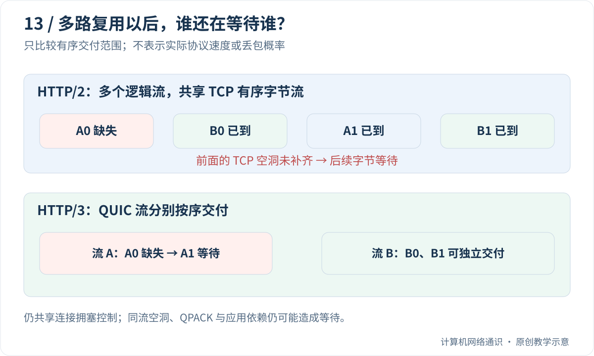

在当今的 Web 性能优化领域，有一个非常反直觉的技术公理：
**协议的版本号从 1.1 升级到 2，再升级到 3，绝不仅仅是“数字变大了”，更不代表它在任何网络环境下都一定能跑得更快。**

如果脱离了底层物理现实，你往往会遭遇如下诡异的现象：

- 为什么在丢包率较高、信号微弱的移动网络环境下，采用先进 **HTTP/2** 协议的网站，加载速度竟然比老旧的 **HTTP/1.1** 还要慢上一大截？
- 为什么早期的前端工程师要费尽心机搞“雪碧图/精灵图（CSS Sprite）”、“代码内联”以及“多域名分片”，而这些技巧在现代 Web 中却被全面列为淘汰的反模式？
- 统治了互联网半个世纪的 TCP 协议，到底做错了什么，以至于最新的 **HTTP/3 毅然决然做出了一个看似离经叛道的重大抉择——彻底抛弃 TCP，全面倒戈拥抱基于无连接 UDP 的 QUIC 协议？**

HTTP 三十年的演进史，本质上是人类软件架构师与**“排队与阻塞”**之间的一场旷日持久的决战史。

本文将深入各代协议的底层微观报文，全面拆解 **应用层队头阻塞、HTTP/2 二进制分帧与多路复用、TCP 传输层队头阻塞**，以及 **QUIC / HTTP/3 的用户态流式解耦与零 RTT 连接迁移革命**。

## Table of contents

## 第一章：HTTP/1.1 时代的辉煌与“应用层队头阻塞”之痛

在 1999 年发布的 HTTP/1.1（RFC 2616）中，最重要的改进是引入了 **持久连接（Persistent Connection / Keep-Alive）**：允许浏览器在同一个 TCP 连接上连续发送多个 HTTP 请求，免去了每次都重新发起 TCP 三次握手的开销。

然而，HTTP/1.1 在物理设计上存在一个致命的软肋——**请求与响应必须严格遵循串行先入先出（FIFO）顺序！**



### 1. 应用层队头阻塞（HTTP Head-of-Line Blocking）

在 HTTP/1.1 的单一 TCP 连接中：

- 浏览器在当前这个连接上发送了请求 A（比如下载一个需要复杂计算的报表），紧接着发送了请求 B（一个仅有 2KB 的静态 CSS 样式表）；
- **服务端必须等请求 A 的数据全量传输完毕之后，才有资格开始发送请求 B！**
- 如果请求 A 因为数据库慢查在服务端卡了整整 5 秒钟，那么后序所有只需要 1 毫秒就能处理完的小请求，**全被死死卡在管道后面无法动弹！**

### 2. 前端开发者的无奈妥协：民间“黑魔法”时代

为了绕过 HTTP/1.1 的单连接阻塞缺陷，前端工业界诞生了一批极具时代特色的妥协技术：

1. **域名分片（Domain Sharding）**：
   由于现代主流浏览器（如 Chrome）对同一个域名下的最大并发 TCP 连接数做出了硬性限制（**最多只能同时开辟 6 个连接**），工程师便将资源分散存放在 `img1.site.com`、`img2.site.com`、`img3.site.com` 等多个不同域名下，强行欺骗浏览器开辟数十个 TCP 连接进行并发下载；
2. **雪碧图 / 精灵图（CSS Sprites）**：
   把几百个微小的按钮图标拼成一张庞大的巨幅大图，通过 CSS 坐标切片展示，宁可增加浏览器内存排版计算，也绝不敢发起几百次独立的 HTTP 请求；
3. **小资源 Base64 内联与文件合并**：
   把小图片编码为 Base64 直接写进 HTML 代码，把几十个 JS 文件强行打成一个臃肿的 `bundle.js`。

这些技巧虽然暂时缓解了页面加载速度，却带来了代码可维护性极差、局部细微改动导致整包缓存彻底失效的巨大反噬。

---

## 第二章：HTTP/2 时代的革命——二进制分帧与多路复用

2015 年，IETF 正式发布了 **HTTP/2（RFC 7540）**，彻底打破了长达十六年的沉寂。

HTTP/2 并没有改变 HTTP 的任何应用层语义（`GET`、`POST`、状态码、Headers 依然原汁原味），它在底层引爆了一场**通信层面的架构重构**。

### 1. 核心突破一：二进制分帧层（Binary Framing）

HTTP/1.1 是纯文本协议，解析器必须在内存中逐字符扫描并寻找 `\r\n\r\n`。
**HTTP/2 将报文彻底打碎为机器极易高效解析的纯二进制帧（Frame）**：

```text
[HTTP/2 二进制帧标准结构 (9 字节固定帧头 + 载荷 Payload)]
+-----------------------------------+-------------------+-------------------+
| 长度 Length (24 位: 最多 16MB)     | 类型 Type (8 位)   | 标志位 Flags (8 位) |
+-----------------------------------+-------------------+-------------------+
| 保留位 (1位) |            流标识符 Stream ID (31 位)                        |
+---------------------------------------------------------------------------+
|                          帧数据载荷 (Frame Payload)                         |
+---------------------------------------------------------------------------+
```

- **帧类型（Type）**：明确分流。如 `HEADERS 帧` 专门存放请求头，`DATA 帧` 专门存放正文数据；
- **流标识符（Stream ID）**：**多路复用的物理灵魂！** 标识当前这个帧到底属于哪一个具体的请求/响应对话。

### 2. 核心突破二：真正的多路复用（Multiplexing）

有了 `Stream ID`，HTTP/2 在同一个 TCP 连接上实现了**交错乱序并发传输**：

```text
[HTTP/2 单一 TCP 管道中的多路复用]
发送端 ──> [Stream 1: HEADERS] [Stream 3: DATA] [Stream 1: DATA] [Stream 5: HEADERS] ──> 接收端
```

- 浏览器发起几十个请求，所有的帧可以在同一个 TCP 连接中**自由交叉、插队穿梭发出去**；
- 服务端只要某个请求先准备好，就可以随时向客户端回发该流的 `DATA 帧`；
- 客户端在接收端根据每一个帧头部的 `Stream ID`，在内存中瞬间把乱序的数据帧重新归并拼装为完整的响应！
- **战果**：**应用层的“队头阻塞”被彻底消灭！** 前端工程师再也不需要搞域名分片和雪碧图，一个网站只需维持一个持久的 TCP 连接，即可实现数百个资源的无阻塞极速并发！

### 3. 核心突破三：HPACK 头部压缩算法

在 HTTP/1.1 中，每一次请求（甚至仅仅是点击同一个页面上的一个小按钮），浏览器都会重复带上几乎完全相同的一两千字节的 Cookie、User-Agent 等 Headers，带宽浪费惊人。

HTTP/2 引入了顶级的 **HPACK 压缩算法（RFC 7541）**：

- **静态字典（Static Table）**：预先固化了 61 个高频头部（如 `1: :authority`, `2: :method GET`），传输时只需发送一个单字节的数字下标代号；
- **动态字典（Dynamic Table）**：双方在通信过程中，自动将本次连接中出现过的自定义头（如特定的 User-Agent 字符串、自定义 Token）动态写入内存字典。下一次再发完全相同的头，**直接发送一个数字索引，通信体积压缩率高达 85% 以上！**

---

## 第三章：HTTP/2 遭遇的滑铁卢——传输层 TCP 队头阻塞

HTTP/2 看起来已经足够完美了。然而，当它在全球互联网的弱网移动环境下大规模落地后，网络工程师们却被一个意料之外的幽灵狠狠困扰住了：

> **冷酷的工业界现实**：
>
> **在丢包率达到 2% ~ 5% 的恶劣弱网 Wi-Fi 或移动蜂窝网络下，HTTP/2 的整体加载延迟，竟然显著劣于老旧的 HTTP/1.1！**

为什么革命性的 HTTP/2 会在弱网环境下败下阵来？

### 致命的物理真相：传输层 TCP 队头阻塞（TCP HOL Blocking）

我们在第 8 篇推导过：**底层 TCP 协议是一个严格保持绝对顺序的字节流！**

```text
                        同一个底层 TCP 连接管道 (HTTP/2)
           Stream 1 (图片)         Stream 2 (JS 脚本)        Stream 3 (CSS)
                 │                         │                         │
                 ▼                         ▼                         ▼
            [TCP 报文段 1]          [TCP 报文段 2]           [TCP 报文段 3]
                   │                       │                         │
                   │                       ▼ (物理丢包 ❌!)           │
                   ▼                                                 ▼
             [接收端正常收到]                                  [提前到达形成空洞!]
                                                                     │
                                                                     ▼
                   ⭐️ 整个 TCP 接收缓冲区因为段 2 的空洞被彻底卡死锁定！
                      Stream 3 (即便完全没丢包) 也被操作系统内核强制扣押！
                      无法提交给应用层解析！所有的流全部陪绑死等重传！
```

- 在 **HTTP/1.1** 下：由于浏览器开辟了 **6 个独立的 TCP 连接**，连接 1 上丢了一个包，只会影响连接 1，其余 5 个连接完全不受干扰，继续高速传输；
- 在 **HTTP/2** 下：由于**所有的流全部挤在同一个唯一的 TCP 连接中**！一旦底层网络丢了一个包，操作系统内核的 TCP 协议栈为了维持绝对严格的顺序交付，**会强制冻结锁定当前连接的所有数据提取，直到那个丢失的包超时重传补齐为止！**
- **结论**：**HTTP/2 虽然彻底消灭了“应用层的队头阻塞”，却在不经意间把所有的鸡蛋全部放在了一个篮子里，遭遇了更深层次的“传输层 TCP 队头阻塞”！**

---

## 第四章：HTTP/3 的终极革命——抛弃 TCP，拥抱 QUIC / UDP

既然问题出在 TCP 的身上，那为什么不直接修改 Linux 内核中的 TCP 协议，让它支持多流独立乱序交付呢？

### 1. 互联网骨干网的绝症：中间盒僵化（Ossification）

网络工程师们曾经尝试过升级 TCP。但他们绝望地发现，在横跨全球数十年的发展中，分布在各大洲骨干网络中的路由器、防火墙、NAT 网关设备，**其内部的硬件芯片与嵌入式固件已经将 TCP 的报头结构硬编码写死了！**

只要你敢在 TCP 报头里添加新的多流控制选项，沿途很多陈旧的中间网络设备（Middleboxes）因为看不懂新选项，**会直接将其判定为非法畸形数据包，暴力丢弃！**
在操作系统内核层对 TCP 进行大规模颠覆式改造，在工程实施上几乎无法在全球平滑落地。

### 2. 用户态的惊天逆袭：QUIC 协议诞生

既然内核的 TCP 改不动，以 Google 为代表的架构师们做出了一个震惊全人类互联网的决定：
**彻底弃用 TCP！转战被视作“不可靠”的 UDP 协议！**

2022 年，IETF 正式发布了以 **QUIC（Quick UDP Internet Connections，RFC 9000）** 为传输底座的全新一代标准——**HTTP/3（RFC 9114）**！

```text
    传统的 HTTP/2 协议栈                   全新的 HTTP/3 协议栈
+---------------------------+       +---------------------------+
|          HTTP/2           |       |          HTTP/3           |
+---------------------------+       +---------------------------+
|        TLS 1.2 / 1.3      |       |      QUIC (运行在用户态)   |
+---------------------------+       | (多流解耦 / 拥塞控制 / 强加密) |
|         TCP 协议栈         |       +---------------------------+
+---------------------------+       |          UDP 协议         |
|         IP 网络层         |       +---------------------------+
+---------------------------+       |         IP 网络层         |
+---------------------------+       +---------------------------+
```

### 3. HTTP/3 与 QUIC 的四大核心杀手锏

#### 杀手锏一：彻底终结队头阻塞（真正的独立多流）

QUIC 在无连接的 UDP 之上，自主实现了一套轻量级的多流逻辑。

- 每一个数据流（Stream）都拥有独立的单流控制与重传队列；
- **流 1 丢包，内核和 QUIC 仅仅单独重传流 1 的数据块！**
- **其余流 2、流 3、流 4 的数据在到达的瞬间，立刻被应用层当场提取消费！流与流之间在物理上彻底解耦，互不陪绑！**

#### 杀手锏二：0-RTT / 1-RTT 极速建连

在传统的 HTTP/2 + TLS 1.3 体系中：必须先走完 TCP 三次握手（1-RTT），再走完 TLS 安全握手（1-RTT），总共耗费 2-RTT 才能发出第一行 HTTP 数据。
**QUIC 将传输层连接与 TLS 1.3 安全握手在数学上融为一体！**

- 首次访问：仅需 **1-RTT** 即可完成全部连接建立与会话加密；
- 再次连接（Session Resumption）：**惊人的 0-RTT**！客户端在发送第一个 UDP 报文时，就能同时携带加密的业务数据，实现真正意义上的“零延迟打开”！

#### 杀手锏三：连接迁移（Connection Migration）——移动互联时代的福音

在传统的 TCP 协议中，一个连接受制于我们前面讲过的**四元组（源IP, 源端口, 目的IP, 目的端口）**。
当你拿着手机从家里的客厅走到电梯口，**Wi-Fi 突然断开，手机自动无缝切换到 4G/5G 蜂窝网络**：

- 你的手机物理 IP 地址发生了剧变！
- **基于四元组的旧 TCP 连接瞬间全盘死亡崩溃！** 正在进行的视频通话必须重新断线重连，正在加载的页面直接报网络中断。

> **QUIC 连接迁移黑科技**：
>
> **QUIC 彻底抛弃了基于 IP + 端口的脆弱锚定机制！**
>
> 它在报头中引入了一个全局唯一的 **64 位连接标识符（Connection ID，简称 CID）**！
> 无论你的手机怎么切换网络、IP 和端口怎么剧烈跳变，**只要 CID 保持不变，两端通信在底层的虚拟信道中丝滑平稳续接！** 用户在看视频、打游戏时，连一毫秒的重连卡顿都感知不到！

---

## 总结与专栏全局视野

在本篇《计算机网络通识（十三）》中，我们见证了 Web 协议三十年波澜壮阔的架构自我革命：

1. **HTTP/1.1 的困局**：理解了长连接的演进，推导了单连接串行交付引发的应用层队头阻塞，以及雪碧图等前端妥协产物的物理背景；
2. **HTTP/2 的飞跃**：解构了二进制分帧层（Binary Framing）如何赋予多路复用自由交错的并发能力，掌握了 HPACK 静态/动态字典的高压缩比奥秘；
3. **TCP 的宿命羁绊**：洞悉了在网络弱网环境下，底层 TCP 协议的累积确认与滑动窗口空洞如何导致整条 HTTP/2 管道遭遇连带冻结的深层真相；
4. **HTTP/3 的断腕重生**：深刻理解了骨干网中间盒僵化导致无法修改 TCP 的工业现实，掌握了 QUIC 在 UDP 基础之上实现的“流与流彻底物理隔离、0-RTT 极速建连、Connection ID 连接平滑无感迁移”三大现代核心奇迹。

在理解了传输协议的高速演进之后，我们必须放眼整个互联网的宏观部署架构：

- 现代大型互联网系统，绝不可能把一台单薄的后端服务器直接暴露在公网巨浪中；
- 所谓 **反向代理（Reverse Proxy）**、**负载均衡（Load Balancer）** 和 **内容分发网络（CDN）** 到底有何本质区别？
- 它们是如何在网络的最边缘，为全人类挡下海量并发洪峰的？

让我们正式迈向专栏的第十四篇架构力作：**[《代理、负载均衡和 CDN 分别在做什么？》](/blog/posts/understanding-proxies-load-balancers-and-cdns/)**！
