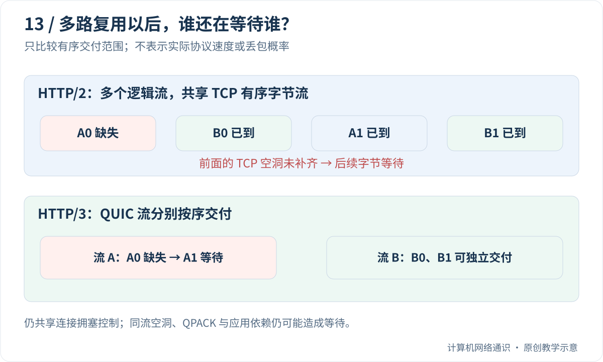

打开一张网页，浏览器往往还要下载样式、图片、字体和脚本。假如每份内容都要排在上一份后面等，页面就会显得很慢。HTTP 的几个版本，正在尝试改变这些等待的方式。

本篇始终围绕“两张图片 A 和 B”展开：谁必须等谁，等待发生在 HTTP 还是传输层。先看能解决的问题，再记协议名称。

## Table of contents

## 一张网页，为什么会有很多请求？

HTML 描述页面结构，里面可能写着“这里放一张图片，那边加载一份样式”。浏览器需要继续请求这些资源，而不是服务器一定把所有内容一次塞进最初的文档里。

例如主文档、图片 A、图片 B、一个脚本，可以产生四次请求。**请求** 是应用层的工作单位；**连接** 是承载通信的状态和传输关系。四次请求不一定对应四条连接，更不一定对应四个数据包。

先记这三个不同层次，后面“复用”就不会混淆：我们可能让多个请求用同一条连接，也可能让一条请求的内容分散在多个传输包里。

## 第一种办法：用完一条连接，下一次接着用

如果每次要一张图片都重新建立连接，就会反复花时间握手。**连接复用** 或持久连接，表示在条件允许时，让后续请求继续使用已建立的连接。

把它想成打电话：说完第一件事不立刻挂断，接着问第二件事。它省下再次拨号的成本，却没有自动解决“第二件事怎样不被第一件事挡住”。

HTTP/1.1 可以使用持久连接。还有管线化机制，允许先发送多个请求，但相应响应仍按请求顺序发送。在这条连接上，前面的响应迟迟没好，后面的就可能等待。浏览器也可以建立多条连接分担，但会增加状态和建立成本。

## 第二种办法：给不同任务编号，交错发送

设图片 A 很大，图片 B 很小。如果必须把 A 全发完才发 B，B 会等很久。HTTP/2 把消息拆成带标记的小单位，称为 **帧**；属于同一次请求和响应的逻辑交流，用 **流 ID** 区分。

示意发送顺序可以是：

```text
A 的第 1 块 → B 的第 1 块 → A 的第 2 块 → B 的第 2 块
```

接收方看每块的流标记，把 A 的内容归入 A，B 的内容归入 B。这样在 HTTP 层，B 不必永远排在整份 A 后面。这叫 **多路复用**：多路逻辑任务共享一条承载连接。

这里“HTTP/2 帧”不是前面讲的以太网帧；两个层次都使用 frame 这个词，结构和作用不同。HTTP/2 的逻辑流，也不是每条各自占用一条 TCP 连接。

## 可是下面那条 TCP 仍然要求顺序

HTTP/2 的帧被编码为字节，通常交给同一条 TCP 字节流。如果较早的一段 TCP 字节丢失，TCP 会等待补齐，后面的已到达字节不能跨过缺口交给 HTTP/2。

于是，缺失字节也许原本属于 A，却让装着 B 数据的后续字节暂时不能交付。**队头阻塞** 可以先理解为“前面的问题把后面的就绪内容也挡住”。要追问的是在哪一层、哪些内容被挡住，而不是只背一个名词。

HTTP/2 改善了应用层响应顺序的等待，但不能让下面的 TCP 自动变成多条独立字节流。

## 第三种办法：让传输层也认识独立的流

HTTP/3 使用 **QUIC** 承载。QUIC 运行在 UDP 上，但额外提供可靠流、重传、拥塞控制和加密认证等机制。UDP 只是承载入口，可靠传送的工作并没有凭空消失。

QUIC 可以分别维护 A 流和 B 流的有序交付。如果 A 缺一块，A 自己继续等待；B 若已经满足交付条件，就不必单纯因为 A 的空洞而被统一字节顺序挡住。

不过两者仍共享网络路径和连接资源。如果整条网络拥塞，B 也会受影响；如果丢失的一包里同时装了 A、B 的数据，两者都会缺内容。HTTP/3 解决的是特定的跨流交付阻塞，并不让所有等待消失。

## 用三个问题比较，而不是只看版本号

| 要问的问题                     | HTTP/1.1                     | HTTP/2                        | HTTP/3                           |
| ------------------------------ | ---------------------------- | ----------------------------- | -------------------------------- |
| 能复用连接吗？                 | 可以                         | 可以                          | 可以                             |
| 是否有协议中的多路请求流机制？ | 没有 H2 那样的独立流分帧机制 | 有 HTTP/2 流                  | 结合 QUIC 流                     |
| 传输层的顺序依赖在哪里？       | TCP 字节流                   | 多个 HTTP 流共享 TCP 字节顺序 | 各 QUIC 流分别有序，仍有共享约束 |

表格只比较本篇主线，不覆盖协议全部能力。服务器生成内容慢、页面脚本执行慢、必须先下载 HTML 才知道图片地址，这些等待都不一定靠换版本解决。

下文的具体术语和示例围绕刚才三种办法展开。图里 A、B 是两个逻辑任务，不是两个浏览器，也不是两条物理网线。

## HTTP/1.1：复用连接，还需要安排响应顺序

上一讲介绍过持久连接。它能让多个请求复用已建立的 TCP 连接，减少重复建连成本，但不自动获得独立的并行响应流。

HTTP/1.1 管线化允许客户端在前一响应完成前发送后续请求，不过响应仍需按对应顺序发送。一个前面的慢响应，会延迟后面已经准备好的响应。浏览器历史上更多通过建立多个连接来获得并发，实际连接数量属于实现策略，不能写成所有浏览器永远固定的常数。

多个连接能够分散等待，但也增加握手、状态与竞争。同一站点资源拆成很多域名曾被用于绕过并发限制；到了新的协议环境，这种旧优化可能反而破坏连接复用，不能不看条件照搬。

## HTTP/2：把消息拆成帧，交错放进一条连接

HTTP/2 引入二进制分帧和流。请求与响应被组织进带有流标识的帧，不同流的帧可以交错发送，接收端再按流归组。一个大的图片响应不必在 HTTP 层独占整条连接直到全部发送完。

HTTP/2 还使用 HPACK 压缩字段，减少许多请求中重复的元信息；它也定义了流控制等机制。这里的“流”是 HTTP/2 的逻辑流，不是每条流都有一条独立 TCP 连接。[RFC 9113](https://www.rfc-editor.org/rfc/rfc9113.html)给出了完整定义。

关键限制在下一层：所有这些帧通常仍承载于同一条 TCP 有序字节流。若前面的 TCP 字节缺失，后面的字节即使已经到达，也不能绕过空洞交给 HTTP/2 解析器。受到影响的可能是多个 HTTP 流。

因此，HTTP/2 解决了 HTTP/1.1 响应排列中的一部分阻塞，但没有取消 TCP 的有序交付要求。

## HTTP/3：把多个独立流交给 QUIC

HTTP/3 把 HTTP 语义映射到 QUIC。QUIC 运行在 UDP 之上，自己提供可靠流、损失恢复、流量控制、拥塞控制，并结合 TLS 1.3 建立加密与认证。

UDP 在这里提供一个承载入口，不是让 HTTP 放弃可靠性。普通 HTTP/3 请求和响应仍使用可靠的 QUIC 流；协议另外支持的数据报扩展也不能与这种基本语义混为一谈。

QUIC 的一个重要差异是：不同流拥有独立的有序交付范围。某个流缺少一段数据，不必因为同一个连接中的统一字节顺序，把其他已具备交付条件的流一起挡住。HTTP/3 的流映射见 [RFC 9114](https://www.rfc-editor.org/rfc/rfc9114.html)。



## “没有队头阻塞”为什么说得太满？

QUIC 避免的是 TCP 那种跨流的有序字节交付阻塞，不是消除所有依赖和等待。

- 同一 QUIC 流内部仍需按序交付，自己的空洞仍然会阻塞自己。
- 多个流共享路径、连接资源和拥塞控制；丢包导致发送机会缩小时，其他流也可能受到性能影响。
- 一个丢失的 QUIC 包可能同时携带多个流的数据，相关流都会缺失内容。
- HTTP/3 的 QPACK 字段压缩存在受控的解码依赖，应用资源之间也可能有前置依赖。

例如 HTML 还没下载和解析，就不知道某个脚本 URL；这不是更换传输协议就能消除的等待。解释页面加载时，协议层与应用依赖图需要一起看。

## 可选实验：只模拟“交付顺序”这一件事

不写程序也可以先算：A0 在 80 ms 才完整到达，B0 在 20 ms 到达。如果所有块受统一顺序约束，B0 仍要等到 80 ms；如果 B 是独立的有序流且没有其他前置阻碍，它可以在 20 ms 具备交付条件。差别来自模型的顺序规则，不是测出了实际浏览器速度。

保存为 `stream_order.py`，按[Python 准备说明](/blog/posts/understanding-ports-and-sockets/#可选编程实验的准备怎样运行本系列的-python-代码)运行。`max` 取较晚时间，表达“必须既等数据到，又等前面需要的内容到”。

下面模型假设原始传输排列为 A0、B0、A1、B1，其中 A0 直到 80 ms 才被恢复，其他块更早到达。数字是人为设定的，并非测量。

```python
# 原始排列：(逻辑流, 块名称, 数据完整到达时间 ms)
blocks = [("A", "A0", 80), ("B", "B0", 20),
          ("A", "A1", 30), ("B", "B1", 40)]

ordered_delivery = {}
ready = 0
for stream, name, arrived in blocks:
    ready = max(ready, arrived)
    ordered_delivery[name] = ready

independent_delivery = {}
stream_ready = {}
for stream, name, arrived in blocks:
    ready = max(stream_ready.get(stream, 0), arrived)
    stream_ready[stream] = ready
    independent_delivery[name] = ready

for name in ["B0", "B1"]:
    print(name, "one ordered stream:", ordered_delivery[name],
          "independent streams:", independent_delivery[name])
```

输出为：

```text
B0 one ordered stream: 80 independent streams: 20
B1 one ordered stream: 80 independent streams: 40
```

A1 在两种模型中都要等 A0；B 在独立流模型中则不需要等 A 的空洞。这个模型只说明有序交付范围改变后可能出现的差异。

它没有模拟报文封装、拥塞窗口、重传调度、加密、字段压缩或浏览器渲染，**不能把 80/20 的比值当成 HTTP/3 比 HTTP/2 快四倍的证据**。真实比较必须使用相同内容、路径、缓存与连接状态，并记录损失和时延条件。

## 进阶：握手与连接迁移还带来了什么？

QUIC 将传输与 TLS 握手更紧密地结合，减少传统 TCP 与 TLS 分步建立时的部分等待；恢复连接在满足条件时还可以使用早期数据。0-RTT 仍有重放等限制，也不是每次访问都能使用。

QUIC 使用连接 ID 帮助识别连接，避免完全依赖一个永远不变的地址四元组。客户端从 Wi-Fi 切到蜂窝网络时，在实现支持、策略允许且路径验证成功的条件下，有机会维持逻辑连接。

这不意味着任意 IP 变化都无缝成功，也不意味着新路径容量与旧路径相同。路径验证、抗放大限制和拥塞状态都需要正确处理，相关设计见 [RFC 9000](https://www.rfc-editor.org/rfc/rfc9000.html)。

## 在浏览器中确认实际使用的协议

打开开发者工具的 Network 面板，显示 Protocol 列，再重新加载页面。可能看到 `http/1.1`、`h2` 或 `h3`，具体列名和显示随浏览器版本变化。操作方式可查 [Chrome DevTools 文档](https://developer.chrome.com/docs/devtools/network/reference/)。

第一次与后续访问可能不同：服务器可通过 Alt-Svc 等机制告知其他服务入口，客户端也可能已有缓存信息；现代发现机制不只一种。UDP 被网络策略阻断时，客户端可能回退到基于 TCP 的协议。

若使用 curl，先执行 `curl --version` 查看本机构建支持哪些特性，再使用相应选项。一个 curl 不认识 `--http3`，只能说明该构建没有这个能力，不能据此认定网站不支持 HTTP/3。强制一种协议后失败，与默认模式成功回退也是不同结果。

## 选择协议，不要只比较版本号

大文件稳定传输、短小 API、高损失移动网络和低时延局域网，收益来源可能不同。服务器实现、CPU 开销、缓存命中、优先级和应用依赖，也会影响最终体验。

测试时至少记录目标 URL、实际协议、是否新连接、缓存状态、对象大小、总耗时和首字节时间。新连接的 HTTP/3 与复用连接的 HTTP/2，或热缓存与冷缓存，不能直接当成公平的协议对照。

把协议演进理解成“改变等待发生的位置”，比把 HTTP/3 当作万能加速开关更有用。

## 读完后，用自己的话试着解释

HTTP/3 的 A 流缺了一段，B 流的数据完整到达。B 是否一定要等 A？能否据此保证 B 完全不受丢包影响？

<details>
<summary>展开参考答案</summary>
<div class="mt-4 leading-7">B 不必仅因 A 的流内空洞而等待，但仍受共享路径、拥塞控制和其他协议或应用依赖影响。因此不能说任何丢包都与其他流无关。</div>
</details>

上一篇：[HTTPS 与 TLS](/blog/posts/how-https-and-tls-establish-trust/)

下一篇：[代理、负载均衡和 CDN](/blog/posts/understanding-proxies-load-balancers-and-cdns/)

## 参考与延伸阅读

- [Cloudflare：QUIC Version 1 is live](https://blog.cloudflare.com/quic-version-1-is-live-on-cloudflare/)——QUIC v1 的工程背景。
- [RFC 9113](https://www.rfc-editor.org/rfc/rfc9113.html)、[RFC 9114](https://www.rfc-editor.org/rfc/rfc9114.html)——HTTP/2 与 HTTP/3。
- [RFC 9000](https://www.rfc-editor.org/rfc/rfc9000.html)、[RFC 9001](https://www.rfc-editor.org/rfc/rfc9001.html)、[RFC 9002](https://www.rfc-editor.org/rfc/rfc9002.html)——QUIC 传输、TLS 与恢复控制。
- [Chrome Network 面板](https://developer.chrome.com/docs/devtools/network/reference/)——核对浏览器实际连接行为。
