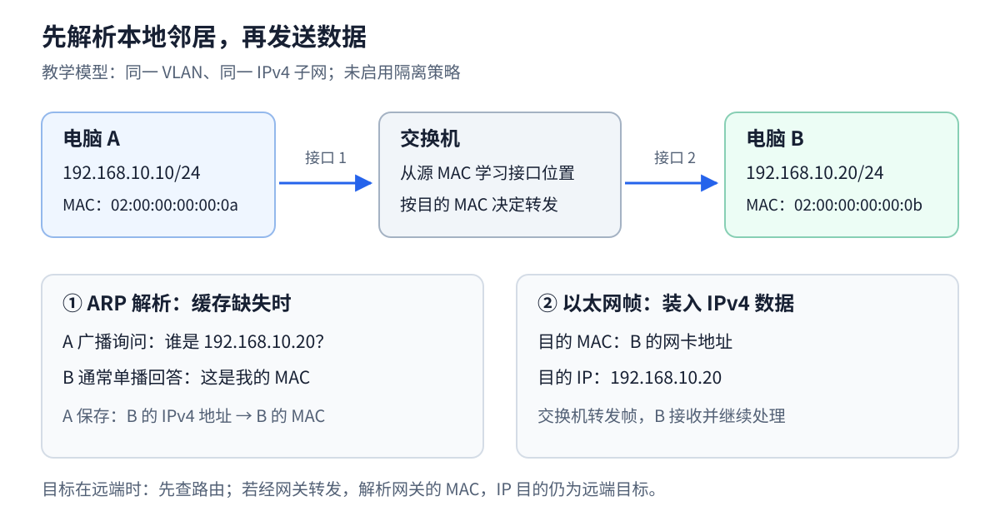

拔掉家里通往光猫或外部运营商的入户网线，你的电脑还能把一部高清电影传输给客厅的 NAS 私有云或电视盒子吗？

答案是：**完全可以，而且传输速度丝毫不受影响！**

在很多人的潜意识里，“网络”等同于“互联网”。然而在物理现实中，网络通信遵循严格的**局部性交付原则**：处于同一个局域网（LAN）内的设备，数据根本不需要离开你的房间，更不需要送到远在千里之外的运营商核心网绕一圈。

理解局域网通信，是建立整个计算机网络系统级认知的第一块基石。

本文将从最朴素的物理网线出发，深入剖析 **Ethernet II 帧结构、MAC 物理寻址、交换机的自学习转发算法、ARP 地址解析协议的广播风暴**，以及针对局域网致命安全威胁——**ARP 欺骗**的物理防御准则。

## Table of contents

## 第一章：物理拓扑与以太网帧结构

在同一个局域网内，计算机通过双绞线网线或 Wi-Fi 无线信道连接到同一个二层交换机（Switch）或家用路由器的 LAN 口上：



当主机 A（`192.168.1.10`）试图向同一网段的主机 B（`192.168.1.20`）发送数据时，操作系统的数据链路层负责将上层的 IP 数据报封装为 **以太网帧（Ethernet Frame）**。

### 1. Ethernet II 帧格式全解

在商业以太网中，工业界最通用的是 **Ethernet II（DIX Ethernet）** 帧结构：

```text
+-------------------+-------------------+---------------+--------------------+---------------+
| 目的 MAC 地址     | 源 MAC 地址       | 上层协议类型   | 数据载荷 (Payload)  | 帧校验序列 FCS|
| (6 字节: 48 位)   | (6 字节: 48 位)   | (2 字节: Type)| (46 ~ 1500 字节)   | (4 字节: CRC32|
+-------------------+-------------------+---------------+--------------------+---------------+
```

1. **目的 MAC 与源 MAC（各 6 字节）**：
   标识当前这一物理跳步中，负责发送与接收网卡的硬件烧录物理地址；
2. **类型（Type，2 字节）**：
   指示数据载荷应该分用交付给上层的哪一个协议栈解析：
   - `0x0800`：IPv4 数据报；
   - `0x0806`：ARP 地址解析协议报文；
   - `0x86DD`：IPv6 数据报。
3. **数据载荷（Payload，46 ~ 1500 字节）**：
   以太网帧对载荷长度有着严苛的上下限约束：
   - **最大传输单元 MTU（1500 字节）**：单帧承载的最大 IP 数据报大小；
   - **最小长度限制（46 字节）**：在早期共享式以太网中，为了确保 CSMA/CD 碰撞冲突检测机制有效，整帧最小物理长度不能低于 64 字节（$6+6+2+46+4=64$ 字节）。若载荷不足 46 字节，网卡会自动在末尾填充垃圾字节补齐。
4. **帧校验序列 FCS（4 字节）**：
   由网卡硬件在发送时通过 **CRC32（循环冗余校验码）** 自动计算填入。接收端网卡计算比对，若发现传输中因信号干扰发生哪怕 1 个比特的位翻转，硬件会**直接静默丢弃该损坏帧**，不向上层提交任何垃圾数据！

---

## 第二章：MAC 地址与交换机的自学习算法

数据要在网卡间流淌，首先必须有不可篡改的物理身份标识。

### 1. MAC 地址：硬件物理烙印

每一个合法的以太网网卡在出厂前，其芯片的 ROM 内部都由 IEEE 统一授权烧录了一个全球唯一的 48 位（6 字节）硬件地址——**MAC 地址（Media Access Control Address）**。

```text
通常以十六进制冒号隔开表示: 00:1A:2B:3C:4D:5E
┌─────────────────────────┐ ┌─────────────────────────┐
│ 前 24 位: OUI (组织唯一标识符) │ │ 后 24 位: NIC 厂商序列号      │
│ 由 IEEE 官方分配给设备制造商     │ │ 由硬件生产厂商自行流水编号分配  │
│ (如 Intel, Realtek, Apple)│ │                         │
└─────────────────────────┘ └─────────────────────────┘
```

- **单播地址**：第 1 个字节的最低位为 `0`，表示一对一精确交付；
- **广播地址**：全 1 地址 `FF:FF:FF:FF:FF:FF`，表示向局域网内所有在线网卡同时喊话！

### 2. 交换机的核心中枢：MAC 转发表自学习算法

在早期以太网中，设备连接在“集线器（Hub）”上。集线器是一个纯粹的物理层共享设备，任何一台电脑发出的信号都会向全网无脑盲目广播，造成严重的**冲突域碰撞（Collision Domain）**与信道争用。

而现代局域网的核心中枢是 **二层交换机（Layer 2 Switch）**。交换机内部维护着一张动态映射表——**MAC 地址表（CAM 表）**：

> **交换机的自学习与转发三部曲**：
>
> 1. **学习（Snooping / Learning）**：
>    交换机监听每一个物理端口。当端口 1 收到主机 A 发送的数据帧时，交换机立刻提取帧头中的 **源 MAC 地址**，并在内存表中记录一条动态映射：
>    `MAC_A ===> 端口 1 (更新老化定时器)`；
> 2. **查找与转发（Forwarding / Filtering）**：
>    交换机接着审视该帧的 **目的 MAC 地址**：
>    - **命中（Hit）**：若表中已记录了目标 MAC 在端口 2，交换机直接通过内部背板硬件交换矩阵，**仅将该数据帧精准单播转发给端口 2**！其他端口完全不受打扰，实现了**端口级冲突域隔离**！
> 3. **泛洪（Flooding）**：
>    如果目的 MAC 在表中**未曾记录（未知单播帧）**，或者目的 MAC 本身就是 **广播地址（`FF:FF:FF:FF:FF:FF`）**：
>    交换机会将该数据帧复制，**向除接收端口外的所有其他在线端口同时广播泛洪**！直到目标主机回包时，交换机顺势学到目标位置，转发表宣告闭环！

**动态老化机制**：
MAC 表项并不会永久驻留。为了防止设备插拔换网口导致的路由错误，每个表项设置了 **老化时间（Aging Time，通常为 300 秒）**。超时未活动的表项会被自动清除。

---

## 第三章：ARP 地址解析协议——逻辑与物理的桥梁

现在面临一个致命的技术鸿沟：
应用程序在代码中只知道目标主机的 **IP 地址（如 `192.168.1.20`）**。
然而，在数据链路层的以太网帧头中，操作系统网卡驱动**必须填写目标网卡的物理 MAC 地址！**

**操作系统是如何在茫茫局域网中，仅凭一个数字 IP 顺藤摸瓜找出发对方真实的物理 MAC 地址的？**

答案就是：**ARP（Address Resolution Protocol，地址解析协议）**！

### 1. ARP 广播请求与单播应答全流程

```text
[阶段 1: ARP 广播寻址 (向全网大喊)]
主机 A (192.168.1.10) ──以太网广播 (目的 MAC: FF:FF:FF:FF:FF:FF)──> 交换机
                                                                     ├──> 主机 C (192.168.1.30): IP 不匹配，静默丢弃
                                                                     └──> 主机 B (192.168.1.20): IP 命中！捕获请求！
内容: "谁是 192.168.1.20？请把你的物理 MAC 地址告诉我，我是 192.168.1.10 (MAC_A)！"

[阶段 2: ARP 单播回复 (精准回信)]
主机 B (192.168.1.20) ──以太网单播 (目的 MAC: MAC_A)───────────────> 交换机 ──> 主机 A
内容: "我就是 192.168.1.20，我的网卡物理 MAC 是 MAC_B！"
```

1. **第一步：ARP 广播请求**：
   主机 A 构造一个 ARP 请求报文，在以太网头部将目的 MAC 填为全 1 广播 `FF:FF:FF:FF:FF:FF`。交换机将广播帧复制分发给局域网内的所有机器；
2. **第二步：各节点比对校验**：
   局域网内所有机器的网卡硬件接收到广播帧并送交内核。内核检查报文中的目标 IP：
   - 主机 C 发现目标 IP 不是自己，直接在内核态将报文无情丢弃；
   - 主机 B 发现目标 IP 正好是自己！主机 B 首先顺手把主机 A 的【IP_A $\to$ MAC_A】映射缓存进自己的 ARP 表中；
3. **第三步：ARP 单播应答**：
   主机 B 构造 ARP 应答报文，**此时目的 MAC 已经明确是主机 A 的物理地址**！因此应答是以太网**单播帧**直接送回主机 A。
4. **第四步：缓存与实际发包**：
   主机 A 收到应答，将【`192.168.1.20` $\to$ `MAC_B`】写入内核缓存，并将挂起的实际业务数据帧（如 TCP 握手帧）打上目标 MAC 发出！

### 2. ARP 缓存表（ARP Cache）

如果每次发数据包都要全网广播一次，局域网早就会被铺天盖地的广播风暴彻底挤爆。

操作系统内核在内存中维护了一张 **ARP 缓存表**。在 Linux 终端中，你可以通过以下命令直接检阅：

```bash
arp -an
# 或者现代命令:
ip neigh show
```

输出如下：

```text
? (192.168.1.20) at 00:1a:2b:3c:4d:5e [ether] on eth0
? (192.168.1.1)  at 00:50:56:c0:00:08 [ether] on eth0
```

- 每次发送数据前，内核优先检索该表；只要命中，**在 0 纳秒内瞬间完成物理封装，零网络额外开销！**
- ARP 缓存具有**生存时间限制（通常几分钟）**，超时自动淘汰，自适应移动设备的 IP 变更。

---

## 第四章：暗黑攻防——ARP 欺骗与中间人拦截（MITM）

ARP 协议诞生于 1982 年（RFC 826）。在早期的网络极客世界中，所有入网节点被默认假设为“绝对诚信、友好协作的”。

这种君子协定般的无认证设计，为局域网安全埋下了一颗巨大的定时炸弹——**ARP 欺骗（ARP Spoofing / Cache Poisoning）**。

### 1. 攻击物理原理解密

> **ARP 协议的致命物理缺陷**：
>
> **“无状态、无认证的盲目信任机制！”**
>
> 任何一台主机，即便它从未主动发送过 ARP 请求，**只要它收到了一份自称是应答的 ARP 报文，操作系统内核就会毫无戒心地立刻用报文里的数据，强制全量覆写并篡改自己内存中的 ARP 缓存表！**

```text
[正常状态]
主机 A ──────────────────────────────────────────> 路由器网关 (192.168.1.1)
(缓存: 192.168.1.1 -> MAC_Gateway)

[黑客骇入发狂攻击 (ARP 投毒)]
黑客伪造 ARP 应答轰炸主机 A: "我是 192.168.1.1，我的 MAC 是 MAC_Hacker！"
同时伪造 ARP 应答轰炸网关:   "我是 192.168.1.10，我的 MAC 是 MAC_Hacker！"
              │
              ▼ (双方缓存全部被恶意篡改污染!)
主机 A ──────> [ 黑客电脑 (开启流量转发窃听与密码嗅探) ] ──────> 真实网关
```

**灾难后果**：

- **断网攻击（DoS）**：黑客将假 MAC 指向一个不存在的虚无地址，导致全网主机所有发往网关的数据全部撞墙丢弃，整个局域网瞬间全盘瘫痪断网；
- **中间人窃听与篡改（Man-in-the-Middle）**：黑客在自己的机器上开启 IP 转发（`ip_forward`），主机 A 与外界的所有账密、明文 HTTP 通信被黑客尽收眼底并任意篡改，而受害者毫无察觉！

### 2. 工业级安全防线

面对 ARP 的先天缺陷，现代网络工程构筑了三道物理防线：

1. **静态 ARP 绑定（Static ARP Binding）**：
   在主机或服务器上显式将关键网关的 MAC 钉死为静态绑定（`arp -s 192.168.1.1 00:50:56:c0:00:08`），强行锁死禁止任何动态动态覆写；
2. **交换机动态 ARP 检查（DAI, Dynamic ARP Inspection）**：
   企业级交换机监听全网所有的 ARP 报文，比对 DHCP Snooping 安全绑定数据库，凡是发现 IP 与物理端口、MAC 不符的非法虚假 ARP 报文，交换机直接在硬件层进行端口级阻断拦截！
3. **全面升级传输层加密（TLS / HTTPS）**：
   即便二层链路被攻击者渗透监听，由于应用层数据已被经过强加密，黑客捕获到的也只是一堆毫无意义的杂乱随机密文。

---

## 第五章：实战抓包验证：观察一次真实的局域网寻址

在 Linux 终端中，我们可以通过网络工程师的超级听诊器——**`tcpdump`**，亲眼目睹 ARP 报文在以太网帧头中的真实跳动：

```bash
# -e: 打印链路层 Ethernet 帧头 (显示 MAC 地址)
# -n: 不将 IP 解析为主机名
# -i eth0: 指定监听网卡
# arp: 仅过滤捕获 ARP 协议报文
sudo tcpdump -e -n -i eth0 arp
```

打开另一个终端，执行一次跨设备 `ping`，抓包控制台立刻打出震撼的物理时序：

```text
23:10:01.102456 00:1a:2b:3c:4d:10 > ff:ff:ff:ff:ff:ff, ethertype ARP (0x0806), length 42:
    Request who-has 192.168.1.20 tell 192.168.1.10, length 28

23:10:01.102890 00:1a:2b:3c:4d:20 > 00:1a:2b:3c:4d:10, ethertype ARP (0x0806), length 42:
    Reply 192.168.1.20 is-at 00:1a:2b:3c:4d:20, length 28
```

1. 第一行：源 MAC 为本机，目的 MAC 赫然显示为全网广播 **`ff:ff:ff:ff:ff:ff`**，以太网协议类型为 **`0x0806`**，报文长度 28 字节，大声疾呼询问 `who-has 192.168.1.20`；
2. 第二行：耗时仅区区 0.4 毫秒，目标网卡精准通过单播将带有真实物理地址的 `Reply` 送回！
3. 随后网络层无缝交接，ICMP Echo Request 报文被打上 `00:1a:2b:3c:4d:20` 的目的 MAC，飞驰在网线上！

---

## 总结与专栏全局视野

在本篇《计算机网络通识（二）》中，我们解开了局域网物理交付的完整密码：

1. **链路物理封包**：深入拆解了 Ethernet II 帧的 5 大核心字段，理解了 CRC32 硬件校验与 46~1500 字节 MTU 的物理边界；
2. **硬件寻址与交换机**：明晰了全球唯一的 48 位 MAC 地址分类，深入推导了二层交换机依靠“源 MAC 学习、目的 MAC 单播命中、未知泛洪与 300 秒老化”构建冲突域隔离的自学习算法；
3. **逻辑与物理破局**：彻底搞懂了 ARP 协议如何以广播请求与单播应答，在 IP 逻辑地址与网卡物理地址之间架起高速公路，并分析了内存 ARP 缓存表的作用；
4. **攻防底线**：深刻洞悉了 ARP 盲目信任导致的欺骗与中间人监听危害，掌握了静态绑定与交换机 DAI 硬件拦截的防御准则。

至此，在同一个局域网内的两台电脑已经可以畅通无阻地传输数据了！

但是，如果目标电脑根本不在你的局域网里，而是远在千里之外的另一家机房：

- 我们的电脑是怎么知道对方“和我不属于同一个网段”的？
- **子网掩码（Netmask）** 和 **默认网关（Default Gateway）** 到底是如何通过二进制位运算，在万分之一秒内判定数据包是应该在本地寻找、还是必须打包上缴给路由器的？

让我们正式迈向专栏的第三篇深度力作：**[《IP 地址、子网掩码和默认网关到底是什么？》](/blog/posts/understanding-ip-addresses-and-subnets/)**！
