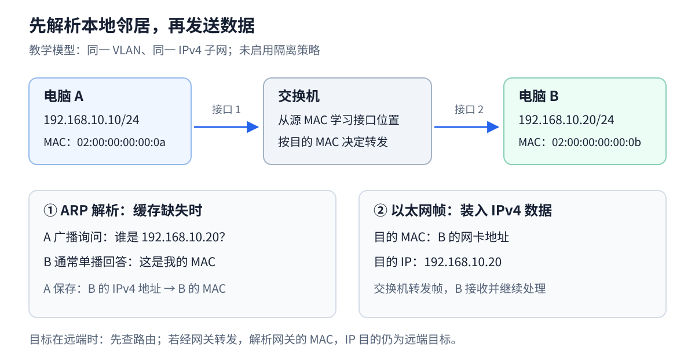

手机和电脑连上家里的 Wi-Fi 后，即使暂时不能上网，它们仍可能互相传文件。这说明“连接到本地网络”和“连接到互联网”不是同一件事。

本篇先把范围缩到一个房间：两台电脑、一台交换机、几根网线。我们会从设备是什么讲起，再跟踪一条消息怎样找到接收方。读完以后，你应当能解释：为什么已经知道 IP 地址，还要查另一个叫 MAC 的地址。

## Table of contents

## 先认识桌面上这几样东西

**网卡** 是设备参与网络通信的接口。台式机插网线的接口对应有线网卡，笔记本连接 Wi-Fi 使用无线网卡。同一台电脑可以同时有两者，所以“这台电脑只有一个网络身份”并不准确。

**交换机** 有多个连接接口。两台电脑各用一根网线接入它，它就能在接口之间转发合适的数据。初学时可以把它看成房间里的分发站，但分发依据是地址表，不是工作人员看懂了文件内容。

**无线接入点**，简称 AP，把无线设备接入本地网络。家里叫“无线路由器”的盒子通常把路由、交换和无线接入等功能放在一起。一个盒子承担多个角色，容易让人误以为 Wi-Fi、交换机、路由器是同一种东西。

| 日常说法       | 实际表达的事情                                         |
| -------------- | ------------------------------------------------------ |
| 已连上 Wi-Fi   | 设备已连接无线接入点，不保证互联网可用                 |
| 在一个局域网里 | 在一个有限范围的本地网络中；仍可能存在隔离规则         |
| 可以上网       | 至少某些去往外部网络的通信成功                         |
| 能访问 NAS     | 能访问提供文件存储服务的设备；NAS 是网络存储设备的简称 |

下面用有线以太网作主线。**以太网** 是常见的局域网技术，规定了怎样组织本地传输的数据等规则。无线网络有自己的帧格式，但“先找到本地接收者”的问题仍然存在。

## 两种地址，分别回答两种问题

设电脑 A 要访问同一小网络里的电脑 B。你知道 B 的 IP 是 `192.168.10.20`，相当于知道网络层要找的地址。然而，当前这段以太网还需要知道应把本地数据帧交给哪张网卡，这里会用到 MAC 地址。

**帧** 是以太网组织一次传输内容的单位。可以先把它理解成一个本地信封：里面装着 IP 数据包，外面写着发送和接收网卡的 MAC 地址。给数据加上这一层信息叫 **封装**；接收后读出里面的内容叫 **解封装**。

这不是在说 IP 是“姓名”、MAC 才是“真正地址”。两者都是地址，只是作用范围与处理规则不同。普通交换机主要按 MAC 地址转发以太网帧，路由器主要按 IP 目的地址决定跨网络的下一步。

MAC 常写成 `02:00:00:00:00:0b`，冒号只是帮助人分组阅读。数字中的 `a` 到 `f` 是十六进制数字，分别表示十进制 10 到 15；不用先会计算，也能把整串当作需要精确匹配的标签。

## 在纸上演一遍：A 第一次找 B

先约定 A 与 B 在允许相互通信的同一本地网络中，A 已知道 B 的 IP，但没有 B 的 MAC。交换机也还没有学会两者的位置。

1. A 根据自己的地址和网络配置，判断 B 应当在本地。判断方法下一篇再算，暂时接受这个前提。
2. A 发出 ARP 询问：“谁使用 `192.168.10.20`？请告诉我你的 MAC。”ARP 是 IPv4 网络里把本地 IP 对应到链路地址的一种协议。
3. 因为 A 还不知道 B 的 MAC，这个询问采用本地广播：让同一广播域中的设备都有机会收到。广播域就是这种广播可以传播到的范围；普通路由器不会把它一路转发到互联网。
4. 交换机从询问的来源学到“A 在接口 1”，并把广播发往其他适用接口。B 看到目标 IP 是自己，回复自己的 MAC；其他主机通常不为这个地址作答。
5. 回复经过交换机时，交换机又学到“B 在接口 2”。A 将结果暂存在邻居缓存，之后就能构造发给 B 的帧。
6. 后续帧到达交换机，交换机根据目的 MAC 查表，从 B 所在接口转发。只要已有信息仍有效，就无须每发一帧都重新广播问一次。

这里实际上有 **两张不同的表**：A 的邻居表存“IP → MAC”，交换机的 MAC 表存“MAC → 接口”。二者都是为了减少重复寻找，但记录的关系不同。能分清这两张表，就抓住了本篇主线。

## 如果 B 不在本地，刚才的过程哪里会变？

假如目标是远方网站，A 不会向全世界广播“谁是这个网站”。它先根据路由决定把包交给本地网关，再用 ARP 找 **网关** 的 MAC。内层 IP 包仍写远方网站的地址，外层帧写本地网关的 MAC。

所以“局域网通信要查 MAC”不等于“上网前要查网站的 MAC”。能直接询问的是本地下一站。后面第 3 篇讲如何选下一站，第 4 篇讲多站接力。

接下来的地址表和图是刚才小故事的精确版本。图里的 A、B、交换机没有新增角色，只是把它们用到的字段写全。

> [!NOTE] 读图前的小词典
> 后文的 VLAN 是“虚拟局域网”，可以在同一台交换机上划出彼此分隔的逻辑网络。初读时只要理解为“设备确实在同一个可互通的本地区域”。缓存是临时保存的查询结果；“老化”表示结果太久未更新后会被清除或失效。

## 先搭一个最小网络

假设两台电脑通过网线接到同一台交换机，处在同一个 VLAN，没有端口隔离或特殊访问控制。地址配置如下，全部是教学示例：

| 设备   | IPv4 地址       | 子网掩码        | 网卡 MAC 地址       | 交换机接口 |
| ------ | --------------- | --------------- | ------------------- | ---------- |
| 电脑 A | `192.168.10.10` | `255.255.255.0` | `02:00:00:00:00:0a` | 1          |
| 电脑 B | `192.168.10.20` | `255.255.255.0` | `02:00:00:00:00:0b` | 2          |

这里两台电脑都把 `192.168.10.0/24` 识别为直接连接的网络。暂时将 `/24` 理解为“前 24 位是网络部分”，下一篇会展开计算。

这个前提包含两件事：**IP 配置认为对方在本地，二层网络也确实允许双方互通。** 仅仅地址长得相似，或者连着同一个 Wi-Fi 名称，都不能单独保证通信成立。



## IP 数据包还需要一个本地信封

A 想把数据发给 `192.168.10.20`。在本例的以太网上，IP 数据包不能只写一个目标 IP 就直接送上网线；它需要被封装进以太网帧。

把这次封装简化成下面的结构：

```text
以太网帧
├── 目的 MAC：B 的网卡地址
├── 源 MAC：A 的网卡地址
├── EtherType：说明里面装的是什么协议
├── 载荷：IPv4 数据包
│   ├── 源 IP：192.168.10.10
│   └── 目的 IP：192.168.10.20
└── 帧校验序列（FCS）
```

其中，IP 地址参与网络层的寻址和路由，MAC 地址用于这一段链路上的交付。常见以太网 MAC 地址是 48 位，以六组十六进制数显示；它可以被软件配置，也可能因隐私功能而随机化，不能把它当作永远不变的设备身份证。

“目的 MAC 是 B”也意味着：**经过交换机，并不需要把目的 MAC 写成交换机自己的地址。** 普通二层交换机负责转发这个帧，并不是这次数据通信的接收终点。

## 交换机怎样知道 B 插在哪个接口？

可以先替交换机设计一张小表：

```text
MAC 地址                   位于哪个接口
02:00:00:00:00:0a           1
02:00:00:00:00:0b           2
```

这就是本例中的 MAC 地址表。实际交换机还要区分 VLAN，动态条目也会老化。表里的“接口 1、接口 2”指交换机的连接接口，与 TCP 的 `80`、`443` 端口不是一回事。

现在假设表是空的。A 的帧从接口 1 到达时，交换机读取 **源 MAC**，学到“A 在接口 1 后面”；随后读取 **目的 MAC**，决定往哪里送。这里“从来源学习”和“按目标转发”是两个不同动作。

对于常见的二层转发行为，可以这样判断：

| 收到的帧                          | 常见处理                             |
| --------------------------------- | ------------------------------------ |
| 目的 MAC 已知，且对应另一个接口   | 转发到那个接口                       |
| 目的 MAC 已知，但对应收到帧的接口 | 不再从其他接口转发                   |
| 目的 MAC 未知的单播帧             | 向同一 VLAN 中其他允许转发的接口泛洪 |
| 目的 MAC 是广播地址               | 向同一广播域中其他允许转发的接口泛洪 |

**泛洪是交换机采取的动作，广播是帧的寻址方式。** 一个发给 B 的未知单播帧，即使被复制到多个接口，目的 MAC 仍然是 B，不会被改成广播地址。广播帧的目的 MAC 则是 `ff:ff:ff:ff:ff:ff`。

Practical Networking 的 [Host to Host through a Switch](https://www.practicalnetworking.net/series/packet-traveling/host-to-host-through-a-switch/) 用逐帧动画说明了学习与转发，适合对照上面的表阅读。这里描述的是常见默认行为；实际设备可以配置未知单播抑制、端口隔离等策略，不能把“所有接口一定都收到”当作保证。

## A 又怎样知道 B 的 MAC？

交换机解决了“某个 MAC 在哪个方向”，但 A 还只有 B 的 IP。这时需要 ARP，即地址解析协议。

假设 A 的邻居缓存里还没有 B。一次常见的初始解析如下：

1. A 发送 ARP 请求，询问“谁使用 `192.168.10.20`”，并附上自己的 IP 和 MAC。以太网目的地址是广播 MAC。
2. 交换机学习 A 的源 MAC，并将请求泛洪到本 VLAN 的其他可转发接口。
3. B 发现请求问的是自己，通常单播回复 A，说明自己的 MAC。
4. A 保存 `192.168.10.20 → 02:00:00:00:00:0b`，随后可以构造发给 B 的数据帧。

B 的回复经过交换机时，交换机又可以从源 MAC 学到 B 所在的接口。一次交换同时帮助主机建立地址映射，也帮助交换机学习位置，但两者维护的是不同的表。

| 表                | 本例中由谁维护 | 回答的问题                         |
| ----------------- | -------------- | ---------------------------------- |
| ARP / IPv4 邻居表 | A、B 等主机    | 这个本地下一跳的 IP 对应哪个 MAC？ |
| MAC 地址表        | 交换机         | 去这个 MAC 应从哪个接口转发？      |

ARP 的请求和回复直接由以太网承载，**不是放在 IPv4 数据包里的协议**；它的载荷包含 IPv4 地址，不等于它本身有 IPv4 头。具体字段与处理流程可参见 [RFC 826](https://www.rfc-editor.org/rfc/rfc826.html)。

有了可用缓存，A 不必每发一个数据包都广播一次。缓存会被更新或老化，时机依赖操作系统与状态。也因此，抓包时只看到数据、没看到 ARP，不一定是漏抓，可能只是抓包开始前已经完成了解析。

## 目标不在本地时，ARP 问的是谁？

给 A 配一个默认网关 `192.168.10.1`。当 A 要访问另一个网络时，操作系统先查询路由表；如果选中的路由要求通过这个网关转发，需要解析的是 **网关的 MAC**。

| A 要访问的对象             | ARP 查询对象        | 发出数据帧的目的 MAC | IPv4 目的地址   |
| -------------------------- | ------------------- | -------------------- | --------------- |
| 本地 B：`192.168.10.20`    | B                   | B 的 MAC             | B 的 IP         |
| 通过默认网关访问远端服务器 | 网关 `192.168.10.1` | 网关接口的 MAC       | 远端服务器的 IP |

普通路由器不会把这个 ARP 广播继续转发到互联网。它收到交给自己的数据帧后，再根据 IP 目的地址决定下一步。Practical Networking 的 [Traditional ARP](https://www.practicalnetworking.net/series/arp/traditional-arp/) 特别区分了同网段主机与远端目标对应的解析对象。

所以，在 A 的邻居表里找不到某个远端网站的 MAC 完全正常。邻居表不是互联网所有设备的通讯录。代理 ARP 等机制会改变“由谁回答”的细节，但不会把普通 ARP 变成跨互联网的全局查询。

## DHCP：这些配置最初从哪里来？

前面假设 IP、掩码和网关都已配置。家用电脑通常通过 DHCPv4 自动获取这些参数，也可能同时获得 DNS 服务器等配置。

DHCP 是帮助设备自动取得网络配置的协议。可以先读成四句对话：“谁能给我配置？”“我可以提供这一组。”“我选择这组。”“确认分配给你。”**租约** 表示这组动态地址配置有使用期限，需要按规则续期。

一次典型的首次分配可用 **DORA** 记忆：

| 阶段        | 报文         | 含义                     |
| ----------- | ------------ | ------------------------ |
| Discover    | DHCPDISCOVER | 客户端寻找可用服务器     |
| Offer       | DHCPOFFER    | 服务器提出地址与配置方案 |
| Request     | DHCPREQUEST  | 客户端表明选择哪个方案   |
| Acknowledge | DHCPACK      | 服务器确认分配与配置     |

初始发现使用广播，客户端此时还不需要拥有可用的单播 IPv4 地址。后续响应可能广播，也可能单播，不能把四步一概画成广播。DHCP 中继还可以帮助客户端与其他网络里的服务器通信；这是一项明确的中继功能，不是路由器随意转发所有广播。

动态分配通常带有 **租约**。续租不必重走完整四步；租约到期且未成功续租时，客户端必须停止使用该租约地址。完整状态过程见 [RFC 2131 第 3、4 节](https://www.rfc-editor.org/rfc/rfc2131.html#section-3)。

这与 ARP 是两个问题：DHCP 帮助设备取得自己的配置，ARP 帮助设备在本地找到选定下一跳的链路地址。手工配置 IP 的主机同样会使用 ARP。

## 为什么家里只看到一个“路由器”？

一个家用设备往往同时承担多个角色：LAN 口之间的交换机、连接其他网络的 IP 路由器、无线接入点，以及 DHCP 服务、DNS 转发、NAT 和防火墙。具体功能是否启用取决于工作模式。

两台 LAN 设备互访时，可能只用到了其中的交换功能。拔掉 WAN 线不等于关闭了这台盒子里的交换机；而把整台设备断电，往往连本地交换和无线接入都一起失去了。

Wi-Fi 使用的是 802.11 链路机制，空中帧格式并不等于这里画的以太网帧。接入点可以桥接无线与有线网络，让 IPv4 和 ARP 在这个逻辑局域网里工作；访客网络、客户端隔离则可能禁止设备互访。先分清设备在这一刻承担的角色，再分析通信路径，会比仅记住产品名称更有用。

## 动手：对照邻居表观察一次通信

先做只读检查，不改网络配置，也不清空缓存。Windows 在开始菜单搜索 PowerShell，打开后复制一条完整命令再按回车。竖线 `|` 表示把前一个命令的结果交给后一个命令整理显示；跨两行的那条命令要一起复制。

先用第一条找到当前联网接口，再从第二条里看 `IPAddress`（邻居 IP）、`LinkLayerAddress`（链路地址，例如 MAC）、`State`（当前状态）。这些字段不会保证与教学地址相同，也不需要修改成相同。Windows PowerShell 可运行：

```powershell
Get-NetIPConfiguration
Get-NetNeighbor -AddressFamily IPv4 |
  Format-Table InterfaceAlias, IPAddress, LinkLayerAddress, State
```

Linux 可运行：

```bash
ip -4 address show
ip -4 route show
ip -4 neigh show
```

注意选择实际联网的接口，避免把 VPN、虚拟机或容器接口混进来。下面只是用于说明字段的 **示意输出，并非本文环境的实测结果**：

```text
192.168.10.20 dev eth0 lladdr 02:00:00:00:00:0b REACHABLE
192.168.10.1  dev eth0 lladdr 02:00:00:00:00:01 STALE
```

`STALE` 不等于对方已经断网，只表示邻居可达性信息需要在后续使用中重新确认。没有 B 的条目，也不能证明 B 不在线，可能只是当前没有解析过它。

上面的表格观察不需要安装其他软件。进一步想看消息内容，可以使用 **Wireshark**：它记录经过所选接口、可被捕获的报文并解释字段，这个过程叫抓包。**显示过滤器** 只是从已有记录中筛选要看的消息。`ping` 则向目标发出诊断请求并等待回应，不是下载测速。

如果已经安装 Wireshark 并具备抓包权限，可以在自己的测试网络里继续：

1. 找到一台已知地址的本地设备 B，并确认双方处于同一子网且允许互访。
2. 在 A 的实际联网接口启动抓包，显示过滤器填写 `arp || icmp`。
3. Windows 运行 `ping -n 3 <B的IPv4地址>`；Linux 运行 `ping -c 3 <B的IPv4地址>`，把占位符替换为真实地址。
4. 如出现 ARP，展开以太网头和 ARP 字段，分别核对广播目的 MAC、目标 IP，以及回复里的发送方 MAC。
5. 再看 ICMP Echo 报文：IP 目标与以太网目标是否分别指向 B 的 IP 和 MAC？最后回到邻居表验证映射。

如果缓存已存在，可能不会出现初始 ARP 广播。可以选择另一台尚未通信过、且得到允许的测试设备，或等待邻居状态自然变化。不要为了“必须看到四个包”就认定实验失败。

如果 ARP 有回复而 ping 没回复，说明已经获得了该 IP 的链路地址信息，仍可能是对方防火墙不响应 ICMP。反过来，只有 ARP 请求没有回复，则应先检查地址、VLAN、隔离策略和设备状态，暂时不用追查 DNS 或 HTTP。

## 留一个问题

A 的 IP 仍是 `192.168.10.10`，现在把目标换成 `192.168.11.20`：它应该直接查询对方的 MAC，还是把数据交给网关？

仅看地址还不能回答，必须同时知道子网掩码和路由配置。下一篇就从这个问题出发，拆开 IP 地址、子网和默认网关之间的关系。

## 读完后，用自己的话试着解释

A 查到 B 的 IP 对应某个 MAC；交换机学到这个 MAC 在接口 2。这两条记录存在同一张表里吗？

<details>
<summary>展开参考答案</summary>
<div class="mt-4 leading-7">不是。A 的邻居表记录 IP 与 MAC 的对应，交换机的 MAC 表记录 MAC 与接口的对应。两者也可能各自更新或老化。</div>
</details>

## 参考资料

本文的拓扑、表格与插图为原创教学示例；以下资料用于核对协议规则与进一步阅读，不是逐篇翻译。

- [Practical Networking：Host to Host through a Switch](https://www.practicalnetworking.net/series/packet-traveling/host-to-host-through-a-switch/)：交换机的源地址学习与目的地址转发。
- [Practical Networking：Traditional ARP](https://www.practicalnetworking.net/series/arp/traditional-arp/)：本地目标与远端目标的 ARP 解析对象。
- [RFC 826：An Ethernet Address Resolution Protocol](https://www.rfc-editor.org/rfc/rfc826.html)：ARP 格式、请求与回复处理。
- [RFC 2131：Dynamic Host Configuration Protocol](https://www.rfc-editor.org/rfc/rfc2131.html)：DHCPv4 地址分配、租约与客户端状态。

上一篇：[打开一个网页，网络世界发生了什么？](/blog/posts/what-happens-when-you-open-a-webpage/)

下一篇：[IP 地址、子网掩码和默认网关到底是什么？](/blog/posts/understanding-ip-addresses-and-subnets/)
