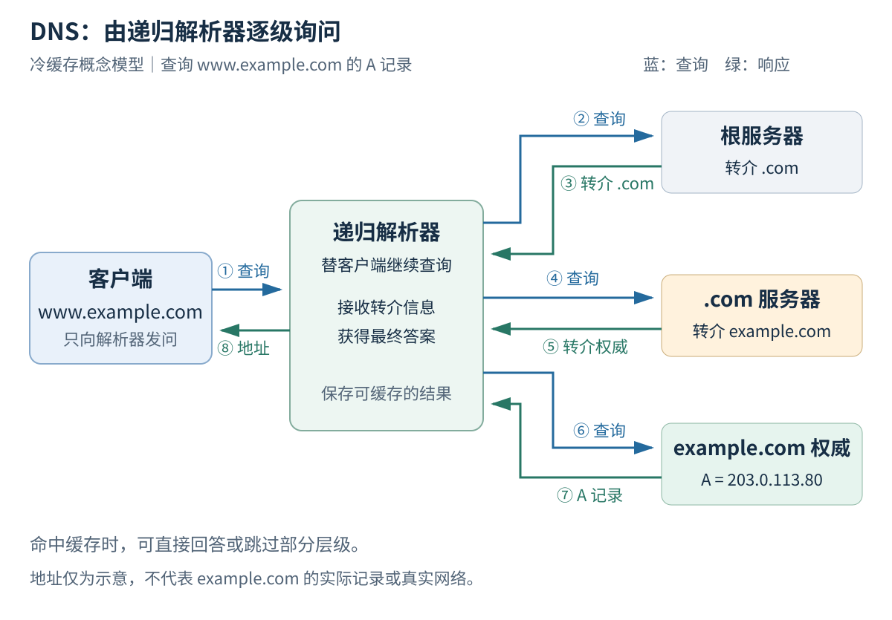

前四篇已经解释了主机怎样把 IP 数据包交给本地邻居，再通过路由器送往远端。现在还缺少一个入口：用户输入的是域名，网络连接需要的是地址，这两者如何接起来？

“DNS 是互联网的电话簿”是一个方便的开头，但真实问题很快就会超出这个比喻：为什么同一个域名在不同地方查到不同地址？为什么改完记录后，有人已经看到新网站，有人还在访问旧网站？DNS 查询成功了，为什么 HTTPS 仍然报错？

要解释这些现象，需要看清 **谁管理记录、谁替你查询、哪些结果可以被缓存**。

本文结合 [Cloudflare 的 DNS 入门说明](https://www.cloudflare.com/learning/dns/what-is-dns/)和 [Julia Evans 的 A toy DNS resolver](https://jvns.ca/blog/2022/02/01/a-dns-resolver-in-80-lines-of-go/)组织问题。前者适合建立角色分工，后者启发我们把“解析”拆成能观察的查询与响应；下面的图、记录和 Python 小实验均为自拟。

## Table of contents

## DNS 查询的对象不是整条网址

假设浏览器访问：

```text
https://www.example.com/articles/network?lang=zh
```

需要查询的名称通常是 `www.example.com`，不是后面的路径和查询字符串。DNS 不负责寻找 `articles/network` 这个网页，也不知道返回页面应该使用哪种语言。

更准确地说，DNS 根据 **名称、记录类型和类别** 查询资源记录。常见的互联网查询使用 IN 类别；不同类型可以表达不同信息：

| 类型  | 查询得到的信息                   | 自拟示例或用途                        |
| :---- | :------------------------------- | :------------------------------------ |
| A     | IPv4 地址                        | `www.example.com → 203.0.113.80`      |
| AAAA  | IPv6 地址                        | `www.example.com → 2001:db8::80`      |
| CNAME | 另一个规范名称                   | `docs.example.com → docs.example.net` |
| NS    | 哪些服务器对相应区域提供权威服务 | 查询 `example.com` 的权威服务器       |
| MX    | 接收某域邮件的服务器及优先级     | 邮件投递                              |
| TXT   | 文本形式的记录内容               | 域名验证、邮件相关策略等              |

表中的地址来自文档示例地址空间，不是 `example.com` 的真实解析结果。

一条 A 查询可能得到多个地址；没有 A 记录也不意味着名称不存在，它可能只有 AAAA 或其他类型。CNAME 则表示别名关系，解析器可能继续查找目标名称的记录。它不是 HTTP 301/302 跳转，也不会自动改变浏览器地址栏。

## 四种角色，不是一台万能的 DNS 服务器

在一次典型的外部域名查询中，可以先分清下面的角色：

| 角色                 | 负责什么                                               |
| :------------------- | :----------------------------------------------------- |
| 客户端侧解析功能     | 接收应用的解析需求，可能由系统服务或浏览器实现         |
| 递归解析器           | 接受查询，利用缓存或继续询问其他服务器，返回结果       |
| 根与顶级域权威服务器 | 提供名称层级中的委派信息，帮助找到更接近目标的权威区域 |
| 目标区域的权威服务器 | 根据自己管理的区域数据，回答相关记录或给出适当响应     |

Cloudflare 在 [What is DNS?](https://www.cloudflare.com/learning/dns/what-is-dns/)中特别区分了递归解析器和权威服务器：前者替客户端寻找结果，后者对所管理的数据提供权威回答。

家用路由器显示的 DNS 地址可能只是一个转发入口，后面还有运营商或其他递归解析服务。浏览器如果启用自己的安全 DNS，也可能不采用系统配置的同一条解析路径。

因此，看到一个“DNS 服务器地址”时，可以多问一句：它是在替我完成查询，还是负责发布这个域的权威数据？

## 跟踪一次没有命中缓存的查询

为了只观察委派关系，假设递归解析器还没有所需缓存，但已有根服务器的启动信息。我们查询 `www.example.com` 的 A 记录，并假设相关区域按常见层级委派。



_图为原创概念模型。地址和最终回答是教学示意，不是对真实域名解析过程的抓包记录。_

整个过程可以分成五步：

1. 客户端向递归解析器提出问题，希望获得最终结果。
2. 解析器询问根服务器，得到通往 `.com` 权威服务器的委派信息。
3. 解析器再询问 `.com` 服务器，得到 `example.com` 区域的委派信息。
4. 解析器询问目标区域的权威服务器，获得所需记录；若遇到别名或进一步委派，可能继续查询。
5. 解析器把结果返回客户端，并按规则缓存适合缓存的数据。

**这里始终是解析器在继续发起查询。** 根服务器通常返回“接下来可以问谁”，并不是替客户端把问题一路转发到网站服务器。

这种按响应中的线索继续询问的过程，体现了迭代查询；客户端请求递归服务，则希望接收方替自己完成后续工作。两种说法描述的是查询行为，不能仅凭“用了几台服务器”来区分。[RFC 1034](https://www.rfc-editor.org/rfc/rfc1034.html)说明了名称空间、委派和解析过程。

还有两个常见误区：

- 域名里每多一个点，不代表一定多访问一台服务器。只有存在相应的区域委派，才需要沿委派继续查找；`www` 常常只是区域内的一条记录。
- 根服务器不保存所有网站的地址。根提供名称空间顶层的权威信息，具体记录由分布在不同管理边界的区域维护。

图中省略了冗余服务器选择、QNAME 最小化、重试和 DNSSEC 验证等机制，真实查询次数不能按这五步机械计数。

## 从响应里读出“答案”和“下一步线索”

Julia Evans 的 [toy resolver 文章](https://jvns.ca/blog/2022/02/01/a-dns-resolver-in-80-lines-of-go/)有一个很适合学习的切入点：除了最终答案，还要观察响应中的委派和附加地址。她的教学实现也明确省略了缓存、DNSSEC 验证和完整的故障处理，不能直接当作生产解析器。

一份 DNS 消息包含首部，以及 Question、Answer、Authority、Additional 等区段。可以把它们先理解为：

```text
Header       查询标识、标志、响应码、各区段记录数量
Question     正在问哪个名称、哪种记录
Answer       与问题有关的回答，例如 A、AAAA 或 CNAME
Authority    权威相关信息，例如委派中的 NS 或否定回答中的 SOA
Additional   额外信息，例如某些委派附带的服务器地址
```

“附带地址”为什么有用？假设你得知下一步应去问某个权威服务器，但服务器本身也是用名字表示的，这时还需要找到它的地址。在特定委派条件下，父区域提供的 glue 地址可以帮助打破这种依赖。

不过，Additional 里的内容不全是 glue，也不能不加验证地当成任何域名的可信答案。完整解析器需要处理记录所属范围、来源和缓存规则。协议的消息结构可查 [RFC 1035](https://www.rfc-editor.org/rfc/rfc1035.html)。

## TTL：缓存可以保存多久？

下面是一条自拟的记录展示：

```text
www.example.com.  300  IN  A  203.0.113.80
名称             TTL 类  类型  数据
```

TTL 的单位是秒，用来限制记录在通常缓存流程中的有效保存时间。若某解析器刚缓存一条 TTL 为 300 的记录，20 秒后再次返回它，剩余 TTL 可能已经降到约 280，而不是每次自动重新变成 300。

这解释了“改完 DNS 为什么没有立即生效”：

```text
00:00  解析器甲缓存旧地址，TTL 为 300 秒
00:30  管理员在权威侧更改地址
01:00  甲仍可能使用尚未过期的旧记录
       没有旧缓存的解析器乙则可能查询到新记录
```

这是普通缓存行为的示意；真实系统还可能实施预取、TTL 策略或特定的过期数据服务机制。DNS 没有一个统一按钮，能让世界各地的所有缓存同时刷新。

TTL 也不是网站的“存活时间”，更不是某个 IP 地址可以被使用多久的租约。已经建立的应用连接是否继续使用，还取决于应用行为。

否定结果也可以缓存。例如“名称不存在”不会每次都重新问到权威服务器；[RFC 2308](https://www.rfc-editor.org/rfc/rfc2308.html)规定了 DNS 否定缓存的重要规则。因此，在修复一个原本不存在的名称后，旧的否定缓存也可能影响观察结果。

## 查询失败时，先看失败属于哪一种

| 观察到的结果                  | 可以说明什么                                                | 不能直接推出什么                           |
| :---------------------------- | :---------------------------------------------------------- | :----------------------------------------- |
| NXDOMAIN                      | 响应声明目标名称不存在；有别名链时可能指链末名称            | 不是“这台网站服务器关机了”                 |
| NOERROR，但没有所需类型的记录 | 可能是该名称没有这个类型的数据，即 NODATA；还需看响应上下文 | 不等于名称一定不存在                       |
| SERVFAIL                      | 服务器未能成功完成查询，原因可能有多种                      | 不能仅凭它认定域名被删除                   |
| 超时                          | 在等待期限内没有拿到预期响应                                | 不能确定是服务器故障、链路过滤还是其他问题 |
| 返回地址，但网页失败          | 地址查询已得到结果                                          | 不保证连接、TLS 或 HTTP 一定成功           |

NXDOMAIN 的名称语义在 [RFC 8020](https://www.rfc-editor.org/rfc/rfc8020.html)中有进一步说明。若响应中包含 CNAME 链，最初查询的别名可能存在，NXDOMAIN 指向的却是链末名称，需要连同别名链一起看。这里最实用的方法是保留原始响应和查询条件，避免把所有失败都简写成“DNS 坏了”。

同一域名查询结果不同，也不一定是异常。可能因为记录更新时机、缓存状态、所用解析器、地址族，或者权威服务的流量调度策略不同。先比较问题是否相同，再比较答案。

## DNS 用 UDP，为什么还能看到 TCP 或 HTTPS？

传统 DNS 常通过 UDP 53 端口查询，但 DNS 也使用 TCP。遇到被标为截断的 UDP 响应时，客户端常需要通过 TCP 重试；不能把 TCP 理解为“只有区域传送才会用”。[RFC 7766](https://www.rfc-editor.org/rfc/rfc7766.html)明确讨论了 DNS 对 TCP 的支持要求。

还需要区分加密传输与 DNS 数据验证，常见机制如下：

| 机制                | 主要解决的问题                                                  |
| :------------------ | :-------------------------------------------------------------- |
| DNS over TLS，DoT   | 使用 TLS 保护与 DNS 服务之间的传输，默认使用 TCP 853            |
| DNS over HTTPS，DoH | 把 DNS 消息承载在 HTTPS 中传输                                  |
| DNSSEC              | 为 DNS 数据提供来源认证与完整性验证机制，本身不负责加密查询内容 |

它们分别可参考 [RFC 7858](https://www.rfc-editor.org/rfc/rfc7858.html)、[RFC 8484](https://www.rfc-editor.org/rfc/rfc8484.html)和 [RFC 4033](https://www.rfc-editor.org/rfc/rfc4033.html)。

对个人浏览器而言，启用 DoH 通常保护的是客户端到所选解析服务这一段。所选服务仍然参与处理查询；这不意味着所有后续 DNS 查询都必然加密，也不意味着访问网站时的目标地址消失了。

## 动手查询：比较类型、缓存与委派

### Windows PowerShell

先对同一个名称分别查询 IPv4 和 IPv6：

```powershell
Resolve-DnsName example.com -Type A -DnsOnly
Resolve-DnsName example.com -Type AAAA -DnsOnly
Resolve-DnsName example.com -Type NS -DnsOnly
```

`-DnsOnly` 限制使用 DNS，而不是同时尝试 LLMNR 或 NetBIOS；它不代表跳过所有本地缓存。可以用下面的只读命令观察系统缓存：

```powershell
Get-DnsClientCache
```

缓存输出可能包含本机访问过的名称。做实验时只需要观察目标条目，无需把完整结果贴到公开文章里。

上述参数以 [Microsoft 的 Resolve-DnsName 文档](https://learn.microsoft.com/en-us/powershell/module/dnsclient/resolve-dnsname?view=windowsserver2025-ps)为准。如果环境没有这个命令，可先用 `nslookup example.com` 观察基础解析。

本文不固定展示 `example.com` 的真实地址和 TTL：它们会随时间、解析器和网络环境变化。

### Linux、macOS 或安装了 dig 的环境

```bash
dig example.com A +noall +answer
dig example.com AAAA +noall +answer
dig example.com NS
dig +trace www.example.com
```

前三个命令用于比较记录类型。第四个命令沿委派自行查询，适合观察根、顶级域和权威回答之间的联系，具体行为见 [BIND 的 dig 手册](https://bind9.readthedocs.io/en/v9.20.23/manpages.html#dig-dns-lookup-utility)。

`dig +trace` **不是重放浏览器刚才实际使用的解析过程**。它需要本机能够直接访问沿途 DNS 服务；某些网络只允许访问指定解析器，这时追踪失败与普通网页能打开可以同时发生。

还可以在 Wireshark 中先使用显示过滤器 `dns`，观察一次传统 DNS 查询的 Question 和响应区段。若浏览器命中缓存、使用 DoH/DoT，或者抓错网络接口，就不一定能看到可直接解码的传统 DNS 查询。

## 一个离线小实验：域名如何写进查询消息？

先不实现完整解析器，只编码 DNS 的 Question 区段。下面的 Python 代码不发网络包：

```python
import struct

name = "www.example.com"
labels = name.split(".")
qname = b"".join(
    bytes([len(label)]) + label.encode("ascii")
    for label in labels
) + b"\x00"
question = qname + struct.pack("!HH", 1, 1)  # QTYPE=A，QCLASS=IN

print(question.hex(" "))
print("Question bytes:", len(question))
```

这段代码的确定性输出为：

```text
03 77 77 77 07 65 78 61 6d 70 6c 65 03 63 6f 6d 00 00 01 00 01
Question bytes: 21
```

逐段阅读就能看见编码方式：

- `03` 后面跟着 3 个字节的 `www`；
- `07` 后面跟着 7 个字节的 `example`；
- `03` 后面跟着 3 个字节的 `com`；
- `00` 结束名称；
- 最后的两个 16 位整数分别表示 A 类型和 IN 类别，使用网络字节序。

代码只处理这里固定的 ASCII 域名，没有做通用输入校验、国际化域名转换、完整消息首部、名称压缩或响应解析。它的用途是把可读的名称和协议中的字节联系起来；消息格式仍以 [RFC 1035](https://www.rfc-editor.org/rfc/rfc1035.html)为依据。

## 带着这些问题继续观察

下次遇到域名问题，可以先记录四件事：

1. 查询的是哪个完整名称、哪种记录类型？
2. 使用的是系统解析器、浏览器安全 DNS，还是手动指定的服务？
3. 返回的是记录、否定响应、服务失败，还是超时？
4. DNS 已成功后，问题是否发生在连接、证书或 HTTP 阶段？

这样，DNS 就从一句“把域名变成 IP”的口号，变成了一组能被检查的请求、委派、缓存和回答。

上一篇：[一个数据包怎样跨越多个路由器？](/blog/posts/how-packets-travel-across-routers/)

下一篇：[端口和 Socket：网络怎样找到你的程序？](/blog/posts/understanding-ports-and-sockets/)

回看全景：[打开一个网页，网络世界发生了什么？](/blog/posts/what-happens-when-you-open-a-webpage/)

[浏览专栏目录](/blog/series/)

## 参考与延伸阅读

- [Cloudflare：What is DNS?](https://www.cloudflare.com/learning/dns/what-is-dns/)——递归解析器与权威服务器的入门解释。
- [Julia Evans：A toy DNS resolver](https://jvns.ca/blog/2022/02/01/a-dns-resolver-in-80-lines-of-go/)——从教学程序观察回答、委派和附加信息。
- [RFC 1034](https://www.rfc-editor.org/rfc/rfc1034.html)、[RFC 1035](https://www.rfc-editor.org/rfc/rfc1035.html)——DNS 概念与消息格式；这些基础规范已有后续更新，不能单独代表现代实现的全部行为。
- [RFC 2308](https://www.rfc-editor.org/rfc/rfc2308.html)、[RFC 8020](https://www.rfc-editor.org/rfc/rfc8020.html)、[RFC 7766](https://www.rfc-editor.org/rfc/rfc7766.html)——否定缓存、NXDOMAIN 与 DNS over TCP。
- [RFC 7858](https://www.rfc-editor.org/rfc/rfc7858.html)、[RFC 8484](https://www.rfc-editor.org/rfc/rfc8484.html)、[RFC 4033](https://www.rfc-editor.org/rfc/rfc4033.html)——DoT、DoH 与 DNSSEC。
- [Resolve-DnsName](https://learn.microsoft.com/en-us/powershell/module/dnsclient/resolve-dnsname?view=windowsserver2025-ps) 与 [dig 手册](https://bind9.readthedocs.io/en/v9.20.23/manpages.html#dig-dns-lookup-utility)——查询工具的选项与行为。
