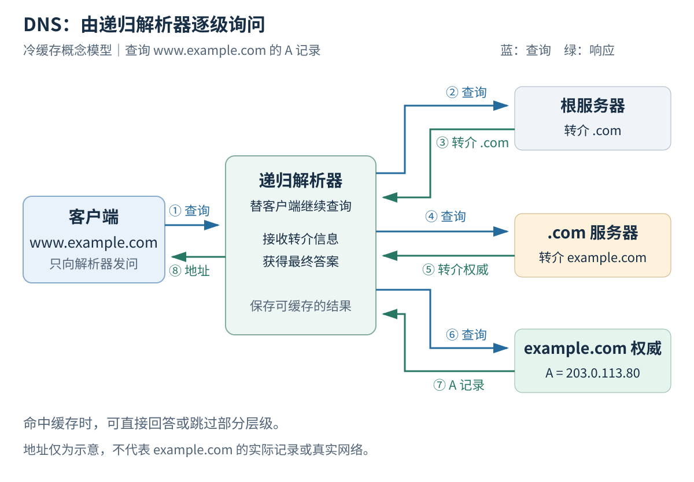

在前几篇中，我们推导了主机如何在局域网内依靠 MAC 地址直接寻址，以及跨网段时如何通过路由器逐跳转发数据包。

然而，所有这些底层传输的前提，都是我们手中已经握有一个明确的 **目标 IP 地址**。

现实中，几乎没有人会去背诵 `142.250.190.46` 或 `240e:e1:8200::1` 这样冰冷晦涩的数字串。我们敲下的是 `github.com`、`bilibili.com` 这样充满人类语义的字符。

**域名系统（Domain Name System，简称 DNS）**，正是维系整个互联网运转的“中央电话本”：

- 为什么全球数十亿网民每秒发起数万亿次域名请求，整个互联网却没有被冲垮？
- 所谓的**“全球只有 13 个根域名服务器”**到底是什么意思？难道只要炸掉 13 台物理电脑，全人类就会断网吗？
- 客户端向本地网络发起的**递归查询**，与递归服务器向全球节点发起的**迭代查询**究竟有着怎样严密的时序分工？
- 为什么修改了阿里云或 Cloudflare 上的域名解析记录后，全国各地的生效时间常常要延迟几分钟甚至几小时？

本文将全面揭开 DNS 这座全人类最大规模分布式树状数据库的底层架构，拆解从根域到权威服务器的逐级委派流程，并剖析常见记录类型与现代加密演进。

## Table of contents

## 第一章：倒置的全球多叉树——DNS 分层命名体系

如果把全世界所有的域名和 IP 地址放在一台巨型中心服务器里集中存储，那么任何一次微小的网络抖动或单点故障，都将引发全人类互联网的大瘫痪。

DNS 从一开始就采用了一种高度自治、层层下放权力的**倒置分层树状数据结构（Hierarchical Tree Structure）**：



```text
                                  . (根域 Root Domain)
            ┌───────────────────────┼───────────────────────┐
          .com                    .org                    .cn (顶级域 TLD)
      ┌─────┴─────┐                   │                       │
   github      google             wikipedia                baidu (二级域 SLD)
      │           │                                           │
     api         www                                         tieba (三级子域)
```

以完整合格域名（FQDN）`api.github.com.` 为例（注意末尾隐藏的那个纯点 `.`）：

1. **根域（Root Domain，末尾的 `.`）**：
   位于全球树形结构的最高顶点。它不记录具体网站的 IP，它唯一的职责是**统管所有的“顶级域服务器”在哪里**；
2. **顶级域（TLD, Top-Level Domain）**：
   - 通用顶级域（gTLD）：如 `.com`（商业）、`.org`（非盈利组织）、`.net`（网络服务）；
   - 国家/地区代码顶级域（ccTLD）：如 `.cn`（中国）、`.jp`（日本）、`.uk`（英国）；
3. **二级域（SLD, Second-Level Domain）**：
   企业或个人向域名注册商花钱购买租用的域名资产（如 `github.com`）；
4. **子域（Subdomain）**：
   由二级域的所有者自行在内网自由分配派生的主机名（如 `api.github.com`）。

### 揭秘“全球仅有 13 个根域名服务器”的物理真相

教科书上常写着“全球只有 13 组根域名服务器（以字母 A 到 M 命名）”，这常常引发初学者的惊恐。

> **底层网络工程真相**：
>
> **“13 组”绝不代表“只有 13 台物理电脑”！**
>
> 在早期的原始 DNS 规范中，受限于 UDP 报文单包 512 字节的上限，一个回复报文中最多只能塞入 13 个根服务器的 IPv4 地址，因此在逻辑架构上只能命名从 `a.root-servers.net` 到 `m.root-servers.net` 共 13 个**逻辑服务 IP 地址**！
>
> 在物理现实中，现代根服务器全面采用了 **Anycast（任播技术）**：
> 同一个逻辑 IP 地址（如 `198.41.0.4`），在全球数百个国家的大型数据中心中部署了**数千台物理服务器镜像节点**！
> 当你发起根查询时，BGP 路由协议会自动就近引导至离你物理距离最近的镜像节点，不仅具备近乎无限的高并发抗压能力，更拥有强大的抗 DDoS 攻击防灾韧性！

---

## 第二章：跑腿员与发言人——核心角色与查询时序

在一次 DNS 解析中，必须清晰区分两类性质截然不同的服务器角色：

1. **递归解析器（Recursive Resolver / 本地 DNS）**：
   - 角色形象：**“跑腿业务员”**；
   - 代表：用户电脑网络配置里填写的 DNS 地址（如当地电信运营商提供的 DNS、腾讯的 `119.29.29.29`、Google 的 `8.8.8.8`、Cloudflare 的 `1.1.1.1`）；
   - 职责：它本身不生产数据，但当用户向它提问时，它承诺**“替你跑遍全世界、一级一级追问到底，直到拿到最终结果”**。
2. **权威域名服务器（Authoritative Nameserver）**：
   - 角色形象：**“法定户口档案管理员”**；
   - 代表：网站所有者在阿里云、腾讯云或 Cloudflare 上配置解析记录的后台服务器；
   - 职责：**它拥有对某个特定域名（如 `github.com`）记录的最终官方裁决权！** 它给出的答案是权威的第一手真理。

### 递归查询 vs 迭代查询的时序配合

当你的电脑向网络发起域名查询时，背后经历了一次精妙的“内外配合”：

```text
[你的电脑] ──────(递归查询: "请必须帮我查出结果!")──────> [递归解析器 (如 8.8.8.8)]
                                                              │
    ┌─────────────────────── 迭代查询流程 ───────────────────────┤
    │                                                          │
    │ 1. 问根服务器: "你知道 api.github.com 吗？"                 │
    │    答: "我不知道具体 IP，但 .com 归这个 TLD 服务器管，去找它！"│
    │                                                          │
    │ 2. 问 .com 顶级域: "你知道 api.github.com 吗？"             │
    │    答: "我不知道具体 IP，但 github.com 的权威服务器归 NS1，去找它！"
    │                                                          │
    │ 3. 问权威服务器 NS1: "你知道 api.github.com 吗？"            │
    │    答: "我知道！它的 IPv4 地址是 20.205.243.166！"          │
    │                                                          │
    ▼                                                          ▼
[你的电脑] <───────(把最终拿到的 IP 回传并写入本地缓存)───────────────┘
```

- **递归查询（Recursive Query）**：发生在**客户端电脑与递归解析器之间**。客户端只发一次问询，剩下的全部复杂脏活累活全权委托给解析器；
- **迭代查询（Iterative Query）**：发生在**递归解析器与各级全球节点之间**。被询问的服务器如果不知道答案，它不会代为向后查询，而是礼貌地返回一个“引荐指针（Referral）”，告诉解析器下一个应该去问谁。

---

## 第三章：常见核心 DNS 资源记录类型（Resource Records）

权威服务器在回答解析器时，返回的数据结构被称为 **资源记录（Resource Record，简称 RR）**。

在日常工程与云服务配置中，最高频的 6 大记录类型如下：

| 记录类型    | 全称与定位                | 典型记录内容                                    | 核心工程场景                                                                                                               |
| :---------- | :------------------------ | :---------------------------------------------- | :------------------------------------------------------------------------------------------------------------------------- |
| **`A`**     | Address (IPv4 映射)       | `example.com. IN A 93.184.216.34`               | 将域名直接映射为标准的 32 位 IPv4 地址。                                                                                   |
| **`AAAA`**  | Quad-A (IPv6 映射)        | `example.com. IN AAAA 2606:2800:220:1:248...`   | 将域名直接映射为 128 位 IPv6 地址。                                                                                        |
| **`CNAME`** | Canonical Name (规范别名) | `www.example.com. IN CNAME example.com.`        | **“别名指针”**：将一个域名指向另一个域名。**CDN 接入的核心技术**（用户访问时由 CDN 厂商的 CNAME 动态调度至最优边缘节点）。 |
| **`NS`**    | Name Server (委派授权)    | `example.com. IN NS ns1.cloudflare.com.`        | 声明某个区域的权威解析职责具体移交给哪一台服务器。                                                                         |
| **`MX`**    | Mail Exchanger (邮件交换) | `example.com. IN MX 10 mail.example.com.`       | 声明该域名的电子邮件服务器地址，数值（如 `10`）代表优先级权重。                                                            |
| **`TXT`**   | Text (纯文本描述)         | `example.com. IN TXT "v=spf1 include:... ~all"` | 存放任意纯文本描述。广泛用于企业邮箱反钓鱼身份认证（**SPF / DKIM**）及各大云厂商域名所有权验证。                           |

---

## 第四章：缓存的艺术与时效控制——TTL 机制

如果在每次打开网页、每次加载一张小图片时，全网都要从根服务器重新迭代查询一遍，全球主干网络会被瞬间打爆。

**DNS 系统的精髓在于高密度的分布式多级缓存！**

### 1. 生存时间（TTL，Time to Live）的底层机理

在每一条权威 DNS 记录中，都强制包含一个以秒为单位的整数——**`TTL`**：

```text
api.github.com.    60    IN    A    20.205.243.166
                   │
                   └── TTL = 60 秒 (生存期)
```

当递归解析器从权威服务器拿到这条记录后：

1. 它会将这条记录写入自身的内存高速缓存中；
2. **在接下来的 60 秒内**，如果局域网内有其他用户也要访问该域名，递归服务器**直接从本地缓存秒级命中并返回结果**，完全不需要再次跨越互联网发起外部迭代查询；
3. 缓存中的 TTL 会随着真实时间流逝**倒计时递减**。当归零失效后，下一次请求才会重新发起迭代回源。

### 2. 为什么修改了解析不能全球立即生效？

当我们在域名控制台将网站从旧服务器 IP 切到新服务器 IP 时：

- 很多用户反馈：“为什么我刷新网页还是访问到旧服务器？”；
- **核心真相**：全世界分散在各大洲、各个运营商内部的成千上万个递归服务器，其本地缓存中依然保存着未过期的旧记录！
- **运维避坑军规**：如果计划在周五深夜进行重大的服务器 IP 迁移，**必须提前 24 小时将域名的 TTL 临时调低（如调为 60 秒）**！等全球旧缓存全部自然淘汰后，在周五执行切换，新记录便能在数十秒内迅速席卷全球生效！

---

## 第五章：传输协议与现代加密演进（DoT / DoH）

很多工程师对 DNS 协议的传输层载体存在刻板印象：“DNS 是基于 UDP 传输的”。

真实的技术规范远比这更为精细。

### 1. UDP 53 vs TCP 53 的职责边界

- **常规轻量查询（默认使用 UDP 53 端口）**：
  一次常规查询只需要一个发送报文和一个回复报文。使用无连接的 UDP 能够省去 TCP 三次握手和四次挥手的巨大网络往返开销，极大地节约服务器物理内存与端口并发资源；
- **以下两种场景强制触发回退至 TCP 53 端口**：
  1. **响应报文长度超过 512 字节（截断标志位 TC 置位）**：早期 UDP 单包上限 512 字节。若返回的记录过多（如多条 TXT 证书记录），服务端会在报头中将 **`TC（Truncated）` 截断标志位置为 1**，客户端收到后会自动重新使用 **TCP 53** 发起可靠大报文重连；
  2. **主从 DNS 区域传送（Zone Transfer，`AXFR` / `IXFR`）**：从服务器同步全量域名数据库时，必须依赖 TCP 保证数据的绝对可靠不丢包。

### 2. 传统明文 DNS 的致命隐患与 DoH 加密革命

传统的 DNS 报文是**完全裸露的明文**！你在浏览器搜索了什么网站，途经的公共 Wi-Fi 路由器、小区宽带运营商可以看得一清二楚，甚至进行恶意的 **DNS 劫持**（将正确 IP 篡改为广告导航页）。

为了捍卫用户隐私，现代互联网演进出了两大安全标准：

- **DoT（DNS over TLS，RFC 7858，专属端口 853）**：使用 TLS 对 DNS 报文进行底层隧道加密；
- **DoH（DNS over HTTPS，RFC 8484，标准端口 443）**：**现代浏览器主力标配！** 将 DNS 查询伪装为标准的 HTTP/2 或 HTTP/3 报文，混杂在正常的 HTTPS Web 流量中传输。任何中间监听者不仅无法解密你查询了什么域名，甚至从流量特征上根本区分不出你是在看网页还是在查 DNS！

---

## 第六章：终端诊断工具实战——`dig` 的解剖艺术

在 Linux / macOS 终端中，排查域名解析故障最专业的工具莫过于 **`dig`（Domain Information Groper）**。

执行一次深入查询：

```bash
dig api.github.com
```

输出的报文是一堂生动的 DNS 协议现场教学课：

```text
; <<>> DiG 9.16.1-Ubuntu <<>> api.github.com
;; ->>HEADER<<- opcode: QUERY, status: NOERROR, id: 48951
;; flags: qr rd ra; QUERY: 1, ANSWER: 1, AUTHORITY: 0, ADDITIONAL: 1

;; OPT PSEUDOSECTION:
; EDNS: version: 0, flags:; udp: 65494
;; QUESTION SECTION:
;api.github.com.                 IN      A

;; ANSWER SECTION:
api.github.com.          60      IN      A       20.205.243.166

;; Query time: 42 msec
;; SERVER: 127.0.0.53#53(127.0.0.53)
;; WHEN: Thu Nov 05 23:15:00 CST 2026
;; MSG SIZE  rcvd: 59
```

- **`status: NOERROR`**：状态码为正常（若域名不存在则显示 `NXDOMAIN`；若权威服务器内部解析崩溃则显示 `SERVFAIL`）；
- **`flags: qr rd ra`**：
  - `qr`（Query Response）：当前报文是响应；
  - `rd`（Recursion Desired）：客户端期望递归；
  - `ra`（Recursion Available）：服务器支持递归查询；
- **`QUESTION SECTION`**：我们提出的问题（查询 `A` 记录）；
- **`ANSWER SECTION`**：返回的最终真理（TTL 倒计时 60 秒，目标 IPv4 为 `20.205.243.166`）；
- **`Query time`**：本次查询网络往返耗时（42 毫秒）。

---

## 总结与专栏全局视野

在本篇《计算机网络通识（五）》中，我们解开了全球最大分布式数据库的运作奥秘：

1. **倒置多叉树**：厘清了根域、顶级域、二级域的层级委派，破解了“全球只有 13 组根服务器”依托任播技术分布数千节点的物理真相；
2. **两分法时序**：透视了客户端向递归解析器的“全包跑腿”递归查询，以及解析器向全球权威节点逐级叩门的迭代查询；
3. **记录家族**：掌握了 `A`、`AAAA`、`CNAME`、`MX`、`TXT` 的核心工程应用场景；
4. **缓存与时效**：推导了 TTL 倒计时机制，掌握了重大生产服务迁移时提前调低 TTL 的运维避坑准则；
5. **协议边界与安全**：解构了常规 UDP 53 与超长截断 TCP 53 的分流逻辑，洞悉了 DoH 基于 HTTPS 加密抗劫持的现代隐私演进。

至此，通过 DNS 的指引，数据包已经彻底明确了远端服务器的 IP 地址，并依靠路由器逐跳转发抵达了宿主机网卡。

但是，当数据包顺利涌入目标服务器的操作系统内核后：

- 一台物理服务器上同时运行着 Web 服务、MySQL 数据库、SSH 远程终端，**操作系统到底是如何依靠“端口（Port）”将数据包准确投递给对应的特定应用程序的？**
- 程序员天天写的 **Socket（套接字）** 在操作系统内核中究竟代表什么数据结构？`bind`、`listen`、`accept` 背后的物理生命周期是怎样的？

让我们正式迈向专栏的第六篇核心力作：**[《端口和 Socket：网络怎样找到你的程序？》](/blog/posts/understanding-ports-and-sockets/)**！
