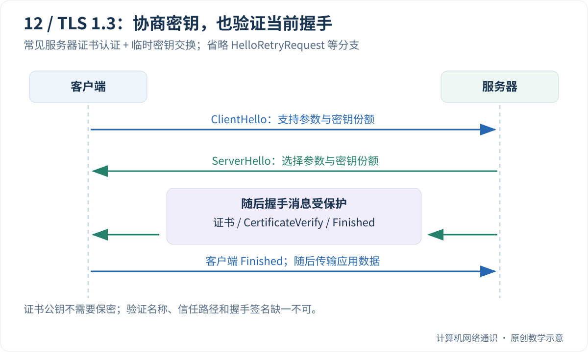

如果两个人事先没有共享秘密，怎样在可能被旁观的网络上协商密钥？即使协商成功，又怎么知道对面真的是要访问的网站，而不是中间人？

这两个问题不能只靠“把 HTTP 加密”一句话回答。HTTPS 需要把**传输保密、消息完整性与端点身份验证**组合起来。加密可以让旁观者难以读懂内容，但如果密钥恰好与冒充者协商出来，通信依然不可信。

[Cloudflare 对 TLS 1.3 的解析](https://blog.cloudflare.com/rfc-8446-aka-tls-1-3/)介绍了现代握手的设计变化。本文聚焦常见的服务器证书认证、临时密钥交换的 TLS 1.3 完整握手，不把旧版 RSA 密钥交换流程混进这条主线。

## Table of contents

## HTTPS 在保护哪一段？

对于直接连接，TLS 建立在客户端与服务器之间，HTTP 内容在这段连接中受到保护。若网站前面有终止 TLS 的反向代理，浏览器实际与代理握手，代理再通过另一段连接访问源站。

因此，“浏览器地址栏是 HTTPS”不自动证明代理到源站也加密。要画清每一段连接由谁终止、谁持有密钥、谁能读取明文，再讨论保护范围。

| 目标           | TLS 提供的机制方向         | 不代表什么                    |
| :------------- | :------------------------- | :---------------------------- |
| 保密           | 用协商出的流量密钥加密记录 | 隐藏所有网络元数据            |
| 完整性         | 检测受保护内容被篡改       | 保证应用逻辑正确              |
| 服务器身份     | 证书验证与握手认证         | 网站内容值得信任、没有诈骗    |
| 可选客户端身份 | 客户端证书等机制           | 普通 HTTPS 默认就完成用户登录 |

终端中毒、服务器被入侵或应用主动泄露内容，都不在“网络传输加密”能够独自解决的范围内。

## 证书里有什么，又没有什么？

证书把公钥与名称等信息绑定，由签发者签名。客户端会根据本地信任配置，尝试构建并验证到受信任根的路径，同时检查目标名称、有效期、用途及其他适用约束。

服务器通常发送叶子证书和必要的中间证书；受信任根一般来自客户端的信任库，不需要因为服务器把某张根证书附上，就接受它为可信。

**证书包含公钥，不包含服务器的私钥。** 任何人可以复制公开证书，但没有对应私钥，不能正常完成需要该私钥的握手签名。证书不是一段需要保密的“网站密码”。

名称也必须匹配。浏览器访问 `www.example.com`，不能因为某个服务器有一张受信任 CA 签发给 `other.example` 的证书，就认定它是目标。证书路径可信与名称正确是两项不同检查。

主机时钟明显错误时，有效期判断也会出问题。排查证书失败，应核对具体错误、目标名称、证书链和系统时间，而不是一律关闭验证。

## 不提前共享秘密，怎样得到共享密钥？

常见 TLS 1.3 完整握手使用临时 Diffie-Hellman 类密钥交换，例如椭圆曲线变体。双方交换公开参数，各自保留私密部分，随后推导出共享秘密，再结合握手上下文派生不同用途的密钥。

这个描述中的“公开参数”可以在网络上发送。安全性依赖于：仅凭公开信息，攻击者难以计算相应共享秘密。它不是“客户端生成会话密钥，再永远用证书公钥加密发给服务器”的通用流程。

临时密钥交换还支持前向保密目标：在相应秘密妥善销毁、算法和实现满足要求的前提下，未来长期认证私钥泄露，不应直接解密过去捕获的会话。这并不保护已经被记录下来的端点明文。

[密钥交换与认证的具体组合由 TLS 1.3 规范定义](https://www.rfc-editor.org/rfc/rfc8446.html)。PSK、恢复会话和不同模式存在差异，本文图示只取一种常见情况。

## TLS 1.3 的一次常见完整握手



1. 客户端发送 ClientHello，表达支持的版本、算法、密钥份额和其他扩展。
2. 服务器选择参数并返回 ServerHello，双方据此建立握手阶段的密钥。
3. 服务器发送受保护的扩展、证书、CertificateVerify 和 Finished 等消息。
4. 客户端验证证书及握手认证，发送自己的 Finished，随后使用应用流量密钥通信。

这里的 CertificateVerify 用于把认证私钥与当前握手上下文关联起来；Finished 用于验证握手记录及密钥推导的一致性。不能把它们都简称为“证书校验”，否则容易忽略握手本身也需要防篡改。

TLS 1.3 在 ServerHello 之后保护大部分握手消息，因此被动抓包通常不能像旧式未加密示意图那样直接读到服务器证书。浏览器的证书查看器与抓包文件展示的是不同观察渠道。

## SNI、ALPN 与证书各管一件事

同一个入口可能承载多个域名。SNI 帮助服务器在握手时选择相应站点配置；ALPN 用于协商应用协议，例如 HTTP/2 或 HTTP/1.1；证书验证则确认对端是否被授权代表目标名称。

发送了 SNI，不等于已经验证证书。协商到 `h2`，也不表示网站业务正常。

在没有适用加密 ClientHello 机制的情况下，握手中的一些信息仍可能对路径观察者可见；即使隐藏了部分名称，目的 IP、时序与流量大小也仍会暴露信息。HTTPS 不能简单等同于“别人完全不知道我在连谁”。

## 恢复与 0-RTT 为什么需要额外小心？

后续连接可以利用先前建立的状态减少握手开销。某些 TLS 1.3 恢复场景还允许客户端更早发送 0-RTT 数据。

更早发送不意味着比完整握手拥有更多安全保证。早期数据存在重放风险，服务端必须结合应用语义与防重放策略决定是否接受；不能把扣款之类不可随意重复的操作当作普通静态资源处理。

也不要把“使用 TLS 1.3”说成“每一次都是 0-RTT”。完整握手、恢复、是否允许早期数据，以及底层传输本身，都影响真实时延。

## 动手：先检查本地 TLS 客户端的验证默认值

下面代码不联网，只检查 Python 创建的客户端默认上下文：

```python
import ssl

context = ssl.create_default_context()
print("certificate required:", context.verify_mode == ssl.CERT_REQUIRED)
print("hostname checking:", context.check_hostname)
```

正常应输出两个 `True`。这说明默认上下文要求验证证书并检查主机名，**不证明任何具体站点的证书已经验证通过**。真正握手还需要加载可用信任库、连接目标，并提供正确的服务器名称。

如果本机装有 OpenSSL，可以由你在自己的网络环境中执行：

```bash
openssl s_client -connect example.com:443 -servername example.com -verify_hostname example.com -verify_return_error
```

这里显式指定 SNI、验证名称和遇到验证错误就返回失败。观察协商版本、证书链与验证结果；示例没有预设具体证书颁发机构或到期日，因为这些会变化。命令在握手后可能继续等待输入，可用 Ctrl+C 结束。

[OpenSSL s_client 文档](https://docs.openssl.org/3.5/man1/openssl-s_client/)解释了这些选项。它使用的信任配置可能与浏览器不同，因此命令成功或失败都应结合具体环境解释。不要只从“工具打印了证书”推出验证已成功。

## 把浏览器报错翻译成下一步行动

- 名称不匹配：核对访问的域名、SNI、证书覆盖范围和代理配置。
- 证书过期或尚未生效：核对证书时间以及本机时钟。
- 找不到可信签发链：检查中间证书是否齐全、客户端信任库是否适用。
- 握手成功但请求失败：继续进入 HTTP 状态、权限和应用日志。

关闭证书验证只会移除一项关键检查，不会把错误名称或不可信链变成正确配置。开发环境确有自签名需求时，也应明确配置自己的信任根与名称，而不是把忽略错误带入生产客户端。

上一篇：[HTTP 请求、响应与缓存](/blog/posts/understanding-http-requests-responses-and-caching/)

下一篇：[从 HTTP/1.1 到 HTTP/3](/blog/posts/from-http1-to-http3/)

## 参考与延伸阅读

- [Cloudflare：A Detailed Look at RFC 8446](https://blog.cloudflare.com/rfc-8446-aka-tls-1-3/)——TLS 1.3 的设计与握手变化。
- [RFC 8446](https://www.rfc-editor.org/rfc/rfc8446.html)——TLS 1.3 规范。
- [Python ssl](https://docs.python.org/3/library/ssl.html)——验证上下文与客户端接口。
- [OpenSSL s_client](https://docs.openssl.org/3.5/man1/openssl-s_client/)——握手观测命令的选项。
