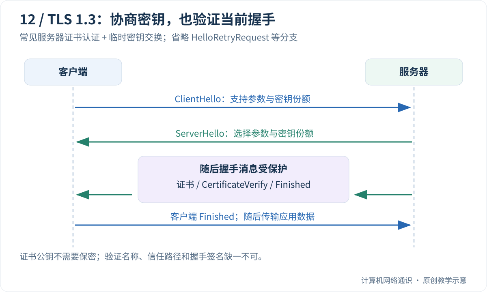

如果两个素未谋面的间谍，要在一条完全被敌方窃听、甚至随时可能被敌方篡改替换报文的公开无线电信道上，商量出一套绝密的作战计划。

他们既不能事先共享密码（因为任何密码在发送的瞬间就会被敌方截获），也不能随便相信对方发来的任何字纸（因为敌方可能在中间伪装成你的联络人）。

**在数学和逻辑上，这看起来是一个根本无法破解的“死局”！**

然而，我们今天在咖啡厅连接着毫无防备的公共开放 Wi-Fi，在浏览器中输入银行密码完成转账时，这套不可能的数学奇迹却每分每秒都在安静地发生着。

这就是 **HTTPS（HTTP over TLS）** 的伟大之处：

- 为什么单纯依靠“对称加密”或者“非对称加密”都无法独立支撑起现代互联网的安全大厦？
- 所谓的**“中间人攻击（MITM）”**是如何在黑客手里把公钥偷梁换柱、神不知鬼不觉骗过通信双方的？
- 国际权威的 **CA（证书认证机构）** 是如何用一套层层背书的**数字证书链（Certificate Chain）**，为全世界数以亿计的网站打上不可伪造的“数字钢印”的？
- **TLS 1.3** 是如何将繁琐的安全握手耗时从上一代的 2-RTT 彻底斩半、压缩为惊艳的 **1-RTT 极速握手**的？

本文将全面拆解现代密码学在传输层安全（TLS）中的工业级落地，推导混合加密、数字签名与 CA 信任链的底层逻辑。

## Table of contents

## 第一章：明文之痛与安全的三大基石

在明文 HTTP 时代，传输的数据在经过公共路由器时，面临着三大致命安全威胁：

1. **窃听（Eavesdropping）**：通信内容毫无机密性，任何路由器抓包都能看到密码明文；
2. **篡改（Tampering）**：通信报文没有完整性校验，运营商可以在网页中强行插入弹窗广告；
3. **冒充（Spoofing）**：你以为你在和工商银行通信，对方可能只是一台高仿的钓鱼欺诈服务器。

> **现代信息安全的三大基石（CIA 三要素）**：
>
> 一套受信任的通信协议，必须同时捍卫三大命题：
>
> - **机密性（Confidentiality）**：只有收发双方能看懂内容，旁观者看到的只能是一串无序杂乱的乱码；
> - **完整性（Integrity）**：数据在途经网络时，哪怕有 1 个比特被篡改，接收方能立刻察觉并当场拒收；
> - **真实性 / 身份认证（Authenticity）**：证明“你真的是你，而不是假冒的骗子”。

---

## 第二章：密码学双雄与混合加密体系（Hybrid Encryption）

为了达成机密性，密码学家创造了两大截然不同的加密工具：

### 1. 对称加密（Symmetric Encryption）——极速的纯粹力量

- **代表算法**：AES-GCM、ChaCha20；
- **机制**：加密和解密使用**同一把密钥（Key）**；
- **优势**：计算速度极其惊人，现代 Intel/AMD CPU 普遍内置了 AES-NI 硬件指令集，每秒能加解密数 GB 的海量数据流；
- **死穴**：**密钥分发的悖论！** 双方初次通信，我如何把这把钥匙安全送给你？如果在网络上明文传输钥匙，钥匙被黑客截获，后续的所有加密形同虚设！

### 2. 非对称加密（Asymmetric Encryption）——数学奇迹的单向门

- **代表算法**：RSA、ECC（椭圆曲线）；
- **机制**：由一对密钥构成——**公钥（Public Key）** 与 **私钥（Private Key）**。
  - 公钥全天下公开，任何人都能拿它来加密；
  - **但只有手握私钥的法定主人，才能解密！**
- **死穴**：计算极其繁琐沉重！非对称加密的数学复杂度建立在超大质数分解或离散对数上，计算速度比对称加密慢了整整**数百倍到上千倍**，根本无法支撑海量高清视频与网页的实时全量加密。

### 3. 混合加密架构的完美结合

聪明的架构师将两者融为一体，创造了 **混合加密体系（Hybrid Encryption）**：



> **混合加密的操作流**：
>
> 1. 在通信刚建立的握手阶段，通信双方利用**非对称加密算法（或 ECDHE 密钥协商）**，在公开信道上安全协商出一把临时的 **“对称会话密钥（Session Key）”**；
> 2. 一旦对称密钥协商完毕，非对称加密立刻功成身退！
> 3. 后续海量的 HTTP 请求与响应正文，**100% 切换为高性能的对称加密（AES）进行全速传输！**
>
> 既彻底解决了对称加密的“密钥分发死锁”，又完美避开了非对称加密的“性能灾难”！

---

## 第三章：公钥的致命陷阱与 CA 数字证书链

然而，即便有了非对称加密，危机依然没有解除。一个极其恶毒的攻击模型摆在面前——**中间人攻击（Man-in-the-Middle，MITM）**！

### 1. 偷梁换柱：中间人是如何得逞的？

```text
[浏览器]                                [黑客路由器 (中间人)]                          [真实服务器]
   │                                              │                                       │
   │ ──── "我要服务器公钥!" ──────────────────────>│ ──── "我要服务器公钥!" ───────────────>│
   │                                              │                                       │
   │                                              │ <─── 返回 [真实服务器公钥 Pub_S] ───────│
   │                                              │ ⭐️ 黑客截留真实公钥！
   │                                              │    生成一套黑客自己的公私钥对！
   │ <─── 恶意掉包: 返回 [黑客公钥 Pub_H] ──────────│
   │                                              │
   ▼ 浏览器毫无察觉:
   用【黑客公钥】加密临时密钥 ──────────────────────>│ ⭐️ 黑客用自己的私钥解密，轻而易举偷窥密钥！
                                                  │    再用真实公钥加密发给服务器...
```

**终极命题诞生**：
浏览器收到了一个公钥，**浏览器凭什么能断定这个公钥真的属于 `bilibili.com`，而不是某个黑客掉包伪造的？**

公钥自身没有任何防伪标识。必须有一个全人类共同信赖的**“权威公证处”**出来背书！

---

### 2. 破局之道：数字证书与 CA 信任链

这个全球公认的公证处，被称为 **CA（Certificate Authority，证书认证机构）**。

#### 数字证书的物理结构

网站在上线前，必须向合法的 CA 机构申请一张 **X.509 数字证书**。证书内部白纸黑字盖章记录了：

- 证书所有者信息（如 `bilibili.com`）；
- 该网站的真实公钥内容；
- 证书有效期限；
- 颁发者 CA 机构的名称；
- **最核心的灵魂：CA 机构亲笔画押的“数字签名（Digital Signature）”！**

#### CA 是如何给证书盖上“不可伪造的数字签名”的？

```text
[CA 颁发证书的签署阶段 (生产线)]:
1. CA 将证书中的所有文字信息明文打包；
2. 使用单向密码学哈希函数 (如 SHA-256) 计算出一个极短的唯一特征指纹: [摘要 Hash_A]；
3. ⭐️ 核心动作: CA 动用自己深藏在地宫离线 HSM 硬件中的顶级绝密私钥:
   私钥加密(Hash_A) = [数字签名 Signature]！
4. 将该数字签名缝合在证书最末尾，下发给网站。

[客户端浏览器的本地验证阶段 (法医验身)]:
1. 浏览器收到证书，将正文文字提取，用完全相同的 SHA-256 重新算一遍指纹: [自测摘要 Hash_B]；
2. 浏览器调出内置的该 CA 的公开公钥，执行解密:
   CA 公钥解密(数字签名) = [还原出的原始摘要 Hash_A]；
3. ⭐️ 最终比对: 只要 Hash_A === Hash_B！
   说明证书内容没有任何一个字符遭到中间人篡改！且必定是由该 CA 官方亲笔签名背书！
```

**为什么黑客无法伪造？**
黑客即便截获了证书，如果他敢篡改里面的公钥，导致计算出的 `Hash_B` 改变；而黑客没有 CA 的顶级私钥，他根本无法伪造出一个能被 CA 公钥解开的合法新数字签名！浏览器校验哈希不一致，会立刻当场弹出刺眼的红色大屏安全拦截警告！

#### 证书链（Certificate Chain）与操作系统信任基石

很多初学者问：那 CA 自己的公钥又由谁来证明是真实的呢？

- **多级委派证书链**：你的网站证书（叶子证书） $\to$ 由**中间 CA（Intermediate CA）**签名 $\to$ 中间 CA 证书由**根 CA（Root CA）**签名；
- **终极信任锚点（Trust Anchor）**：全世界最顶级的几十家权威根 CA 证书，**直接由微软、苹果、Google 和 Linux 官方维护团队，在操作系统出厂和浏览器发布时，以硬编码的方式直接物理安装死在了你的操作系统内核与浏览器可信证书库中！**
- 信任链层层递归，最终锚定在本地操作系统的出厂信任底座之上！

---

## 第四章：现代时序革命——TLS 1.3 的 1-RTT 极速握手

在老旧的 TLS 1.2 时代，建立安全连接极其繁琐，需要在 TCP 三次握手的基础上，再追加漫长的两次往返（2-RTT），导致打开网页的延迟极高。

2018 年，IETF 发布了颠覆性的 **TLS 1.3（RFC 8446）**，彻底重构了安全握手的时序：

```text
客户端 (Client)                                          服务端 (Server)
[TCP 三次握手成功，信道已通]
      │                                                        │
      │ ──── 1. ClientHello ─────────────────────────────────> │
      │      • 携带支持的 TLS 密码套件列表                        │
      │      • ⭐️ 抢先机密: 直接提前附带 ECDHE 的临时公钥参数!    │
      │        (Key Share: client_public_key)                  │
      │                                                        │ ⭐️ 服务端在这一瞬间，就能直接解算出
      │                                                        │    双方的对称会话密钥！并立刻开启加密！
      │                                                        │
      │ <─── 2. ServerHello + Encrypted Extensions ─────────── │
      │      • 服务端选定密码套件与附带自己的 Key Share         │
      │      • ⭐️ 从这里开始，后续所有的报文全盘进入对称加密!     │
      │      • Certificate (服务端加密发送数字证书链)           │
      │      • Finished (安全握手结束标记)                     │
      │                                                        │
      ▼ 客户端拿到服务端的 Key Share，在本地瞬间也计算出对称密钥!  ▼
[安全握手圆满达成! 仅耗费 1-RTT! 客户端立即向管道发射首批加密的 HTTP GET 请求数据!]
```

### TLS 1.3 的两大核心革命

1. **彻底废除不安全与无前向保密的旧算法**：
   彻底斩断了早已千疮百孔的静态 RSA 密钥交换，强制全面采用 **ECDHE（临时椭圆曲线迪菲-赫尔曼算法）**。每一次会话的公私钥对全部是内存临时的，**具备前向保密性（Forward Secrecy）**——即便未来服务器的私钥被盗，黑客也绝不可能逆向破解历史抓包截获的任何会话数据！
2. **握手延迟腰斩至 1-RTT**：
   客户端在发出第一个打招呼报文 `ClientHello` 时，就“大胆预判”并直接送出了自己的密钥协商参数。服务端仅需 1 个往返即可完成密钥闭环，比老旧的 TLS 1.2 快了整整一倍！

---

## 第五章：虚拟主机的分流航标——SNI 机制

在云计算普及的今天，一台拥有独立公网 IP 的服务器上，往往通过 Nginx 虚拟主机技术同时托管着上百个不同的域名（如 `site-a.com` 和 `site-b.com`）。

这在 HTTPS 早期曾引发了一个巨大的逻辑矛盾：

- 客户端在发起 TLS 握手时，连接的是服务器的 IP；
- 但此时 HTTP 请求还没有发出去（HTTP 报文还在加密信道外面排队），服务器根本不知道客户端到底想访问它托管的哪一个域名，**因此根本不知道该掏出哪一张对应的 SSL 证书给客户端出示！**

> **SNI（Server Name Indication，服务器名称指示，RFC 6066）**：
>
> 在 TLS 握手的第一个明文报文 `ClientHello` 中，客户端在扩展字段中显式标明：
> `Extension: server_name = "api.bilibili.com"`！
>
> 服务端的 Nginx 还没开始解密，看一眼 SNI 扩展，立刻心领神会，精准挑出该域名专属的 SSL 证书呈递过去，彻底解决了单 IP 多域名托管的多证书冲突难题！

---

## 总结与专栏全局视野

在本篇《计算机网络通识（十二）》中，我们解密了互联网安全信任大厦的全部基石：

1. **安全三大基石**：明晰了机密性（防窃听）、完整性（防篡改）与真实性（防冒充）的 CIA 铁三角；
2. **混合加密哲学**：推导了非对称加密安全协商临时密钥、对称加密承担海量数据高速传输的珠联璧合设计；
3. **数字签名与 CA 信任链**：彻底破除了公钥可能被中间人掉包替换的致命死穴，透视了从根 CA 到本地出厂根证书库的不可篡改背书网络；
4. **TLS 1.3 现代革命**：解构了强制 ECDHE 实现前向保密的深层机制，掌握了将连接建立压缩至 1-RTT 的现代极速时序；
5. **多证书导航**：掌握了 SNI 扩展在单 IP 托管多虚拟主机时的路由机制。

现在，我们的网络信道不仅绝对可靠，而且具备了坚不可摧的军事级安全防护。

然而，随着全球移动互联网、高清视频流与超大规模单页应用（SPA）的爆发式增长：

- 为什么早期的 **HTTP/1.1** 会因为单连接串行排队而遭遇惨烈的**“队头阻塞（Head-of-Line Blocking）”**？
- **HTTP/2** 是如何通过**二进制分帧与多路复用**，在同一个 TCP 连接上并发并发传输几百张图片的？
- 为什么即便到了 HTTP/2，底层 TCP 协议的丢包重传依然会把整个连接彻底卡死？
- 最新的 **HTTP/3** 为什么会做出一个震惊整个软件工业界的决定——**坚决抛弃统治互联网数十年的 TCP，全面倒戈拥抱基于 UDP 的 QUIC 协议？**

让我们正式迈向专栏的第十三篇架构演进力作：**[《从 HTTP/1.1 到 HTTP/3：协议在解决什么问题？》](/blog/posts/from-http1-to-http3/)**！
