> [!NOTE] 译者序
> 本文翻译自 Tailscale 官方技术博客的传世经典 [《How NAT traversal works》](https://tailscale.com/blog/how-nat-traversal-works)，原作者为 Tailscale 创始工程师 **David Anderson**。
>
> 在去中心化系统、P2P 传输（WebRTC、BitTorrent）以及新一代虚拟组网（Tailscale、WireGuard）中，“如何让两台深处不同路由器防火墙之后的设备直接建立通信”一直被视作黑魔法。这篇文章被全球网络工程师和系统架构师誉为 **“全网解释 NAT 穿透最透彻、工程细节最扎实的唯一神作”**。
>
> 译文在保证 100% 忠于原文技术细节与幽默风趣语调的同时，**完整收录了 Tailscale 官方原版的全部 21 张高清架构与数据流向图**，并对专有名词（EIM/EDM、Hairpinning、ICE 状态机）进行了系统梳理与中文注释。

---

## Table of contents

---

## 序言：点对点（P2P）直连的终极命题

在之前的文章中，我们详细介绍了 Tailscale 的整体架构。但在那篇文章中，我们刻意略过了一个非常关键的细节：**我们究竟是如何穿透各种 NAT（网络地址转换器），让你散落在各处的设备无论隔着多少层迷障，都能直接彼此相连的？**

今天，我们就来彻底把这个黑盒打开！

我们先从一个看似最简单的问题出发：**如何在两台机器之间建立点对点（Peer-to-Peer, P2P）的直接连接？**

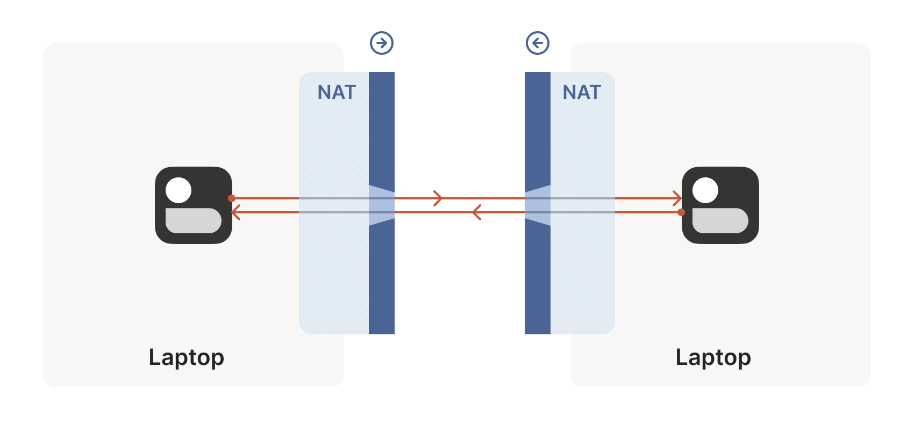

在 Tailscale 的场景中，我们希望建立的是一条加密的 WireGuard® 隧道，但具体是什么协议其实并不重要。我们接下来要探讨的技术具备极其广泛的通用性，它们凝结了全世界无数网络工程师数十年的智慧。例如，WebRTC 就是依靠这套百宝箱里的戏法，在浏览器之间飞速传输 P2P 音频、视频和任意数据的；网络电话（VoIP）和许多在线联机游戏也在使用类似的技术（尽管它们并不总能成功）。

本文将从最普适的角度来拆解这些技术，并在适当的地方以 Tailscale 和其他系统作为实例。

假设你现在正在设计属于你自己的网络协议，并且你希望它能够穿透 NAT。你首先需要满足两个绝对的前提条件：

1. **你的协议必须基于 UDP。** 理论上你确实可以对 TCP 进行 NAT 穿透，但这会给一个本就极其复杂的问题再套上一层极其厚重的复杂度枷锁，甚至根据你涉足的深度，还可能需要侵入内核定制驱动。因此，本文的其余部分将全神贯注于 UDP。如果你想要的是 TCP 那种面向流的可靠连接，建议直接使用 **QUIC**——它构建在 UDP 之上，既能享受 UDP 穿透 NAT 的全部红利，又能在应用层获得优雅的流传输抽象。
2. **你必须拥有对发送和接收数据包的网络套接字（Socket）的绝对控制权。** 作为一条铁律：你不可能直接拿一个现成的第三方网络库，就指望它能凭空穿透 NAT。因为在主协议正常传输之外，你必须能够从同一个 Socket 发送和接收用于辅助穿透的额外数据包。某些协议（如 WebRTC）将 NAT 穿透深度集成在自身之中；但如果你是在从零构建系统，最清晰的设计思路是将“NAT 穿透引擎”视为一个独立的实体，与你的“主业务协议”**共享同一个底层 Socket**。两者并行运转，前者为后者劈波斩浪。


> [!TIP] 无法直接控制底层 Socket 时的变通方案
> 在某些特殊场景下，你可能很难直接获得底层 Socket 的操作权限。此时一种实用的折中方案是**在本地运行一个轻量代理（Local Proxy）**。你的主协议直接连接该本地代理，再由代理负责全套 NAT 穿透逻辑并将流量中继给远端节点。这种间接层让你无需魔改既有程序，就能白嫖 NAT 穿透的能力。

搞定了前提条件，让我们回归第一性原理，一步步推导 NAT 穿透。

我们的终极目标：**让两台设备之间能够双向流动 UDP 数据包，从而让上层协议（WireGuard、QUIC、WebRTC……）一展身手。**

在现实世界中，阻碍这件事情“直接搞定”的恶龙有两个：**有状态防火墙（Stateful Firewalls）** 和 **NAT 设备**。

---

## 搞懂有状态防火墙（Figuring out firewalls）

在这两个拦路虎中，有状态防火墙反而是相对简单的那一个。事实上，绝大多数 NAT 设备内部都集成了一个有状态防火墙，因此在解决 NAT 之前，我们必须先彻底驯服它。

在现实中你可能见过防火墙的各种化身：Windows Defender 防火墙、Ubuntu 上的 `ufw`（底层基于 iptables 或 nftables）、BSD/macOS 上的 `pf`，以及 AWS 的安全组（Security Groups）。虽然它们的配置极其灵活，但最通用的默认策略几乎都是千篇一律：**放行所有“出站（Outbound）”连接，拦截所有“入站（Inbound）”连接**（除非有显式配置的白名单，比如放行 22 端口的 SSH）。

然而，所谓的“连接”与“方向”，纯粹是网络协议设计者为了方便人类思考而凭空捏造出来的概念。在网线和光纤的微观物理层面，根本不存在单向这回事——所有通信最终都演变成了两台机器之间往返飞行的独立数据包。

那么，防火墙究竟是如何分辨哪个包是“出站”，哪个包是“入站”的呢？

这就是 **“有状态（Stateful）”** 的核心奥秘：**防火墙会忠实记录它在过去见过哪些数据包，并根据这段历史记忆，来裁决眼前刚刚抵达的新数据包究竟该放行还是丢弃。**

对于 UDP 流量，防火墙的规则其实极其质朴：**只有当防火墙先前看到过一个与之匹配的出站 UDP 包时，它才会放行对应的入站 UDP 包。**

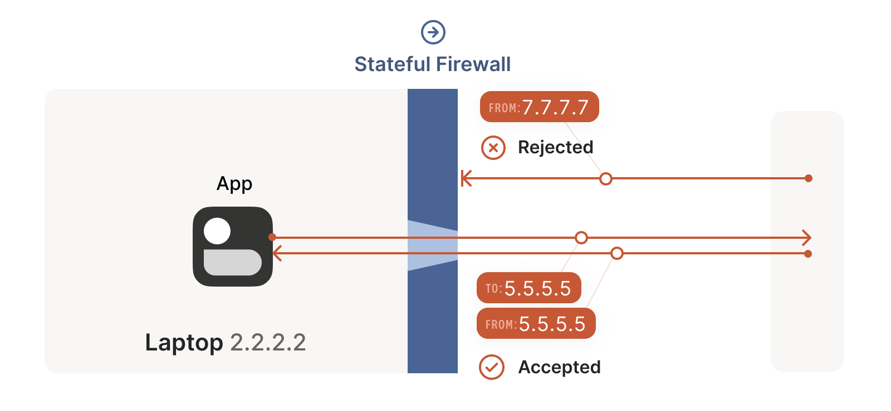

例如，如果我们的笔记本防火墙发现一个 UDP 包正从本地的 `2.2.2.2:1234` 飞往外部的 `5.5.5.5:5678`，它就会在内核状态表里记下一笔：“未来从 `5.5.5.5:5678` 发往 `2.2.2.2:1234` 的入站包也是合法的”。毕竟，既然我信任的内部机器主动想找 `5.5.5.5:5678` 聊天，那理所应当要允许对方把话回过来。

*(注：少数极其宽松的防火墙只要看到 `2.2.2.2:1234` 向外发过包，就会允许互联网上任意地址向该端口回包。这种防火墙固然让穿透变得异常简单，但在今天真实的网络世界中已经基本绝迹。)*

---

### 防火墙的死锁对峙（Firewall face-off）

只要网络路径上的所有防火墙都“面朝同一个方向”，上述 UDP 规则就不会造成什么大麻烦。这正是我们日常与互联网上的服务器通信时的典型场景：服务器暴露公网，客户端深居防火墙后。唯一的约束无非是：**身处防火墙之后的客户端必须充当所有连接的发起方（Initiator）。只要它不先开口，外界就休想碰它一下。**

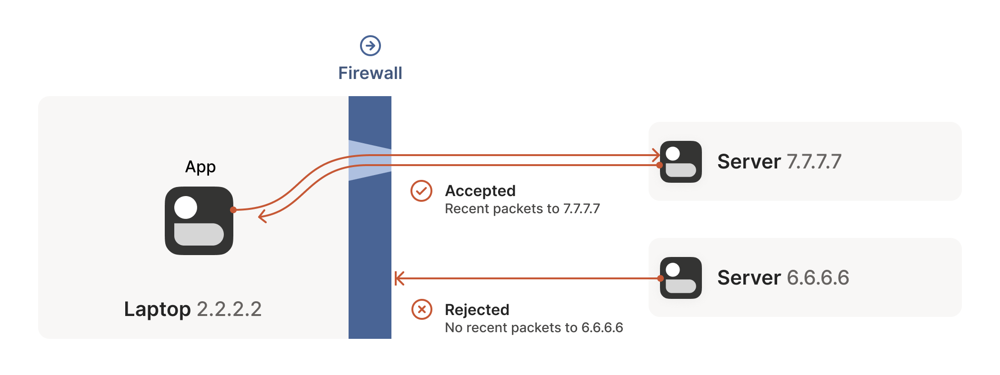

这种模式很有效，但也很无趣——这不过是重新发明了传统的客户端/服务器（Client/Server）架构。在传统 VPN 领域，这就导致了典型的中心辐射型（Hub-and-Spoke）拓扑：中心节点（Hub）没有任何防火墙阻拦，所有被防火墙笼罩的边缘分支（Spoke）都单向主动连接到这个中心。

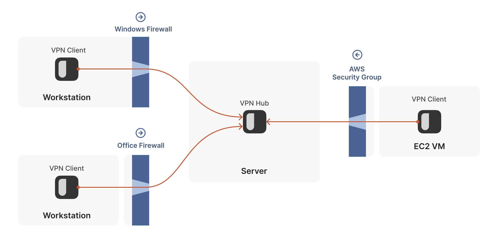

然而，一旦我们的两个“客户端”想要**抛弃中心、直接对话**时，灾难发生了。

此时，两端的防火墙在面朝对方“怒目而视”！

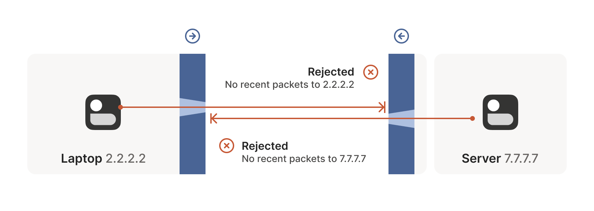

根据我们上面建立的规则：
* A 要收到 B 的包，A 必须先向 B 发送一个包；
* B 要收到 A 的包，B 必须先向 A 发送一个包；
* **结论：双方都必须先出手，但双方都无法先出手！**

我们该如何打破这个僵局？

最原始的办法是要求用户手动登录路由器或系统防火墙，“开一个端口映射（Port Forwarding）”，放行对端的流量。但这不仅对非技术用户极度不友好，在如今设备频繁漫游的 Mesh 网络（例如 Tailscale）中更是根本不可行——你总不能指望用户每次去星巴克喝咖啡、或者在机场连上 Wi-Fi 时，都先黑进咖啡馆的路由器把端口改一遍吧？

我们需要第三种方案，一种**完全不需要重新配置任何防火墙**的优雅方案。

---

### 巧妙破解挑剔的防火墙（Finessing finicky firewalls）

破解的诀窍，就隐藏在仔细研读有状态防火墙那条看似不可动摇的铁律之中：**数据包必须先流出，响应数据包才能流进。**

但是，请千万注意：**除了要求源 IP、目的 IP、源端口与目的端口精准吻合之外，没有任何一条规则要求“入站的包必须真正是对那个出站包的因果逻辑响应”！**

换言之：只要曾经有一个数据包带着正确的 IP 和端口流出了防火墙，后续任何看起来像是回包的数据，哪怕它的源头根本从未收到过你当初发出的那个包，防火墙也会毫不怀疑地直接放行！

因此，要穿透这两道彼此对峙的有状态防火墙，我们需要在正式通信前达成某种默契：**双方必须提前获知对方正在使用的 `IP:Port`。**

静态手工配置不仅痛苦而且无法扩展。为了解决这个问题，我们引入了一个轻量级的**协调服务器（Coordination Server）**，作为带外（Out-of-band）的信息同步桥梁。

一旦双方都知道了彼此的地址，奇迹即将发生——**双方几乎在同一时间向对方的地址喷射 UDP 数据包！**

在开始之前必须打个预防针：由于最初的几个包注定会撞墙，所以它们绝对不能承载不可丢失的重要业务数据（除非你有重传机制）。这本就是 UDP 的宿命，而在穿透过程中更是常态。

现在，笔记本（`2.2.2.2:1234`）与工作站（`7.7.7.7:5678`）同时在固定端口监听。让我们把时间放慢，观察数据包的微观世界：

#### 第一阶段：笔记本先发出一记“石沉大海”的刺探

笔记本的第一个数据包从 `2.2.2.2:1234` 飞向 `7.7.7.7:5678`。它穿过了 Windows Defender 防火墙来到公网。另一端的企业防火墙由于从未见过来自 `2.2.2.2:1234` 的记录，直接将数据包丢弃。然而，Windows Defender 防火墙已经忠实记下：“未来允许来自 `7.7.7.7:5678` 的回包发给 `2.2.2.2:1234`”。

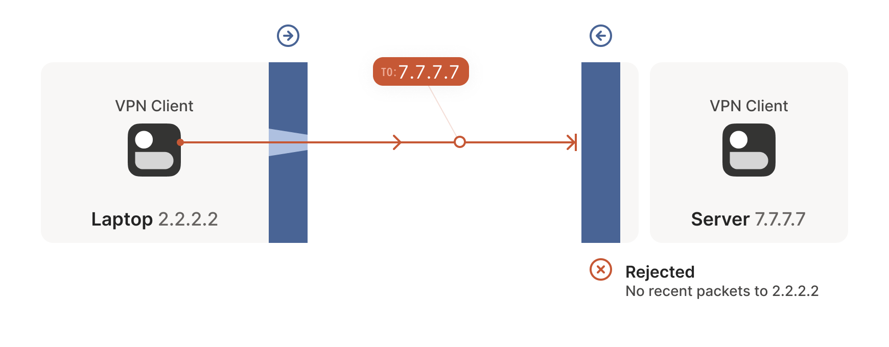

#### 第二阶段：工作站也向笔记本发出一记刺探

紧接着，工作站从 `7.7.7.7:5678` 发往 `2.2.2.2:1234` 的数据包穿过企业防火墙和互联网，抵达笔记本。此时，Windows Defender 认出：“这正是我刚才等的那位！放行！” 数据包成功破门！

与此同时，企业防火墙也记录下：“未来允许来自 `2.2.2.2:1234` 的回包进入 `7.7.7.7:5678`”。

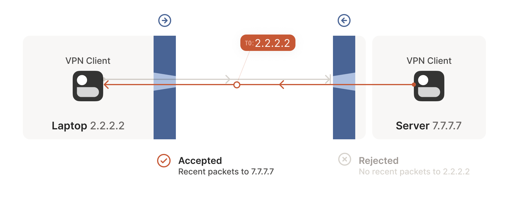

#### 第三阶段：笔记本欢欣鼓舞，送出真正的回包

受到工作站来包的鼓舞，笔记本立刻送出回包。它穿过 Windows Defender，来到企业防火墙前——因为第二阶段企业防火墙已经记录了出站状态，这个包被当作合法的响应予以放行，顺利抵达工作站！

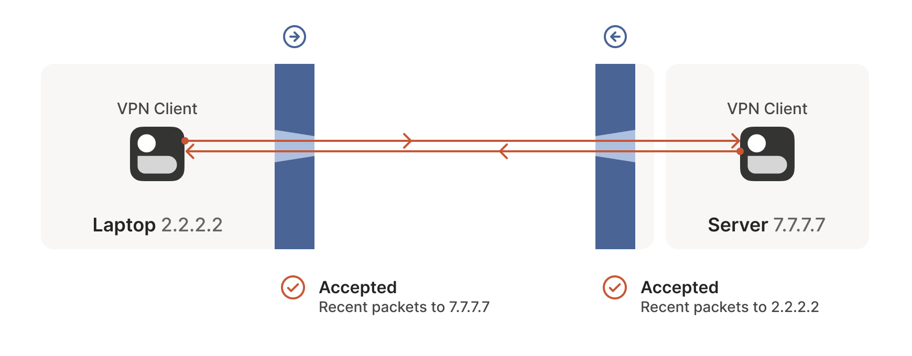

大功告成！通过**两端协同并发发包**的手段，我们在两道原本互相封锁的防火墙上，硬生生同时撕开了一道双向互通的裂缝。

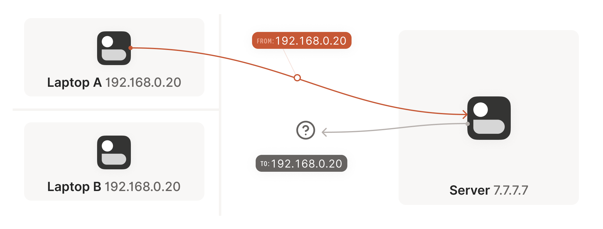

---

### 现实连接中的关键陷阱

在纸面上推演非常简单，但在工程落地时，我们是在利用第三方黑盒系统的隐式规则，必须极其严谨地处理以下边界情况：

1. **并发时序的艺术：** 双方必须在**大致相同的时间窗口内**发起穿透，以确保在双方会话未超时前，各自防火墙的单向通道都能被及时点亮。如果让双方无限循环重试会造成极大的网络和电量浪费。最好的方案是通过一个预先存在的**辅助信道（Side Channel）**发布统一的对表发包指令。
   * 这个辅助信道无需高性能：几秒的延迟完全可以容忍，传输的数据量不过几百字节。一台极其微型的云服务器就能轻松充当成千上万台机器的“红娘（Matchmaker）”。
   * 在古早时期，我曾用过 XMPP 聊天消息作为协调信道，效果拔群；WebRTC 则要求开发者自己实现“信令服务器（Signaling Channel）”；而在 Tailscale，我们的协调服务器以及全球分布的 **DERP** 节点阵列就是这根定海神针。
2. **防火墙会遗忘（保活心跳）：** 有状态防火墙的内存是昂贵且有限的。如果一段会话在一段时间内没有任何数据包（对于 UDP，业内最常见的淘汰时限通常是 **30 秒**），防火墙就会毫不留情地清空这条状态记录。一旦记录消失，大门将再次焊死。因此，我们必须维持一个定时器，在空闲时定期发送轻量的 **Keep-Alive 心跳包**，或者具备随时通过带外信道重置连接的能力。
3. **一个天大的好消息：** 这套“同时传输”的绝技**对路径上的防火墙层数完全免疫**！无论中间串联了 2 层、3 层还是 10 层有状态防火墙，只要它们遵循“允许出站、允许匹配的回包入站”这一基本原则，并发发包都能像多米诺骨牌一样，一枪把整条链路的所有防火墙全部穿透。

……听起来我们已经征服了世界，对吗？

很遗憾，并没有。因为上面所有推导都有一个致命的前提：**双方必须提前精准知晓对方的公网 `IP:Port`。**

现实中，**NAT 设备**的登场，将彻底击碎这个美好的假设。

---

## NAT 的本质（The nature of NATs）

我们可以把 NAT（网络地址转换器）想象成一个**带有更恶毒特性的有状态防火墙**：它不仅具备有状态防火墙的一切防御手段，而且还会在数据包途经它时，**横插一杠强行篡改数据包的内容**！

广义的 NAT 指代任何对源 IP/端口或目的 IP/端口进行重写的行为。但在网络穿透的语境下，我们遭遇的一切灾难几乎百分之百都源自 **源地址转换（Source NAT, 简称 SNAT）**。（目的地址转换 DNAT 固然有用，但在客户端穿透场景中通常不是主角）。

SNAT 最广泛的应用场景，就是让千家万户的海量设备共享极其稀缺的公网 IPv4 地址。以常见的家用路由器为例，局域网内的几十台手机、电脑、智能家居，全部被映射到一个唯一的公网 IP 上。没有 NAT，IPv4 早在二十年前就会因耗尽而彻底崩溃。

---

### 穿梭于 NAT 的迷宫

让我们看一下一台位于家庭 Wi-Fi 下的笔记本连接公网服务器时，究竟发生了什么：

笔记本从 `192.168.0.20:1234` 向服务器 `7.7.7.7:5678` 发送 UDP 包。路由器发现这是一个新的私网会话，于是从自己的公网 IP `2.2.2.2` 上挑选一个未使用的端口（如 `4242`），建立一条等价映射：`192.168.0.20:1234 <=> 2.2.2.2:4242`。

随后，路由器修改报文源地址为 `2.2.2.2:4242`，将其发送到互联网上。

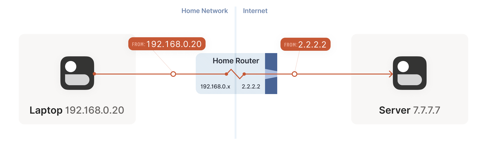

当服务器回包时，过程完全反转：服务器把包发往 `2.2.2.2:4242`，家用路由器根据映射表将目的地址还原为 `192.168.0.20:1234`，笔记本以为互联网本来就认得它的私有 IP。

在企业网络中，底层原理完全相同，唯一的区别在于企业级 NAT 往往由多台负载均衡网关构成集群，并且拥有一个包含数十个甚至数百个公网 IP 的地址池，以便承载成千上万名员工的高并发连接。

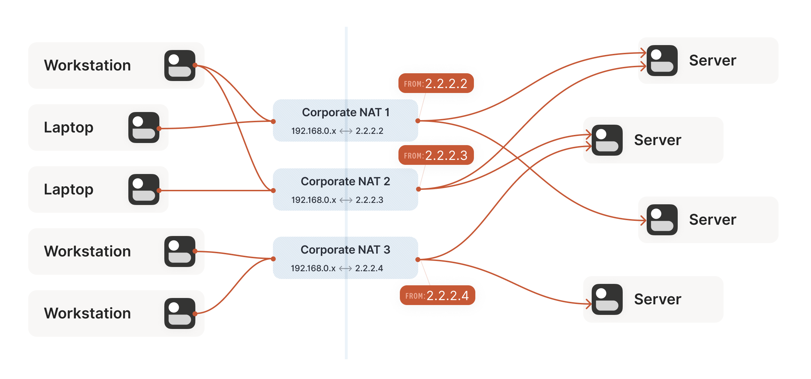

---

### 深入 STUN：打破死锁的魔镜

现在，让我们把两台同时藏在 NAT 后面的机器放在一起：

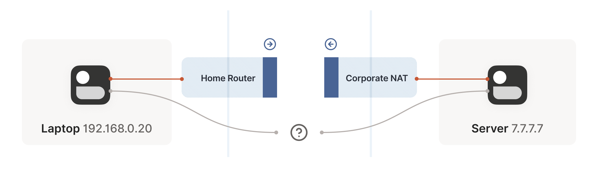

死锁再次降临，而且比纯防火墙时代严峻十倍：
* A 和 B 根本不知道对方向公网暴露的端口是什么；
* 更要命的是：**在 A 真正向公网发出第一个数据包之前，那个公网端口根本就不存在！** 因为 NAT 映射是按需动态分配的。
* 双方必须先说话才能创建映射，但双方不知道对方的映射就无法说话。

为了打破这个死锁，**STUN（Session Traversal Utilities for NAT，RFC 5389）** 应运而生。

STUN 既是一套关于 NAT 设备行为学的研究报告，也是一个极其简单优雅的网络协议。它的底层思想朴素到了极致：

**既然身处 NAT 后面的我不知道自己长什么样，那我就主动向公网上的一个明眼人（STUN 服务器）发个包，让它照照镜子告诉我，在公网看来我究竟是哪个 `IP:Port`！**

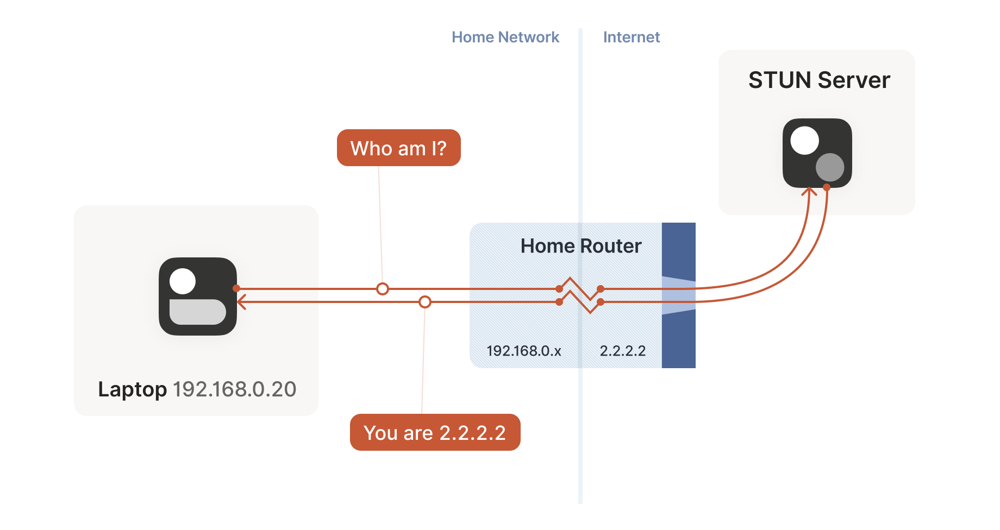

STUN 协议的本质就是这么简单（虽然为了防止极度残缺的路由器篡改报文内容，协议在载荷里对 IP/Port 做了轻微的 XOR 混淆，还加了一套主要供 TURN/ICE 使用的鉴权框架，但就发现映射而言，它就是一面镜子）。

> [!WARNING] 绝对不能犯的编程错误
> 这正是为什么我们在前文强调：**业务协议必须与 NAT 穿透引擎共用同一个 Socket！**
> NAT 设备是严格按 `{源 IP, 源端口, 协议}` 来分配公网映射的。如果你开了一个临时 Socket 去问 STUN，拿到了 `2.2.2.2:4242`，然后转头新建了另一个 Socket 去跑业务，NAT 会毫不犹豫地为新 Socket 分配一个完全不同的端口（比如 `2.2.2.2:4243`）！你拿到的 STUN 结果将瞬间沦为废纸。

---

### STUN 的美好与幻灭：“好” NAT 与“坏” NAT

有了 STUN，我们似乎已经摸到了胜利的曙光：
1. 机器 A 和 B 分别通过 STUN 拿到各自的公网端点；
2. 双方通过协调信道交换这两个端点；
3. 双方按照前文讲解的“同时发包法”射穿彼此的防火墙；
4. 握手成功，开始通信！

这真的可行吗？

现实会给乐观的人狠狠泼上一盆冷水。这套流程在大多数家用路由器上运转良好，但在大量企业级防火墙面前会摔得粉身碎骨。**设备厂商在宣传册上把自己吹嘘得越“安全”，这套方案失效的概率就越高。** *(虽然 NAT 本质上跟真正的安全半毛钱关系都没有，但这又是另一个槽点了。)*

为什么会失效？因为我们在推演时偷偷塞进了一个致命的前提假设：

> **“既然 STUN 服务器看到我是 `2.2.2.2:4242`，那么全世界的所有机器看到我，都应该是 `2.2.2.2:4242`。”**

现实中的 NAT 设备在这一点上分裂成了两个派系：

* **乖巧温和的“好” NAT：** 它的行为完全符合上述假设。只要本地 Socket 不变，无论你向外面的哪台机器发包，它都为你复用同一个公网端口 `2.2.2.2:4242`。结合 STUN 与并发发包，穿透畅通无阻！
* **疑神疑鬼的“坏” NAT：** 它极其偏执。**你每尝试连接一个不同的外部目标，它就会在公网 IP 上随机挑一个崭新的端口为你创建映射！**
  * 你连 STUN 服务器（`5.5.5.5:1234`），它分配了 `2.2.2.2:4242`；
  * 你转头去连对端机器（`7.7.7.7:2345`），NAT 却为你偷偷开辟了另一个端口！
  * 对端完全不知道新端口的存在，傻傻地按照 STUN 的通知向老端口发包，结果全被 NAT 无情阻击！

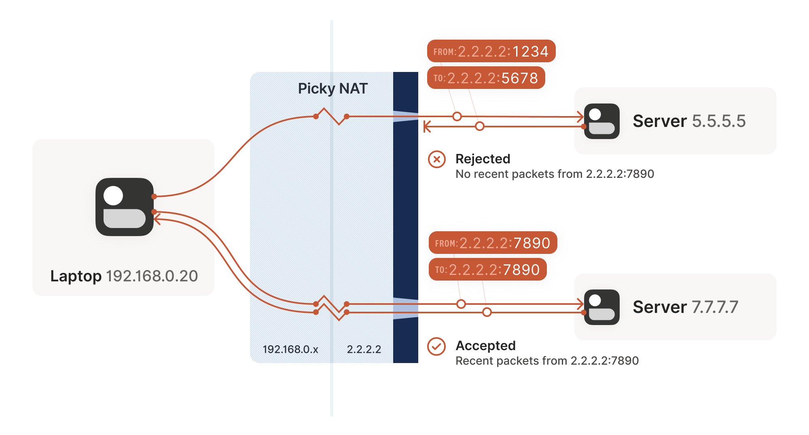

---

### 重新定义 NAT：抛弃混乱的“锥形（Cone）”旧概念

如果你以前接触过 NAT 穿透，你一定被这组词折磨得痛不欲生：**完全锥型（Full Cone）**、**受限锥型（Restricted Cone）**、**端口受限锥型（Port-Restricted Cone）** 以及 **对称型（Symmetric）**。

实话实说，**这套早期的“锥形”分类法极其混乱且反直觉**。在工程实践中，连老牌网络工程师都经常搞混什么叫受限锥型；许多人随口把所有的“容易穿透的 NAT”统称为 Full Cone，但实际上在今天，大部分家用路由器分明是 Port-Restricted Cone。

现代 IETF RFC（特别是 **RFC 4787 / 5382 / 5508**）彻底推翻了这一套老旧的模糊定义，提出了更为精准的**二维正交分类法**。

RFC 明确指出：决定一个 NAT 行为的，不是什么虚无缥缈的“圆锥”，而是两个独立的维度：

1. **NAT 映射生成行为（Mapping Behavior）：** 分配公网映射时，是否取决于外部目标？
   * **目标端点无关映射（Endpoint-Independent Mapping, EIM）：** 只要内部源 `{IP, Port}` 相同，映射出的外部 `{IP, Port}` 永远相同。这就是我们俗称的 **“好/容易搞定的 NAT（Easy NAT）”**。
   * **目标端点相关映射（Endpoint-Dependent Mapping, EDM）：** 只要外部目标发生改变，分配的外部端口就跟着改变。这就是让人闻风丧胆的 **“坏/硬骨头 NAT（Hard NAT / 对称型 NAT）”**。
2. **防火墙过滤行为（Filtering Behavior）：** 外部回包放行时，对历史包的校验严苛程度。
   * **端点无关过滤（Endpoint-Independent Filtering）：** 只要端口有映射，天王老子发来的包都放行（完全锥型）。
   * **仅目标 IP 过滤（Address-Dependent Filtering）：** 必须向该目标 IP 发过包才放行（受限锥型）。
   * **目标 IP+端口双重过滤（Address and Port-Dependent Filtering）：** 必须向该目标的特定 IP+端口发过包才放行（端口受限锥型）。

把这两个正交维度交叉组合，我们就得到了现代工程与古典术语的完整对照图谱：

| 防火墙过滤规则 \ NAT 映射规则 | 目标端点无关映射（EIM / Easy NAT） | 目标端点相关映射（EDM / Hard NAT） |
| :--- | :--- | :--- |
| **端点无关过滤** | 完全锥型（Full Cone NAT） | *(现实中不存在此类畸形配置)* |
| **受限 IP 过滤** | 受限锥型（Restricted Cone NAT） | *(现实中不存在此类畸形配置)* |
| **受限 IP+端口过滤** | 端口受限锥型（Port-Restricted Cone） | **对称型 NAT（Symmetric NAT）** |

#### 为什么写代码的人完全不需要在乎“锥形”？

看懂这张表格后，你会发现一个让人如释重负的事实：

对于编写 NAT 穿透程序的工程师来说，**防火墙过滤到底是哪种，根本无关紧要！**

为什么？因为我们在前一章发明的**双向并发发包技巧**，其威力足以在瞬间粉碎所有三种级别的防火墙过滤！在当今的真实网络世界中，绝大部分防火墙本来就是最严厉的“IP+端口双重过滤”。

因此，在编写穿透代码时，你的心智模型只需要简化为二元对立：

```
+------------------------------------+------------------------------------+
| 目标端点无关映射 (EIM / Easy NAT)   | 目标端点相关映射 (EDM / Hard NAT)  |
+------------------------------------+------------------------------------+
|   防火墙就算再严，并发发包即可穿透    |     目标变了端口就变，常规打洞失效    |
|            [好对付]                |               [硬骨头]             |
+------------------------------------+------------------------------------+
```

只要通信链路上哪怕存在**一台** EDM（Hard NAT），我们目前的 STUN + 并发发包大招就会当场瘫痪。

那么，面对这块硬骨头，我们还有招吗？

---

### 你考虑过放弃吗？保底中继（Relay）的救赎

在这个时刻，我们需要进行一次诚实的技术内心独白：**当百宝箱里的所有技巧全部耗尽，我们真的能 100% 打通两台机器吗？**

市面上很多简陋的 NAT 穿透库，在此时会两手一摊，直接抛出“连接失败”。

但在 Tailscale 看来，这是绝对不可接受的——**没有连通性，Tailscale 就失去了存在的意义。**

解决这个长尾死局的终极底牌是：**中继（Relay）**。找一台位于公网、双方都能畅通访问的中继服务器，替双方搬运加密数据包。

你可能会皱眉：“用中继转发流量，难道不是很挫吗？”

坦白说，确实不如 P2P 直连完美。但请换个角度思考：
* 如果中继服务器部署得足够靠近两端的网络骨干，且拥有充足的带宽，连接质量的劣化实际上并没有想象中那么夸张（仅仅增加了一点轻微的时延）；
* 最重要的是：**哪怕时延稍微高一点，也比直接“无法连接”强上一万倍！**
* 中继只是兜底保障（Fallback of last resort），它只处理那些极度刁钻的长尾复杂拓扑，高达 90% 以上的日常连接依然能够顺利走通 P2P 直连。

更何况，现实中有些网络会用比复杂 NAT 更残暴的手段绞杀直连——例如，加州大学伯克利分校（UC Berkeley）的访客 Wi-Fi **封锁了一切非 DNS 端口的出站 UDP 流量**！无论你的 NAT 技巧多么出神入化，面对直接吞噬 UDP 包的物理防火墙也是巧妇难为无米之炊。无论如何，你都必须有一套坚不可摧的中继保底系统。

在传统标准中，负责中继的协议叫做 **TURN（Traversal Using Relays around NAT，RFC 5766）**。客户端向公网 TURN 服务器申请一个中继端口，双方把流量倒给 TURN 转发。

但 Tailscale 并没有采用 TURN：
1. TURN 协议设计得相当臃肿繁琐；
2. 公网上没有开放的免费公共 TURN 服务器，享受不到像公共 STUN 那样的生态红利；
3. **TURN 走的是 UDP/TCP 专属协议，极易在严苛网络环境下被深层包检测（DPI）封杀。**

因此，Tailscale 自己发明了 **DERP（Detoured Encrypted Routing Protocol，绕行加密路由协议）**。

DERP 拥有极其优雅的设计：
* **它完全跑在标准的 HTTP/HTTPS（TLS 443）之上**：即便在只允许 80/443 网页浏览的严苛企业内网，也能畅行无阻；
* **基于公钥寻址**：DERP 节点只负责根据目标公钥盲转发加密载荷，它无法偷窥你的任何数据内容；
* **身兼双职**：DERP 既是穿透彻底失败时的**保底数据中继通道**，同时又是前文提到的节点间交换握手元数据的**带外协调信道（Side Channel）**！

---

## 极客的进阶锦囊（NAT notes for nerds）

如果你对“90% 的直连率 + 10% 的中继兜底”感到满意，看到这里其实已经可以关掉文章去写代码了。

但是……如果你是一名追求极致的工程师，绝不满足于“差不多得了”，那么接下来这组进阶技巧，将带你在逼近 100% P2P 直连率的极限赛道上狂飙。

---

### 生日悖论的妙用（The benefits of birthdays）

让我们重新审视那个让人束手无策的死局：**通信路径的一端是 Easy NAT（EIM），另一端是恶魔般的 Hard NAT（EDM）。**

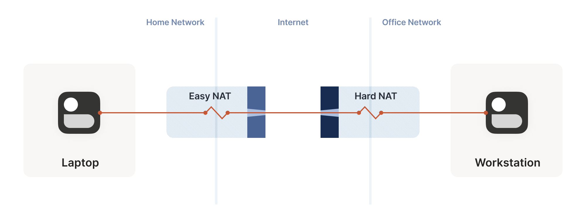

现在的核心矛盾是：A 知道 B 的公网 IP 必定是 `7.7.7.7`（根据 RFC 4787 REQ-2 规范，NAT 设备在为同一内网客户端分配不同端口映射时，极大概率会稳定保持使用同一个公网外网 IP）。

**唯一的未知数，是 B 在连接 A 时，究竟会被分配到 1 ~ 65535 中的哪个端口？**

如果让 A 去盲猜 B 的端口，挨个遍历 65535 个可能，在每秒 100 个包的温和速率下，最坏情况需要整整 10 分钟！这不仅慢得令人发指，而且动静极大，极易触发对端机房的入侵检测系统（IDS）报警。

但是，借助概率论中著名的 **“生日悖论（Birthday Paradox）”**，我们可以打出一记漂亮的数学暴击！

与其让 Hard 端孤零零地开一个端口让 Easy 端去猜，**不如让 Hard 端一口气向 Easy 端并发开启 256 个 Socket 发包！**

这意味着 Hard 端的 NAT 网关瞬间在 `7.7.7.7` 上对外激活了 256 个能够直达内部的有效映射端口。此时，Easy 端只需以随机抽样的方式，快速向 `7.7.7.7` 上的随机端口发射探测包。

这不再是从 65535 里面捞 1 个固定针，而是求**两个大小分别为 256 与 $N$ 的随机子集发生碰撞的概率**！

计算公式略微偏离经典生日悖论（因为是两组独立集合的交集探测），但结果对我们更加有利。假设 Hard 端开启了 256 个端口，随着 Easy 端随机探测包数量的增加，成功打通的概率呈现出极其陡峭的爆炸式增长：

| Easy 端发送的随机探测包数量 | 成功碰撞打通的概率 | 在 100 包/秒速率下的耗时 |
| :---: | :---: | :---: |
| **174** | **50%** | **~ 1.7 秒** |
| **256** | **64%** | **~ 2.5 秒** |
| **1024** | **98%** | **~ 10 秒** |
| **2048** | **99.9%** | **~ 20 秒** |

看！在短短 20 秒、仅探测了全部搜索空间不到 4% 的情况下，**我们有高达 99.9% 的把握，硬生生砸穿这堵看似坚不可摧的 Hard NAT 之墙！**

这绝对是工程与数学结合的至高美学。

---

#### 那么……如果两端全都是 Hard NAT 呢？

贪心的人可能会问：如果通信两端都是 EDM，这个生日攻击还能用吗？

很不幸，数学规律是残酷的。

当两端都是 Hard NAT 时，每次探测不仅目的端口是随机的，源端口也会发生跳变。**搜索空间从一维的 65,535 暴增到了二维的 $65535 \times 65535 \approx 43\text{ 亿}$！**

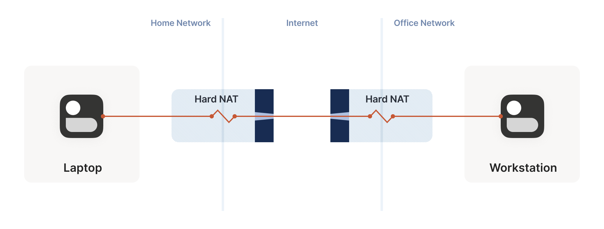

在同样的探测预算下（一方发 256 包，另一方发 2048 包），两端均为 Hard NAT 时的成功率是——**0.01%**。

要在这片浩瀚的四维海洋里达成 99.9% 的碰撞率，双方各自需要轰击 **170,000 个数据包**。在每秒 100 包的安全速率下，需要苦等 **28 分钟**。

更致命的是硬件极限：绝大多数企业级路由器（例如常见的 Juniper SRX 300）的内核连接跟踪表（NAT Session Table）上限只有 **64,000 条**。为了打通这一根网线，你不仅需要等半个小时，还会当场把公司整台路由器的会话表撑爆，导致整栋大楼所有员工瞬间断网！

因此：**当且仅当拓扑为“一端 Easy、一端 Hard”时，生日悖论才是一把杀敌制胜的绝世好剑。** 庆幸的是，绝大多数家庭宽带路由器都是 Easy NAT，而云服务器/企业内网往往是 Hard NAT。这一技巧精准覆盖了最主流的“家连公司”与“家连云上”的刚需场景。

---

### 端口映射协议：直接命令路由器开门

面对那些顽固的 NAT，最爽快的方式莫过于走正规行政审批：**直接向路由器下达指令，让它为我们无条件放行特定端口！**

这就是端口映射协议族。历史上经历过三代演进：

1. **UPnP IGD（通用即插即用，Internet Gateway Device）：** 诞生于 90 年代末，充满了那个时代的烙印（XML、SOAP、基于 UDP 的组播 HTTP……）。协议非常繁琐，且实现漏洞频出。但由于历史悠久，全世界仍有无数老设备支持它。
2. **NAT-PMP（NAT 端口映射协议）：** 苹果公司为了反抗 UPnP 的臃肿而推出的替代品，极简轻便，只做端口映射一件事。
3. **PCP（端口控制协议，RFC 6887）：** NAT-PMP 的第二代升级版，被标准化为互联网官方规范，支持 IPv6、精细的访问控制和生命周期管理。

这相当于一次**超级加倍版的 STUN**：不仅获知了自己的公网端点，还顺便解除了对端发包时的防火墙防御！

唯一的遗憾是：由于早年 UPnP 爆出过高危安全漏洞，许多企业甚至家庭网管会在管理后台一键禁用 UPnP。更糟的是，很多廉价路由器的管理后台只有一个名为“UPnP”的开关，关掉它会同时把完全安全的 NAT-PMP 和 PCP 一并株连杀绝。

---

### 令人窒息的双重 NAT（Double NAT）

如果一个客户端前面串联了**两个** NAT 路由器（例如：光猫拨号自带一层 NAT，下面又接了一台自己的千兆路由器），会发生什么？

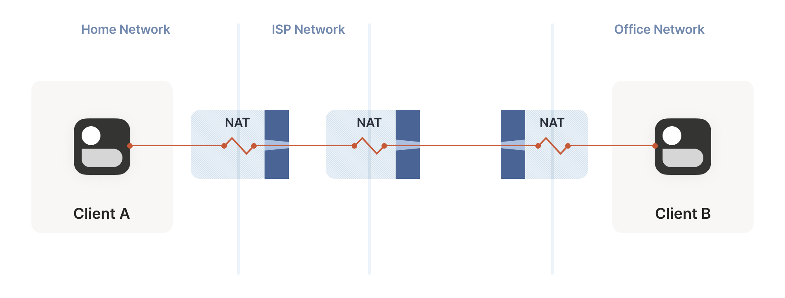

在网络社区里，关于“Double NAT 是洪水猛兽”的警告铺天盖地。

但从底层数据包的角度来看，**普通的多层 NAT 对我们前面的并发发包打洞没有任何负面影响！** 多层 NAT 就像多层有状态防火墙一样，只要每一层都忠实执行出站记录与匹配回包放行，打洞数据包依然能像穿透单层 NAT 一样一穿到底。

**真正被 Double NAT 彻底废掉的，是上面提到的端口映射协议（UPnP/PMP/PCP）。**

客户端发送的 UPnP 请求只能抵达离它最近的第一台路由器，拿到的是一个属于“中间局域网”的虚假公网 IP；它根本无法触达更外层的光猫。这导致自动开门彻底失效，许多依赖 UPnP 的联机主机游戏（如 PlayStation/Xbox）会直接报错警告。

但只要你依赖的是 STUN 与 ICE，多层 NAT 并非世界末日。

---

### 运营商级 NAT（CGNAT）与发夹弯（Hairpinning）

如果说双重 NAT 还是家庭用户的自找烦恼，那么 **运营商级 NAT（Carrier-Grade NAT, 简称 CGNAT / NAT444）** 则是运营商强加给所有网民的现实枷锁。

随着 IPv4 彻底枯竭，宽带运营商再也无法给每家每户分配哪怕一个动态公网 IP。如今千家万户的光猫拿到的都是形如 `100.64.0.0/10`（RFC 6598 专用地址段）的大内网 IP，由运营商在城域网核心出口处部署巨型 NAT 集群，将成千上万个家庭收拢到少量的公网 IP 上。

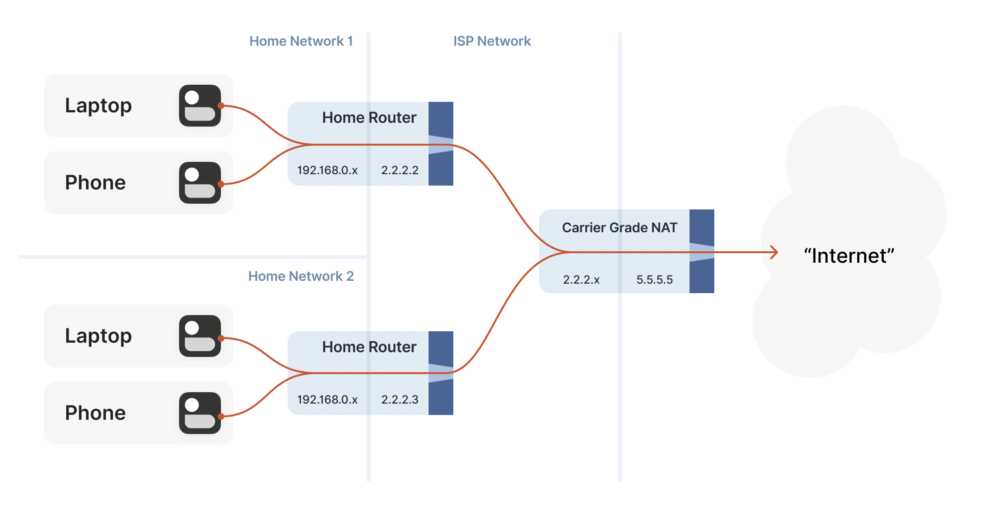

在 CGNAT 笼罩的世界里，如果**两个属于同一个运营商 CGNAT 内网但处于不同家庭的客户端，想要建立 P2P 直连**，如果他们求助于位于互联网公网上的 STUN 服务器：
* STUN 会告诉 A：“你的外网地址是 `2.2.2.2:1234`”；
* STUN 会告诉 B：“你的外网地址是 `2.2.2.2:5678`”。

现在，客户端 A 试图向 `2.2.2.2:5678` 发送打洞数据包。

这个数据包一路向上涌向运营商的顶级 CGNAT 网关。此时，CGNAT 网关必须具备一种极其特殊且罕见的能力——**发夹弯（NAT Hairpinning / 环回）**：

1. 网关看到入站数据包目标是 `2.2.2.2:5678`；
2. 网关猛然警觉：“等一下！这个公网 IP 和端口，不就是我右边那个家庭 B 的映射吗？”；
3. **网关立刻调转车头（像发夹一样弯曲 180 度），绝不把这个包往公网外层发，而是直接顺着内部下行链路注入家庭 B 的通道！**

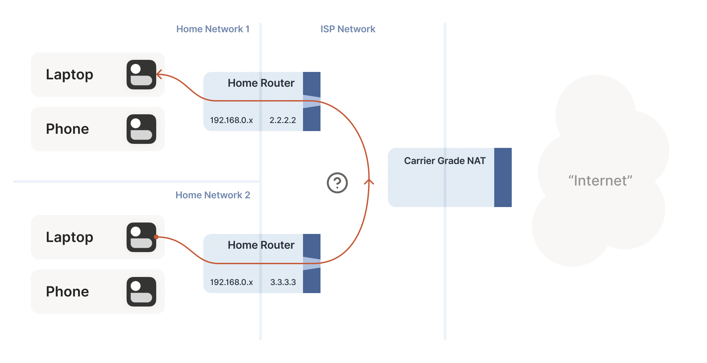

**如果 CGNAT 网关不支持 Hairpinning（很多老旧核心路由硬件在芯片 ASIC 流片时就硬编码了“内网向外的数据包必须送向 WAN 口物理引脚”，根本无法在硅片内部折返），那么发往自己公网 IP 的数据包会被静默丢弃！**

如果不支持 Hairpinning，这两台近在咫尺的设备，就只能被迫退化为通过公网 Relay 中继进行数据中转。

---

### IPv6 的光明与 NAT64 的过渡阴影

读到这里，你可能已经在屏幕前愤怒地咆哮了：“**搞这么大一堆又臭又长奇技淫巧的罪魁祸首就是 IPv4！我们直接全面拥抱 IPv6 不就天下太平了吗？！**”

你说得对……但只对了一半。

IPv6 确实彻底根除了地址匮乏，每台设备都能拥有独一无二的公网全局可路由单播地址。**我们终于可以彻底跟 NAT、STUN、生日碰撞、UPnP、Hairpinning 说再见了！**

**但是，IPv6 依然干不掉有状态防火墙！** 你的电脑依然处于本地操作系统防火墙或公司路由器的防护之下，依然遵循“禁止外部主动入站”的铁律。因此，本文最开头讲的“协调信道 + 并发发包撕开防火墙”的技法，在 IPv6 时代依然是绝对的必修课！

更关键的是：**今天的世界依然不是一个 Pure IPv6 的世界。** 全球 IPv6 的普及率目前仍在百分之三四十左右徘徊，且极度不均衡。

而在双栈并存的漫长过渡期中，我们还必须面对更诡谲的生物——**NAT64 + DNS64**。

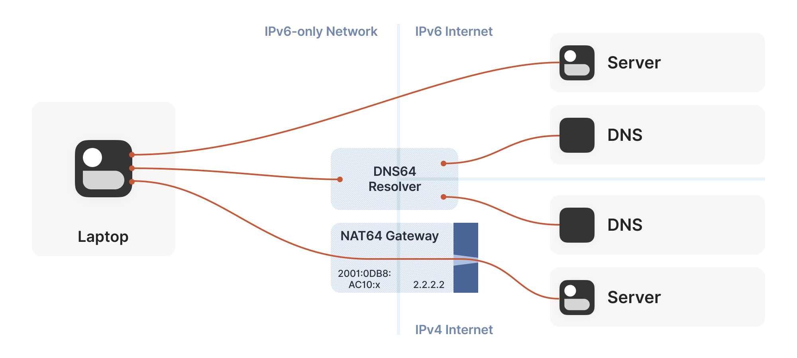

在很多现代蜂窝移动网络（如 4G/5G 手机）中，运营商在手机端只分配了 IPv6 单栈地址。为了让手机能访问那些只有 IPv4 的老旧网站，运营商部署了 NAT64 网关。

对于依赖 DNS 域名的普通 App，这一切由 DNS64 自动完成合成（把 IPv4 地址包装成特定前缀的 IPv6 地址）。

但对于我们这种在 Socket 底层手撕原生 IP 的 P2P 穿透程序，如果系统本身没有开启透明代理层（CLAT），我们就必须亲自动手：
1. 向保留域名 `ipv4only.arpa` 发起 DNS 探测；
2. 如果解析出的不是固定的 IPv4 测试常量，而是携带了特定前缀的 IPv6 地址，我们就动态反推出了当前局域网内 **NAT64 的前缀合成规则**；
3. 随后，将远端对等体的 IPv4 地址手工拼装进这个 IPv6 前缀中，构造出合法的跨协议穿透探测包！

---

## 集大成者：ICE 协议与全路径探索

我们已经收集齐了这颗星球上关于有状态防火墙、NAT 映射（EIM/EDM）、生日悖论、显式开门（UPnP/PCP）、Hairpinning 和 IPv6/NAT64 的全套武器库。

但最后一个终极工程难题浮出水面：

**面对此时此刻网络另一端某个未知的设备，你怎么知道该掏出哪一套武器？**

你难道要先写 1000 行探测逻辑，测出链路特征，再去动态组合应对策略吗？

在早期研究中，人们确实试图这么做，但很快被现实打得鼻青脸肿——互联网中间件的行为千奇百怪，穷举规则的维护代价呈指数级爆炸。

直到 **ICE（Interactive Connectivity Establishment，交互式连通性建立，RFC 8445）** 协议的诞生，才带来了一场思想上的哲学洗礼。

ICE 协议的核心灵魂，精炼成一句话就是：

> **“不要试图去猜测；同一时刻把所有的方案全部并发打出去，哪条先通就用哪条！”**

这就是终极的大道至简！

### ICE 的现代工程实践法则

如果你打算构建一个高水准的 P2P 连通框架，请务必吸纳以下工程精髓：

1. **收集全部候选地址（Gather Candidates）：**
   * 本机所有物理网卡绑定的 IPv6 地址；
   * 本机所有物理网卡绑定的 IPv4 局域网地址；
   * 通过 STUN 探测到的公网映射地址（如果存在 NAT64，也包含合成地址）；
   * 通过 UPnP/PMP/PCP 成功申请到的显式端口映射；
   * 保底中继服务器地址。
2. **候选者交换与全交叉探测（Cross Probing）：** 双方通过带外信道互换列表后，立刻向对方所有的可能地址并发喷射携带鉴权签名的 Ping 探测包。这些包同时扮演了两个神圣职责：**既是撕开防火墙和 NAT 映射的先锋穿透弹，又是计算往返时延（RTT）的质量体检表。**
3. **零等待热切换（Zero-RTT Fallback & Upgrade）：**
   * 标准 ICE 规范要求先进行漫长的“探测阶段”，全部测完之后再切换到“正式传输阶段”。
   * **Tailscale 抛弃了这种低效做法**：在两端发起连接的第 1 毫秒，**直接在后台 DERP 保底中继上点亮通信**！用户的数据包立刻得到毫秒级响应开始传输，完全零等待；与此同时，底层的 P2P 路径探测在后台并发全速狂奔。一旦在某条直连路径上收到了对端的 Pong 回包，系统便**在纳秒级将流量平滑、无缝、无感地热迁移到直连通道上**！
4. **动态降级与自愈：** 一旦某条正在使用的直连路径因为网络波动或中间路由状态重置而断裂，系统会立刻回退到中继链路保底，并重新触发路径探测。用户除了察觉到极轻微的时延抖动外，业务连接永不断线。
5. **端到端安全是一切的前提：** 在动态路径漂移的世界里，“基于 IP 白名单”的安全理念已经化为泡影（甚至恶意攻击者可以伪造探测包诱导你把流量送往它的黑洞）。**你承载的上层协议必须自备端到端加密与强认证**（例如 WireGuard 的 Curve25519 密钥对，或 QUIC 的 TLS 1.3 握手）。

---

## 终局复盘：NAT 穿透的技术配方清单

历经九九八十一难，我们终于把这套让全世界计算机在没有公网 IP 的情况下直接握手的完整体系搭建完毕。

如果你想动手实现自己的穿透系统，请收下这份可以直接带进工程实践的 **TL;DR 终极实现清单**：

### 🛠️ 必备先决组件

* [x] **协议底座：** 全面拥抱 UDP（若需可靠流传输，选择 QUIC）。
* [x] **底层掌控：** 应用程序必须能绝对控制底层 Socket，让穿透引擎与业务流量共享套接字。
* [x] **信令信道：** 一个可靠的带外协调信道（如 WebSocket 或 HTTP 长轮询）。
* [x] **公网镜子：** 1~2 个高质量的公共 STUN 服务器。
* [x] **保底网络：** 一个基于 HTTPS 的公网中继节点网络（如 DERP）。

### 🚀 运行流程序列

1. **枚举本地端点：** 获取本机所有物理网络接口的 IP 地址（IPv4 LAN + IPv6）。
2. **查询 STUN 映射：** 从主 Socket 向 STUN 发包，记录返回的公网 `WAN IP:Port`，同时判定当前 NAT 是 EIM 还是 EDM。
3. **尝试本地端口开门：** 并发向默认网关请求 UPnP / NAT-PMP / PCP 端口映射。
4. **嗅探 NAT64：** 通过 `ipv4only.arpa` 检查是否处于 IPv6-only 网络，并在必要时合成候选地址。
5. **带外交换候选集：** 将上述所有采集到的端点，连同本节点的公钥，通过带外信道与对端原子交换。
6. **先跑中继，瞬间开工：** 立即通过 DERP 中继建立保底通路，让上层业务零等待开始传输。
7. **全量并发轰击探测：** 互相向对端的所有候选地址发射穿透探测 Ping；若遇到“一端 Easy、一端 Hard”的拓扑，立刻追加**生日攻击并发发包**。
8. **静默无缝升级：** 无论哪条低时延的 P2P 直连通道率先传回合法的 Pong，底层网络驱动立即将路由指标迁移到直连路径。
9. **心跳保活与自愈：** 维持每 20~25 秒一次的双向心跳以防有状态防火墙老化，并在直连断裂时自动切回中继重新寻路。
10. **端到端全面加密：** 确保应用载荷拥有不可篡改的端到端非对称密码学加固。

---

掌握了这套屠龙之技，你就拥有了进入真正去中心化应用大门的金钥匙。让原本被层层孤立的设备在互联网络的洪流中自由对话吧！

---

上一篇：[Tailscale 的工作原理](/blog/posts/how-tailscale-works/)

下一篇：[网络不通或很慢，应该从哪里开始查](/blog/posts/a-layered-guide-to-network-troubleshooting/)
