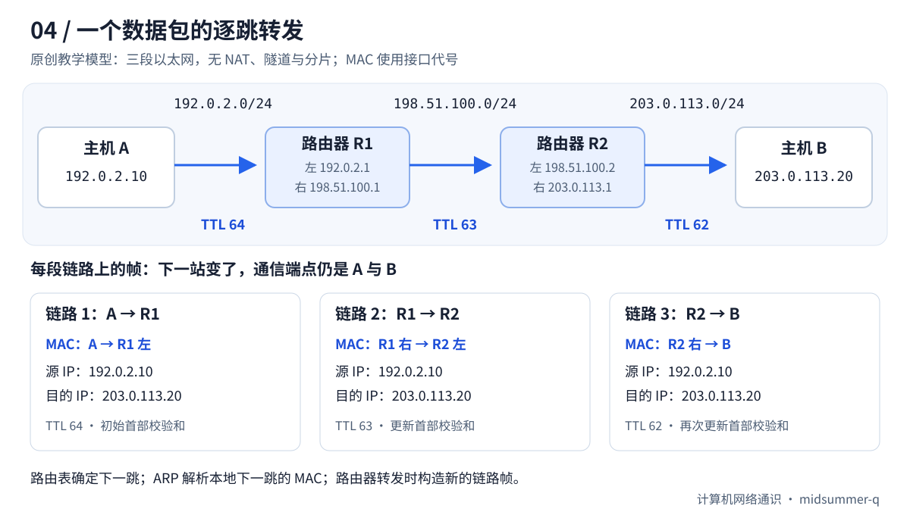

在上一篇中，我们推导了主机如何在判定目标非本地后，将数据包上缴给默认网关。

但随后一个更庞大的疑问油然而生：

- 我们的网关路由器知道远在千里之外、大洋彼岸的服务器的具体 MAC 地址吗？
- 互联网上拥有成千上万台错综复杂的路由器，**难道每一台路由器在发包前，都要预先把从中国到美国横跨数十个节点的完整路书全部规划好吗？**
- 如果两台路由器的路由表配置产生矛盾，数据包在它们之间来回踢皮球，整个互联网会被这些无限循环打转的数据包拖垮吗？
- 经典的 **`ping`** 和 **`traceroute`** 工具，到底是用怎样的黑魔法，能够穿透茫茫网络迷雾，把数据包沿途经过的每一台路由器的真实 IP 逐一揪出来的？

本文将跟随一个真实的数据包，跨越两台以上的核心路由器，深入剖析 **逐跳转发模型、最长前缀匹配算法（LPM）、MAC 帧头的剥离与重写**，以及基于 **ICMP** 协议的生存时间（TTL）防死锁与路由追踪探测技术。

## Table of contents

## 第一章：逐跳转发模型——互联网的接力棒哲学

很多初学者容易将网络路由想象成开车的 GPS 导航：出发前必须在地图上完整规划好“从 A 出发，先过 B 桥，再走 C 匝道，最终到 D 点”的完整清单。

在互联网庞大的网状拓扑中，这种中心化的全路径规划是完全不可能实现的（全网拓扑瞬息万变，线路分秒都在发生闪断与切换）。

> **互联网路由的核心哲学：逐跳转发（Hop-by-Hop Routing）**
>
> **任何一台路由器（包括源主机），在转发数据包时，根本不需要知道通往终点的完整全局路径！**
>
> 它所做的一切工作，仅仅是在数据包到达的万分之一秒内，翻阅自身的本地路由表，做出一个极度克制而精准的局部决策：
> **“为了让这个包离目标终点更近一步，在这个岔路口，我应该把它递交给我的哪一个直接相连的邻居节点（下一跳 Next Hop）？”**

```text
[主机 A] ──(第 1 跳)──> [路由器 R1] ──(第 2 跳)──> [路由器 R2] ──(第 3 跳)──> [主机 B]
```

数据包就像一根接力棒，在沿途路由器之间完成一场精准的接力赛跑。

---

## 第二章：路由表与最长前缀匹配算法（LPM）

路由器凭借什么做出“往哪一个接口扔”的决策？——凭的是维护在内核与硬件 ASIC 芯片中的 **路由表（Routing Table）**。

### 1. 路由表的核心结构解析

在 Linux 路由器或宿主机中，我们可以通过 `route -n` 或 `ip route show` 检阅内核路由表：

```bash
route -n
```

```text
Kernel IP routing table
Destination     Gateway         Genmask         Flags   Metric  Ref  Use  Iface
192.168.1.0     0.0.0.0         255.255.255.0   U       100     0      0  eth0
10.0.0.0        192.168.1.254   255.0.0.0       UG      100     0      0  eth0
0.0.0.0         192.168.1.1     0.0.0.0         UG      100     0      0  eth0
```

- **`Destination`（目的网络）** 与 **`Genmask`（子网掩码）**：联合圈定该条路由覆盖的目标网段范围；
- **`Gateway`（下一跳网关）**：
  - 如果为 **`0.0.0.0`**，代表目标与当前网卡处于**同一个直接相连的本地子网**，可直接广播 ARP 单播交付；
  - 如果为一个具体 IP（如 `192.168.1.1`），代表跨网段，必须将数据递交给该网关 IP 代为转发；
- **`Flags`（标志位）**：`U` 代表该路由处于激活启动状态；`G`（Gateway）代表该路由需要跨越网关中转；
- **`Iface`（输出接口）**：决定数据包从本机的哪一张物理网卡芯片（网口）发射出去。

### 2. 路由判定的最高法典：最长前缀匹配原则（LPM）

当一个数据包的目的 IP 为 `10.1.2.3` 进入路由器时，它既匹配 `10.0.0.0/8` 这条规则，又符合万能匹配的默认路由 `0.0.0.0/0`。

此时，路由器该听谁的？

> **最长前缀匹配原则（Longest Prefix Match，简称 LPM）**：
>
> **当数据包的目的 IP 同时命中路由表中的多条记录时，路由器必须坚决挑选——子网掩码中最长（即连续包含 1 的数量最多、网段范围最窄最精准）的那条规则作为最终转发依据！**

- 掩码长度越长，说明该条路由对目标区域的划分越细致精确；
- 默认路由 `0.0.0.0/0` 的前缀长度为 **`0`**，掩码最短、范围最宽泛，因此它的匹配优先级永远垫底，充当全网匹配失败后的**终极保底安全气囊**！

---

## 第三章：逐跳转发的物理现实——“变与不变”的时序图解

这是很多网络初学者极易产生逻辑混乱的核心枢纽：**数据包在跨越一个又一个路由器时，报文内部到底哪些字段在变，哪些字段永远不变？**



假设主机 A（`192.168.1.10`, MAC_A）经由路由器 R1（接口 1: `192.168.1.1`, MAC_R1_in；接口 2: `10.0.0.1`, MAC_R1_out），跨网段向主机 B（`10.0.0.20`, MAC_B）发送数据：

### 1. 阶段一：主机 A 发送给路由器 R1

- **网络层 IP 报头**：
  `源 IP: 192.168.1.10` $\to$ `目的 IP: 10.0.0.20`
- **数据链路层以太网帧头**：
  主机 A 查表发现目标非本地，将以太网帧头填上网关 R1 的物理地址：
  `源 MAC: MAC_A` $\to$ `目的 MAC: MAC_R1_in`

### 2. 阶段二：路由器 R1 内部的“物理蜕壳与再组装”

数据帧到达路由器 R1 的入口网卡芯片：

1. **拆解链路层外衣**：R1 网卡比对发现目的 MAC 是自己，接收数据帧并进行 FCS 校验。随后，**R1 毫不留情地将该以太网帧头彻底撕开剥除丢弃！**
2. **审查 IP 报头**：R1 提取内部的 IP 数据报，发现目的 IP `10.0.0.20` 不是自己，而自己开启了 IP 转发功能（`ip_forward=1`）；
3. **查表命中下一跳**：R1 检索自己的路由表，发现 `10.0.0.0/24` 属于自己右侧接口 2（`eth1`）直接相连的网段；
4. **重新封装全新以太网帧头**：
   R1 通过自己的右侧网卡，在本地发送 ARP 探测到主机 B 的物理地址 `MAC_B`。
   随后，R1 **重新制造了一个全新的以太网帧头**，缝合在原 IP 数据报的外面：
   `源 MAC: MAC_R1_out` $\to$ `目的 MAC: MAC_B`！

> **逐跳转发的“变与不变”哲学总结**：
>
> - **永远不变的是逻辑终点**：在不考虑 NAT 网络地址转换的前提下，数据报中的 **源 IP 地址** 和 **目的 IP 地址** 在浩瀚的转发旅程中**始终保持原样、绝对不变**！
> - **每跳重写的是物理单跳**：数据包每穿透一个路由器接口，**以太网帧头就会被彻底撕碎重建一次**！源 MAC 变为当前出口路由器的网卡 MAC，目的 MAC 变为下一个物理邻居的网卡 MAC！

---

## 第四章：TTL 与网络环路死锁防范

在复杂的动态路由协议（OSPF、BGP）收敛过程中，或者由于网络工程师的手抖误配置，路由表中可能会不幸出现**环路（Routing Loop）**：

- 路由器 R1 的路由表写着：“去往目标找 R2”；
- 路由器 R2 的路由表写着：“去往目标找 R1”。

如果没有防御机制，一个数据包进入这两台路由器之间，就会像乒乓球一样在千兆光纤上以微秒级的速度被无休止地来回对踢！随之而来的海量死循环数据包会在数秒钟内将全网带宽彻底占满塞死，导致骨干网络崩溃！

### 1. 生存时间（TTL，Time to Live）的物理机制

在每一个 IPv4 报头的第 9 个字节，都被强制设置了一个 8 位的整数——**TTL（生存时间）**。其最大值为 255（Linux 默认常设为 64，Windows 默认常设为 128）。

> **TTL 的递减铁律**：
>
> **全世界所有的合规路由器，在转发一个 IP 数据报时，第一道工序必须是将报头中的 TTL 数值强制减 1！**
>
> 由于修改了 TTL，路由器还必须同步重新计算并刷新 IP 报头的首部校验和（Header Checksum）。

### 2. ICMP 超时报文（Time Exceeded）

当一个数据包因为环路打转，或者历经漫长跋涉，其 **TTL 被某台路由器递减为 `0`** 的那一瞬间：

1. 当前路由器**立刻坚决停止转发，将该数据包当场物理丢弃抹除！**
2. 路由器遵循 **ICMP 协议（Internet Control Message Protocol，互联网控制报文协议）**，抓出原数据包的 IP 报头与前 8 字节数据，组装成一个 **ICMP 超时差错报文（Type 11, Code 0: Time-to-live exceeded in transit）**；
3. 将此 ICMP 差错报文原路送回给最初的发包源主机！

**环路被瞬间打破，全网死锁被彻底瓦解！**

---

## 第五章：在黑暗中点亮网络地图——`traceroute` 的探测黑魔法

当网络发生故障时，我们如何知道数据包是在哪一个路由器节点中断丢失的？

这必须归功于计算机网络中最精妙绝伦的探测发明——**`traceroute`（Windows 下为 `tracert`）**！

### 1. `traceroute` 的物理执行时序

`traceroute` 极其狡黠地**利用了上述“TTL 每过一跳自动减 1”以及“减到 0 触发 ICMP 报错回传当前路由器 IP”的底层物理机制！**

```text
[源主机]                                                                        [目标主机]
   │
   │ ── 发送数据包 (故意设置 TTL = 1) ──> [第 1 跳路由器 R1]
   │ <── R1 发现 TTL 归零，丢弃并回送: [ICMP 超时报文 (源地址: IP_R1)]
   │     ⭐️ 源主机成功捕获第 1 跳路由器 IP: IP_R1！测算往返 RTT！
   │
   │ ── 发送数据包 (故意设置 TTL = 2) ──> [第 1 跳 R1] ──> [第 2 跳路由器 R2]
   │ <── R2 发现 TTL 归零，丢弃并回送: [ICMP 超时报文 (源地址: IP_R2)]
   │     ⭐️ 源主机成功捕获第 2 跳路由器 IP: IP_R2！
   │
   │ ── 发送数据包 (故意设置 TTL = 3) ──> ...
   │ 逐步累加探测，直到数据包安全抵达终点！
```

1. **第一轮探测**：源主机发出一个探测包，**故意将 TTL 设为极小的 `1`**！
   - 数据包刚刚抵达第一跳网关路由器，网关将其减为 0，当场丢弃；
   - 网关向源主机回送 ICMP 超时报文。源主机拆开该报文的源 IP，**第 1 跳路由器的身份瞬间曝光！**
2. **第二轮探测**：源主机发出探测包，**将 TTL 递增设为 `2`**！
   - 第一跳放行（TTL 变为 1），第二跳路由器将其减为 0 丢弃并回送 ICMP；
   - **第 2 跳路由器的身份再次被精准捕获！**
3. **逐跳推进**：依次设置 `TTL = 3, 4, 5...`，沿途的所有路由器节点就像在聚光灯下一个接一个排队显形，直到最终抵达目标主机！

### 2. 终端实战与星号 `* * *` 的真相

在终端执行：

```bash
traceroute -n 8.8.8.8
```

输出清晰呈现出通往美国 Google 核心网的逐跳拓扑链路：

```text
traceroute to 8.8.8.8 (8.8.8.8), 30 hops max, 60 byte packets
 1  192.168.1.1  1.205 ms  1.102 ms  1.015 ms       (家用网关)
 2  100.64.0.1   4.120 ms  4.015 ms  3.980 ms       (运营商接入层 CGNAT)
 3  59.43.18.22  12.301 ms 12.100 ms 12.010 ms      (电信骨干 CN2 网络)
 4  * * *                                           (神秘星号节点)
 5  8.8.8.8      150.120 ms 150.050 ms 149.990 ms   (目标达成)
```

**为什么第 4 跳会显示为 `* * *`？**
很多工程师误以为这是“丢包网络坏了”。
**真实网络真相**：很多大型骨干网核心运营商出于安全防范考虑，在路由器防火墙策略中**故意禁用了回送 ICMP 报文的功能（防嗅探）**。数据包正常飞速穿过了该节点，只是该节点拒绝回发 ICMP 超时确认包，因此客户端因超时打印了三个星号，紧接着下一跳继续被成功解析！

---

## 总结与专栏全局视野

在本篇《计算机网络通识（四）》中，我们跟随数据包跨越了局域网的物理樊篱：

1. **接力棒模型**：理解了互联网逐跳转发的本质，路由器依靠局部邻居决策完成全球互通；
2. **匹配最高法典**：掌握了路由表的核心结构，推导了最长前缀匹配原则（LPM）如何以最窄掩码实现高优先级路由；
3. **逐跳蜕壳封装**：深入透视了数据包跨越路由器时“源/目的 IP 绝对不变、以太网 MAC 帧头逐跳彻底重写”的底层物理机理；
4. **环路死锁粉碎者**：厘清了 TTL 逐跳减 1 的防死锁机制，解密了 ICMP 超时报文的生成全过程；
5. **黑暗探测术**：彻底搞懂了 `traceroute` 利用 TTL 阶梯递增在黑暗中绘制全球路由拓扑的巧妙构思。

现在，我们已经理解了数据包是如何依靠 IP 地址在整个地球的网络上穿州过省的。

但是，人类的记忆力是无法背诵数以亿计的类似于 `142.250.190.46` 的冰冷 IP 数字的：

- 我们日常使用的 `bilibili.com`、`github.com` 是如何被全球分布式系统翻译成精准的 IP 地址的？
- 全球仅有的 **13 组根域名服务器** 是如何顶住全球数十亿网民每秒数千亿次查询冲击的？
- 所谓的 **递归查询** 与 **迭代查询** 到底有什么区别？为什么修改了域名解析后常常要等几分钟才生效？

让我们正式迈向专栏的第五篇核心力作：**[《DNS：输入一个域名，谁告诉你服务器在哪里？》](/blog/posts/how-dns-resolution-works/)**！
