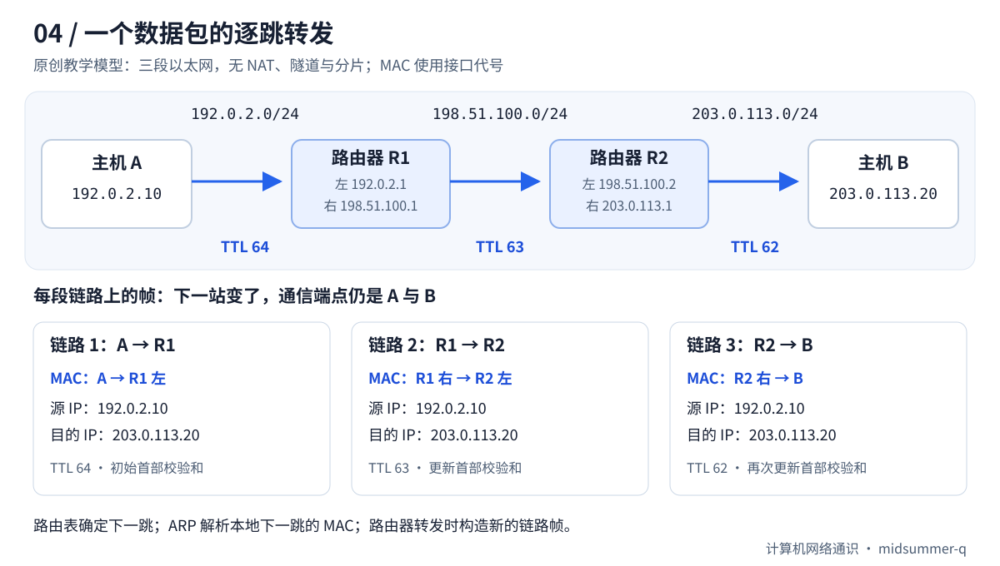

给同一房间里的电脑发数据，可以借助交换机完成。可是你访问的网站可能在另一座城市，中间隔着许多不同网络。你的电脑不认识每一台沿途设备，数据又怎样一步步走到目的地？

本篇把路程缩成“电脑 A → 路由器 R1 → 路由器 R2 → 电脑 B”。先用不带数字的小故事看职责，再用地址表逐跳对照。你不需要先背路由协议名称。

## Table of contents

## 什么叫一跳？什么叫路由？

**路由器** 连接不同网络，并为收到的 IP 数据包选择下一步的转发方向。一个包被路由器向前转发一次，通常称为经过一跳。在讨论 traceroute 时，“第几跳”主要围绕这些三层转发设备展开，不是网线上的每个插头或普通交换机都各算一跳。

**路由** 是到某个目的地址范围的路径信息。**路由表** 是本机保存这些信息的表格；**转发** 是收到包后，按已有规则把它交出去。你可以把路由表想成每个路口的指路牌，但牌子写的是地址范围和下一站，并不一定写完整行程。

例如 R1 可以只知道：“去 B 所在网络，交给 R2。”R1 无须知道 B 的房间里还有哪台交换机，更不需要与每个经过它的浏览器分别建立 TCP 连接。TCP 连接主要由两端维护，路由器在这一主线里负责转发包。

## 为什么终点不变，外面的地址却一直换？

想象一件物品要由甲交给乙，再由乙交给丙，最后交给丁。物品上一直写“最终给丁”，但每次当面交接的接收者不同。网络中的两类地址也承担不同职责：

```text
A → R1：本地交给 R1；里面写最终去 B。
R1 → R2：本地交给 R2；里面仍写最终去 B。
R2 → B：本地交给 B；里面也写最终去 B。
```

在后文没有地址转换的模型中，IP 包的源、目的地址保持 A 和 B；每一段以太网帧则换成当前发送接口和下一站接口的 MAC。上一段的帧在接收后被拆开，下一段重新封装，所以不是一个带着同一组 MAC 的信封走遍全球。

注意这只是交接职责的类比。真实路由器不是读者手工复制文件，而是高速处理包；它还会检查和更新一些控制字段。不能把“源和目的 IP 不变”扩大成“整个包任何一位都不变”。

## 下一站从哪里知道路？

先从最容易理解的 **静态路由** 开始：管理员预先告诉 R1，“去 B 的网络，下一站是 R2”。R1 就把这条规则存起来，后续包可以查同一张表。与接口直接相连的网络，也可以产生直连路由。

大型网络不断变化，不可能永远手工维护所有路径，于是有动态路由协议，设备之间交换路由信息、按规则计算路径。本篇只需要知道这是“维护指路牌”的工作。OSPF、BGP 是不同协议的名字，暂时不用记其算法。

这两种工作不要混淆：动态更新路径可能在后台发生，而转发眼前一个包时，设备通常使用已准备好的转发表。它不会每收到一个包，就从头搜索一次整个互联网。

## 两条规则都符合，怎么选？

假设指路牌上既有“去这座城市的车走左边”，又有“去这座城市里某个小区的车走右边”。如果你明确要去那个小区，更具体的规则应当优先。

IP 路由也有这样的比较，叫 **最长前缀匹配**：在选定的转发表中，匹配目的地址而且固定前缀位数最多的条目更具体。`/25` 比包含它的 `/24` 范围小，所以二者都匹配时选 `/25`。后文会给出可手算的地址范围。

默认路由 `/0` 不固定任何地址位，是“没有更具体规则时走这里”的兜底项。它不代表路由器知道全世界所有目的地都一定可达，也不代表下一站有能力继续转发。

## 能发出去，为什么还不算完成？

网络交流往往需要回复。A 的请求可以沿正确路线到 B，但 B 如果没有去 A 的路径，响应仍可能回不来。去程与回程还可能经过不同路由器，这称为路径不对称，本身未必是错误。

先在纸上为 A→B 画箭头，再为 B→A 画另一组箭头，才能说明双向通信。在后面的命令输出里，看到前几跳有回复也不能据此保证终点的业务正常。

接下来进入具体拓扑。表中的“左侧接口、右侧接口”是路由器连向两个不同网络的位置；R1、R2 只是设备代号，不是协议名称。

## 先搭一个能在纸上走通的网络

下面是一套自拟拓扑。三段地址均为文档示例地址，不代表可在公网直接访问的设备。为看清基本转发过程，假设各段都是以太网，没有 NAT、隧道、策略路由或分片，也没有防火墙拦截。

| 设备      | 左侧接口          | 右侧接口          |
| --------- | ----------------- | ----------------- |
| 主机 A    | `192.0.2.10/24`   | —                 |
| 路由器 R1 | `192.0.2.1/24`    | `198.51.100.1/24` |
| 路由器 R2 | `198.51.100.2/24` | `203.0.113.1/24`  |
| 主机 B    | `203.0.113.20/24` | —                 |

A 的默认网关是 R1，B 的默认网关是 R2。R1 已有通向 B 所在网络的路由，R2 也有通向 A 所在网络的返回路由。后者不能省略：请求能出去，不等于响应能回来。



_图：本文原创示意。MAC 字段使用接口代号，TTL 初值 64 是本例设定，不是所有系统的统一默认值。_

### 第一段：A 只需找到自己的网关

A 要发出的 IP 包写着：源地址 `192.0.2.10`，目的地址 `203.0.113.20`。查路由后，A 选中下一跳 `192.0.2.1`。

如果邻居缓存里没有记录，A 在本地网络中用 ARP 查询 R1 左侧接口的 MAC 地址。随后，以太网帧的目的 MAC 填 R1，里面 IP 包的目的地址仍填 B。**“把帧交给网关”和“把 IP 包发给网关本身”是两件事。** A 不会为了这次通信在本地广播查询远方 B 的 MAC。

### 第二段：R1 重新选择出口并封装

R1 收到发给自己接口的帧，取出 IP 包。它发现目的 IP 不是自己的本地地址，于是查询转发表，选出下一跳 `198.51.100.2`。

接下来，R1 更新需要变化的 IP 首部字段，并用右侧接口发出一个新帧：源 MAC 是 R1 右侧接口，目的 MAC 是 R2 左侧接口。若尚不知道后者，就在中间这段网络中进行 ARP 查询。R1 无须知道 B 的 MAC，也无须为每个数据包向所有路由器询问一次路线。

### 第三段：R2 发现目的网络就在眼前

R2 的 `203.0.113.0/24` 是直连网络。它查询 B 的邻居信息，把更新后的 IP 包装进发给 B 的以太网帧。B 收到后，才继续将内容交给相应的上层协议。

Practical Networking 的 [Host to Host through a Router](https://www.practicalnetworking.net/series/packet-traveling/host-to-host-through-a-router/) 很适合对照阅读：路由表确定下一跳，ARP 将本地下一跳地址映射到 MAC。阅读图解时应把“端点 IP 地址保持不变”与“整个 IP 首部不变”区分开；下面的 TTL 正是变化字段。

## 路由表怎样选出下一跳

对于这次通信，R1 只需有类似下面的条目。表格是教学模型，省略了设备实际输出中的路由来源、优先级等字段。

| 目的前缀          | 下一跳         | 出口     |
| ----------------- | -------------- | -------- |
| `192.0.2.0/24`    | 直连           | 左侧接口 |
| `198.51.100.0/24` | 直连           | 右侧接口 |
| `203.0.113.0/24`  | `198.51.100.2` | 右侧接口 |

主机也有路由表；默认网关通常表现为默认路由的下一跳。**默认路由 `0.0.0.0/0` 能匹配所有 IPv4 地址，只有没有更具体的匹配时才轮到它。** 没有匹配路由，也没有默认路由，设备不能靠猜测继续转发。

### 一道最长前缀匹配练习

暂时离开前面的拓扑，单独看一个假想转发表。假设三个下一跳都可达：

| 目的前缀           | 下一跳代号 |
| ------------------ | ---------- |
| `0.0.0.0/0`        | X          |
| `203.0.113.0/24`   | Y          |
| `203.0.113.128/25` | Z          |

目的地址为 `203.0.113.200` 时，三条都能匹配，但 `/25` 比 `/24`、`/0` 更具体，选 Z。目的地址改为 `203.0.113.20`，它不属于 `.128` 到 `.255` 的范围，选 Y。目的地址是 `192.0.2.80`，则只剩默认路由，选 X。

这里“最长”指匹配的地址前缀位数最多，不是字符串最长，也不是距离最远。[RFC 1812 第 5.2.4.3 节](https://www.rfc-editor.org/rfc/rfc1812.html#section-5.2.4.3)给出了最长匹配规则。这个规则针对选定转发表内的目的地址查找；真实系统还可能先根据策略选择不同的表。

如果同一前缀有多个候选路径，路由来源优先级、协议度量和设备配置会参与选路，也可能安装多个等价下一跳。不能看到某条默认路由的 metric 更小，就断言它压过已安装的更具体前缀。

### 转发与路由协议各做什么

**转发** 是处理眼前的数据包：查表、选出口、发送。**路由计算与维护** 负责形成可用的路径信息。现代设备通常从路由信息库生成用于快速查找的转发表，入门时可以先把二者理解为“准备规则”和“执行规则”。

规则可能来自直连接口、管理员配置的静态路由，也可能由 OSPF、BGP 等动态路由协议提供。动态路由不是为每个包实时搜索一遍互联网；它也不保证总能选中地理距离最短或延迟最低的路线。网络策略、协议度量和运营关系都会影响结果。

## TTL 是防止兜圈子的倒计数

如果路由配置有误，R1 认为目标应交给 R2，R2 却又交回 R1，数据就可能绕圈。IPv4 首部里的 TTL 字段限制包继续被转发的生命范围；实际转发中，路由器至少将它减一，耗尽时丢弃该包。IPv6 对应字段叫 Hop Limit，跳数限制。

例如本例出发时为 64，经过两台路由器后可变为 62。64 是示例初值，不是必须经过 64 台设备的意思，也不要与 DNS 缓存的 TTL 秒数混用。

路由器还可能发回一条 **ICMP** 差错消息。ICMP 是网络层的控制消息协议，可以报告某些差错；它不是网页正文。后面的 traceroute 正是利用逐渐增加 TTL 的探测，尝试知道哪些设备在什么位置作出回应。理解这个机制后，再看星号就不会急着断言“这里坏了”。

## 每过一跳，到底改变了什么

在本文没有 NAT、隧道和分片的模型中，可以这样记录：

| 字段              | A 发往 R1      | R1 发往 R2     | R2 发往 B      |
| ----------------- | -------------- | -------------- | -------------- |
| 源 IP             | `192.0.2.10`   | `192.0.2.10`   | `192.0.2.10`   |
| 目的 IP           | `203.0.113.20` | `203.0.113.20` | `203.0.113.20` |
| 源 MAC → 目的 MAC | A → R1 左      | R1 右 → R2 左  | R2 右 → B      |
| IPv4 TTL          | 64             | 63             | 62             |
| IPv4 首部校验和   | 初始值         | 随首部变化更新 | 再次更新       |

TTL 用来限制数据包在网络中的存活，避免错误路由形成的环路让它无限转圈。IPv4 路由器每次转发至少将 TTL 减 1；日常观察通常表现为每跳减 1。若转发时耗尽，就丢弃该包，并在适用条件下向源主机发送 ICMP Time Exceeded。校验和覆盖 IPv4 首部，TTL 变化后也要更新，设备可以采用增量更新。[RFC 1812 的 TTL 规则](https://www.rfc-editor.org/rfc/rfc1812.html#section-5.3.1)和[首部校验和规则](https://www.rfc-editor.org/rfc/rfc1812.html#section-4.2.2.5)规定了这些处理。

IPv6 使用名称更直接的 Hop Limit，转发节点每次减 1，而且基本首部没有 IPv4 那样的首部校验和；可对照 [RFC 8200 第 3 节](https://www.rfc-editor.org/rfc/rfc8200.html#section-3)查看其字段定义。二层交换机在同一以太网内转发普通帧，不算这里的一次 IP 路由跳数。

还有一个容易忽略的限制：出口链路的 MTU 决定它能承载多大的 IP 包。有路由不代表任意大小的包都能通过。IPv4 在禁止分片时遇到过大的包，会涉及 ICMP“需要分片”的反馈；IPv6 路由器不进行分片，发送端需要处理 Packet Too Big 等信息。后续讨论路径 MTU 发现时，再展开这些细节。

## ping 和 traceroute 是怎样观察网络的

`ping` 通常发送 ICMP Echo Request，等待 Echo Reply。测到的是这次请求与响应的往返时间 RTT，不是单程时间，也不是下载带宽。ICMP 是 IP 的控制与诊断协议，不需要先建立 TCP 连接。

`traceroute` 则把 TTL 依次设为 1、2、3……，发送多组独立探测。在前面的模型里：

1. TTL 为 1 的探测到 R1 就耗尽，可能收到 R1 的超时报文。
2. TTL 为 2 的探测能离开 R1，在 R2 耗尽，可能收到 R2 的超时报文。
3. TTL 为 3 的探测可以到达 B，再根据探测协议判断是否抵达终点。

它并不是让同一个包沿途签名。输出中的每一行来自相应探测的反馈，三列时间通常代表三次探测各自的 RTT；两行相减不能可靠得到那一段链路的时延。

Windows 的 [`tracert`](https://learn.microsoft.com/en-us/windows-server/administration/windows-commands/tracert) 使用 ICMP Echo 探测；Linux 常见 [`traceroute` 实现](https://manpages.debian.org/testing/traceroute/traceroute.1.en.html)默认使用 UDP，收到终点的 ICMP Port Unreachable 可判定到达，也支持 ICMP、TCP 等方法。因此，两套工具在同一网络上可能得到不同结果，不能先认定其中一套错了。

## 动手：先看本机规则，再看沿途反馈

下面的命令不修改路由配置；探测命令会发送少量网络报文。`1.1.1.1` 是本例的公开探测目标，可以替换成自己管理的服务器 IP。前面的三个文档网段只用于讲解，不应拿来期待公网连通。

Windows 在开始菜单搜索 PowerShell 后打开。下面三项分别执行；以 `#` 开头的行是注释，不是额外命令。先读路由，再做 ping，最后做路径探测。ping 输出中的时间是一次往返；tracert 每行是一组特定跳数限制的探测，`*` 表示等待期间没有相应反馈。

Windows PowerShell：

```powershell
# 查看 IPv4 路由表，寻找 0.0.0.0 默认路由及其网关、接口
route print -4

# 进行 4 次 Echo 探测
ping -n 4 1.1.1.1

# 禁止反向域名解析；限制最多 12 跳，每次等待 1 秒
tracert -4 -d -h 12 -w 1000 1.1.1.1
```

Linux：

```bash
# 查看路由表，并查询系统将怎样发送到指定目的地的包
ip -4 route show
ip -4 route get 1.1.1.1

ping -c 4 1.1.1.1
traceroute -4 -n -m 12 -w 1 1.1.1.1
```

`ip route get` 展示本机选择的下一跳、出口和源地址，**不证明目的地可达**。`traceroute` 在部分发行版中需要另行安装；具体选项以本机手册为准。在 WSL、虚拟机或 VPN 环境中执行，观察到的还包括对应虚拟网络的影响。

用本文纸上拓扑解释输出时，可以得到下面这组**假想结果，不是上述公网命令的实测记录**：

```text
跳数   探测一   探测二   探测三   响应地址
1      1 ms     1 ms     1 ms     192.0.2.1
2      *        *        *        未收到反馈
3      5 ms     4 ms     5 ms     203.0.113.20
```

第二行的星号不等于“包无法经过第二跳”。第三行已经出现 B，说明至少这些到终点的探测获得了响应。R2 可能继续转发普通流量，却不回复或限速处理超时报文；反馈也可能在回程被丢弃。Cloudflare 的 [MTR 解读](https://www.cloudflare.com/learning/network-layer/what-is-mtr/)特别展示了中间节点限制控制报文、而终点仍能正常响应的情况。

再加上两层边界：去程和回程可能不对称；等价多路径 ECMP 可能根据流的字段把不同探测分配到不同路径。因此，某次输出不是所有业务流量的固定路线，也不保证列出了每台物理设备。`ping` 不通不能直接判定网页一定打不开，`ping` 正常也不能证明 HTTPS 服务正常。

读完一次结果，尝试回答三个问题：本机实际选了哪个出口？哪些跳确实返回了反馈？这些反馈能支持什么结论，还有哪些需要用真实业务请求验证？这比只盯着某个星号更有助于排障。

## 读完后，用自己的话试着解释

数据从 A 经 R1、R2 到 B，在没有 NAT 的模型里，R1 发出的帧为什么不写 B 的 MAC？

<details>
<summary>展开参考答案</summary>
<div class="mt-4 leading-7">R1 这一跳直接交接给 R2，所以帧的目的 MAC 是 R2 对应接口。里面 IP 包的目的地址仍是 B，R2 才能继续按最终目标转发。</div>
</details>

## 参考资料与继续阅读

本文的拓扑、路由匹配题、图示和假想输出均为原创教学示例；以下资料用于核对机制和工具行为，没有复用原站插图。

- [Practical Networking：Host to Host through a Router](https://www.practicalnetworking.net/series/packet-traveling/host-to-host-through-a-router/)：对照路由表、ARP 与逐跳链路封装。
- [RFC 1812：Requirements for IP Version 4 Routers](https://www.rfc-editor.org/rfc/rfc1812.html)：重点读 5.2.4.3、5.3.1 和 4.2.2.5 节；IPv6 对照 [RFC 8200](https://www.rfc-editor.org/rfc/rfc8200.html)。
- [Microsoft Learn：tracert](https://learn.microsoft.com/en-us/windows-server/administration/windows-commands/tracert)：Windows 探测方法、参数与星号的含义。
- [Traceroute for Linux 手册（Debian 托管）](https://manpages.debian.org/testing/traceroute/traceroute.1.en.html)：UDP、ICMP、TCP 等探测方法。
- [Cloudflare：What is My Traceroute (MTR)?](https://www.cloudflare.com/learning/network-layer/what-is-mtr/)：理解中间节点不回应与真实转发故障的区别。

上一篇：[IP 地址、子网掩码和默认网关到底是什么？](/blog/posts/understanding-ip-addresses-and-subnets/)

下一篇：[DNS：输入一个域名，谁告诉你服务器在哪里？](/blog/posts/how-dns-resolution-works/)
