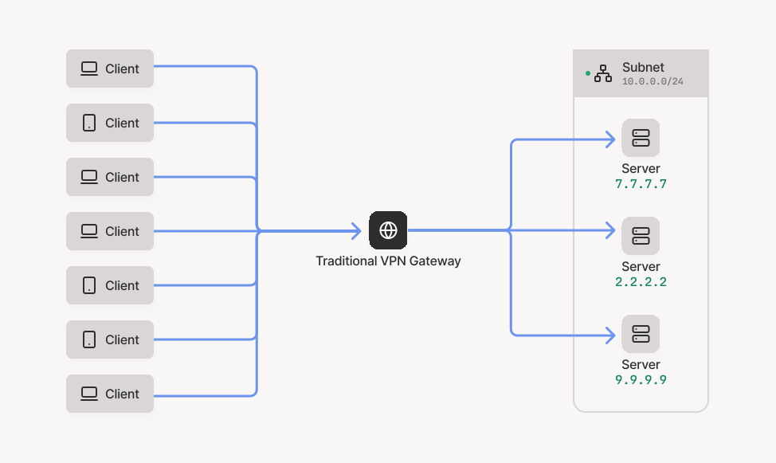
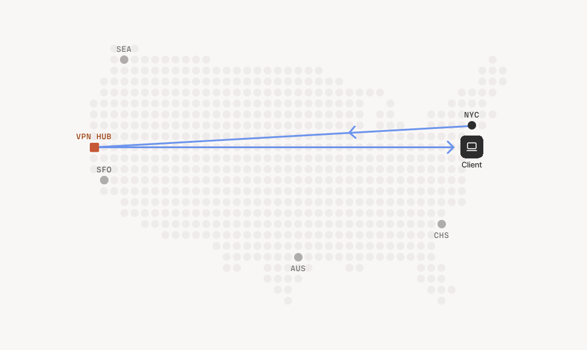
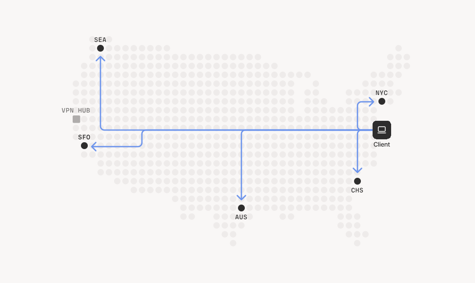
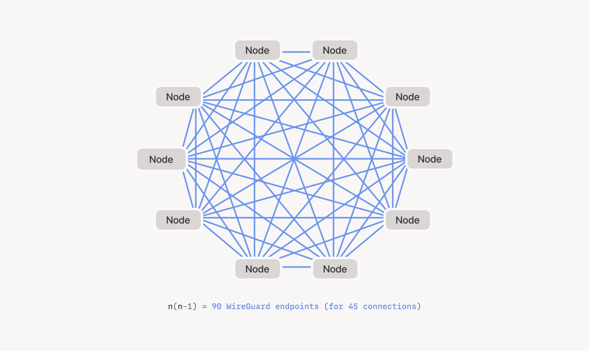
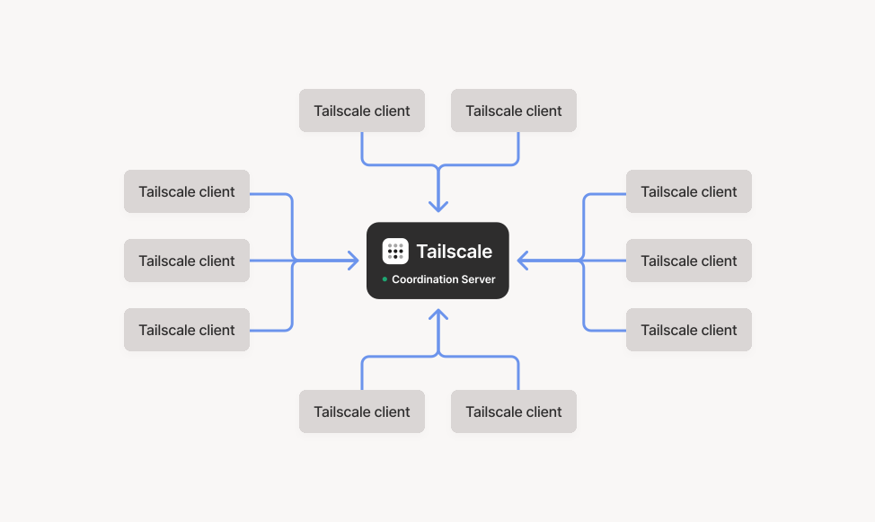
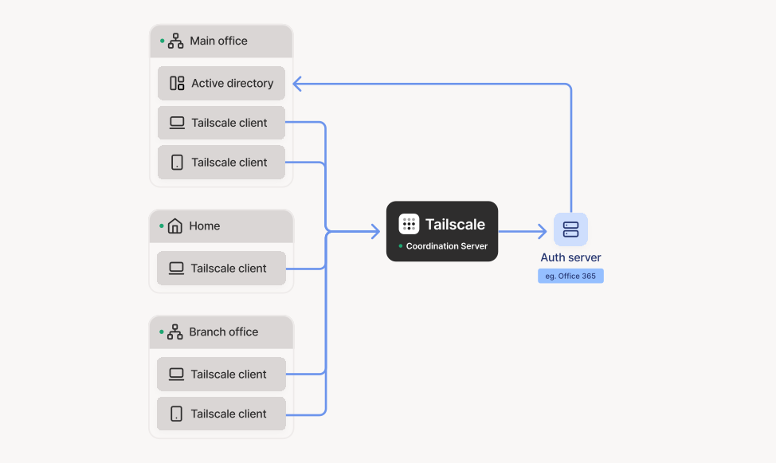
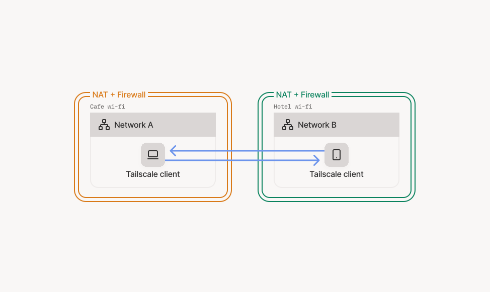
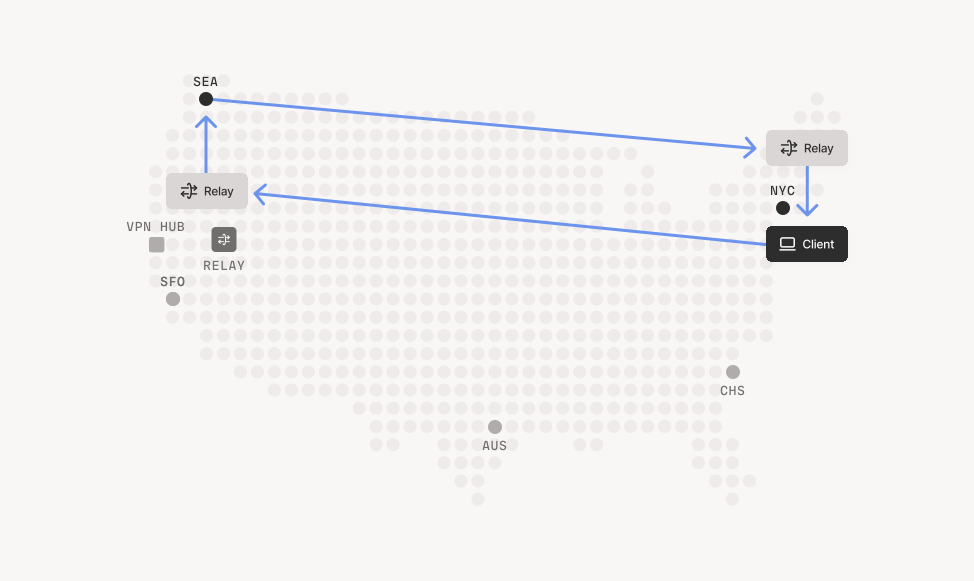
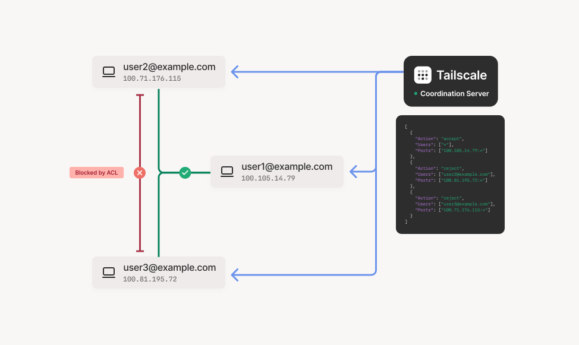

> [!NOTE] 译者序
> 本文翻译自 Tailscale 官方技术博客的架构奠基之作 [《How Tailscale works》](https://tailscale.com/blog/how-tailscale-works)，原作者为 Tailscale 联合创始人兼 CEO **Avery Pennarun**（著名开源黑客，`bup`、`sshuttle` 的作者）。
>
> 如果说前一篇 [《NAT 穿透是如何工作的》](/blog/posts/how-nat-traversal-works/) 是从微观的 Socket 与数据包层面手撕防火墙与打洞算法，那么本文则是从**宏观的系统工程与网络拓扑**层面，彻底推翻传统中心化 VPN，建立起一套“控制面集中、数据面分布式”的现代零信任虚拟组网全景图。
>
> 译文完整收录了 Tailscale 原版由设计师 Ross Zurowski 绘制的全部 9 张高清网络架构矢量图，并对中心辐射缺陷、WireGuard 点对点网状拓扑、基于身份的分布式 ACL 及双向记账审计机制进行了深度剖析。

---

## Table of contents

---

## 序言：自底向上的全新网络抽象

经常有人问我们：**Tailscale 到底是怎么运转起来的？**

之前我们总是一直推迟回答这个问题，原因很简单——我们一直在飞速重构和迭代它！但现在，这套体系的底层基石终于尘埃落定。

今天，就让我们自底向上、沿着我们最初构建它的足迹，完整遍历整个 Tailscale 系统的每个层级（当然，我们会跳过沿途踩过的一些弯路）。

掌握了本文介绍的这套架构哲学，你甚至完全有能力亲手从零写出一个属于你自己的 Tailscale 替代品……不过你完全没必要这么折腾，因为我们的客户端节点软件是 100% 开源的，而且提供了极其慷慨的免费使用计划。

---

## 数据平面（Data Plane）：WireGuard® 的基石

Tailscale 最底层的网络基座，是近几年来在开源社区声名鹊起、设计精湛的 **WireGuard**（具体而言，我们采用了其纯用户态的 Go 语言实现版本：`wireguard-go`）。

WireGuard 的核心能力，是在你的物理电脑、虚拟机或容器（WireGuard 将其统称为“端点/Endpoint”，在本文中我们统称为 **“节点/Node”**）与网络中的其他节点之间，创建一组**极度轻量级的加密虚拟隧道**。

这里我们必须先澄清一个极其普遍的误区：

在大多数情况下，不管是传统的 VPN 用户还是大多数初尝 WireGuard 的开发者，往往都会习惯性地搭建一个 **“中心辐射型（Hub-and-Spoke）”** 架构——每个客户端设备（比如你的笔记本）都连接到一个位于公网的中心“集中器（Concentrator）”或 VPN 网关。

---

## 传统中心辐射型网络（Hub-and-Spoke）的困境



这是搭建 WireGuard 最简单直观的方式。

因为在 WireGuard 的原生设计中，任何两台想要直接通信的节点，**都必须预先知道对方的公钥、公网 IP 地址以及监听端口号**。

如果你的网络里有 10 台机器想要全互联，那么每个节点都必须预先配置其余 9 个节点的元数据，整张网络总共需要维护 $10 \times 9 = 90$ 个独立的隧道端点配置！

但在中心辐射型（Hub-and-Spoke）模型下，你只需要一个固定的中心 Hub 节点和 9 个外围节点（通过“辐条”与中心相连），配置瞬间被简化到了极致。中心 Hub 节点通常拥有一个静态公网 IP，防火墙上开好端口，人人都能轻松找到它。随后，它就像传统的客户端/服务器（C/S）互联网协议一样，欣然接受来自各个防火墙后方客户端的主动入站连接。

中心辐射模式确实能工作，但它的硬伤也是致命的。

首先，绝大多数现代企业**根本就不存在一个所谓绝对唯一的物理中心**。企业拥有散布在全球的多个办公室、横跨 AWS/Azure/GCP 的多个云数据中心、各种 VPC 子网等等。

在传统 VPN 架构中，企业往往被迫指定一个唯一的 VPN 集中器网关，然后在这个集中器与各个物理机房之间搭建次级隧道（通常基于古老繁琐的 IPsec）。这就导致：远程办公的员工必须先千里迢迢把流量打到集中器网关上，再由网关中转转发给真正的数据中心。

这种传统架构的扩展性极其恶劣，会引发臭名昭著的 **“长途回折（Hairpinning / 弯路时延）”** 灾难：

1. 远程员工可能离 VPN 集中器非常遥远（高延迟）；
2. 员工真正想访问的目标服务器，离集中器可能同样非常遥远（再次叠加高延迟）。

想象下面这个让无数远程开发者抓狂的真实惨剧：**一名身处纽约的工程师，试图连接同样位于纽约机房的一台服务器，结果数据包硬生生被 VPN 绑架，先横跨整个美洲大陆绕道旧金山总部的 VPN 网关，再一路颠簸发回纽约！**



幸运的是，WireGuard 的设计理念彻底打破了这一桎梏。

还记得我们前面说 WireGuard 创建的是**一组“极度轻量级”的加密隧道**吗？它的隧道开销是如此之小，以至于我们无需费太大周折，就能轻松构建一个多中心（Multi-hub）拓扑：



但唯一的掣肘在于：此时你的每一个数据中心都需要一个静态公网 IP、一个开放的防火墙端口，以及一套成套的 WireGuard 密钥对。

每当你入职一名新员工，你就必须把这名员工的新公钥分发推送到全部 5 台服务器上；每当你上线一台新服务器，你又得把这台服务器的公钥分发给成百上千名员工。

虽然这比单个 Hub 多了 5 倍的运维心智负担，但咬咬牙似乎还能顶住……对吧？

---

## 真正的点对点网状网络（Mesh Networks）

到目前为止，我们聊的依然是中心辐射型网络。虽然用 WireGuard 搭建多中心并不算太难，但配置依然繁琐，而且我们还没探讨最危险的密钥生命周期管理。

更重要的是，中心辐射架构在本质上存在一个极其别扭的缺陷：**它根本不允许你的两台客户端设备直接对话！**

如果你像我一样经历过早期的互联网时代，你应该还记得：曾经的计算机是可以**直接互相传输文件**的，根本不需要把数据先上传到云端再下载下来。信不信由你，最初的互联网本来就是这样全互联运转的！

悲哀的是，现代互联网的拓扑结构在过去的几十年里，几乎是在无意中一步步蜕化成了纯粹的中心辐射型设计——全世界所有的数据都被迫流经各大头部云厂商的中心数据中心，被他们狠狠赚取高昂的流量中转租金。

既然 WireGuard 隧道是如此极致轻量，**为什么我们不能直接让所有节点与所有其他节点直接相连呢？**

这种让任意两台机器直连的拓扑，就是 **全互联点对点网状网络（Point-to-Point Mesh Network）**：



这种架构无比优雅——它能让开发者设计出纯粹、低时延的高性能点对点应用。

但要想在工程上落地它，简直是一场噩梦：

1. **组合爆炸的密钥分发**：正如前面推算的，一张仅仅 10 个节点的网络就需要维护 $10 \times 9 = 90$ 个隧道端点；每个节点必须知道自己的私钥以及另外 9 个节点的公钥与端点地址。每次密钥轮转、人员离职、新增机器，都需要全局同步更新。
2. **动态 IP 与漫游迷踪**：真实世界的员工电脑几乎没有任何一台拥有静态 IP。设备在休眠唤醒、切换 Wi-Fi、插拔网线时，IP 瞬息万变，节点之间如何重新寻路？
3. **防火墙与 NAT 的深渊**：你不可能让员工去星巴克喝咖啡、住酒店或在机场连 Wi-Fi 时，要求公共路由器的管理员给他的笔记本开一个入站端口映射。
4. **安全合规与审计真空**：传统企业依赖中心防火墙阻断非法访问和记录审计日志。一旦数据彻底走端到端 P2P 直连，流量不再流经中心网关，你该如何实施访问控制（ACL）并记录合规审计？

**而 Tailscale 的全部价值，就是把上述所有噩梦一次性彻底解决！**

接下来，就让我们一步步揭开这套复杂系统的面纱。

---

## 控制平面（Control Plane）：密钥交换与协调中心

经过前面的推演，我们已经明确了目标：**构建一张让任意两台机器点对点直连的 WireGuard Mesh 局域网。**

那些让人头疼的动态 IP 和防火墙 NAT 暂时放一边（后文会专门攻坚）。我们先假设一个理想乡：全世界所有设备都有静态公网 IP，没有防火墙阻拦。

在此前提下，**我们该如何让成千上万台设备安全、自动化地拿到彼此的 WireGuard 公钥与连接元数据？**

为了解决这个问题，我们在每个终端上运行轻量级的开源 **Tailscale 节点软件**。所有节点都会连接一个由 Tailscale 托管的中心化协调枢纽——我们称之为 **“协调服务器（Coordination Server）”**（在我们的生产环境中即 `login.tailscale.com`）。

你可以把协调服务器形象地理解为**一个用于交换公钥与元数据的共享安全邮箱（Drop Box）**：



等一下！看到这里你可能会警惕起来：“**兜兜转转，你们难道不是又退回了中心辐射（Hub-and-Spoke）模型吗？**”

**完全不是！**

请务必严格分清**控制平面（Control Plane）**与**数据平面（Data Plane）**的本质差异：

* **控制平面是中心辐射型的**：所有的节点确实都连接到中心协调服务器，但这无关痛痒，因为**控制平面上跑的流量几乎为零**！它仅仅在初次握手或网络拓扑变更时，传输几个只有几百字节的加密公钥和策略配置。
* **数据平面是彻底去中心化的 Mesh 网状网络**：用户真正的所有大流量数据包（文件传输、音视频流、SSH、数据库查询），**百分之百直接在节点之间点对点疾驰，绝对不经过控制服务器！**

我们极其推崇这种“中心化管控 + 分布式执行”的混合架构。企业与技术团队往往渴望对安全策略拥有**全局集中的掌控力**，但他们绝不想要一个扼杀数据吞吐的**中心性能瓶颈**。传统 VPN 集中器把两者捆绑在一起，一遇高并发就当场暴毙；而 Tailscale 的实际数据吞吐能力，会随着节点数量的增加而呈现**线性的分布式水平扩展**！

#### 密钥交换的具体时序

整个协调过程极其优雅严密：

1. **本地生成密钥**：每个节点在本地随机生成自己的 WireGuard 公私钥对，并将公钥与当前节点的身份账号完成绑定。
2. **投递公钥**：节点主动连接协调服务器，留下自己的公钥，并附上一段元数据笔记：“我现在位于哪个网络地址，我属于哪个租户域”。
3. **拉取网络拓扑**：节点从协调服务器下载同域内其他节点留下的公钥列表与连接端点。
4. **配置 WireGuard 驱动**：节点在本地自动调用接口，为 WireGuard 配置好这组对等公钥与路由表项。

> [!WARNING] 绝不妥协的零信任铁律
> **私钥永远、永远不会离开它被生成的本地设备！**
> 私钥是协商 WireGuard 会话时证明节点身份的唯一凭证。正因为私钥绝不出门，**全网只有正在通话的两台对等机器自身，才具备解密通信数据包的能力！**
> 这就是现代架构所倡导的 **“零信任网络（Zero Trust Networking）”**：端到端强加密，链路中间的任何路由器、ISP、甚至 Tailscale 官方服务器，都绝无可能偷窥或篡改你的任何明文数据。

*(注：唯一的例外是当你主动配置并开启了“子网路由/Subnet Routers”功能时。这是为了兼容传统老旧机房网络，由指定的 Tailscale 节点充当边缘网关将数据包解密后转送进物理内网，这也是 Tailscale 支持渐进式迁移的关键所在。)*

---

## 身份联动与双因子认证（Login and 2FA）

但是，上面的推演中还隐藏着一个极其致命的细节：

**协调服务器凭什么知道某台机器应该把公钥分发给谁？它怎么知道这台机器真的属于你？**

公钥本身就像它的名字一样，是完全公开的，就算泄露给全世界或者贴在公告栏上也不会造成安全隐患。这就像你给服务器配置 SSH 时把 `id_rsa.pub` 拷进 `authorized_keys` 一样：公开公钥很安全，但你必须极其严密地审视**究竟把谁的公钥放进白名单里**。

决定这件事情的最传统做法是搞一套“账号+密码”（即预共享密钥 PSK）。想要入网？先登录输密码，然后上传公钥。进阶一点，再加上短信验证码或 Google Authenticator 双因子认证（2FA/MFA）。

但 Tailscale 走了一条完全不同的道路：**我们自己坚决不存任何用户的密码，坚决不造一套孤立的账号系统！**

相反，Tailscale **将全套身份认证彻底委托给现成成熟的第三方身份提供商（IdP）**——全面拥抱基于 **OAuth2、OIDC（OpenID Connect）** 或 **SAML** 的单点登录协议（SSO）。最典型的就是大家每天都在用的 Google Workspace (Gmail)、Microsoft Office 365 等。



你的身份提供商（如 Okta、Google）掌管着你的组织用户花名册、密码策略、硬件安全密钥（FIDO2/YubiKey）以及双因子认证。

这种架构带来了极其震撼的收益：

1. **企业无需维护第二套 VPN 账号**：你离职或者被 Google Workspace 停用账号的瞬间，你的 Tailscale 网络权限瞬间蒸发。
2. **零隐私数据负担（Zero PII）**：Tailscale 官方服务器上根本不存储你的密码哈希，甚至不知道你的敏感个人信息，因此极度安全。
3. **秒级即时激活**：当你在 Mac 或 iPhone 上下载客户端并点击“登录”，通过浏览器完成企业 SSO 验证后，Tailscale 会立刻为你所在的组织域开辟一个安全的密钥中继空间，与其他设备完成公钥交换。

短短两分钟，配置完毕，Mesh 网络点亮！

---

## NAT 穿透：撕裂两端防火墙的黑魔法

……等等，我们依然还没有真正跨越现实的鸿沟。

还记得吗？前面推演时我们假设了“每台机器都有静态公网 IP，且没有任何防火墙拦截”。

但在现实世界里，你的设备可能连着咖啡馆极其垃圾的 Wi-Fi、可能在高铁上用只有一格微弱信号的 4G 热点、可能躲在严格限制入站的企业光猫之后：



双方都没有公网 IP，双方都没有对外开放端口。

在过去，很多网络软件会要求你“在路由器后台开启 UPnP”，但这招在商业网络中基本百分之百不奏效，就算能用，也因为巨大的安全漏洞早被网管全面封杀。

面对这个看似死局的难题，Tailscale 研发了一整套基于互联网 **STUN（RFC 5389）** 与 **ICE（RFC 8445）** 标准演进的绝世神技——**即使两端都处于 NAT 与严格有状态防火墙后方，也能在没有任何公网端口开放的情况下，硬生生砸穿两道屏障建立端到端直连！**

> [!TIP] 深度阅读推荐
> 关于 Tailscale 穿透技术的全部硬核工程细节（有状态防火墙记忆时序、EIM/EDM 锥形矩阵、生日悖论概率碰撞、CGNAT 发夹弯与全路径竞速探索），请务必精读我们专栏的上一篇万字长文：
> 👉 [**《NAT 穿透是如何工作的：技术原理与终极指南》**](/blog/posts/how-nat-traversal-works/)

---

## 加密中继（DERP）：封杀 UDP 时的终极保底

万事俱备，只欠东风。

在真实网络世界的阴暗角落里，还潜伏着一些极其残暴的网络环境：比如直接封杀一切非 53 端口 UDP 流量的严苛公共 Wi-Fi，或者 NAT 映射规则变态到连数学概率都无法穿透的极度对称型网络。

面对这些连 STUN 和 ICE 都无能为力的长尾绝境，Tailscale 拿出了最后的底牌——全球分布的 **DERP（Designated Encrypted Relay for Packets，指定加密数据包中继）** 服务器阵列。

DERP 扮演的角色类似于传统 ICE 架构中的 TURN 服务器，但它比老旧臃肿的 TURN 强大得多：**它完全基于标准的 HTTPS（TCP 443）长连接构建，并基于 WireGuard 节点的公钥进行数据包路由！**



*(题外话：尽管上面的示意图画得像只有美国节点，但我们实际上在全球各大骨干机房部署了数十个 DERP 节点。用我们首席设计师 Ross 的原话来说：“我本来很想把伦敦画进去，但要想找到两张投影方式兼容且非墨卡托投影的矢量图简直是场灾难。” 看，这就是我们对技术严谨性的执念——另外，赶紧放弃使用误导性极大的墨卡托投影地图吧！)*

关于 DERP，有两点至关重要：

1. **DERP 绝不可能偷窥数据**：因为 WireGuard 的私钥始终留在本地设备，流经 DERP 的所有数据本身早已被对端公钥高强度加密。DERP 只是一个瞎子信使，盲目地将密文从一个公钥转发给另一个公钥，就像公网上的普通路由器一样。
2. **曲线救国赋予 WireGuard “TCP 模式”**：WireGuard 原生协议只支持 UDP。但由于 Tailscale 客户端无缝集成了对 DERP（HTTPS/TCP）的支持，当 UDP 彻底瘫痪时，节点会自动回退走 DERP，**等于变相为 WireGuard 赋予了穿透极其严苛网络的 TCP 传输能力！**

---

## 进阶设计一：分布式 ACL 与安全访问策略

很多人习惯性地把 VPN 归类为“安全软件”。这种直觉很普遍，毕竟 VPN 浑身堆满了加密算法、公私钥和证书。

但从系统本质来说，**传统 VPN 根本不是“安全软件”，而是“连通性软件”！** 它的本职工作是扩大能够进入你内网的设备数量，而不是像安全软件那样去收缩和限制它。

正因如此，传统的集中式 VPN 网关（Hub-and-Spoke）必须与笨重的防火墙捆绑销售：所有流量打到 VPN 集中器后，立刻灌进防火墙，防火墙根据硬编码的内网 IP 地址去套 ACL 规则，最后才放行进核心网络。

但这种模式痛苦不堪：
* 防火墙规则是基于冰冷无常的 **IP 地址** 编写的，而不是基于具体的 **“用户”** 或 **“角色”**；
* 如果你在全球有多个机房（多 Hub），你必须在每一个机房的防火墙上把规则完全同步一遍，漏配一条就会引发安全事故；
* 网络层太不安全，逼得大家必须在传输层和应用层疯狂叠甲（为什么你在公司内网还得用 SSH 和 HTTPS？因为内网本身根本无法被信任！）。

而当你切换到去中心化的 Mesh 网络时，这个问题瞬间被推到了风口浪尖：**既然根本没有中心网关，你的防火墙规则到底该往哪儿放？！**

Tailscale 给出的答案石破天惊：**把防火墙下沉到每一个独立的节点中！由每个节点在本地解密数据包的瞬间，自主执行拦截！**



为了让管理如丝般顺滑，企业的全套安全策略在 Tailscale 控制台上**统一集中编写**（使用清晰的用户身份与标签，如 `tag:prod`、`group:eng`），随后由协调服务器自动推送到每个节点的内存中。

**这就是终极的“集中化策略制定，分布式边缘执行”！**

更绝妙的是最外层的保护：协调服务器（安全邮箱）只会把某台机器**真正有权限连接**的对端公钥推给它。对于那些未经授权的外部机器，本地节点连对方的公钥都拿不到。

这意味着什么？这意味着未经授权的机器发送的任何探测包，由于本地没有对应的解密密钥，**在内核驱动层直接被当作噪声静默丢弃！**

在攻击者的视角下，**你的服务器在网络空间中根本就不存在！** 任何针对网络协议漏洞的端口扫描和探测在这里全部失效。对于保护那些年久失修、无法打补丁的老旧内部系统，这种防护能力具备降维打击级的威力。

---

## 进阶设计二：复式记账审计日志（Audit Logs）

强合规企业的另一个核心诉求是：**审计追踪（Audit Trails）**。

传统的物理防火墙不仅阻断流量，还会把每一笔连接记入日志。既然 Tailscale 连中心流量漏斗都没有，企业该怎么审计？

Tailscale 的创新再次让人击节赞叹：**我们让通信两端的每一个节点，将所有内部连接的元数据，以异步流式的方式实时上报给中央日志服务。**

这种设计带来了一个极具密码学美感的副产物——**复式记账（Double-entry Logging）**：

> **网络中的每一次端到端会话，都会在源端设备与目的端设备上同时记录两笔账！**

这使得篡改日志在数学上变得几乎不可能——任何恶意攻击者如果想要抹掉自己的入侵痕迹，他必须在**几十毫秒的实时流式上报窗口内**，同时黑掉源端和目的端两台完全独立的物理机器并同步修改日志！这种攻击成本在工程上直接被拔高到了天花板。

而且，每个节点上报的仅仅是内部拓扑建立的最小元数据，绝对不包含员工的互联网浏览轨迹或个人隐私。

---

## 进阶设计三：渐进式零信任演进（Incremental Deployment）

面对 Tailscale 这样一套颠覆性的 Overlay 虚拟网络，许多架构师最大的顾虑通常是：**“我们必须一次性把全公司的老网络全部掀翻重来吗？”** 很多声称主打 Google BeyondCorp 或零信任的产品往往强制要求全量替换。

答案是：**绝对不需要。Tailscale 天生就是为“渐进式演进”而生的。**

你完全可以在没有任何硬件采购、不搭建任何自建服务器的情况下，在两分钟内启动 PoC 概念验证：

```
第一阶段：微型起步 (Day 1)
  只需在两台开发机上安装客户端并用统一账号登录，点对点通道瞬间打通，
  丝毫不影响既有的物理网络和老旧安全配置。

第二阶段：子网中继桥接 (Week 1)
  在某个核心机房的一台 Linux 虚机上开启“Subnet Router”子网路由功能，
  立刻为全体员工打通通往该机房特定内网网段的安全访问，搭建起混合架构。

第三阶段：全域零信任 (Month 1+)
  随着信心建立，在越来越多的核心生产服务器、Kubernetes 容器集群中原生接入 Tailscale，
  实现全链路主机到主机的端到端强加密。
```

当最后一台服务器完成接入，局域网中再也没有任何未加密的明文流量裸奔，你的企业便顺理成章地达成了原本遥不可及的**终极零信任网络（Zero Trust Networking）**！此时，你便可以从容地将那些笨重不堪的传统老旧 VPN 网关优雅下线。

---

## 结语：重塑去中心化网络的未来

从 WireGuard 的轻量级数据平面，到协调中心的元数据中继；从 OIDC 身份解耦，到 STUN/ICE 撕裂 NAT；从分布式入站 ACL，到双向记账审计——Tailscale 用精妙的工程权衡，重新定义了现代网络连接的范式。

它不仅撕下了传统 VPN 集中器的性能枷锁，更将原本被各大云厂商割裂的互联网，重新缝合成了一张任何两台设备都能随时随地自由对话的去中心化纯净网络。

*(再次向我们才华横溢的设计师 Ross Zurowski 致敬，感谢他为本文绘制的精彩图解！)*
