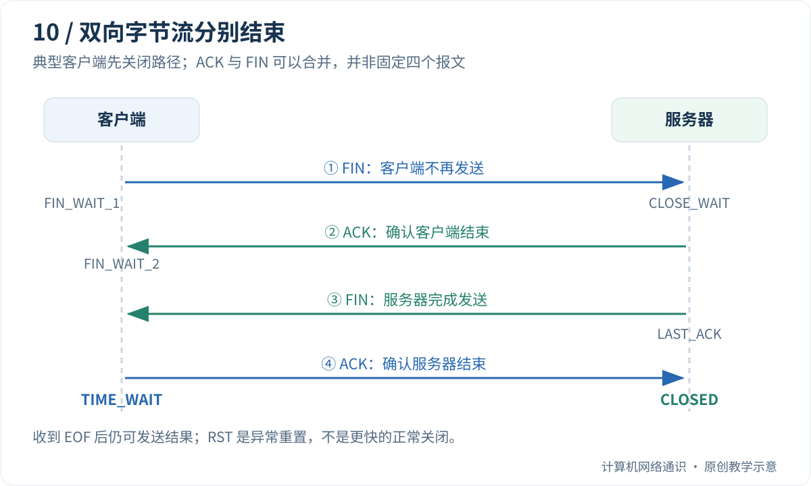

在经历了三次握手的建立、序列号的可靠确认以及滑动窗口的高速调度之后，通信双方终于完成了全部数据的传输。

在很多人的直觉中，“结束一段通信”理应像挂断电话一样利落干脆。然而，TCP 在断开连接时，却设计了一套极其繁琐、充满仪式感的**“四次挥手（Four-Way Wavehand）”**：

- 为什么三次握手可以把服务端的 SYN 和 ACK 合并在一个包里发出，而四次挥手**却坚决不能合并，一定要把中间两步拆开？**
- 客户端在敲下 `close()` 之后，明明已经断开连接，为什么在 `netstat` 监控中，它的套接字还要在内存里像幽灵一样死死驻留长达一两分钟的 **`TIME_WAIT`** 状态？
- 生产环境报警中，如果服务器上突发出现了数万个处于 **`CLOSE_WAIT`** 状态的连接，为什么说这**百分之百是后端业务代码犯下了低级的重大 Bug？**
- 什么是 **`RST`（复位报文）**？为什么向一个已经关闭的连接写入数据，操作系统会直接抛出令进程当场暴毙的 `SIGPIPE` 信号？

本文将全面解构 TCP 连接终结的完整生命周期，深入剖析双向全双工流的“半关闭（Half-Close）”本质，并彻底讲透 `TIME_WAIT` 与 `CLOSE_WAIT` 的内核机制与排障军规。

## Table of contents

## 第一章：全双工信道的半关闭（Half-Close）哲学

在探讨挥手时序之前，我们必须重温 TCP 最底层的物理特性：

> **TCP 是一条全双工（Full-Duplex）通信信道！**
>
> **在物理上，一条 TCP 连接由两条完全独立、互不干扰的“反向单向字节流”拼装而成！**
>
> - 方向 A $\to$ B：由 A 的发送缓冲区与 B 的接收缓冲区构成；
> - 方向 B $\to$ A：由 B 的发送缓冲区与 A 的接收缓冲区构成。

因此，关闭一段 TCP 连接，在逻辑上必须被严格拆分为两次相互独立的动作：

1. **A 向 B 声明**：“我的数据已经全部发完了，我将关闭向你的发送信道！”
2. **B 确认收到**，此时系统进入 **半关闭（Half-Close）状态**：A 不能再发数据，但**B 依然可以毫无阻碍地继续向 A 发送剩余的业务数据**！
3. 等 B 把自己想发的话也彻底讲完了，**B 再向 A 声明**：“我的数据也全部发完了，关闭我向你的发送信道！”
4. **A 确认收到**，整条全双工信道才宣告彻底死亡！

这就是为什么 TCP 断开连接**必然需要两对独立的“请求-确认”，合计共四次交互！**

---

## 第二章：四次挥手的完整时序与状态演进

一次标准的 TCP 四次挥手过程与两端操作系统内核的状态机变迁如下：



```text
主动关闭方 (Active Closer)                              被动关闭方 (Passive Closer)
[状态: ESTABLISHED]                                     [状态: ESTABLISHED]
      │                                                        │
      │ ──── 1. FIN 报文 (FIN=1, seq=u) ─────────────────────> │ ──> 被动方进入 [CLOSE_WAIT] 状态
      │      (主动方进入 [FIN_WAIT_1] 状态)                      │     (内核自动回送 ACK, 应用层 read 返回 0)
      │                                                        │
      │ <─── 2. ACK 报文 (ACK=1, seq=v, ack=u+1) ──────────── │
      │      (主动方进入 [FIN_WAIT_2] 状态, 等待对方发 FIN)      │
      │                                                        │
      │                                                        │ ⭐️ 被动方应用层处理完残留数据，调用 close()
      │                                                        ▼
      │ <─── 3. FIN 报文 (FIN=1, ACK=1, seq=w, ack=u+1) ────── │ ──> 被动方进入 [LAST_ACK] 状态
      │                                                        │
      │ ──── 4. ACK 报文 (ACK=1, seq=u+1, ack=w+1) ──────────> │ ──> 被动方收到 ACK, 彻底销毁进入 [CLOSED]
      │                                                        │
      ▼                                                        ▼
主动方进入 [TIME_WAIT] 状态！
(强制倒计时 2MSL 时间后，才彻底释放套接字进入 CLOSED)
```

### 为什么第 2 步和第 3 步绝对不能合并？（三次握手 vs 四次挥手）

很多人纳闷：三次握手时，服务端的 SYN 和 ACK 就能合体成一个报文发出，为什么挥手时服务端的 ACK 和 FIN 非要分家？

> **极其精妙的操作系统内核分层原因**：
>
> - **第 2 步回复 ACK**：是由**操作系统内核的 TCP 协议栈在底层完全自动完成的！**
>   一旦网卡收到客户端发来的 FIN，内核协议栈毫秒不拖延，立刻自动回复 ACK。客户端收到后就知道：“对方已经收到我的关闭申请了”；
> - **第 3 步发送 FIN**：**内核绝对无权擅自替应用程序发送！它必须等待被动方的“用户态业务应用程序显式调用 `close()` 或 `shutdown()`”！**

此时，被动方的应用层代码才刚刚在 `read()` 调用中收到了一个 `0`（代表对端已关闭，遇到文件结束符 EOF）。
被动方可能还有大量未写完的日志、未落盘的响应数据需要继续通过现存的半双工信道推给对方。
**被动方的应用程序何时处理完、何时调用 `close()`，在时间上具有完全不可预测的业务动态性（可能是 10 毫秒，也可能是 2 秒钟）！**
因此，操作系统绝不可能在第 2 步把 FIN 和 ACK 合并在一个包里，中间两步必须彻底解耦、独立发包！

---

## 第三章：`TIME_WAIT` 状态——2MSL 守护神的双重物理使命

整个四次挥手体系中最令人着迷、也是生产线上最容易引发争论的状态，莫过于主动关闭方在最后时刻经历的 **`TIME_WAIT`（时间等待）**。

主动关闭方发出最后一个 ACK 后，它并没有立刻退场，而是在内核中被强制挂起了一个长达 **2MSL** 的倒计时。

- **`MSL`（Maximum Segment Lifetime，报文最大生存期）**：
  任何一个 IP 数据报在网络中能够存活的最大物理时间（RFC 793 建议为 2 分钟，现代 Linux 内核通常硬编码设为 **30 秒或 60 秒**）。
- **`2MSL`**：即一个报文单程发送的最大寿命加上确认报文返回的最大寿命，总长通常为 **60 秒到 120 秒**。

**主动关闭方为什么要傻等长达两分钟才肯释放内存？**
它在坚守两项神圣的物理使命：

### 使命一：可靠终结连接，防止被动方死锁

假设在极端情况下，主动方发出的**最后一个 ACK 报文在网络中丢包了**！

1. 被动方迟迟收不到第四次确认，会认为自己的第三次 FIN 丢了，触发超时重传，重新向网络补发第三次 FIN；
2. **如果主动方没有 `TIME_WAIT`**，发完 ACK 就当场自杀销毁了套接字：
   当迟来的重传 FIN 飞到主动方时，主动方的操作系统由于找不到对应的通信会话，会冷冰冰地回复一个 `RST` 报错报文！
   被动方收到 `RST`，认为通信发生非正常崩溃，抛出 `Connection reset by peer` 异常退出！
3. **有了 `TIME_WAIT` 的坚守**：
   主动方在 2MSL 期间内依然活着。只要再次收到被动方重传的 FIN，主动方能够再次平稳补发 ACK，**确保被动方能够体面、正常、优雅地关闭退出！**

### 使命二：让网络中残留的历史“迷途报文”彻底死在路上

我们在第 7 篇推导过，旧数据包可能会在路由器的深层队列中发生长时间的迷途滞留。

- 经过 `2MSL` 的漫长静默等待，足以确保**本次连接在传输过程中所产生的每一个迷途数据包，其 TTL 都在物理光纤中全部归零消耗殆尽并彻底消亡！**
- 当未来有新的业务在相同的四元组（源IP、源端口、目的IP、目的端口）上建立新连接时，**绝不可能有任何上一次连接的陈年死数据跳出来进行干扰和数据污染！**

---

## 第四章：生产级避坑指南——`TIME_WAIT` 与 `CLOSE_WAIT` 事故排查

在生产监控中，`netstat -n | awk '/^tcp/ {++S[$NF]} END {for(a in S) print a, S[a]}'` 往往能暴露出截然不同的运维底色。

### 1. 产生海量 `TIME_WAIT` 是不是故障？

在大型微服务架构中，经常发现前端接入层（如 Nginx、API 网关）上积攒了成千上万个 `TIME_WAIT`。

> **底层定性准则**：
>
> **`TIME_WAIT` 永远只会出现在——“主动发起关闭的那一方”！**
>
> HTTP/1.1 协议中，服务端在响应完成后如果主动断开短连接，服务端就会成为主动关闭方，从而背上海量的 `TIME_WAIT`。
> 它是一个**完全合法的正常网络协议状态**，并不代表程序出 bug 了。

#### 高并发短连接下的资源耗尽风险与对策

成千上万个处于 `TIME_WAIT` 的套接字会占用内核微量内存（每个几十字节），并霸占本地端口，导致新连接发起时报错 `Cannot assign requested address`（本地端口耗尽）。

**工业级化解方案**：

1. **启用长连接（Keep-Alive）与连接池（Connection Pool）**：
   从根本上减少短连接的频繁创建与销毁，让成百上千次 HTTP 请求复用同一个底层 TCP 管道；
2. **开启地址端口复用选项：`SO_REUSEADDR`**：
   在服务器代码中声明：
   ```c
   int opt = 1;
   setsockopt(listen_fd, SOL_SOCKET, SO_REUSEADDR, &opt, sizeof(opt));
   ```
   允许处于 `TIME_WAIT` 状态的端口被立即重新绑定启动，**彻底终结服务重启时由于端口被占而报错 `Address already in use` 的生产噩梦！**

---

### 2. 线上重大事故：数万个 `CLOSE_WAIT` 堆积崩塌

如果监控大盘显示后端业务机器上出现了成千上万个 **`CLOSE_WAIT`**，请立刻拉响最高级别的生产警报！

> **致命定性**：
>
> **`CLOSE_WAIT` 永远出现在“被动关闭方”！**
>
> **海量 `CLOSE_WAIT` 堆积，百分之百意味着——你的后端业务应用程序内部犯下了极其严重的严重代码缺陷（Bug）！**

```text
对方发来 FIN ───> 内核自动回了 ACK ───> 进入 [CLOSE_WAIT] 状态
                                                │
                                                ▼ 此时应用层读到了 EOF (返回 0)
                                        ⭐️ 程序员的业务代码卡死了!
                                           或者由于异常未执行 close(sockfd)!
                                                │
                                                ▼ (永远无法发出第三次 FIN)
                                      连接永久死锁在 CLOSE_WAIT 状态!
```

#### 常见灾难场景诱因

1. **未在分支中关闭套接字（Resource Leak）**：
   程序员在 `read()` 返回 0 之后，由于中间发生了异常，代码 `catch` 之后直接 `return`，**遗漏了底部的 `close(sockfd)`**；
2. **连接池内部死锁**：
   工作线程在处理逻辑时陷入了数据库死锁，或者在调用第三方外部 RPC 接口时未设置超时时间导致线程无限挂起，**根本没有机会去执行关闭动作**！

#### 灾难后果与急救

每一个处于 `CLOSE_WAIT` 的连接，都霸占着一个操作系统的**文件描述符（FD）**和一块套接字内存！
当积攒到数万个时，该进程的文件描述符瞬间达到上限（`Too many open files`），**整台服务器拒绝接收任何新的网络请求，服务当场彻底宕机！**

**急救手段**：通过 `lsof -p <PID>` 定位堆积连接的进程，采集 JStack / GDB 线程调用栈取证后，紧急重启该服务进程释放文件描述符！

---

## 第五章：强行斩断——`RST` 报文与非正常断开

四次挥手是绅士般的和平分手（Graceful Teardown）。但在残酷的现实中，TCP 同样拥有直接掀桌子的冷酷手段——**`RST`（Reset，复位连接报文）**。

### 1. 触发 `RST` 的三大经典物理场景

1. **访问一个未被监听的端口**：
   你向服务器的 8080 端口发送 SYN，但服务器根本没有开启 8080 端口服务。服务器内核绝不会等待，而是**直接回送一个带有 `RST=1` 的报文，秒级打回请求！**（客户端报错 `Connection refused`）；
2. **发生严重异常时强行切断**：
   应用程序由于 OOM 或段错误被操作系统强杀，内核清理资源时，直接向对端发射 `RST` 报文，粗暴销毁通信链路，不走漫长的四次挥手；
3. **向一个已经对端关闭的信道写入数据（破裂管道）**：
   对方已经调用了 `close()` 关闭了连接。如果我方没有正确感知，执意调用 `write(sockfd, ...)` 往里面塞数据，对方内核收到后发现该连接已死，立刻回送 `RST`！
   如果我方执意继续第二次写入，操作系统会直接向我方进程发送 **`SIGPIPE`（13号破裂管道信号）**！
   在默认情况下，未注册处理器的进程在收到 `SIGPIPE` 时会**直接被操作系统就地击毙终止！** 现代高性能服务端开发必须显式忽略该信号：`signal(SIGPIPE, SIG_IGN)`。

---

## 总结与专栏全局视野

在本篇《计算机网络通识（十）》中，我们解构了全双工连接优雅终结的底层奥秘：

1. **全双工半关闭本质**：推导了 TCP 通信由两条独立单向流构成的物理事实，深刻理解了四次挥手的中间两步必须解耦、绝对不能合并的时序根因；
2. **2MSL 守护神**：深入剖析了主动关闭方在 `TIME_WAIT` 状态下坚守 2MSL 的双重使命——确保被动方体面退出，确保全网迷途旧报文自然消亡；
3. **生产排障分水岭**：确立了高并发下 `TIME_WAIT` 的正常性与 `SO_REUSEADDR` 应对方案，拉响了 `CLOSE_WAIT` 堆积必然代表应用程序泄漏文件描述符的代码级最高警报；
4. **强行终止哲学**：洞悉了 `RST` 报文在端口未开、异常崩溃与防范 `SIGPIPE` 管道破裂崩溃中的底层逻辑。

至此，在经历了前十篇的系统洗礼之后，我们已经完整走通了从物理以太网、IP 寻址路由、DNS 域名解析，到 TCP 连接建立、可靠传输、拥塞流控与四次挥手的全部底层传输层世界！

**传输的隧道已经完全打通，数据的真正业务含义即将登场！**

从下一篇开始，我们将正式推开应用层 Web 世界的大门：

- 浏览器在与服务器对话时，发送的 **HTTP 报文** 到底长什么样？
- 所谓的 **强缓存（Cache-Control）** 与 **协商缓存（ETag）** 是如何在纳秒级内帮全网节约数百 PB 带宽的？
- **Cookie** 和 **Session** 是如何在一个本质完全“无状态”的协议上，记住你的登录身份的？

让我们正式迈向专栏的第十一篇核心力作：**[《HTTP：浏览器与服务器究竟在说什么？》](/blog/posts/understanding-http-requests-responses-and-caching/)**！
