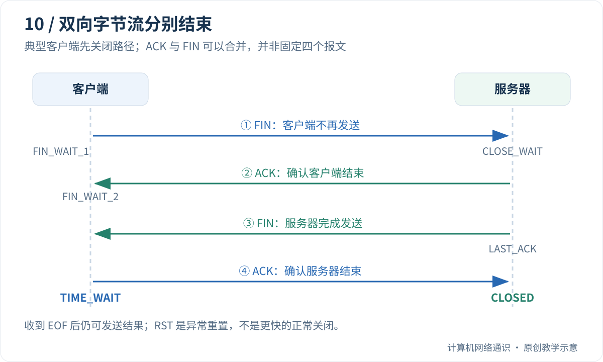

客户端调用 `close()`，服务器为什么不一定立即消失？服务器收到了 EOF，为什么还可以回一段数据？监控里出现很多 TIME_WAIT，是不是连接泄漏？

这些问题的共同起点是：**TCP 有两个方向的字节流，结束一个方向，不等于另一个方向同时结束。** 进程中的句柄生命周期、协议栈中的连接状态和远端程序的业务状态，也不总在同一瞬间变化。

[Cloudflare 的 When TCP sockets refuse to die](https://blog.cloudflare.com/when-tcp-sockets-refuse-to-die/)通过实验展示了超时与保活的复杂性。本文先使用最简单的正常关闭模型，再讨论异常结束与观测方法；不把某个 Linux 版本中的计时结果当成跨平台常数。

## Table of contents

## FIN 表示这个方向没有更多字节

假设客户端已发送完请求，想告诉服务器：“我的请求到这里结束，但我还要接收你的结果。”这就是半关闭适合表达的场景。

TCP 的 FIN 排在该方向已经发送的数据之后，并占用一个序列号。对端按顺序处理到 FIN 后，应用读取完此前的数据，再调用流式 `recv()`，就会得到空字节串，表示 EOF。

EOF 不表示最后一批数据是空的，也不表示连接的另一方向不能再发送。如果程序把 `recv()` 返回 `b""` 当成“暂时没有数据”继续无限循环，就会产生错误行为；阻塞读取暂时没有数据时会等待，超时模式则可能抛出超时异常。

## 为什么常见图里有四次挥手？

正常关闭可以画成：客户端 FIN、服务器 ACK、服务器 FIN、客户端 ACK。这样画，是因为服务器可以先确认客户端不再发送，再等待自己的应用完成工作后关闭发送方向。



| 观察位置                | 典型状态   | 应怎样理解                                 |
| :---------------------- | :--------- | :----------------------------------------- |
| 客户端发出 FIN 后       | FIN_WAIT_1 | 等待自己 FIN 得到确认                      |
| 客户端 FIN 被确认后     | FIN_WAIT_2 | 本端已结束发送，仍等待对端结束             |
| 服务器收到 FIN 后       | CLOSE_WAIT | 对端结束发送，本地应用尚未关闭发送方向     |
| 服务器也发送 FIN 后     | LAST_ACK   | 等待最后确认                               |
| 客户端确认服务器 FIN 后 | TIME_WAIT  | 保留状态，处理迟到报文及最后确认丢失等情况 |

这只是常见单方先关闭路径。ACK 与 FIN 可以合并，双方也可能同时关闭，所以**正常关闭不保证抓包里恰好只有四个独立报文**。理解两个方向的结束和确认，比数箭头更重要。

## shutdown 和 close 不是同一个动作

Socket API 中的 `shutdown(SHUT_WR)` 表示结束本地发送方向，同时保留读取能力。`close()` 则释放当前程序持有的 Socket 句柄；其最终网络效果还与其他引用、未发送数据、关闭选项和系统实现有关。

[Linux shutdown 手册](https://man7.org/linux/man-pages/man2/shutdown.2.html)区分了停止接收、停止发送和两者都停止。不要用“调用 close 等于立即发出一个 FIN 并立刻释放所有网络状态”概括所有情况。

对于只需请求一次、随后等待结果的简单协议，半关闭可以作为“请求体结束”的信号。但 HTTP 等协议已经定义了自身消息边界，不能随意用关闭写方向代替它们的报文格式。

## 动手：发送 EOF 后继续接收结果

下面的示例仍只使用本机回环地址。客户端发送短请求并关闭写方向，服务器读到 EOF 后回传结果，客户端继续读取直到服务器也结束发送。

```python
import socket


def read_until_eof(sock):
    parts = []
    while True:
        block = sock.recv(1024)
        if not block:
            return b"".join(parts)
        parts.append(block)


with socket.socket(socket.AF_INET, socket.SOCK_STREAM) as listener:
    listener.bind(("127.0.0.1", 0))
    listener.listen(1)
    listener.settimeout(2)
    with socket.create_connection(listener.getsockname(), timeout=2) as client:
        connection, _ = listener.accept()
        with connection:
            connection.settimeout(2)
            client.sendall(b"finished request")
            client.shutdown(socket.SHUT_WR)

            request = read_until_eof(connection)
            print("server got:", request)
            connection.sendall(b"result after client EOF")
            connection.shutdown(socket.SHUT_WR)
            print("client got:", read_until_eof(client))
```

输出应为：

```text
server got: b'finished request'
client got: b'result after client EOF'
```

两端请求和结果都很短，因此顺序执行即可。把这个模式直接用于任意大数据、双方同时写入的协议，可能由于缓冲区与读取顺序而互相等待；真实服务还需要并发调度和资源限制。

这个实验验证半关闭后仍可接收数据，没有测量 TIME_WAIT 的持续时间，也没有模拟异常断网。

## RST 为什么不是“更快的 FIN”？

FIN 是有序结束一个方向；RST 则重置连接状态，表示连接不能继续按原来的正常流程进行。它可能来自没有匹配连接的端点，也可能与应用主动中止、协议状态不符或中间设备有关。

收到 RST，应用可能在读写时看到连接重置等错误，但错误出现的具体调用和时机与系统、缓冲状态有关。不能保证远端发出 RST 的同一瞬间，应用正在执行的代码马上得到通知。

因此，不应该为了减少 TIME_WAIT 就把所有连接都改成重置关闭。这样做可能丢弃尚未完成交付的数据，也会改变对端所见的结束语义。关闭速度不是唯一目标。

## TIME_WAIT 和 CLOSE_WAIT 应该分开看

TIME_WAIT 常出现在执行正常主动关闭的一侧，既可能是客户端，也可能是服务器。它帮助最后 ACK 丢失后的恢复，并降低旧连接报文干扰后来连接的风险。规范中的 2MSL 是协议概念，操作系统实际等待策略与实现不能直接用一个固定秒数概括。

大量短连接可以自然产生很多 TIME_WAIT，不等于应用忘了关 Socket。真正的问题是数量、增长趋势、临时端口压力和业务失败是否相关，而不是看到状态名就清零。

CLOSE_WAIT 则表示已经知道对方结束发送，而本地应用还没有完成关闭流程。短暂存在很正常；持续积累时，更应该检查异常路径、资源释放和程序是否仍在等待不可能到来的输入。

[Linux tcp 手册](https://man7.org/linux/man-pages/man7/tcp.7.html)给出了实现相关的状态、选项和计时说明。阅读优化建议时，要确认系统版本和适用条件，避免把内核参数当成通用修复按钮。

## 超时与保活，究竟在等什么？

| 机制            | 主要关注                   | 不能代替什么               |
| :-------------- | :------------------------- | :------------------------- |
| 应用请求期限    | 用户愿意等一次操作多久     | 不等于 TCP 的重传期限      |
| Socket 读写超时 | 某次 API 操作的等待        | 不自动证明业务是否完成     |
| TCP 重传计时    | 已发送内容迟迟未被确认     | 不能发现所有纯空闲连接故障 |
| TCP keepalive   | 空闲时探测连接是否仍可通信 | 不验证远端业务线程健康     |
| 应用心跳        | 对端应用是否按约定处理消息 | 不保证接下来的业务一定成功 |

链路中断时，如果双方都没有发送数据，也没有保活，连接状态可能长时间维持 ESTABLISHED。状态表示本地协议栈当前所知，不是持续更新的全球真相。

Linux 的 `TCP_USER_TIMEOUT` 可以限制某些未确认或无法继续发送的数据等待时间，但它和 keepalive 的交互需要结合实现核实。Cloudflare 的上述文章很适合学习实验方法，不宜直接复制其中旧版本参数作为所有环境的最佳值。

## 观察现有连接，而不是先改参数

在 Windows PowerShell 中可以查看：

```powershell
Get-NetTCPConnection |
  Group-Object State |
  Select-Object Name, Count
```

Linux 可用：

```bash
ss -tan
```

这些命令由读者在自己的环境执行。记录时间、进程、连接端点和错误日志，再比较状态是否持续积累。一次快照只能说明当时的情况，不能单独定位谁泄漏了资源。

最后想一想：服务器收到客户端 FIN 后，还要计算并返回结果，此时出现 CLOSE_WAIT 是否必然是 bug？并不是；关键在于应用是否仍有合理工作，以及完成后是否正确关闭。

上一篇：[带宽、RTT 与窗口](/blog/posts/why-high-bandwidth-does-not-guarantee-speed/)

下一篇：[HTTP 请求与响应](/blog/posts/understanding-http-requests-responses-and-caching/)

## 参考与延伸阅读

- [Cloudflare：When TCP sockets refuse to die](https://blog.cloudflare.com/when-tcp-sockets-refuse-to-die/)——通过实验区分多种超时与保活行为。
- [Linux shutdown(2)](https://man7.org/linux/man-pages/man2/shutdown.2.html)——半关闭接口。
- [Linux tcp(7)](https://man7.org/linux/man-pages/man7/tcp.7.html)——TCP 的 Linux 实现选项。
- [RFC 9293](https://www.rfc-editor.org/rfc/rfc9293.html)——连接关闭与状态机的基础定义。
