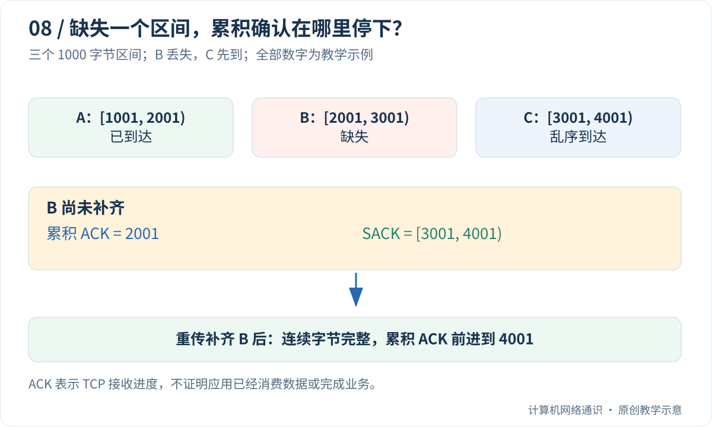

在真实的物理世界中，没有任何一条网络信道是绝对可靠的：

- 经过无线 Wi-Fi 传输时，微波炉的电磁辐射可能瞬间导致几个比特发生位翻转；
- 骨干网光纤路由器在突发拥塞时，会毫不留情地将排队超限的数据包直接丢进黑洞；
- 不同的数据包由于在不同路由器间走上了不同长短的链路，后发出的数据包完全有可能超越先发出的数据包，**乱序（Reordering）** 到达。

然而，在应用层开发中，无论是通过 HTTP 下载一部 4GB 的无损蓝光电影，还是通过 Git 同步上百万行源代码，我们拿到并写入磁盘的数据，**永远是严丝合缝、顺序绝对正确、没有一个字节差错的！**

这是计算机网络体系中最不可思议的工程奇迹：**TCP 协议是如何在一片充满丢包、重复与乱序的废墟之上，构筑起一条绝对平稳连续的虚拟数据隧道的？**

本文将从字节维度的编号体系切入，深入拆解 **累计确认（Cumulative ACK）机制、RTO 动态自适应算法、快速重传与 SACK**，并彻底讲透现代网络编程中**“粘包/半包”**的物理本质。

## Table of contents

## 第一章：可靠性的第一基石——以“字节”为尺度的编号世界

很多初学网络的人容易产生一个重大误区：以为 TCP 是按照“数据包的个数”进行编号的（第 1 包、第 2 包、第 3 包）。

> **TCP 的底层物理认知**：
>
> **TCP 的编号对象，绝对不是应用层调用 `write()` 的次数，也不是网络抓包中的数据包序号！**
>
> **TCP 严格是以每一个“字节（Byte）”作为唯一的度量基准进行递增编号的！**

```text
应用层发送数据: "HELLOWORLD" (共 10 字节)
字节位置:        0   1   2   3   4   5   6   7   8   9
字节字符:       'H' 'E' 'L' 'L' 'O' 'W' 'O' 'R' 'L' 'D'
TCP 绝对序号:   101 102 103 104 105 106 107 108 109 110 (假设 ISN 从 101 开始)

报文段 1: Seq = 101, Data = "HELLO", Len = 5 (涵盖 101 ~ 105)
报文段 2: Seq = 106, Data = "WORLD", Len = 5 (涵盖 106 ~ 110)
```

- **报头中的序列号（`Seq`）**：严格代表当前这个报文段中所携带的**第一个字节的绝对序号**；
- 接收端在收到报文后，提取 `Seq` 和数据长度 `Len`，在内核接收缓冲区中像拼图一样，把离散的字节严丝合缝地安放在对应的内存物理槽位中。

---

## 第二章：累计确认（Cumulative ACK）与乱序空洞

有了编号，接收端如何向发送端反馈接收进度？——依靠报头中的 **确认序号（Acknowledgment Number，简称 `ack`）**。

### 1. 确认号的绝对数学定义

很多开发者常把 `ack` 理解为“收到了第几号”。这是极不严谨的。

> **累计确认（Cumulative ACK）的物理铁律**：
>
> **确认序号 `ack = N` 的绝对物理定义是：**
>
> **“序号为 `N - 1` 及其以前的所有字节，我全部已经完整、正确、按序收到了！请发送端下一次从序号 `N` 开始发送！”**



### 2. 乱序到达与“空洞（Hole）”现象

假设发送端连续发出三个报文段：

- 段 1：`1 ~ 1000`
- 段 2：`1001 ~ 2000`
- 段 3：`2001 ~ 3000`

在网络传输中，段 2 在路上发生了意外丢包，而段 3 却提前平安到达了接收端。

接收端此时该如何回复？

- 接收端发现自己缺少了 `1001 ~ 2000` 这段核心数据，在接收缓冲区内部形成了一个致命的 **“空洞（Hole）”**；
- 尽管段 3 已经被安全收下放进了缓冲区，**但接收端向发送端回复的确认序号，坚决只能是 `ack = 1001`！**
- 接收端绝对不能回复 `ack = 3001`！因为按照累计确认铁律，一旦回复 3001，发送端就会误以为前 3000 个字节全到了，导致丢失的段 2 永远无法被重传！

---

## 第三章：超时重传（RTO）与自适应网络脉搏

既然发生了丢包，发送端如何察觉？最基础的机制就是——**超时重传（Retransmission TimeOut，简称 RTO）**。

### 1. 重传定时器的运作

每当发送端向网络发出一批数据段时，内核都会为该批数据启动一个独立的 **重传定时器（Timer）**：

- 如果在定时器倒计时结束前，收到了包含该段序号的 ACK 确认，定时器被安全撤销重置；
- 如果定时器倒计时归零，依然没有收到确认，发送端断定数据已经死亡，**立刻无条件向网络重新发送该数据段！**

### 2. RTO 绝不是一个固定常数！—— Jacobson / Karels 算法

很多初学者问：RTO 应该设为 1 秒、500 毫秒还是 100 毫秒？

- 设太短了：网络稍微有一点抖动，数据还在路上，发送端就急躁地重传，导致网络上充斥着毫无意义的重复垃圾包；
- 设太长了：真的发生丢包时，系统要傻等几秒钟才反应过来，网络吞吐量断崖式暴跌。

> **RTO 的动态演进哲学**：
>
> 互联网是一个活着的复杂动态系统。从北京到广州的延迟可能是 30 毫秒，通过卫星链路的延迟可能是 600 毫秒。
>
> **RTO 必须根据实时的“往返时延（RTT，Round-Trip Time）”进行动态数学跟踪与自适应计算！**

现代 Linux 内核遵循著名的 **Jacobson / Karels 算法**：

1. 内核测量每一次发包与收到 ACK 的真实往返时间样本 $RTT$；
2. 计算平滑往返时间（加权移动平均）：
   $$SRTT = (1 - \alpha) \cdot SRTT + \alpha \cdot RTT$$
3. 计算往返时延的平均偏差（抖动偏置）：
   $$RTTVAR = (1 - \beta) \cdot RTTVAR + \beta \cdot |SRTT - RTT|$$
4. 最终得出具备数学弹性的 RTO 超时阈值：
   $$RTO = SRTT + 4 \cdot RTTVAR$$

### 3. 指数退避原则（Exponential Backoff）

如果一个包连续重传多次依然超时，说明网络中间节点发生了极其严重的严重拥塞。
此时，TCP 会启动 **Karn 指数退避算法**：**下一次重传的 RTO 时间直接翻倍（例如从 200ms $\to$ 400ms $\to$ 800ms $\to$ 1.6s...）**！
通过主动大幅放缓重传节奏，避免在拥塞的网络伤口上撒盐，为全网路由器的恢复争取宝贵的时间！

---

## 第四章：高速救赎——快速重传与 SACK 选择性确认

超时重传虽然稳妥，但它的致命缺点就是“慢”——由于必须等待一个完整的 RTO 周期，应用层往往会感知到几百毫秒的明显卡顿。

为了追求极致的高性能，现代 TCP 进化出了无需等待超时的**主动快速恢复双子星**。

### 1. 快速重传（Fast Retransmit）与三次冗余 ACK

回到前面的空洞案例：段 2（`1001 ~ 2000`）丢了，而后序的段 3、段 4、段 5 依然在源源不断地飞来。

接收端每收到一个后序报文，它既不能推进 `ack`，又不能当哑巴：

- 接收端在收到段 3 时，立刻发送一次：`ack = 1001`（第 1 次重复 ACK）；
- 收到段 4 时，再次立即发送：`ack = 1001`（第 2 次重复 ACK）；
- 收到段 5 时，再次立即发送：`ack = 1001`（第 3 次重复 ACK）！

```text
发送端                                                  接收端
  │ ──── 段 1 (1~1000) ───────────────────────────────> │ ──> 回复 ACK 1001
  │ ──── 段 2 (1001~2000) ───(物理丢包 ❌)───────────>
  │ ──── 段 3 (2001~3000) ───────────────────────────> │ ──> 触发第 1 次冗余 ACK 1001
  │ ──── 段 4 (3001~4000) ───────────────────────────> │ ──> 触发第 2 次冗余 ACK 1001
  │ ──── 段 5 (4001~5000) ───────────────────────────> │ ──> 触发第 3 次冗余 ACK 1001!
  │
  ▼ ⭐️ 发送端连续收到 3 次相同的冗余 ACK！断定段 2 必死无疑！
  │ ─── 立即重传段 2 (1001~2000) ────────────────────> │ (完全不需要等待 RTO 超时!)
  │                                                    │
  │ <─── 接收端填补空洞，一口气推进回复: ACK 5001 ─────── │ (所有数据瞬间贯通就绪!)
```

> **快速重传（Fast Retransmit）准则**：
>
> **当发送端连续收到 3 次完全相同的冗余确认（Triple Duplicate ACKs）时，发送端直接判定该序号对应的报文已在网络中物理丢失！**
>
> **发送端完全不需要傻等 RTO 定时器归零，当场立刻抢先重传丢失的数据段！**

**为什么必须是 3 次？**
因为网络中偶尔存在轻微的“乱序换道”（段 2 可能只是被某条路由延迟了微秒级）。如果只收到 1 次或 2 次重复 ACK 就急躁重传，极大概率会造成误判重传；3 次冗余 ACK 能够在绝大多数情况下百分之百确认是“真丢包”而非“假乱序”。

### 2. SACK（选择性确认）：终结全量盲目重传

快速重传虽然快，但它有一个历史局限：**它只能告诉发送端“1001 丢了”，却无法告知发送端“后序的段 3、段 4、段 5 到底到了没有”！**
如果段 2 和段 4 同时丢了，发送端只能重传段 2，然后再次等后序的冗余确认，效率大打折扣。

为此，现代 TCP 普遍在报头选项中开启了 **SACK（Selective Acknowledgment，RFC 2018）**：

```text
接收端在回复标准 ack = 1001 的同时，在 TCP 选项字段中附带一张已收到的“局部孤岛地图”:
TCP Options: SACK [2001-3000], [4001-5000]
```

发送端收到带有 SACK 的确认报文，一目了然：

- 原来 `2001~3000` 和 `4001~5000` 对方已经完好无损地收下了！
- 发送端精准且仅仅向网络补发 `1001~2000` 和 `3001~4000` 两个缺失空洞！**彻底杜绝了已到达数据的重复全量重传，极大地拯救了高丢包弱网下的传输吞吐量！**

---

## 第五章：面向无界字节流——应用层“粘包与半包”的物理真相

在业务开发中，无数新手在基于原生 TCP Socket 写网络通信时，都遭遇过著名的“粘包（Packet Splitting / Merging）”灾难：

- 客户端明明调用了两次 `write()`：一次发送 `"hello"`，一次发送 `"world"`；
- 服务端调用一次 `read()`，竟然一口气读出了 `"helloworld"`！
- 或者是客户端发了一个 1000 字节的结构体，服务端一次 `read()` 却只读出了可怜的 300 字节！

### 1. 为什么说“粘包”是一个伪命题？

> **极其颠覆认知的网络架构真相**：
>
> **在 TCP 协议的设计哲学中，根本就不存在所谓的“包（Packet）”的概念！**
>
> **TCP 是一个面向“无边界字节流（Byte Stream）”的流式协议！**

在 TCP 的内核世界里，它就像一条连通两端的**自来水管道**：

- 客户端调用 `write()`，就等于往水管里倒了一杯水；随后又倒了一杯水；
- 水在水管的发送缓冲区里自然汇聚交融在了一起；
- 服务端打开水龙头（调用 `read()`），它舀出来的到底是一杯水、半杯水还是两杯水的合集，**完全取决于当前的内核缓冲区积攒情况与应用层传过去的 buffer 尺寸！**
- **TCP 只承诺按照字节的顺序绝对可靠交付，它从骨子里根本就不知道、也不在乎你的业务系统到底哪一段才算是一条完整的“业务消息”！**

### 2. 工业级应用层消息定界的解法

想要在无边界的 TCP 字节流中准确切分出业务消息，必须由**应用层协议自己设计帧边界（Framing）**：

```text
1. 固定长度法 (Fixed Length):
   规定每条消息严格固定为 128 字节，不足在尾部填充垃圾字符 (存在带宽浪费)。

2. 特殊定界符法 (Delimiter-based):
   规定每条业务消息末尾必须紧跟特定的分隔符 (如 HTTP 协议使用 \r\n\r\n 截断报头)。
   (缺点: 业务载荷中若包含该分隔符必须进行转义处理)。

3. 长度前缀法 (Length-prefixed / Header + Payload) ⭐️ 工业界终极通用标配!
   +--------------------+-----------------------------------------------+
   | 4 字节数据长度 Length | 紧随其后的真实业务数据载荷 (Payload)               |
   +--------------------+-----------------------------------------------+
```

在长度前缀方案中，服务端每次先精准读取头部的 4 个字节，解算出当前消息的真实长度（如 `Len = 1024`），随后调用循环读取函数 `recv_exact`，直到完整榨取满 1024 字节后，才将其作为一个完整的业务对象交给业务逻辑处理，彻底终结粘包噩梦！

---

## 总结与专栏全局视野

在本篇《计算机网络通识（八）》中，我们解开了 TCP 在动荡网络中保持绝对稳定的全部秘密：

1. **字节标尺**：推导了以字节为物理单位的 Sequence Number 编号世界；
2. **累计确认与空洞**：透视了 `ack = N` 代表前序所有字节完整收妥的严密数学定义，解密了乱序空洞的形成；
3. **自适应超时控制**：剖析了 Jacobson/Karels 算法如何通过动态跟踪 RTT 与抖动偏置，自适应调节 RTO 脉搏，掌握了指数退避在网络严重拥塞时的避险法则；
4. **高速抢先自愈**：彻底搞懂了三次冗余 ACK 触发快速重传的无超时恢复设计，以及 SACK 携带离散区间精准补发空洞的现代工程奇迹；
5. **流式本质与定界**：清算了“粘包”的伪命题本质，确立了长度前缀法在应用层数据分帧中的工业级标准地位。

既然 TCP 能够保证数据一个字节都不丢、顺序绝对无差错地送达：

- 为什么在办理了千兆光纤宽带的电脑上，在访问某些服务器时，**下载速度却依然像蜗牛一样慢吞吞地爬行？**
- 什么是 **带宽时延积（BDP，Bandwidth-Delay Product）**？为什么它决定了我们在网络线路上能“飞翔”的最大数据量？
- 著名的 **滑动窗口（Sliding Window）**、**流量控制（Flow Control）** 与 **拥塞控制（Congestion Control）** 是如何在纳秒级内调节全网的数据阀门的？

让我们正式迈向专栏的第九篇深度大作：**[《为什么带宽很大，下载却不一定快？》](/blog/posts/why-high-bandwidth-does-not-guarantee-speed/)**！
