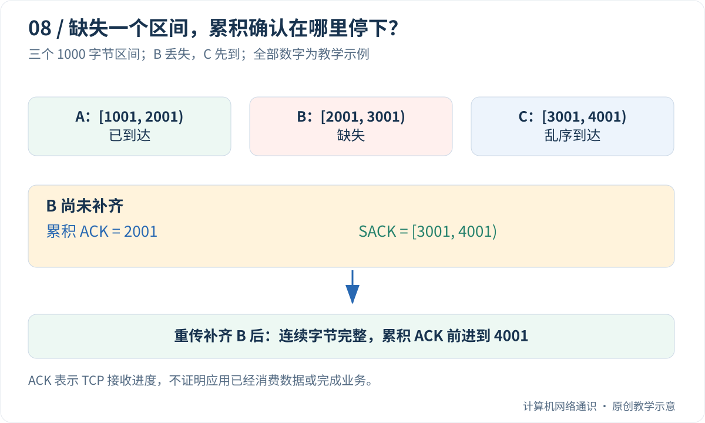

发送照片时，中途少了一块，接收端为什么通常不会显示一张随意缺角的图片？这并不是网络保证从不丢包，而是 TCP 会编号、确认，并尝试补齐缺失字节。

本篇先拿十个英文字母演一遍收发，再放大到图里的数千字节。读完主线，你应该能区分“数据到了操作系统”“程序读到了数据”和“业务已经处理完成”这三个时刻。

## Table of contents

## 丢包、乱序、重复分别是什么？

一段内容可能被分成多个 TCP 段，再装进 IP 包传输。途中设备忙不过来，可能丢弃包；链路问题也可能让数据无法被正确接收。**丢包** 就是某些包没能按预期到达接收位置。

先发的部分不一定先到，叫 **乱序**。发送方担心数据丢失而再次发送，原来那份却稍后也到了，就可能出现 **重复**。这三种现象不同，但都要求两端能识别内容的位置。

TCP 不会给每张照片理解“这里是一只猫的耳朵”。它处理的是一串字节。应用把照片表示为字节后交给 TCP，接收应用再把收到的字节解释回文件。

## 用十个字母，亲手追踪一次缺口

为了不用先看大数字，假设握手已经完成，下一字节序列号是 101。要发送 ASCII 字节 `ABCDEFGHIJ`，编号如下：

```text
字节： A   B   C   D   E   F   G   H   I   J
编号：101 102 103 104 105 106 107 108 109 110
```

为讲解方便，分三批发出：`ABCD`、`EFG`、`HIJ`。注意这是我们选择的分段，不是 TCP 永远这样分。

1. 接收方收齐 `ABCD`。连续内容到 104，返回 `ACK=105`，意思是“下一步期待 105”。
2. `EFG` 对应 105—107，却没有到达。接收方暂时不知道是丢了还是晚了。
3. `HIJ` 到了，编号是 108—110。接收方可以暂存，但连续内容仍有缺口，所以累积确认仍停在 105。
4. 发送方根据超时或后续反馈等线索重新发送缺失字节。不能仅凭一次没回复，就知道包具体在哪台设备丢了。
5. `EFG` 补齐以后，原先保存的 `HIJ` 也能连上，连续确认可推进到 111。

**累积确认** 的“累积”，就是确认一个连续前缀：在这个例子里，`ACK=111` 表示 111 之前需要的连续字节已经收齐，不需要为每个字节单独发送一个确认。

如果原来的 `EFG` 又迟到，TCP 可以识别它对应已经接收过的区间，不会把应用数据变成 `ABCDEFGHEFGIJ`。同一段字节不应因重传而被当成新内容重复交付。

## 为什么先到的 HIJ 还要等？

TCP 给程序的是有序字节流。如果让程序先拿到 `ABCDHIJ`，以后才补上 `EFG`，每一个使用 TCP 的应用都得重新处理乱序，协议提供的顺序保证也就失去了意义。

因此，后面已经到达的数据可能在接收缓冲区里等待缺口。**缓冲区** 是暂存数据的一块内存；它不代表数据已经被业务程序使用。这种“前面的缺失挡住后面的交付”也会在 HTTP/2 文章里再次出现。

选择性确认 SACK 是补充报告：虽然累积 ACK 仍停在 105，但可以额外告诉发送方“108—110 这一段已经到了”。这样发送方更容易只补缺失部分。SACK 不等于允许应用跳过缺口。

## 重新发送之前，为什么需要等待与判断？

A 没有马上收到 B 的回复，至少有几种可能：请求丢了，回复丢了，双方排队太久，或者 B 只是处理较慢。发送方无法直接看见整条路径，因此要结合计时和确认信息作判断。

等待太短，会把正常延迟误判成丢失，制造不必要的重传；等待太长，又会让真正丢失的数据迟迟得不到补救。TCP 会估计往返时间，并使用相应的超时和恢复算法。后文的 RFC 链接供进一步学习，不要求第一遍背计时公式。

## 三种“收到了”，不是同一个保证

| 谁说收到了        | 它最多说明什么                |
| ----------------- | ----------------------------- |
| 对端 TCP 发来确认 | 对端 TCP 层已收到相应连续字节 |
| 对端程序读取成功  | 程序已从 Socket 取得字节      |
| 业务返回成功      | 应用按自己的协议报告处理结果  |

例如客户端提交订单，服务器已经创建订单，但返回的成功响应丢了。客户端只看到超时，不能由此证明订单未创建。TCP 重传与去重不能替代业务请求的唯一编号和去重规则。

下面把十个字母的例子扩成三个 1000 字节区间。看到 `[1001, 2001)` 时，方括号表示包含 1001，右圆括号表示不包含 2001，因此总共有 `2001-1001=1000` 个字节。

## 序列号在数什么？

假设握手已经结束，发送方下一字节的序列号为 1001。它准备发送 3000 字节，为了画图方便，分成三段：

| 段  | 字节区间，左闭右开 | 长度 |
| :-- | :----------------- | ---: |
| A   | [1001, 2001)       | 1000 |
| B   | [2001, 3001)       | 1000 |
| C   | [3001, 4001)       | 1000 |

这里的分段大小仅是教学选择。实际边界受 MSS、路径、发送时机与实现影响。重传时也不必沿用最初一模一样的数据包边界。

如果 A 连续收到，接收方可以确认 `ACK=2001`，表示接下来期待 2001 开始的字节。如果 B 丢了、C 先到了，C 并不能填补前面的空洞，连续确认点仍然停在 2001。



不要把 `ACK=2001` 理解成“第 2001 个包收到了”。同样，ACK 证明的是对端 TCP 栈的接收进度，不证明应用已经消费这些字节，更不证明数据库已经提交交易。

## 乱序到达，为什么应用没有直接看见后半段？

普通 TCP 流向应用提供有序字节。接收栈可以暂存越过空洞的内容，等待缺失部分；在空洞被补齐以前，后续字节通常不能跨过它交给流读取者。

这有利于让应用按顺序解析文件或消息，却也引入等待。某一小段丢失，会阻挡这条字节流中后面已经到达的内容。后面讨论 HTTP/2 时，这个性质会解释为什么多路复用仍可能受到 TCP 队头阻塞影响。

但不要据此认为应用一定一次读到完整图片。TCP 维护字节顺序，不维护应用的“图片”或“消息”概念。一次 `recv(4096)` 可能只返回几百字节；之后再读，才能继续获得后续内容。

## 发送方怎么怀疑发生了丢失？

主要有两类线索：确认长时间没有推进，以及后续确认反复指向同一个空洞。

**重传超时**依赖对往返时间及其变化的估计。发送方不能为全互联网固定一个极短等待值，否则跨洋连接还没来得及回应，就会被反复误判；也不能无限等待。超时后的退避进一步限制重复发送压力。[RFC 6298](https://www.rfc-editor.org/rfc/rfc6298.html)规定了基础重传计时算法。

**快速重传**利用重复确认等反馈，可能在定时器到期前发现空洞。经典算法用三次重复 ACK 作为触发条件之一，但现代实现还有其他检测与恢复机制。不能把“每一次重传之前必有三个重复 ACK”当成抓包定律。[RFC 8985](https://www.rfc-editor.org/rfc/rfc8985.html)描述的 RACK-TLP 就利用时间信息改善损失判断。

重传还可能是误判：原数据并没有丢，只是被延迟了。TCP 需要处理后来到达的重复数据，避免把同一段字节作为新的应用内容交付两次。

## SACK 给出的，是空洞后面的地图

单靠累积 ACK，发送方知道 2001 之前的字节连续到达，却不知道 C 是否已经收到。选择性确认 SACK 可以补充“这些不连续区间也收到了”的信息。

在上面的例子中，接收方可能继续给出 `ACK=2001`，同时报告 SACK 区间 `[3001, 4001)`。发送方因此更有依据地补发 B，而不是把 B 后面所有内容盲目再发一遍。

SACK 不会把累积 ACK 的含义改成“跳过空洞”。它是附加信息，需要双方支持并在握手中协商许可；发送方也仍需保留恢复所需的数据和状态。具体定义见 [RFC 2018](https://www.rfc-editor.org/rfc/rfc2018.html)。

当 B 最终到达，接收方可以把已有 C 接到后面，连续确认点推进到 4001。这个推进是因为字节区间终于连续了，而不是因为数据包的数量凑够了。

## “可靠”有哪些边界？

TCP 会尽力提供可靠、有序的字节流，但无法在断网、主机崩溃或无限故障下保证最终成功。它可能以超时或连接错误结束，应用仍然要处理失败。

更微妙的是：请求已经送到并处理，响应却在返回途中丢失。客户端只看到失败，不知道服务端是否完成操作。重新连接并重试“扣款”就可能产生重复业务。

因此，传输层的重复消除不能替代应用的幂等键、请求标识和事务设计。TCP 解决的是一条连接内部的字节传输，不是跨连接的业务“恰好执行一次”。

## 为什么两次 send 不等于两次 recv？

假设应用连续发送 `hello` 和 `world`。接收端可能分别读到它们，也可能读到 `helloworld`，还可能先读到 `hel`。这些都不意味着 TCP 弄坏了内容。

发送调用把字节交给协议栈；接收调用从当前可读字节中取一部分。调用时机和缓冲区大小不同，边界自然可以不同。“粘包”常用来描述这个现象，但容易让人误以为网络发生了额外故障：问题通常是应用没有定义消息边界。

常见方案包括固定长度、分隔符，以及长度前缀。文本按行分隔时要处理转义或禁止消息内部出现分隔符；长度前缀则必须限制最大长度，避免收到一个离谱数字就分配巨量内存。

## 可选编程实验：让同一串消息以不同块大小到达

不会编程可以先在纸上做同一个练习：写下 `05hello06world!`，把它随意剪成几段，再按原顺序拼回。消息开头的长度告诉你要收多少内容，即使当前这段还没拿到足够字符，也应该等待，而不是把半条消息交出去。代码中的长度实际是两个二进制字节，不是纸上写的两个十进制字符。

把代码保存为 `message_framing.py`，按[Python 准备说明](/blog/posts/understanding-ports-and-sockets/#可选编程实验的准备怎样运行本系列的-python-代码)运行。`buffer` 是暂存区，`length` 是下一条消息长度；内层循环只有在“长度字段和正文都够了”时，才取出一条完整消息。

下面的离线程序定义一个简单协议：两字节无符号大端长度，随后是相应长度的消息。它故意把输入拆在长度字段中间，也让多个消息出现在同一块里。

```python
import struct

messages = [b"hello", b"world!"]
wire = b"".join(struct.pack("!H", len(m)) + m for m in messages)


def decode(chunks):
    buffer = bytearray()
    result = []
    for chunk in chunks:
        buffer.extend(chunk)
        while len(buffer) >= 2:
            length = int.from_bytes(buffer[:2], "big")
            if length > 4096:
                raise ValueError("message too large")
            if len(buffer) < 2 + length:
                break
            result.append(bytes(buffer[2:2 + length]))
            del buffer[:2 + length]
    if buffer:
        raise ValueError("incomplete message at end of input")
    return result


cases = [[wire], [wire[:1], wire[1:8], wire[8:]],
         [bytes([value]) for value in wire]]
for chunks in cases:
    decoded = decode(chunks)
    assert decoded == messages
    print(decoded)
```

三次都应该输出 `[b'hello', b'world!']`。如果最后少给一个字节，会在输入结束时报告消息不完整。

这里验证的是解析器对任意分块的适应能力，**没有模拟 TCP 的重传、拥塞控制或真实网络丢包**。真实 Socket 程序中，把每次 `recv()` 的结果喂给同样的缓冲逻辑即可；还应给消息大小、读取期限和总资源消耗设置边界。

## 抓包里的重传标签，能直接当结论吗？

Wireshark 的分析标签是根据捕获内容推断出来的。抓包点漏包、开始捕获过晚、网卡卸载和乱序，都可能影响解释。[Wireshark TCP 分析说明](https://www.wireshark.org/docs/wsug_html_chunked/ChAdvTCPAnalysis.html)列出了相关判定与优先级。

看到重传提示时，先核对序列号区间、ACK/SACK、时序和捕获位置。若要确定故障段，尽量对照两端证据，而不是仅凭一端的一行红色提示就宣布运营商丢包。

可以手算一道题：A 和 C 到达、B 缺失时，累积确认能否越过 B？不能。若应用又恰好读取了 500 字节，是否会改变对端已确认的总范围？也不必然。传输确认、内核缓冲和应用读取是不同层次的进度。

上一篇：[TCP 三次握手](/blog/posts/why-tcp-needs-a-three-way-handshake/)

下一篇：[为什么带宽很大，下载却不一定快](/blog/posts/why-high-bandwidth-does-not-guarantee-speed/)

## 参考与延伸阅读

- [RFC 2018](https://www.rfc-editor.org/rfc/rfc2018.html)——选择性确认。
- [RFC 6298](https://www.rfc-editor.org/rfc/rfc6298.html)——重传计时器。
- [RFC 8985](https://www.rfc-editor.org/rfc/rfc8985.html)——RACK-TLP 损失检测。
- [Beej：Slightly Advanced Techniques](https://beej.us/guide/bgnet/html/split/slightly-advanced-techniques.html)——处理部分收发与消息封装。
- [Wireshark：TCP Analysis](https://www.wireshark.org/docs/wsug_html_chunked/ChAdvTCPAnalysis.html)——抓包工具分析的含义与限制。
