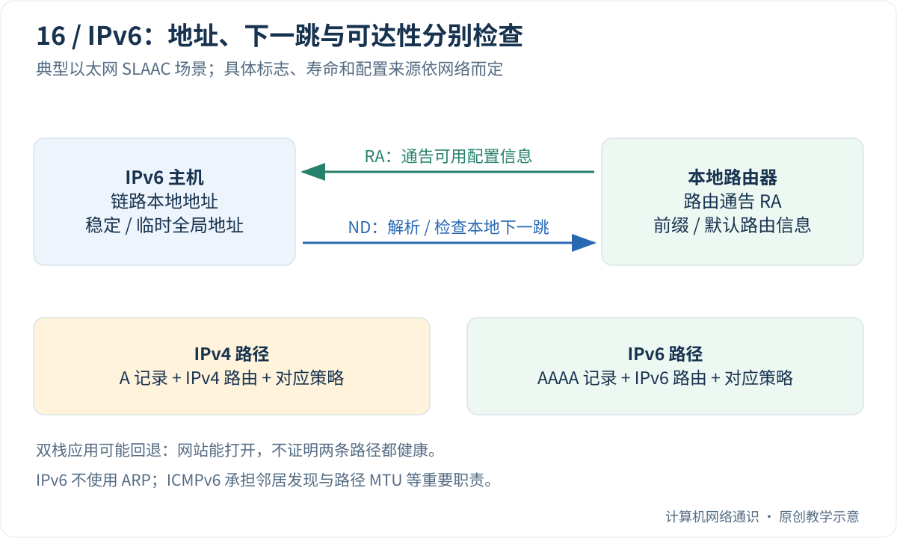

在查看手机 Wi-Fi 详情或电脑网络状态时，我们经常会看到一串长得不可思议、由冒号隔开的神秘字符串：

```text
240e:e1:8200:1a4b:5c6d:7e8f:9a0b:1c2d
fe80::1a2b:3c4d:5e6f:7a8b%eth0
```

而且更让人困惑的是：同一张物理网卡上，竟然同时并排挂着好几个完全不同的 IPv6 地址！

在很多初学者的印象里，IPv6 往往被简单地概括为一句话：**“IPv4 地址不够用了，所以把地址长度从 32 位拉长到了 128 位。”**

然而，如果仅仅是为了“地址扩容”，计算机科学家绝不需要耗费二十余年的心血对整个互联网体系进行翻天覆地的重构：

- 为什么 IPv6 **坚决废除了统治网络数十年的 ARP 广播协议**，改由基于 ICMPv6 的 **邻居发现协议（NDP）** 全面接管？
- 为什么在 IPv6 网络中，不需要部署任何复杂的 DHCP 服务器，电脑只要插上网线，就能在万分之一秒内**自动生成合法的全球公网 IP 并即插即用（SLAAC）**？
- 当人手拥有数以亿计的真实公网 IP 时，上一篇讲过的 **NAT（网络地址转换）是不是终于可以彻底退出历史舞台了？**
- 如果没有了 NAT 的遮蔽保护，我们的电脑直接把真实公网 IP 暴露在互联网上，**难道不会被黑客在几秒钟之内扫描打爆吗？**

本文将带你穿透 128 位的数字表象，深入 IPv6 的核心架构变革，剖析多地址共存、NDP 组播寻址、无状态即插即用自动配置，以及端到端直连回归下的全新安全模型。

## Table of contents

## 第一章：天文数字的物理空间与表示法法则

IPv4 只有 32 位（4 字节），容量极限是 42.9 亿个。
而 IPv6 将地址长度暴力扩充到了 **128 位（16 字节）**！

### 1. 天文数字的物理现实

128 位二进制所能表达的地址总量为：
$$2^{128} \approx 3.4028 \times 10^{38} \text{ 个}$$

> **极其震撼的天文尺度比喻**：
>
> 这个数字大到了人类大脑难以想象的尺度：
> **如果把整个地球表面（包括所有的陆地、海洋以及地下数千米）全部分割成每一平方米的微小面积，IPv6 的地址总量足以让地球上每一平方米的土地，分到整整 $6.7 \times 10^{23}$ 个独立的公网 IP！**
>
> “给地球上的每一粒沙子都分配一个固定的公网 IP 地址”，绝不仅仅是科幻式的比喻，而是在数学上极其保守的物理事实！

### 2. 冒号十六进制表示法与零压缩铁律

由于 128 位二进制太长，点分十进制彻底失效。IPv6 采用 **8 组由冒号隔开的 16 进制数** 表示（每组包含 16 位二进制，即 4 个十六进制字符）：

```text
原始完整地址:
2001 : 0db8 : 0000 : 0000 : 0008 : 0800 : 200c : 417a
```

为了防止把人类写吐，RFC 5952 制定了两条严密的**压缩简化铁律**：

1. **每组前导零（Leading Zeros）可以全部省略**：
   `0db8` 可以简写为 `db8`；`0008` 简写为 `8`；`0000` 简写为 `0`；
2. **双冒号零压缩（`::`）**：
   连续出现的多个全 0 字段组，可以用一个**双冒号 `::`** 整体替代压扁！

```text
压缩优化后:
2001:db8::8:800:200c:417a
```

> **致命避坑铁律**：
>
> **在同一个 IPv6 地址中，双冒号 `::` 坚决有且仅能出现一次！**
>
> 如果一个地址里写了两次双冒号（如 `2001::8::1`），任何计算机在逆向反解时，根本无法推算出左边到底省略了几个 0、右边省略了几个 0，瞬间引发歧义报错！

---

## 第二章：单网卡多地址共存——IPv6 的多重身份

在 IPv4 时代，一张网卡通常只有一个 IP。
而在 IPv6 的世界里，**一张物理网卡同时绑定 3 ~ 5 个不同的 IPv6 地址是极其标准的常态！**



这些地址分属不同的作用域（Scope）：

### 1. 链路本地地址（Link-Local Address，`fe80::/10`）

- 每一个开启了 IPv6 的网卡，在启动的第一瞬间，**内核会自动为自己生成一个以 `fe80::` 开头的地址**；
- **物理约束**：链路本地地址**只在当前这根网线或这个 Wi-Fi 局域网物理链路内部生效！**
- 路由器坚决绝不把链路本地报文转发到其他任何网络。常用于邻居发现、路由器通告与局域网底层信令交互。在指定该地址时，通常需要绑定网卡接口后缀（如 `fe80::1%eth0`）。

### 2. 全球单播地址（Global Unicast Address，GUA，`2000::/3`）

- 相当于 IPv4 的**正牌公网 IP**（目前全球公网统一分配在 `2000::/3` 空间内，以 `2` 或 `3` 开头）；
- 具备全球范围内的绝对路由与互联能力。

### 3. 唯一本地地址（Unique Local Address，ULA，`fc00::/7`）

- 相当于 IPv6 的私网保留地址（类似 IPv4 的 `192.168.X.X`），用于企业内部纯离线私有网络互联。

### 4. 特殊保留地址

- **`::1`（环回地址）**：等价于 IPv4 的 `127.0.0.1`（本机回环）；
- **`::`（未指定地址）**：等价于 IPv4 的 `0.0.0.0`。

---

## 第三章：核心变革一——彻底消灭广播与 ARP，全面升级为 NDP

在第 2 篇中，我们痛陈了以太网 ARP 广播的“原罪”：ARP 请求必须全网广播，任何一台设备发出的噪音，全网所有电脑的 CPU 都必须被迫中断接收并比对，且极易遭受 ARP 欺骗投毒。

> **IPv6 的第一大革命**：
>
> **IPv6 在协议设计中，彻底把“全网广播（Broadcast）”给物理消灭了！**
>
> **全网广播在 IPv6 中根本不存在！所有的广播动作，全部升级为了精准、定向的“组播（Multicast）”！**

### 邻居发现协议（NDP，Neighbor Discovery Protocol）

取而代之的是运行在 ICMPv6 之上的 **NDP 协议（RFC 4861）**：

1. **被请求节点组播地址（Solicited-Node Multicast Address）**：
   当主机 A 想要知道主机 B（`2001:db8::1`）的物理 MAC 地址时，它不再发送全网骚扰广播；
   主机 A 将请求发往一个特殊的组播地址：`ff02::1:ff00:1`（该地址通过特定算法与目标 IP 的后 24 位自动映射绑定）；
2. **硬件级精准收包**：
   在物理局域网中，**只有目标主机 B 的网卡硬件芯片会监听这个特定的组播地址！** 其他所有无关的主机网卡在最底层的物理层直接过滤丢弃该帧，**CPU 完全不被打扰，彻底终结了局域网广播风暴！**
3. **邻居请求（NS）与邻居通告（NA）**：
   主机 A 发送 **邻居请求（Neighbor Solicitation，NS）**，主机 B 单播回送 **邻居通告（Neighbor Advertisement，NA）**，优雅安全地完成物理 MAC 的解析闭环。

---

## 第四章：核心变革二——即插即用：SLAAC 无状态自动配置

在 IPv4 时代，要让一台新电脑入网，必须在局域网里配置一台复杂的 DHCP 服务器，由 DHCP 集中记录租期、分配 IP，极易发生单点故障。

IPv6 实现了真正的**即插即用（SLAAC，Stateless Address Autoconfiguration，RFC 4862）**！

```text
[新电脑插上网线开机]
         │
         │ 1. 广播发送: 路由器请求 (RS, Router Solicitation)
         │    "这片网络里有网关路由器吗？请告诉我当前网络的公网前缀！"
         ▼
[本地网关路由器]
         │
         │ 2. 定向回复: 路由器通告 (RA, Router Advertisement)
         │    "本局域网的全球公网前缀是: 240e:e1:8200:1a4b::/64！"
         ▼
[新电脑网卡内核自主完成数学组装]:
提取 64 位前缀: [ 240e:e1:8200:1a4b ]
自主生成 64 位后缀: [ 5c6d:7e8f:9a0b:1c2d ] (基于 RFC 7217 隐私稳定算法生成)
         │
         ▼ 拼接生成完美的全球公网 IPv6 地址:
240e:e1:8200:1a4b:5c6d:7e8f:9a0b:1c2d！
         │
         ▼ 3. 发送重复地址检测 (DAD, Duplicate Address Detection)
确认全网无人重名后，该 IP 瞬间正式激活上线！耗时仅几毫秒！
```

**为什么叫“无状态（Stateless）”？**
因为**路由器根本不需要建立任何账本数据库去记住“哪台电脑拿了哪个 IP”！** 路由器只管向全网广播前缀，各台电脑在本地利用数学算法自主生成唯一的后缀。插上网线瞬间即刻连通全球！

---

## 第五章：端到端直连回归与全新的安全模型

由于每个人都拥有真实的全球公网 IPv6 地址，我们在上一篇讲过的 **NAT（网络地址转换）在 IPv6 体系下彻底丧失了存在的物理理由！**

任何两台处于世界不同角落的电脑，都可以直接依靠对方的 IPv6 地址发起端到端的直连传输（P2P 文件直传、低延迟游戏联机、音视频通话体验飙升）。

### 颠覆认知的安全哲学：无 NAT 不等于裸奔！

很多缺乏系统级认知的工程师惊呼：“没有了 NAT 隐藏内网 IP，我的电脑岂不是直接在公网裸奔，随时会被黑客扫描黑掉？”

> **终极安全认知澄清**：
>
> **NAT 从来就不是一项安全技术！它只是一项由于 IPv4 地址不够用而催生出来的“权宜补丁”！**
>
> 在真正保护内网安全的，一直都是我们上一篇讲过的——**防火墙（Firewall）！**

在 IPv6 时代，网络工程推行的是更为纯粹、更为专业的**无 NAT 有状态防火墙模型**：

1. **端到端寻址自由**：每一台设备拥有尊严独立的公网 IP，彻底消灭了 NAT 转换表被打爆、端口耗尽的惨剧；
2. **边界防火墙策略一如既往坚固**：
   你家里的 IPv6 路由器依然运行着严密的**有状态防火墙规则**：
   - 允许你的电脑自由向外发起出站连接；
   - **默认坚决阻断外网任何未经许可的主动入站探测与攻击扫描！**
   - 既享受了端到端原生互联的高性能，又毫厘不减弱任何网络安全防护！

---

## 总结与专栏全局承接

在本篇《计算机网络通识（十六）》中，我们解开了下一代互联网的全部底层变革：

1. **空间的飞跃**：理解了 $2^{128}$ 的天文尺度，掌握了每组前导零省略与全局仅能出现一次双冒号 `::` 的压缩铁律；
2. **多重身份模型**：剖析了单网卡上链路本地地址（`fe80::`）与全球单播公网地址（GUA）的分工共存；
3. **广播的终结**：透视了以太网全网广播被彻底消灭的历史必然，掌握了基于组播与 ICMPv6 的 NDP 邻居发现协议；
4. **即插即用哲学**：深入拆解了 SLAAC 无状态自动配置通过路由器通告（RA）与前缀拼接瞬间入网的优雅时序；
5. **安全再定义**：清算了“NAT 等同于安全”的误区，确立了 IPv6 时代端到端直连与独立有状态防火墙协作的全新现代网络安全观。

至此，从物理链路、寻址、路由、DNS、传输层到应用层和下一代协议，我们已经把计算机网络世界的宏伟拼图拼装完毕！

在整个理论体系的收官阶段，我们将进入最硬核的实战篇章：

- 当你的网络突然不通或者网页打开极其缓慢时，**该如何利用一套标准化的“分层排障法眼”，从物理网卡、ARP、路由一直排查到应用层？**
- 网站到底是如何依靠 **Cookie** 和 **Session** 在无状态的世界中守护你的登录凭证与财产安全的？

👉 接下来，请先无缝阅览此前已发布的专栏核心力作：

- **[《什么是 VPN？虚拟专用网络的底层原理、工作流与现代演进》](/blog/posts/what-is-a-vpn/)（专栏第 17 篇）**
- **[《Tailscale 是如何工作的：从零构建现代 Mesh VPN 架构》](/blog/posts/how-tailscale-works/)（专栏第 18 篇）**
- **[《NAT 穿透是如何工作的：技术原理与终极指南》](/blog/posts/how-nat-traversal-works/)（专栏第 19 篇）**

随后，我们将正式进入第二十篇排障宝典：**[《网络不通或很慢，应该从哪里开始查？》](/blog/posts/a-layered-guide-to-network-troubleshooting/)**！
