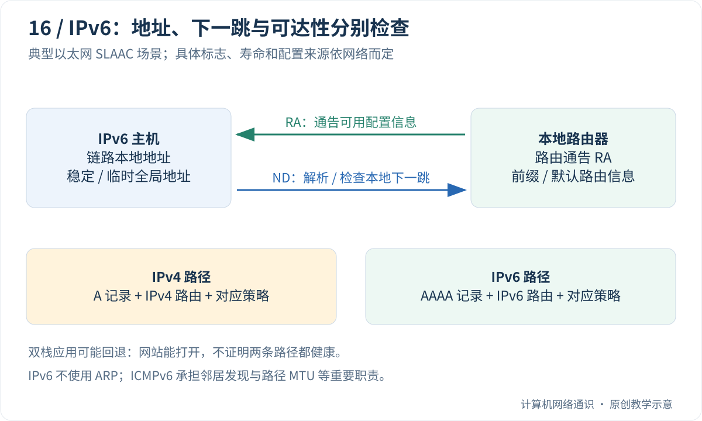

IPv4 常写成四组十进制数字，IPv6 却是一长串带冒号、还夹着字母的地址。为什么需要另一种地址？省掉的那些零去哪里了？一张网卡为什么会列出好几个地址？

本篇先从地址数量与写法讲起，再解释本地发现和自动配置。你不需要先懂十六进制，下面会从数字规则开始。

## Table of contents

## 为什么要扩展地址空间？

IPv4 地址有 32 位，数学上最多表达 `2^32` 种位组合，约 43 亿。这个数字还不能直接当作可分配给普通设备的地址总数，因为有保留用途、分配方式等限制。

联网设备不断增加，IPv4 地址空间有限。前一篇的 NAT 可以让许多设备共享外部地址，但也会引入转换状态和入站访问等问题。IPv6 使用 128 位地址，提供大得多的空间，并调整了一些协议机制。

“地址更多”不等于“互联网速度自动更快”。实际速度仍由路径、容量、协议实现和应用等因素共同决定。也不要以为把 IPv4 地址前面补一些零，就能把它变成可通信的 IPv6 配置；两者是不同的协议版本。

## 十六进制怎么读？字母并不是域名

十进制有 0—9 十个数字，逢十进一；十六进制有 0—9 加 a—f 十六个数字，逢十六进一。其中 a、b、c、d、e、f 分别代表 10、11、12、13、14、15。

```text
十六进制 10 = 十进制 16
十六进制 1f = 1×16 + 15 = 十进制 31
```

一个十六进制数字正好表示 4 个二进制位。IPv6 常写成八组，每组四个十六进制数字；因此是 `8×4×4=128` 位。冒号帮助分组，组里的字母仍然是数字，不是在写网站名称。

你不需要把整个 IPv6 地址转换成一个巨大的十进制整数。日常最重要的是能识别完整形式、压缩形式和前缀。

## 一步步把长地址写短

从这个文档示例开始：

```text
2001:0db8:1234:5678:0000:0000:0000:0034
```

先去掉每组前面的零，但一组全零至少保留一个 0：

```text
2001:db8:1234:5678:0:0:0:34
```

再把连续的三个全零组压成 `::`：

```text
2001:db8:1234:5678::34
```

恢复时，先数可见组：`2001`、`db8`、`1234`、`5678`、`34` 共五组，完整需要八组，所以 `::` 代表三个全零组。一个地址只允许出现一次 `::`，否则就无法确定两处各补几组。

每组内部只能去掉前导零，不能随意删除中间或末尾的零。例如 `1000` 与 `1` 是不同数。上述地址位于文档专用范围，用于阅读和计算，不是要你拿浏览器访问的真实网站。

## /64 与端口为什么还需要另外写？

`/64` 仍表示前 64 个二进制位属于前缀。完整 IPv6 每组是 16 位，因此 `/64` 正好对应前四组。在例子里，`2001:db8:1234:5678::/64` 是一个地址前缀。

地址本身已经有许多冒号。如果 URL 还要写端口，就用方括号把地址包起来：`https://[2001:db8::34]:8443/`。括号里是地址，最后一个括号后面的 `:8443` 才是端口。不能把 IPv6 最后一组数字直接当端口。

## 同一网卡多个地址，各有作用

先认识三种常见用途，不急着背完所有前缀：

- **回环地址 `::1`**：与 IPv4 的 `127.0.0.1` 类似，用于本机通信。
- **链路本地地址**：用于当前本地链路上的交流，例如发现路由器；不能指望普通路由器把它转发到远方网络。
- **全球单播地址**：可用于更大范围的寻址与路由，但是否真的可达仍看路由和防火墙等条件。

一个接口拥有链路本地地址，同时拥有稳定或临时的全球地址，并不表示系统出错。不同地址服务不同范围与隐私需求。具体发送时用哪个源地址，由系统结合目的地和规则选择。

“单播”是发给一个目标，“组播”是发给一组符合条件的接收者。IPv6 没有 IPv4 式广播地址，但仍会用组播开展本地发现；不是从此不需要任何发现消息。

## 没有 ARP，主机怎么找到路由器？

IPv4 中我们学过 ARP：在本地查询下一站对应的 MAC。IPv6 由 **邻居发现 ND** 等机制承担相关职责，它基于 ICMPv6，还包含路由器发现和邻居可达性检测，不只是换一个名字的 ARP。

**路由通告 RA** 是路由器向本地链路发布信息的一类消息。主机可以从中了解默认路由相关信息及前缀等配置。在允许自主配置的条件下，再形成自己的地址，这种方式叫 **SLAAC**，即无状态地址自动配置。

先按中文动作记：“发现路由器 → 学到适用信息 → 配置地址并做必要检查”。下面才读各英文消息和配置组合。地址、默认路由、DNS 信息不必全部从同一个协议取得。

## 双栈：电脑同时会说两种 IP 协议

**双栈** 表示同时具备 IPv4 与 IPv6 能力。网站也可能同时公布 A 和 AAAA 记录，浏览器按策略尝试候选地址。某一路径失败时，另一条可能成功，所以“网页打开了”并不能单独证明两种地址族都正常。

这里可以类比两条不同道路：你最后到达目的地，只能证明某条实际选中的路成功，不能证明另一条路没有施工。排障时分别检查，才不会把 IPv4 的结果当成 IPv6 的证据。

## 先读懂一个 IPv6 地址

IPv6 地址长 128 位，常用八组十六进制数表示，每组 16 位。例如下面两种写法表示相同地址：

```text
2001:0db8:1234:5678:0000:0000:0000:0034
2001:db8:1234:5678::34
```

每组前导零可以省略，一段连续的全零组可以用 `::` 压缩；一份地址中只能使用一次 `::`，否则无法知道省略位置各有多少组。

如果要在 URL 中写字面 IPv6 地址，需要方括号区分地址与端口，例如 `https://[2001:db8::34]:8443/`。这里使用的是文档地址，不是建议访问的真实服务。

`/64` 仍是前缀长度，表示前 64 位属于该前缀。常见以太网 SLAAC 子网使用 `/64`，但不能由此声称所有 IPv6 路由或所有链路都只能用 `/64`。IPv6 的前缀长度同样可以表达汇总路由和其他用途。

## 一个接口为什么会有多个地址？

| 例子或范围   | 常见用途         | 要记住的边界                                      |
| :----------- | :--------------- | :------------------------------------------------ |
| `::1`        | 本机回环         | 不代表另一台设备                                  |
| `fe80::/10`  | 链路本地地址范围 | 只能用于相应链路，需要辨认接口作用域              |
| `fc00::/7`   | 唯一本地地址范围 | 常见本地分配使用 `fd00::/8`，通常不在全球公网路由 |
| 全球单播地址 | 跨网络路由       | 拥有地址不等于入站策略允许                        |
| `ff00::/8`   | 组播             | 是给一组接收者的通信方式                          |

同一个接口可以同时拥有链路本地、稳定地址和临时地址。临时地址用于降低长期关联某个接口的便利性，但不等于全面匿名；应用最终选哪个源地址还受到目标、路由和地址选择规则影响。

链路本地地址在不同接口上可能出现相同文字形式，因此工具常需要类似 `%接口编号` 的作用域信息。接口编号依操作系统和机器而变，不能从教程复制一个数字就保证可用。

## 没有 ARP，怎样找到本地下一跳？

IPv6 不使用 IPv4 的 ARP。邻居发现 ND 基于 ICMPv6，涵盖邻居链路层地址解析、邻居可达性、路由器发现等相关工作。

主机可以用 Neighbor Solicitation 与 Neighbor Advertisement 进行邻居解析。在以太网等链路上，相关组播机制避免把每次解析简单做成 IPv4 ARP 那样的全网广播。IPv6 没有 IPv4 式广播地址，但仍有组播和其他控制通信，不能理解成局域网再无发现流量。



[邻居发现 RFC 4861](https://www.rfc-editor.org/rfc/rfc4861.html)覆盖的范围比“IPv6 版 ARP”更大。把它简化成一个地址转换协议，会遗漏路由器发现和可达性检测这些重要职责。

## 自动配置：地址、默认路由和 DNS 不必来自同一处

路由器通过 Router Advertisement 通告相关信息。主机在满足条件时，可以结合可用于自主配置的前缀形成地址，这就是 SLAAC 的核心路径。形成地址后通常还需要进行重复地址检测；检测有协议假设，并不构成永远不会冲突的数学证明。

默认路由通常来自路由器通告及其寿命信息。不要按 IPv4 DHCP 的习惯推断“使用 DHCPv6，就一定从它获得默认网关”。DHCPv6 可以参与地址或其他配置分发，DNS 信息也可以来自 RA 或 DHCPv6 等机制，具体组合取决于网络配置和主机支持。

SLAAC 也不等于“后半部分永远从 MAC 地址推出来”。现代实现可以使用稳定但不直接暴露 MAC 的标识或临时地址机制；应以当前系统实际配置为准。

前缀还有首选与有效寿命等概念。地址可以进入不再优先用于新连接、但尚未立即失效的阶段。这帮助网络重新编号，不能把每个地址的存在都理解成永久固定。基础流程见 [RFC 4862](https://www.rfc-editor.org/rfc/rfc4862.html)。

## 进阶：报文头与分片也发生了变化

IPv6 基本首部固定为 40 字节，某些可选信息放入扩展首部。基本首部没有 IPv4 首部校验和；这不代表数据完全不受其他层的差错检测保护。

中间路由器不会像 IPv4 某些场景那样为转发数据包执行分片。发送端需要尊重路径 MTU，必要时由源端处理分片或调整发送策略；ICMPv6 Packet Too Big 在路径 MTU 发现中很重要。

因此，把所有 ICMPv6 一律丢弃，可能破坏邻居发现、配置和路径适应。正确做法是根据实际角色与规范设计过滤规则，而不是把 ICMPv6 只当成可有可无的 ping。相关基础规则见 [RFC 8200](https://www.rfc-editor.org/rfc/rfc8200.html)。

## 可选实验：地址压缩和前缀判断

先在纸上把 `2001:db8:1::5` 恢复为八组：可见四组，所以应补四组全零，再把各组补满四个十六进制数字。结果应是 `2001:0db8:0001:0000:0000:0000:0000:0005`。

代码验证的是同类地址写法和前缀归属。保存为 `ipv6_address.py`，按[Python 准备说明](/blog/posts/understanding-ports-and-sockets/#可选编程实验的准备怎样运行本系列的-python-代码)运行。`compressed` 是缩短形式，`exploded` 是完整形式，`in network` 表示属于这个数学地址范围，并没有发送探测包。

下面程序只做离线地址运算，不验证任何真实 IPv6 网络是否连通。

```python
import ipaddress

address = ipaddress.IPv6Address("2001:0db8:1234:5678:0:0:0:0034")
network = ipaddress.IPv6Network("2001:db8:1234:5678::/64")
print("compressed:", address.compressed)
print("expanded:", address.exploded)
print("in prefix:", address in network)
print("another prefix:", ipaddress.IPv6Address("2001:db8:1234:5679::1") in network)
print("link local:", ipaddress.IPv6Address("fe80::1").is_link_local)
```

预期输出：

```text
compressed: 2001:db8:1234:5678::34
expanded: 2001:0db8:1234:5678:0000:0000:0000:0034
in prefix: True
another prefix: False
link local: True
```

不要把 `/64` 的全部地址展开成列表。前缀数学包含数量极大的地址；“知道一个地址是否属于前缀”只需要位运算，不需要枚举。

这也不能直接推出实际下一跳。与 IPv4 一样，真正选路仍需查询路由表及相关策略。属于某前缀和操作系统当前把它视为 on-link，是需要结合配置区分的问题。

## 双栈为什么有时掩盖 IPv6 故障？

一个域名可以同时有 A 和 AAAA 记录，客户端也可能同时具备 IPv4 与 IPv6。应用可采用 Happy Eyeballs 类策略，让不同地址候选的连接尝试有节奏地竞争，降低某条路径故障带来的长等待。[RFC 8305](https://www.rfc-editor.org/rfc/rfc8305.html)描述了这类策略。

结果是：网站能打开，不代表两条路径都健康。浏览器可能迅速回退到 IPv4，而某个只用 IPv6 的程序仍然失败。反过来，IPv6 成功也不能证明 IPv4 配置正确。

在自己的环境可以分别观察：

```powershell
Get-NetIPAddress -AddressFamily IPv6
Get-NetRoute -AddressFamily IPv6
Resolve-DnsName example.com -Type AAAA
```

Linux 对应的基础观察包括 `ip -6 addr`、`ip -6 route`。如果 curl 构建支持，可以用 `curl -4` 与 `curl -6` 比较同一站点；结果还受目标是否提供相应地址、代理和本地路径影响。本文不预设你的网络一定具备 IPv6 外网能力。

## IPv6 可路由，不代表所有服务都开放

IPv6 使许多场景不再需要为了节约地址而部署 NAPT，但 NAT 本来就不是访问控制的唯一方式。有状态防火墙仍可允许出站及相关回应、拒绝未授权入站；主机也仍需正确监听、认证和更新。

[RFC 6092](https://www.rfc-editor.org/rfc/rfc6092.html)讨论了住宅 IPv6 网关的基本安全能力。它帮助说明：保留访问控制并不要求把地址转换当成前提。

理解 IPv6 后，再看后面的 VPN、Tailscale 和 NAT 穿透三篇，就可以区分哪些机制在解决寻址不足，哪些在解决策略、身份和跨网络连接。地址变长只是这张地图中的一部分。

## 读完后，用自己的话试着解释

只有一个 fe80 开头的链路本地地址，能否据此认定这台电脑已能访问 IPv6 互联网？

<details>
<summary>展开参考答案</summary>
<div class="mt-4 leading-7">不能。链路本地地址用于当前链路，不能替代全球通信所需的适用地址、路由和策略。还要验证目标是否有 IPv6 服务及实际路径。</div>
</details>

上一篇：[NAT 与外网访问](/blog/posts/why-inbound-connections-fail-behind-nat/)

下一篇：[VPN 的底层原理](/blog/posts/what-is-a-vpn/)

## 参考与延伸阅读

- [Cloudflare：Less Is More — Why The IPv6 Switch Is Missing](https://blog.cloudflare.com/always-on-ipv6/)——双栈代理的历史工程场景。
- [RFC 8200](https://www.rfc-editor.org/rfc/rfc8200.html)——IPv6 基础协议。
- [RFC 4861](https://www.rfc-editor.org/rfc/rfc4861.html)、[RFC 4862](https://www.rfc-editor.org/rfc/rfc4862.html)——邻居发现与无状态地址配置。
- [RFC 8305](https://www.rfc-editor.org/rfc/rfc8305.html)——双栈连接选择。
- [RFC 6092](https://www.rfc-editor.org/rfc/rfc6092.html)——住宅 IPv6 网关过滤能力。
