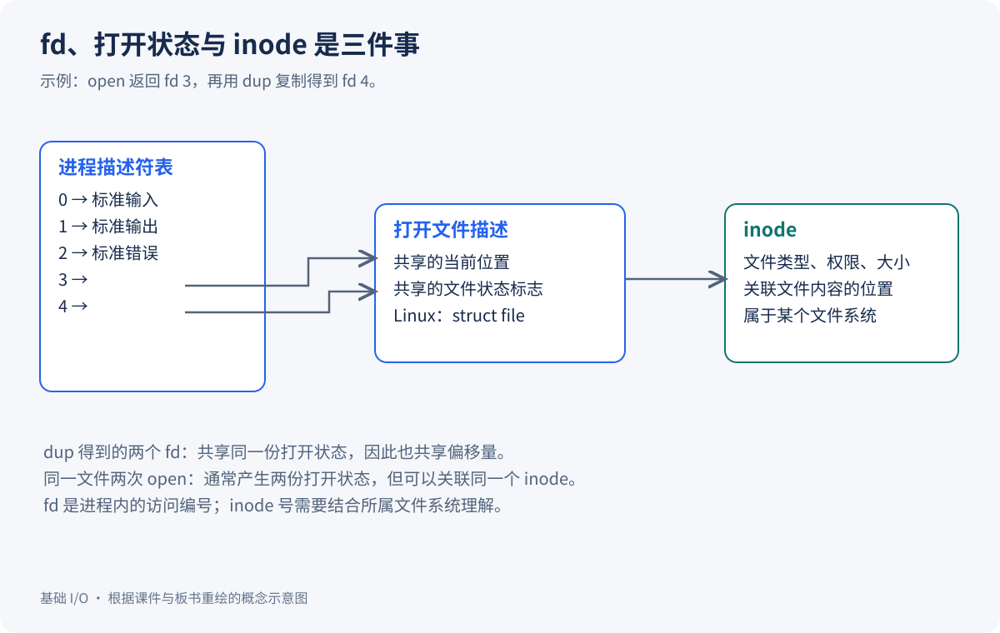
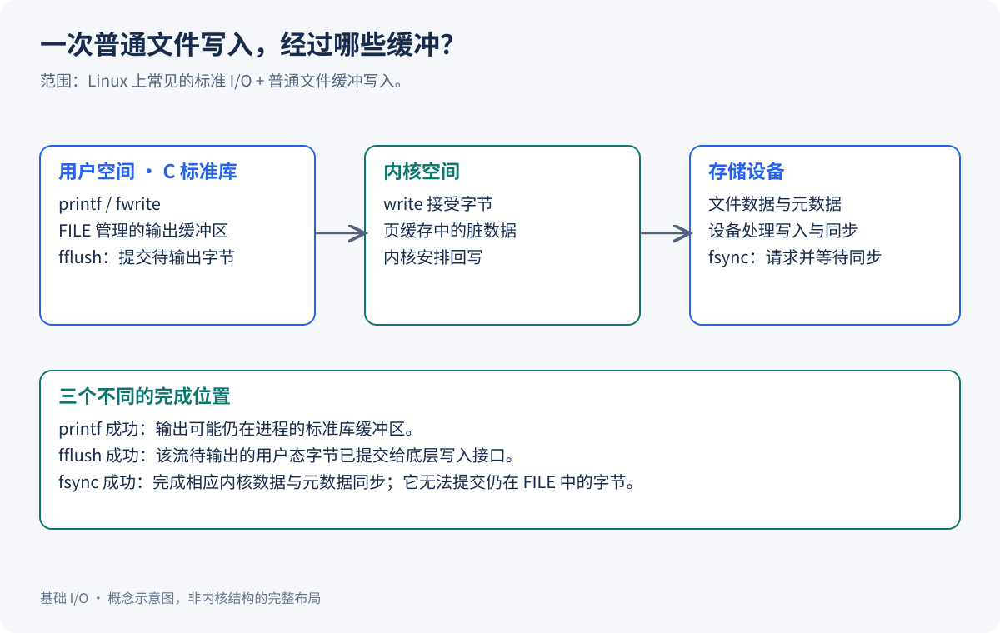
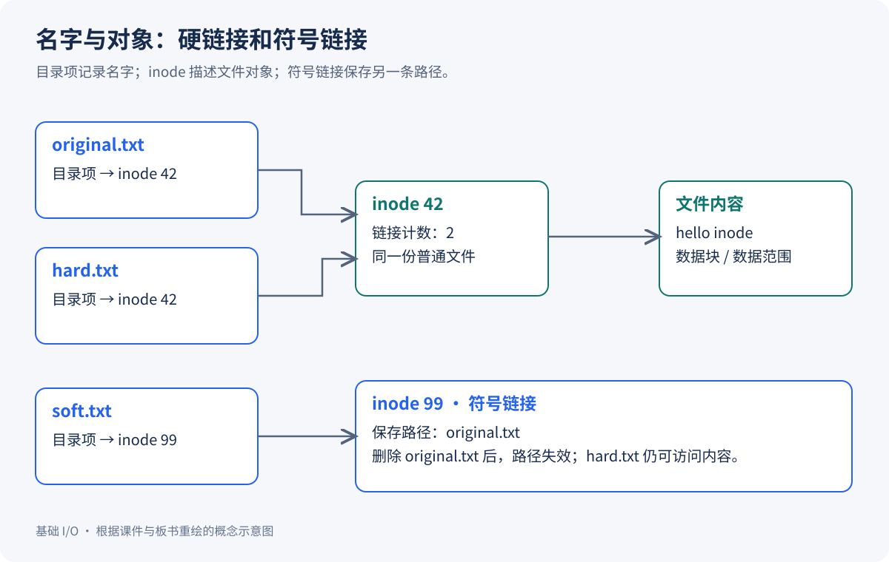

同样一句 `printf("hello\n")`，直接运行时出现在终端，加上 `> log.txt` 后却写进了文件。再往程序里加一个 `fork()`，文件里的某些输出甚至会出现两遍。

这些现象的背后，其实是几个不同层次在协作：C 标准库负责流和缓冲，内核负责文件描述符与打开状态，文件系统负责把名字、属性和内容组织起来。

本文结合《5. 基础IO》课件和对应课堂板书，从一个问题开始：**程序写下的一串字节，究竟是怎样到达文件里的？** 读完后，你应该能解释重定向为什么成立、`FILE *` 和 fd 为什么不同，以及为什么“写成功了”还需要分清写到了哪一层。

文中的程序面向 Linux，具备 C 语言和进程基础即可阅读。示意图依据课程内容重新绘制，表示概念关系，不是内核结构体的完整布局。

## Table of contents

## 先分清：文件、打开文件与文件内容

在编辑器里看到的文字，只是文件的内容。普通文件还包含类型、权限、所有者、大小、时间戳等元数据。一个长度为 0 的空文件，虽然可能不需要分配内容数据块，仍然需要 inode、目录项等管理信息。

板书把文件概括成“属性 + 内容”，是在提醒我们：读写字节、修改权限、查询大小，操作的是不同的信息。

还要区分两个时刻：

- **没有被进程打开时**，文件可以作为文件系统中的对象长期存在。
- **被进程打开后**，内核还要记录这一次打开的访问方式、当前位置等运行状态，让进程能够继续操作它。

打开文件，并不等于把整个文件内容一次性读入内存。一个很大的文件也可以先打开，再分批读取。

### 相对路径究竟相对于哪里？

```c
FILE *fp = fopen("log.txt", "w");
```

这里的 `log.txt` 相对于 **进程的当前工作目录**，不是源代码所在目录，也不一定是可执行文件所在目录。Shell 启动程序时，子进程通常继承它的工作目录；程序也可以通过 `chdir()` 改变这个目录。

例如在 `/tmp/demo` 里执行 `/home/me/bin/app`，如果程序没有改变工作目录，那么这次 `fopen` 会在 `/tmp/demo` 下创建或打开文件。

在 Linux 中，可以观察当前 Shell 的工作目录和文件描述符：

```bash
readlink /proc/$$/cwd
ls -l /proc/$$/fd
```

`$$` 是当前 Shell 的进程号。查看其他进程时，将它换成目标 PID 即可。`/proc/PID/exe` 和 `/proc/PID/cwd` 是两回事：前者关联可执行文件，后者关联工作目录。

## 两套接口：C 标准 I/O 和系统 I/O

课件先复习 `fopen`、`fread`、`fwrite`，再引入 `open`、`read`、`write`。它们不是两套互不相干的文件系统，而是不同层次的接口。

| 操作     | C 标准 I/O                   | POSIX 系统 I/O 接口      |
| -------- | ---------------------------- | ------------------------ |
| 打开     | `fopen` → `FILE *`           | `open` → `int` 类型的 fd |
| 读取     | `fread`、`fgets`、`fscanf`   | `read`                   |
| 写入     | `fwrite`、`fputs`、`fprintf` | `write`                  |
| 调整位置 | `fseek`、`rewind`            | `lseek`                  |
| 查询位置 | `ftell`                      | `lseek(fd, 0, SEEK_CUR)` |
| 关闭     | `fclose`                     | `close`                  |

C 标准 I/O 提供格式化、按行处理、流状态和缓冲等功能。对于 Linux 上常见的磁盘文件流，它最终会通过底层系统接口完成读写，但一次 `fprintf` 不一定立即对应一次 `write`。

严格说，C 程序调用的 `open`、`read` 等入口通常也由 libc 提供封装，再进入内核；本文沿用课程叫法，将它们称为系统调用接口。不要把“库函数”简单理解成“与系统调用无关”，也不要把某个 libc 封装函数与一个固定的内核系统调用实现绑定。

### 打开模式决定了什么？

下面比较普通文件常用模式的主要效果：

| `fopen` 模式 | 常见 `open` 标志组合              | 文件不存在 | 文件已存在       |
| ------------ | --------------------------------- | ---------- | ---------------- |
| `"r"`        | `O_RDONLY`                        | 失败       | 从头读取         |
| `"r+"`       | `O_RDWR`                          | 失败       | 可读写，不清空   |
| `"w"`        | `O_WRONLY \| O_CREAT \| O_TRUNC`  | 创建       | 先清空，再写入   |
| `"w+"`       | `O_RDWR \| O_CREAT \| O_TRUNC`    | 创建       | 先清空，可读写   |
| `"a"`        | `O_WRONLY \| O_CREAT \| O_APPEND` | 创建       | 写入时追加到末尾 |
| `"a+"`       | `O_RDWR \| O_CREAT \| O_APPEND`   | 创建       | 可读，写入时追加 |

这是打开语义的对照，不表示标准流与 fd 在缓冲、读写切换等方面完全等价。尤其是 `+` 模式下交替读写，需要遵守标准流的刷新或定位规则；`a+` 的初始读取位置也不应跨平台想当然，明确定位更稳妥。

`O_RDONLY`、`O_WRONLY`、`O_RDWR` 三选一；创建、截断、追加等选项再通过按位或 `|` 组合。Linux 中 `O_RDONLY` 的值为 0，因此不能用 `flags & O_RDONLY` 判断是否只读，应使用 `(flags & O_ACCMODE) == O_RDONLY`。

```c
int fd = open("log.txt", O_WRONLY | O_CREAT | O_TRUNC, 0666);
```

这里的 `0666` 是八进制权限。使用 `O_CREAT` 时需要提供创建权限；只写 `open(path, O_CREAT | O_WRONLY)` 会遗漏必要参数。创建权限还要受 `umask` 影响：在没有默认 ACL 等额外机制时，通常按 `mode & ~umask` 计算，`0666` 配合 `0022` 得到 `0644`。它只影响新建文件，不能借这次 `open` 修改已有文件的权限。

另一个常见误会是：`O_CREAT` 只负责“必要时创建”，并不负责清空旧内容。覆盖写短字符串却留下文件尾部旧数据，往往是漏了 `O_TRUNC`。这些标志及返回值的精确定义可查 [open(2)](https://man7.org/linux/man-pages/man2/open.2.html)。

### 读出来的是字节，不一定是字符串

`read` 返回实际读取的字节数：大于 0 表示读到数据；对普通文件，在请求长度大于 0 时返回 0 表示已到文件末尾；返回 -1 表示出错。

`fread(ptr, size, count, stream)` 则返回完整读取的 **元素个数**。把 `size` 设为 1，返回值才直接对应字节数。`fwrite` 同理。

下面是一个完整的标准 I/O 版文件输出程序，保存为 `stdio-cat.c`：

```c
#include <stdio.h>

int main(int argc, char **argv) {
  if (argc != 2) {
    fprintf(stderr, "usage: %s FILE\n", argv[0]);
    return 1;
  }

  FILE *fp = fopen(argv[1], "rb");
  if (fp == NULL) {
    perror("fopen");
    return 1;
  }

  unsigned char buf[4096];
  size_t n;
  int failed = 0;
  while ((n = fread(buf, 1, sizeof(buf), fp)) > 0) {
    if (fwrite(buf, 1, n, stdout) != n) {
      perror("fwrite");
      failed = 1;
      break;
    }
  }
  if (ferror(fp)) {
    perror("fread");
    failed = 1;
  }
  if (fclose(fp) == EOF) {
    perror("fclose");
    failed = 1;
  }
  if (fflush(stdout) == EOF) {
    perror("fflush");
    failed = 1;
  }
  return failed;
}
```

这个写法有三个值得保留的细节：

1. 读多少字节，就写多少字节，不用 `strlen` 猜测长度。文件里可以包含 `\0`。
2. 不在 `buf[n]` 写字符串结束符。如果刚好读满整个数组，那个位置已经越界。
3. 循环结束后检查 `ferror`，不能把所有“没有读到数据”都当作正常结束。

`feof` 只能告诉你之前的读取是否遇到了文件末尾，不能提前预告下一次读取。因此不要用 `while (!feof(fp))` 代替检查读取结果。

## fd 是一个编号，编号背后才是打开状态

`open` 成功返回一个非负整数，失败返回 -1。这个整数就是文件描述符，简称 fd。

对普通进程，可以先把 fd 理解成“进程文件描述符表的下标”。内核根据这个下标，找到对应的打开文件描述，再进行读写。Linux 中常用 `struct file` 表示这种打开状态，里面关联当前位置、状态标志和文件操作等信息。



图中区分了三种身份：

| 对象         | 回答的问题                           | 例子                       |
| ------------ | ------------------------------------ | -------------------------- |
| fd           | 这个进程用哪个编号访问？             | `3`、`4`                   |
| 打开文件描述 | 这次打开读到哪里、采用什么访问状态？ | 当前偏移量、追加标志       |
| inode        | 文件系统中的哪个对象、有什么元数据？ | 权限、大小、数据位置的索引 |

因此，**fd 不是文件在整个系统中的唯一编号，也不是 inode 号。** 两个进程都可以有 fd 3，却指向完全不同的文件。

对同一个普通文件调用两次 `open`，通常会得到两个独立的打开文件描述：二者访问相同的文件内容，但各有自己的偏移量。通过 `dup` 或 `dup2` 复制描述符，则会引用同一个打开文件描述，共享偏移量和文件状态标志。文件描述符自己的标志，例如 `FD_CLOEXEC`，需要另外区分。

### 0、1、2 为什么特殊？

通常由 Shell 启动的程序已经继承了三个约定的 fd：

| fd  | `<unistd.h>` 中的名称 | C 标准流 |
| --- | --------------------- | -------- |
| 0   | `STDIN_FILENO`        | `stdin`  |
| 1   | `STDOUT_FILENO`       | `stdout` |
| 2   | `STDERR_FILENO`       | `stderr` |

它们的含义是标准输入、标准输出和标准错误，并不意味着一定连接键盘或屏幕。终端交互时它们常与终端相关；重定向之后也可以连接普通文件、管道等对象。

Linux 的 `open` 会选择当前未占用的最小 fd。在 0、1、2 都已打开且没有其他描述符占用的简单程序里，下一次打开通常得到 3。若先关闭 0，再打开文件，就可能得到 0。所以判断失败要写 `fd < 0`，不能写 `fd <= 0`。

### 用系统调用写一个字节流版本

下面保存为 `fd-cat.c`。与上一版不同，它直接使用 `read` 和 `write`：

```c
#include <errno.h>
#include <fcntl.h>
#include <stdio.h>
#include <unistd.h>

static int write_all(int fd, const unsigned char *buf, size_t len) {
  while (len > 0) {
    ssize_t n = write(fd, buf, len);
    if (n < 0) {
      if (errno == EINTR) continue;
      return -1;
    }
    if (n == 0) {
      errno = EIO;
      return -1;
    }
    buf += n;
    len -= (size_t)n;
  }
  return 0;
}

int main(int argc, char **argv) {
  if (argc != 2) {
    fprintf(stderr, "usage: %s FILE\n", argv[0]);
    return 1;
  }
  int fd = open(argv[1], O_RDONLY);
  if (fd < 0) {
    perror("open");
    return 1;
  }

  unsigned char buf[4096];
  int failed = 0;
  for (;;) {
    ssize_t n = read(fd, buf, sizeof(buf));
    if (n == 0) break;
    if (n < 0) {
      if (errno == EINTR) continue;
      perror("read");
      failed = 1;
      break;
    }
    if (write_all(STDOUT_FILENO, buf, (size_t)n) < 0) {
      perror("write");
      failed = 1;
      break;
    }
  }
  if (close(fd) < 0) {
    perror("close");
    failed = 1;
  }
  return failed;
}
```

这里用循环处理短写：`write` 成功并不保证一次写完请求的全部字节。`EINTR` 表示这次调用在完成数据传输前受到信号中断，可以重试。示例面向阻塞 I/O；非阻塞描述符的 `EAGAIN` 需要配合等待机制处理，不在本篇展开。

课件中的 `lseek` 则用于修改可定位文件的偏移量。例如 `lseek(fd, 0, SEEK_SET)` 回到开头，成功返回新位置，失败返回 `(off_t)-1`。管道等对象不能这样定位；对普通文件，把位置移到文件末尾之外也不会立即扩展文件，之后实际写入才可能形成空洞。

## 重定向：改变 fd 的指向

运行下面的命令时，`fd-cat` 不需要知道输出目的地：

```bash
./fd-cat input.txt > output.txt
```

程序仍向 fd 1 写字节。Shell 在执行它之前，已经把子进程的 fd 1 接到了 `output.txt`。

于是，板书中“先 `close(1)`，再 `open`”的实验就可以解释了：释放 1 号位置后，新打开的文件可能占据这个位置，后续的标准输出便会进入该文件。

这个实验适合观察最小 fd 分配规则。实际指定重定向目标时，更直接的接口是：

```c
int dup2(int oldfd, int newfd);
```

成功后，`newfd` 与 `oldfd` 引用同一个打开文件描述。`newfd` 原来若已打开，会在替换过程中被关闭；不需要先手动 `close(newfd)`。有效的两个参数相等时，`dup2` 保持该描述符不变。

`dup2` 复制的是 **引用关系**，不会复制文件内容。这也解释了为什么复制后关闭多余的旧 fd，仍然可以通过新 fd 访问文件。具体语义见 [dup(2)](https://man7.org/linux/man-pages/man2/dup.2.html)。

### 把课件中的 minishell 提炼成一个小程序

完整 Shell 还要处理分词、引号、内建命令和错误状态。为了集中观察基础 I/O，下面只保留“打开输出文件 → 接到 fd 1 → 执行命令”的核心，保存为 `redirect-exec.c`：

```c
#include <fcntl.h>
#include <stdio.h>
#include <unistd.h>

int main(int argc, char **argv) {
  if (argc < 3) {
    fprintf(stderr, "usage: %s OUTPUT COMMAND [ARG...]\n", argv[0]);
    return 1;
  }

  int fd = open(argv[1], O_WRONLY | O_CREAT | O_TRUNC, 0666);
  if (fd < 0) {
    perror("open");
    return 1;
  }
  if (dup2(fd, STDOUT_FILENO) < 0) {
    perror("dup2");
    close(fd);
    return 1;
  }
  if (fd != STDOUT_FILENO && close(fd) < 0) {
    perror("close");
    return 1;
  }

  execvp(argv[2], &argv[2]);
  perror("execvp");
  _exit(127);
}
```

这里判断 `fd != STDOUT_FILENO` 很重要：若原来的 fd 1 已关闭，`open` 恰好返回 1，再无条件 `close(fd)` 就把刚配置好的输出关掉了。

```bash
gcc -std=c11 -Wall -Wextra -Werror redirect-exec.c -o redirect-exec
./redirect-exec result.txt /usr/bin/printf 'hello IO\n'
cat result.txt
```

预期文件内容是 `hello IO` 加换行。`execvp` 替换程序映像，但通常保留没有设置 close-on-exec 的描述符，所以新程序继承了刚才设置的输出目标。

这个小程序自身被命令替换，不负责交互循环。放回课件的 minishell 时，通常由 Shell `fork` 出子进程，让子进程完成重定向并执行外部命令；父进程保留自己的终端输出并等待。内建命令若在父进程执行，则还需要保存和恢复其描述符，不能直接照搬子进程路径。

`>`、`>>` 和 `<` 的核心区别也就清楚了：

| Shell 语法 | 打开目标的主要标志                | 替换的 fd |
| ---------- | --------------------------------- | --------- |
| `> file`   | `O_WRONLY \| O_CREAT \| O_TRUNC`  | 1         |
| `>> file`  | `O_WRONLY \| O_CREAT \| O_APPEND` | 1         |
| `< file`   | `O_RDONLY`                        | 0         |

重定向还有顺序。例如 `cmd > out.txt 2>&1` 先把 1 接到文件，再让 2 引用此时的 1；`cmd 2>&1 > out.txt` 先复制原来的 1，再替换 1，标准错误可能仍指向终端。

## FILE 比 fd 多了什么？

`FILE *` 是 C 标准库流对象的指针；fd 是内核接口接受的整数。对 Linux 上普通的文件流，可以把前者理解为在后者之上增加了一层管理：

```text
FILE 流对象（概念模型）
├── 与底层文件描述符的关联
├── 输入 / 输出缓冲区
├── 当前位置与缓冲区读写状态
├── EOF、错误等状态
└── 缓冲策略及其他管理信息
```

这不是可直接访问的 C 结构体定义。glibc 的内部字段会随实现变化，程序不应该依赖 `_fileno` 等私有字段；对关联 fd 的流，使用 `fileno(fp)` 查询底层描述符。

更一般地说，标准流也不一定都对应磁盘文件或 fd，例如内存流就不能套用“所有 `FILE` 必定有 fd”的结论。这里的模型限定在课程讨论的常见文件流。

这一层封装带来便利，也带来一个需要牢记的事实：**`printf` 返回时，字节可能只进入了 C 库的缓冲区。**

## 两层缓冲区：先交给内核，再交给存储设备

对普通文件的典型缓冲写入，可以画成下面这条路径：



第一层是进程用户空间中的 C 库缓冲区。把很多次小输出攒成一次较大的写入，可以减少系统调用次数。系统调用需要进入内核，但进入内核不等于每次都发生进程调度切换，也不等于每次都直接访问磁盘。

第二层是内核中的缓存。对普通文件，常见缓冲 I/O 使用页缓存；`write` 可以先更新其中的数据，再由内核安排回写。不同 I/O 路径可能另有机制，图中没有涵盖直接 I/O 或所有设备。

所以，下面三句话的强度不同：

| 表述              | 对典型普通文件写入意味着什么                 |
| ----------------- | -------------------------------------------- |
| `printf` 成功     | 标准库接受了这次输出，可能尚未交给内核       |
| `fflush(fp)` 成功 | 该流待输出的用户态缓冲数据已交给底层写入接口 |
| `fsync(fd)` 成功  | 对该文件请求的内核数据与相关元数据同步已完成 |

`fflush` 只处理标准库这一层，不能代替 `fsync`；`fsync` 也无法替你提交仍留在 `FILE` 缓冲区里的字节。对需要同步的普通文件流，通常要先检查 `fflush(fp)`，再检查 `fsync(fileno(fp))`。文件新建或重命名涉及的目录项持久化还可能需要同步目录。详见 [fflush(3)](https://man7.org/linux/man-pages/man3/fflush.3.html) 和 [fsync(2)](https://man7.org/linux/man-pages/man2/fsync.2.html)。

`close` 也不是磁盘同步接口。关闭一个 fd，更不意味着 C 库会自动替对应的流刷新缓冲区。

### 行缓冲、全缓冲与无缓冲

常见 Linux/glibc 环境下，标准输出连接终端时通常采用行缓冲，连接普通文件时通常采用全缓冲；标准错误默认不缓冲。

| 策略   | 容易观察到的行为                              |
| ------ | --------------------------------------------- |
| 行缓冲 | 输出换行时触发刷新，缓冲区满时也会刷新        |
| 全缓冲 | 累积一批数据后提交，也可显式刷新              |
| 无缓冲 | 不用标准 I/O 缓冲区攒输出；不代表绕过内核缓存 |

正常 `return` 离开 `main` 或调用 `exit`，会执行标准 I/O 的退出刷新；`fclose` 也会尝试刷新对应流。`_exit` 则不会执行这层刷新，异常终止也不能依赖自动刷新。

不要把缓冲区大小记成固定的 1024 或 4096 字节，也不要认为每次 `dup2` 都会重新设置已有流的缓冲策略。如果要明确控制策略，可以在流打开之后、其他流操作之前调用 `setvbuf`，并检查返回值。相关规则见 [setbuf(3)](https://man7.org/linux/man-pages/man3/setbuf.3.html)。

### 为什么打印过了，文件却还是空的？

板书中的实验可以概括为：先把标准输出接到文件，再 `printf`，然后立即 `close(1)`。

若这时字符串仍在标准库缓冲区，`close(1)` 关闭了底层出口；等退出刷新时，写入已经无法正常完成。问题不是“没有执行打印语句”，而是“字节还没有通过出口，出口先被关了”。

对由 `fopen` 获得的流，通常用 `fclose(fp)` 完成刷新和关闭，并检查返回值。对已经使用过的 `stdout` 做描述符替换时，要先检查 `fflush(stdout)`，避免待输出内容被送到新的目标；不要随意交替使用同一底层打开状态上的标准 I/O 和系统 I/O。

## fork 为什么会让输出出现两遍？

这是课件与板书共同强调的实验。`fork` 复制进程的地址空间状态，未刷新的 C 库缓冲数据也包含在其中。Linux 通常通过写时复制实现内存共享与后续分离，但从程序观察，两边都拥有一份自己的用户态缓冲状态。

同时，父子进程继承的 fd 引用同一个打开文件描述。这两点必须分开理解：**用户态缓冲状态各一份，内核打开状态可以共享。**

下面的 `fork-buffer.c` 故意保留待输出内容，用来观察 Linux/glibc 下的课堂现象。生产程序需要协调 `fork` 前后的流访问，不能把这种未刷新状态当作可靠的跨进程输出方案。

```c
#include <errno.h>
#include <stdio.h>
#include <string.h>
#include <sys/wait.h>
#include <unistd.h>

int main(int argc, char **argv) {
  if (printf("printf before fork\n") < 0) return 1;

  if (argc == 2 && strcmp(argv[1], "--flush") == 0) {
    if (fflush(stdout) == EOF) {
      perror("fflush");
      return 1;
    }
  }

  pid_t pid = fork();
  if (pid < 0) {
    perror("fork");
    return 1;
  }
  if (pid == 0) {
    return 0;
  }

  int status;
  while (waitpid(pid, &status, 0) < 0) {
    if (errno == EINTR) continue;
    perror("waitpid");
    return 1;
  }
  return WIFEXITED(status) ? WEXITSTATUS(status) : 1;
}
```

```bash
gcc -std=c11 -Wall -Wextra -Werror fork-buffer.c -o fork-buffer
./fork-buffer
./fork-buffer > fork-output.txt
cat fork-output.txt
./fork-buffer --flush > flushed-output.txt
cat flushed-output.txt
```

在通常的终端与 glibc 默认缓冲配置下，预期观察是：

| 运行方式             | 这一行通常出现几次 | 原因                                               |
| -------------------- | ------------------ | -------------------------------------------------- |
| 直接连接终端         | 1                  | 换行使输出在 `fork` 前已刷新                       |
| 重定向到普通文件     | 2                  | 未刷新的内容随进程状态复制，两边正常退出时各刷一次 |
| 重定向并加 `--flush` | 1                  | `fork` 前主动提交，子进程没有继承待刷新的字节      |

课件把 `printf`、`fwrite` 与 `write` 放在一起比较：已经由 `write` 提交的字节，不会因为后续 `fork` 又被系统调用一次；未提交的标准库缓冲数据却可能被两边各自提交。这里说 `write` “没有缓冲”，只能理解为它不经过这层 C 标准 I/O 缓冲，不能推导出内核没有缓存。

为了单独观察标准库缓冲复制，上面的程序只使用标准流输出，避免混用两套输出接口。若子进程接下来要执行新程序，常见做法是在 `fork` 前处理好已有输出，子进程在 `exec` 失败时使用 `_exit`，避免再次刷新继承的标准库缓冲。

## “一切皆文件”统一的是什么？

板书用 `struct file` 和文件操作函数指针解释了这个设计：上层通过 fd 发起操作，内核根据对象类型分派给相应实现。

读取普通文件、读取终端、读取管道，数据来源不同，但程序都可以面对 `read(fd, buf, size)` 这样的接口。统一之后，许多程序只需处理字节流，就可以通过 Shell 重定向和管道组合起来。

但接口统一，不等于所有对象都支持全部操作。普通文件常可 `lseek`，管道和套接字通常不可；目录也有专门的遍历接口。`/proc` 中的一些“文件”还是内核状态的动态视图，并没有一份对应的普通磁盘内容。

因此，“一切皆文件”的学习重点是 **用统一抽象管理和访问多类资源**，而不是把所有资源都想象成磁盘上的文本。

## 从 fd 继续向下：磁盘、文件系统与 inode

前面解释了打开之后如何读写。板书接着问：在第一次打开之前，系统怎么根据一个名字找到文件？

这就需要从进程视角转向文件系统视角。

### 磁盘提供存储，文件系统提供组织方式

机械硬盘的盘片、磁道和扇区可以帮助理解物理存储与寻道；操作系统通常面对逻辑块地址，而不需要让普通程序指定磁头位置。SSD 没有旋转盘片，仍然可以提供块设备接口。

扇区、文件系统块和内存页属于不同层次。教学图常采用“512 字节扇区、4 KiB 文件系统块”，这是方便计算的例子，不是所有设备和文件系统的固定配置。

文件系统则需要管理：哪些空间已经使用、哪些 inode 空闲、一个文件的内容分布在哪里。板书中的 ext 系列块组布局，常见组成包括：

| 结构       | 管什么                         |
| ---------- | ------------------------------ |
| 超级块     | 文件系统整体规模、特性等元数据 |
| 组描述信息 | 定位块组内的重要管理结构       |
| 块位图     | 数据块等块资源的使用情况       |
| inode 位图 | inode 的分配情况               |
| inode 表   | 文件对象的元数据记录           |
| 数据区域   | 普通文件内容、目录内容等       |

把存储划分为块组，可以缩小管理范围，并尽量把有关联的数据放得更近。实际 ext4 有多种特性组合，布局不能机械地套用一张 ext2 教学图；也不是每个组都必须保存完整超级块副本。可参照 [Linux 内核的 ext4 设计说明](https://docs.kernel.org/filesystems/ext4/overview.html)。

### 文件名在哪里？

inode 主要描述文件对象的属性与数据定位信息；**文件名通常保存在目录项中**，目录项把名字与 inode 号关联起来。



解析 `/home/me/log.txt` 时，可以先把过程理解为：从根目录开始，依次查找 `home`、`me`、`log.txt` 对应的目录项，最终定位目标对象。实际系统还会处理权限、挂载点、符号链接，并利用 dentry、inode 等缓存减少反复查找。

所以一次文件访问中的“编号”不止一个：fd 在进程的描述符表里有意义；inode 号则要放在所属文件系统中理解。比较文件身份时，通常需要同时考虑设备号与 inode 号，不能仅凭两次 `ls -i` 得到同一个数字就下结论。

### inode 怎样找到大文件的内容？

板书里的直接块指针、一级间接、二级间接等结构，展示的是传统块映射思路：小文件可以直接索引数据块，大文件再通过额外的索引块扩大覆盖范围。

例如教学模型假设一个块为 4 KiB、一个块号占 4 字节，那么一个间接索引块可容纳 `4096 / 4 = 1024` 个块号。一级间接索引因此能覆盖约 4 MiB 的内容。继续增加索引层次，就能覆盖更大范围，但查找也需要更多步骤。

这说明的是“有限的 inode 空间如何描述大文件”。现代 ext4 常使用 extent，把连续的一段逻辑块与物理块映射作为一个范围记录，不能把传统指针图当作所有 ext4 文件的实际布局。

## 硬链接与软链接：给对象起名，还是保存一条路径？

理解“文件名在目录项里”之后，硬链接就不难了：它是在同一个文件系统中，为同一个 inode 增加另一个名字。

假设 `original.txt` 和 `hard.txt` 指向同一个 inode，那么通过任意名字修改文件，都在修改同一份内容。“原文件”并不比“硬链接文件”更特殊；删除其中一个名字，不会自动删除另一个。

符号链接则是一个单独的文件系统对象，有自己的 inode，保存的是目标路径。访问它时，系统再按这条路径解析目标；目标不存在时，链接自身仍可以存在。

| 比较项           | 硬链接                     | 符号链接（软链接）       |
| ---------------- | -------------------------- | ------------------------ |
| 指向方式         | 新目录项引用同一 inode     | 保存目标路径             |
| inode            | 与目标相同                 | 与目标不同               |
| 跨文件系统       | 通常不允许                 | 可以                     |
| 目标是目录       | 普通用户通常不能创建       | 可以                     |
| 删除原来的名字后 | 其他硬链接通常仍能访问内容 | 原路径失效时成为悬空链接 |
| 占用关系         | 不复制一份文件内容         | 需要保存链接本身及路径   |

相对符号链接的路径，按 **链接所在目录** 解释，不是按访问它的进程当前目录解释。

可以在新建的临时目录里观察，避免碰到已有文件：

```bash
workdir=$(mktemp -d)
cd "$workdir" || exit 1
printf 'hello inode\n' > original.txt
ln original.txt hard.txt
ln -s original.txt soft.txt
ls -li original.txt hard.txt soft.txt
rm original.txt
cat hard.txt
cat soft.txt
```

预期 `original.txt` 和 `hard.txt` 的 inode 号相同，普通文件的硬链接数变为 2；删除 `original.txt` 后，`hard.txt` 仍能读到内容，而 `soft.txt` 找不到它记录的目标路径。

这里没有给出固定 inode 数字，因为它由实际文件系统分配。最后的 `cat soft.txt` 报错正是实验预期。

还可以进一步解释一个日常现象：**删除了文件名，磁盘空间却没有立即释放。** 对普通文件而言，移除目录项只是减少硬链接计数；若仍有进程持有打开引用，文件内容通常要等最后的打开引用释放后才能回收。这也是“名字消失”和“打开状态结束”不能混为一谈的原因。

## 回到课件：自己封装一层缓冲 I/O

课件末尾用一个简化的 `mFILE` 将 fd、缓冲区和刷新规则放在一起。这个练习的价值，是亲手走一遍标准库这一层的职责。

可以先设计一个仅支持输出的教学模型：

```c
struct mini_stream {
  int fd;
  unsigned char buffer[1024];
  size_t used;
  int error;
};
```

再按下面的顺序实现。这里是实现提纲，不是一份可替换 libc 的完整库：

1. 打开：解释模式，调用 `open`，分配并初始化流对象；分配失败时关闭已打开的 fd。
2. 写入：把数据分段放进缓冲区，装满后刷新；输入长度大于剩余容量时，不能直接整段 `memcpy`。
3. 刷新：循环调用 `write`，处理短写和 `EINTR`；失败时记录错误并保留尚未提交的数据。
4. 关闭：尝试刷新，关闭 fd，释放流对象，同时把失败状态返回给调用者。

如果加入行缓冲，需要处理写入内容中的换行，不能仅检查整次输入的最后一个字符。若中途刷新失败，还要说清楚已接受多少数据，以及调用方能否重试。

标准库式的刷新也不应该无条件附带 `fsync`：用户态缓冲提交与持久化同步是两个职责，应由接口和调用场景明确决定。这正好把课件的封装练习和板书的两层缓冲模型接到了一起。

## 用三个实验检验是否理解

上面的代码建议保存到独立练习目录。先编译两个读取程序：

```bash
gcc -std=c11 -Wall -Wextra -Werror stdio-cat.c -o stdio-cat
gcc -std=c11 -Wall -Wextra -Werror fd-cat.c -o fd-cat
```

**实验一：不用字符串假设，完整复制字节。** 创建含 `\0` 且跨过多个缓冲区的测试文件，再逐字节比较：

```bash
python3 -c 'from pathlib import Path; Path("input.bin").write_bytes(bytes(range(256)) * 40)'
./stdio-cat input.bin > stdio-copy.bin
./fd-cat input.bin > fd-copy.bin
cmp input.bin stdio-copy.bin
cmp input.bin fd-copy.bin
```

两次 `cmp` 应无输出且退出码为 0。再分别试空文件和不存在的路径：前者应正常结束，后者应报错，而不是死循环。

**实验二：程序不变，只改变输出位置。** 运行前面的 `redirect-exec`，再将打开标志中的 `O_TRUNC` 改为 `O_APPEND`，连续运行两次，比较文件内容。这可以检验你是否把“打开方式”和“fd 指向”区分开了。

**实验三：控制 fork 前的刷新。** 比较 `fork-buffer` 的三个运行方式，先预测行数再执行。如果运行器把输出接到管道，所谓“直接运行”也未必连接真实终端，需要先确认环境；不能把 IDE 输出窗口的行为当作终端行缓冲的证明。

做完后，试着不看正文回答这四个问题：

- 为什么 `open` 返回 0 也可能是成功？
- 为什么 `dup2` 后关闭多余的旧 fd，不影响新 fd？
- 为什么 `fflush` 成功不能直接证明断电后数据仍在？
- 为什么删掉一个名字，仍可能从另一个名字或已打开的 fd 读到文件？

这些问题分别落在描述符分配、打开状态共享、缓冲层次和文件身份上。能把它们连起来，就能沿着 `FILE → fd → 打开文件描述 → inode → 数据` 这条路径，解释一次普通文件 I/O 的主要过程。

## 资料与阅读范围

本文以《5. 基础IO》课件为主线：第 1—9 页梳理文件与接口，第 10—24 页讨论 fd、重定向和 minishell，第 24—32 页解释统一文件抽象与缓冲，第 33—35 页给出简化 I/O 库练习。

课堂板书补充了概念推导与文件系统部分：`20251025_fd.png`、`20251028_文件描述符.png`、`20251030_缓冲区的理解.png`、`20251030_磁盘.png`、`20251103_ext文件.png`，以及 `文件系统done.png` 中的软硬链接内容。

正文中的程序是根据这些材料重新组织的独立示例，对返回值、数组边界、短写和关闭顺序补充了处理。动静态库、ELF、进程间通信及网络高级 I/O 不在本篇范围内。
