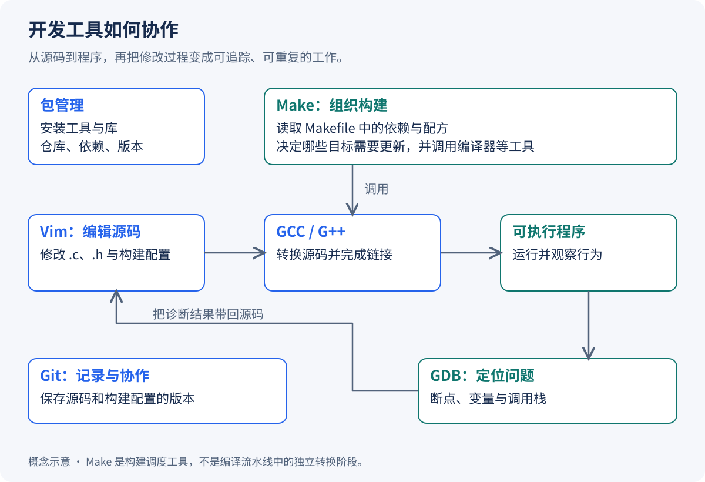
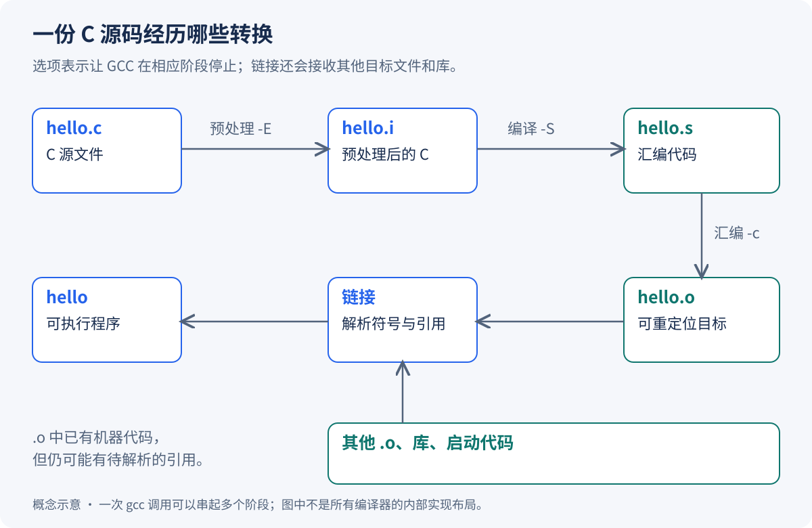
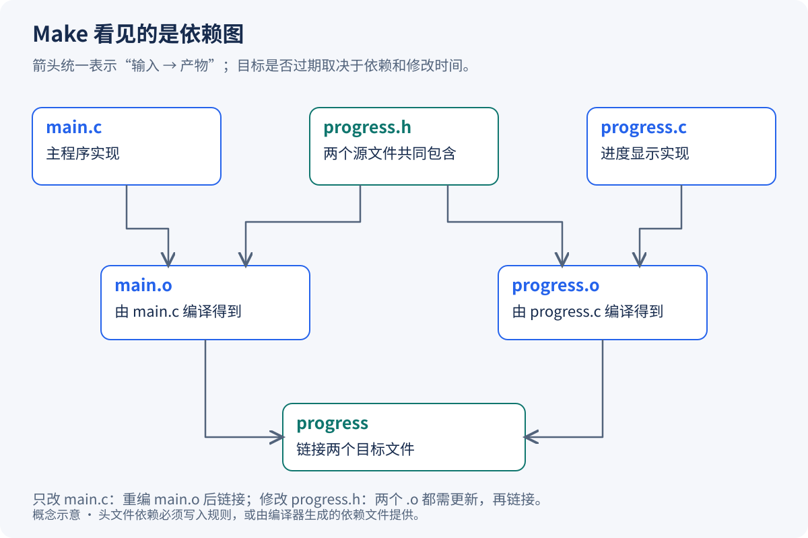

在 IDE 里点击一次“运行”，编辑器、编译器、构建工具和调试器往往已经替我们完成了一串工作。换到 Linux 终端后，这些角色变成了不同的命令：文件由 Vim 修改，源码交给 GCC，依赖关系写进 Makefile，问题用 GDB 定位，改动则进入 Git 历史。

最初的不适应，通常不是少了几个按钮，而是原本被界面隐藏的边界显露出来了：工具没安装与代码编译失败不是一回事，编译成功与链接成功不是一回事，本地提交与推送到 GitHub 也不是一回事。

以一个小型 C 项目为例，从准备开发环境和编辑源码开始，逐步了解多文件构建、版本管理与调试。



## Table of contents

## 先把开发环境准备好：软件包、仓库与依赖

在一台刚装好的 Linux 上输入 `gcc`，得到的可能不是编译结果，而是 `command not found`。这时的问题还不在代码，而在开发工具是否已经进入系统，以及 Shell 能否通过 `PATH` 找到它。

安装软件可以从源代码开始：下载源码、满足构建依赖、编译，再把结果放到合适的位置。但每个人都重复这套工作，既费时，也容易产生难以维护的版本组合。发行版因此把软件整理成 **软件包**：包内通常有预先构建的程序、库和资源文件，同时记录版本、依赖、安装脚本等信息。软件包也不一定都含机器码，脚本、文档和字体同样可以打包。

包管理器再把这些信息连接起来。安装编译器时，它不只是下载一个文件，还会计算所需依赖、选择匹配版本、检查完整性与签名，并更新系统中的安装记录。发行版维护者负责构建和集成，上游开发者维护源代码，镜像站承担分发，企业、高校和社区提供资金或人力。一个系统是否适合开发，很大程度上取决于这条维护链能否持续提供可用、兼容的软件。

### 先确认发行版，再选择命令

Linux 内核相同，并不意味着软件包可以任意互换。Debian、Ubuntu 常见的是 DEB 包，底层工具为 `dpkg`，日常通过 APT 处理仓库和依赖；Fedora、RHEL 及相关发行版采用 RPM 包，常通过 DNF 管理。

旧环境里经常能看到 YUM。以 RHEL 9 为例，`yum` 是指向 DNF 的兼容入口，但不能据此认定所有系统上的 YUM、DNF 版本与选项都完全相同。[Red Hat 的软件管理文档](https://docs.redhat.com/en/documentation/red_hat_enterprise_linux/9/html/managing_software_with_the_dnf_tool/con_software-management-tools-in-red-hat-enterprise-linux-9_managing-software-with-the-dnf-tool)说明了这个关系。

```bash
cat /etc/os-release
uname -m
```

前者说明发行版及版本，后者帮助识别处理器架构。之后再选对应的安装命令。例如，在仓库可用的情况下：

```bash
# Debian / Ubuntu
sudo apt update
sudo apt install build-essential vim gdb git

# Fedora / RHEL 系，按实际发行版选择
sudo dnf install gcc gcc-c++ make vim gdb git
```

`build-essential` 是 Debian/Ubuntu 常用的基础构建工具集合，不能把这个包名原样搬到 RPM 系统。反过来，RPM 系统里的 `gcc-c++` 与 Ubuntu 上的 `g++` 也体现了发行版的命名差异。

这里有一个容易混淆的动作：`apt update` 更新的是 **可用软件包索引**，没有把已安装软件全部升级。安装和升级要由后续命令决定。

### 查到一个软件包之后，要读懂什么

以文件传输工具包 `lrzsz` 为例，可以先搜索，再看详细信息：

| 想了解的信息         | APT                      | YUM / DNF                |
| -------------------- | ------------------------ | ------------------------ |
| 按名称或描述搜索     | `apt search lrzsz`       | `dnf search lrzsz`       |
| 查看匹配的包列表     | `apt list 'lrzsz*'`      | `dnf list 'lrzsz*'`      |
| 查看版本、依赖和说明 | `apt show lrzsz`         | `dnf info lrzsz`         |
| 安装                 | `sudo apt install lrzsz` | `sudo dnf install lrzsz` |
| 移除                 | `sudo apt remove lrzsz`  | `sudo dnf remove lrzsz`  |

在使用传统 YUM 的环境里，上表右侧的基本命令可使用相应的 `yum` 形式。`yum list | grep lrzsz` 也能筛选结果，但直接向包管理器提供包名通常更明确。

包信息中的几个部分各有意义：

- **名称** 决定正在选择哪个软件包；包名与最终命令名不一定相同。
- **版本与发行修订号** 同时反映上游版本和发行版打包修订，不能简单按一个通用的“主版本.次版本”公式解释所有包。
- **架构** 表明构建目标。`x86_64`、`i686` 常见于 RPM，`amd64`、`arm64` 常见于 DEB；`noarch` 或 `all` 通常表示包本身不绑定某种机器码架构。
- **发行版标记和仓库** 说明包面向哪套环境、从哪里获取。例如 `el7` 常见于面向 Enterprise Linux 7 的 RPM 构建，不表示这个包可以直接装到任何 Linux 上。

`lrzsz` 提供的 `rz`、`sz` 用于 ZMODEM 等协议传输：远端执行 `rz` 接收文件、`sz 文件名` 发送文件，但本地终端客户端也必须支持相应协议。它们不是所有 SSH 终端都内置支持的通用上传按钮；普通场景还可以选择 `scp` 或 SFTP。

安装或移除通常需要写系统目录，因此使用 `sudo`。查询命令则往往不需要管理员权限。`-y` 表示自动接受相应确认，理解变更清单之前保留交互确认，更容易看清将安装、升级或移除哪些依赖。一次命令可以安装多个包；需要避免的是多个进程同时修改同一个包数据库，遇到锁占用时应先确认是否有系统更新仍在运行。

APT 的 `remove` 通常保留包管理范围内的配置，`purge` 进一步清除相应配置；`autoremove` 清理不再被需要的自动安装依赖，也应先看清清单。它们并不等于清空用户家目录中的所有配置。[apt(8)](https://manpages.ubuntu.com/manpages/noble/man8/apt.8.html)还解释了交互式 `apt` 与脚本常用的 `apt-get`、`apt-cache` 的区别。

### 仓库不是下载目录，镜像也不是随便换一个网址

仓库除了保存包文件，还提供索引、版本和依赖关系等元数据。镜像站通常同步这套仓库内容，使用户能从网络路径更合适的服务器下载；它不负责把不同发行版的软件包变成兼容版本。

这也是为什么换源时需要同时核对 **发行版、版本代号、架构和仓库组件**。Ubuntu 的 `jammy`、`noble` 等代号不能随意混用；某个镜像的 `ubuntu` 路径若只覆盖 x86 包，就不能直接拿来服务 ARM 机器。可从镜像站自己的帮助页选择配置，例如[清华 TUNA 的 Ubuntu 使用说明](https://mirrors.tuna.tsinghua.edu.cn/help/ubuntu/)。安全更新仓库还要考虑同步延迟，不能仅按下载速度选择。

仓库也可以承担不同职责。基础仓库之外，EPEL 为 Enterprise Linux 生态提供附加软件。`epel-release` 主要安装仓库配置和签名公钥，并不是一次把 EPEL 中的软件全部装进系统；应选择与系统版本匹配的启用方式和依赖仓库。[Fedora 的包说明](https://packages.fedoraproject.org/pkgs/epel-release/epel-release/index.html)列出了这一职责。Ubuntu 的 `main`、`restricted`、`universe`、`multiverse` 则是另一套仓库组件划分，不能把 EPEL 命令照搬过去。

### 换源是一项配置变更，需要能回到原来的状态

传统 RPM 系统的仓库配置常放在 `/etc/yum.repos.d/*.repo`，包含仓库 ID、地址、启用状态和签名检查等设置。Ubuntu 旧版本常在 `/etc/apt/sources.list` 使用单行格式，也会读取 `sources.list.d` 中的配置；Ubuntu 24.04 LTS 起，默认 Ubuntu 仓库采用 `/etc/apt/sources.list.d/ubuntu.sources` 中的 deb822 格式。实际系统可能保留升级前的布局，应以现有文件为准。[Ubuntu 官方文档](https://ubuntu.com/server/docs/package-management/)说明了这一变化。

两种 APT 格式表达的是同类信息。下面仅用于展示字段结构，`noble` 明确指向 Ubuntu 24.04，不能把它当作适用于所有机器的配置：

```text
# 传统 .list 格式的一条记录
deb https://archive.ubuntu.com/ubuntu noble main restricted universe multiverse
```

```text
# deb822 .sources 格式中的一个段落
Types: deb
URIs: https://archive.ubuntu.com/ubuntu
Suites: noble noble-updates
Components: main restricted universe multiverse
Signed-By: /usr/share/keyrings/ubuntu-archive-keyring.gpg
```

实际换源时，先备份准备修改的配置文件，记录原来的仓库与版本；根据目标镜像的说明调整对应地址，保留正确的发行版代号、组件和签名配置。不要用一个不明版本的下载文件覆盖整套源，也不要顺手加入 `-proposed` 等预发布仓库。

修改之后，刷新索引并检查来源。在不同系统里，对应的是下面两组动作：

```bash
# APT：刷新索引，检查候选包版本与来源
sudo apt update
apt policy
apt policy gcc

# 传统 YUM：清理旧元数据后重建缓存，检查启用仓库
sudo yum clean all
sudo yum makecache
yum repolist
```

DNF 对应提供 `clean all`、`makecache` 和 `repolist` 等命令，具体选项应与系统版本匹配。索引刷新成功意味着新仓库配置可用，不代表已经升级系统。`apt upgrade` 用于升级软件；`apt full-upgrade` 还可能为了完成依赖变更移除已安装包，不能把它当成“换源后必须执行的最后一步”。传统 `yum update` 也会真正修改已安装软件，而不只是更新索引。

如果要恢复，使用前面保存的副本还原此次改动的配置，再刷新索引；若此次新增了额外配置文件，也要撤销相应新增项。恢复软件源并不自动回退已经完成的软件升级，两者是不同状态。

### 安装失败时，先判断失败在哪一层

访问远程仓库通常需要网络，但 `ping` 通不代表 DNS、HTTPS、代理和仓库路径都正常；`ping` 不通也可能只是 ICMP 被限制。应先看包管理器报告的是域名解析失败、连接超时、版本不存在、签名失败，还是依赖冲突。索引查询、卸载以及具备完整依赖的离线安装，也不一定需要访问网络。

还有一种失败来自系统生命周期。**CentOS Linux 7 已于 2024 年 6 月 30 日结束维护**，旧包转入归档仓库；换到归档地址只能获得历史软件，不能重新获得持续安全更新。因此，准备新的开发环境时，应选择仍受维护的发行版。这个区别比修复一条过期镜像链接更重要。[CentOS 官方公告](https://blog.centos.org/2023/04/end-dates-are-coming-for-centos-stream-8-and-centos-linux-7/)说明了维护结束与归档安排。

工具能够被可靠地安装、查询和更新之后，开发环境才算有了基础。接下来，编辑器负责把想法写成源文件，编译器和构建工具再把这些文件变成可运行程序。

## 用 Vim 编辑源码：先理解动作，再记按键

工具装好之后，第一个任务通常很普通：在终端里创建或修改一个源文件。IDE 可以把编辑、构建和调试放进同一窗口，但远程服务器、容器或救援环境里，往往只有一个终端。Vim 的价值在于，即使没有完整桌面，也能高效地完成文本修改。

Vim 从 vi 发展而来，沿用了模式编辑的基本思想，并提供语法高亮、撤销、可视选择、分屏和扩展机制。**同一个按键的含义由当前模式决定**，这是它与普通文本输入框最大的差别。

### 从打开文件到保存退出

在 Shell 中输入 `vim hello.c` 后，默认进入普通模式。此时按 `i`，才开始插入文字；按 `Esc` 回到普通模式，再输入 `:w` 并回车，就把缓冲区保存到文件。

| 所处模式                | 按键承担什么职责               | 常见入口与退出方式                      |
| ----------------------- | ------------------------------ | --------------------------------------- |
| 普通模式 Normal         | 移动、删除、复制、组合编辑动作 | 启动时进入；其他模式通常可按 `Esc` 返回 |
| 插入模式 Insert         | 输入文本                       | `i`、`a`、`o` 进入，`Esc` 返回          |
| 命令行模式 Command-line | 输入保存、替换、搜索等命令     | `:`、`/`、`?` 进入，回车执行            |
| 可视模式 Visual         | 先选中范围，再对范围操作       | `v` 按字符选择，`V` 按行选择            |

这些是最常见的入口，并不是 Vim 只有四种模式。`:help vim-modes` 可以查看完整说明。所谓“底行模式”，通常指命令在屏幕底部输入，并不是另一个 Shell。

`i` 在光标前插入，`a` 在光标后追加，`o` 在当前行下方新建一行并进入插入模式。对应的大写 `I`、`A`、`O` 则分别用于行首第一个非空白字符前、行尾和上方新行。这些动作把“到达位置”和“开始输入”合在了一起。

退出也要区分意图：`:q` 尝试退出，存在未保存修改时通常会阻止；`:wq` 保存并退出；`:q!` 放弃当前未保存的修改。感叹号不是“更强的保存”，不能用它解决所有退出问题。

### 光标移动是一套可以组合的语言

普通模式下的 `h j k l` 分别向左、下、上、右移动。方向键也可以用，字母键的优势是手不需要离开主键区。真正减少操作次数的，通常是按单词、行和段落移动。

| 想到达的位置                             | 按键               |
| ---------------------------------------- | ------------------ |
| 下一个单词开头、单词末尾、前一个单词开头 | `w`、`e`、`b`      |
| 当前行第一列、第一个非空白字符、行尾     | `0`、`^`、`$`      |
| 文件开头、文件末尾                       | `gg`、`G`          |
| 第 15 行                                 | `15G` 或 `:15`     |
| 向下、向上移动一整屏                     | `Ctrl-f`、`Ctrl-b` |
| 向下、向上移动半屏                       | `Ctrl-d`、`Ctrl-u` |
| 查看文件与当前位置                       | `Ctrl-g`           |

数字往往表示重复次数：`5l` 是向右移动五个字符，**不是跳到第五列**；要指定屏幕列，可用 `5|`。同样，`3w` 是向前移动三个单词。`^` 会跳过行首空白，而 `0` 不会，这个区别在缩进代码中很常见。

移动还能和编辑动作结合。`d` 表示删除，`y` 表示复制到寄存器，`c` 表示更改并进入插入模式；后面再接一个范围，就能表达“对哪里做什么”。

```text
dw      删除到下一个单词边界
d$      删除到行尾
yy      复制当前行
3yy     从当前行起复制三行
dd      删除当前行
3dd     从当前行起删除三行
cw      更改当前单词的相应部分，并进入插入模式
c3w     更改三个单词对应的范围
```

`cw` 在光标位于单词中时有一些沿袭 vi 的特殊行为；需要精确表达“这个单词整体”时，`ciw` 往往更直观。可以通过 `:help cw` 和 `:help text-objects` 继续了解，而不必把所有组合都背成独立快捷键。

`x` 删除光标处字符，`X` 删除光标前的字符；`6x`、`3X` 分别重复相应动作。`r` 后跟一个字符用于单字符替换，`R` 则进入连续替换模式，直到按 `Esc` 返回。误操作后用 `u` 撤销，`Ctrl-r` 重做，`.` 可以重复最近一次修改。

复制与删除默认会涉及 Vim 的寄存器。`yw` 复制的是 `w` 动作覆盖的范围，不能一概理解成“到单词最后一个字母”；`ye` 才对应 `e` 的范围。粘贴时，字符级内容的 `p` 放在光标后，行级内容的 `p` 放在当前行下面，`P` 放在相应的前面。它们默认也不等于系统剪贴板；是否支持 `"+y`、`"+p` 还取决于 Vim 的编译功能和终端环境。

### 搜索、替换和分屏，让修改有明确范围

`/pattern` 向后搜索，`?pattern` 向前搜索，`n` 沿上一次搜索方向继续，`N` 反向继续。因此，“按 n 总向后找”并不准确。搜索内容默认按 Vim 的模式语法解释，标点可能有特殊含义。

例如，在替换变量名之前，可以先搜索位置，再带确认地执行替换：

```vim
/old_name
:%s/\<old_name\>/new_name/gc
```

`%` 表示整个文件，`g` 表示处理同一行内的多个匹配，`c` 要求逐次确认，`\<` 与 `\>` 限定单词边界。这仍然是文本替换，不是理解 C 作用域的语义重命名工具。

多文件项目不必每次退出再打开。`:edit calc.c` 切换文件，`:split` 或 `:vsplit` 分屏，`Ctrl-w w` 在窗口间切换。编辑过程中可以用 `:set number` 显示行号，`:nohlsearch` 暂时清除搜索高亮。更完整的入门说明见 [Vim 用户手册](https://vimhelp.org/usr_02.txt.html)，本机也可以使用 `vimtutor`。

### 配置应当解释得清，而不是一次装满插件

Linux 上常见的用户配置文件是 `~/.vimrc`。系统配置可能位于 `/etc/vimrc` 或 `/etc/vim/vimrc`，具体由发行版决定；`:version` 和 `:scriptnames` 可以帮助确认实际加载位置。普通用户配置自己的环境，不需要先切换到 root。

一个适合阅读和编辑 C 代码的起点是：

```vim
syntax on
set number
set shiftwidth=4
set softtabstop=4
set tabstop=4
set expandtab
set autoindent
filetype plugin indent on

augroup local_make_indent
  autocmd!
  autocmd FileType make setlocal noexpandtab
augroup END
```

`shiftwidth` 控制缩进层级，`tabstop` 控制一个制表符显示多宽，`expandtab` 让输入 Tab 时插入空格。它们并不是同一个开关。Makefile 的配方默认需要真实 Tab，因此对 make 文件局部关闭 `expandtab`；不要让编辑器把配方开头的 Tab 悄悄转换为空格。

扩展配置的需求通常来自两个方向：想快速看到函数列表，或想在多个文件之间导航。传统的 [Taglist](https://www.vim.org/scripts/script.php?script_id=273) 使用兼容的 ctags 工具提取符号，WinManager 则组织文件浏览器和标签窗口。理解旧配置时，经常会见到：

```vim
let Tlist_Show_One_File = 1
let Tlist_Exit_OnlyWindow = 1
let Tlist_Use_Right_Window = 1
let g:winManagerWindowLayout = 'FileExplorer|TagList'
nnoremap wm :WMToggle<CR>
```

前三项分别限制标签显示范围、控制仅剩标签窗口时的退出行为，以及把窗口放在右侧；后两项设置窗口布局，并把普通模式的 `wm` 映射到切换命令。它们依赖对应插件已安装，不能只复制变量就期待界面发生变化。

旧插件常把脚本放在 `~/.vim/plugin`、帮助文档放在 `~/.vim/doc`，再用 `:helptags ~/.vim/doc` 建立帮助索引。也可以使用 Vim 的 package 目录管理插件。今天再搭配工具时，应根据实际的符号跳转、文件导航需求选择方案；Vim 内置的 `:Explore`、分屏和帮助系统已经能覆盖不少场景。

## GCC/G++：一条编译命令背后发生了什么

编辑器保存的是源代码，CPU 执行的却是机器指令。`gcc hello.c -o hello` 把中间步骤藏了起来，但当构建失败时，区分它停在哪个阶段，往往比反复改命令更有效。

先看一个完整的小文件 `hello.c`：

```c
#include <stdio.h>

int main(void) {
    puts("hello tools");
    return 0;
}
```

在常见 GNU 工具链中，可以按下面的路径理解它如何形成可执行文件：



### 预处理、编译、汇编、链接分别解决什么问题

把一条命令拆开，四个阶段可以写成：

```bash
gcc -E hello.c -o hello.i
gcc -S hello.i -o hello.s
gcc -c hello.s -o hello.o
gcc hello.o -o hello
```

**预处理** 处理头文件包含、宏替换和条件编译等事项；注释在翻译过程中被替换为空白。`hello.i` 仍然是文本，已经包含展开后的声明和代码。`-E` 不加 `-o` 时通常把结果写到标准输出，也完全可以通过 `-o` 生成文件。

**编译** 将预处理后的 C 代码进行语法、语义分析及相应转换，形成汇编表示。`-S` 在汇编之前停止。未声明变量、类型不匹配等问题，通常在这一阶段产生诊断。

**汇编** 把汇编表示变成目标代码。`hello.o` 一般是可重定位目标文件，其中除了机器指令，还有符号、节和重定位等信息。它通常还不能直接作为完整程序运行。`gcc -c hello.c -o hello.o` 则会从 C 源码开始，完成前面的步骤后停在目标文件。

**链接** 合并目标文件、解析跨文件符号并处理地址关系，还会根据工具链配置引入启动代码和所需库。缺少函数实现导致的 `undefined reference`，与编译阶段“看不到函数声明”是两类问题。阶段选项的定义可查 [GCC 输出控制选项](https://gcc.gnu.org/onlinedocs/gcc/Overall-Options.html)。

这个过程是理解工具链的模型，并不要求所有编译器都先把汇编文本写到磁盘。编译器也可能通过内部表示、集成汇编器或管道连接阶段；CPU 也不会直接执行汇编文本。

### 头文件提供接口，库提供实现

`#include <stdio.h>` 让编译器知道 `puts`、`printf` 等接口应怎样使用，但并不等于把标准库的全部实现复制进源码。对常见 Linux/glibc 环境，这些函数的实现来自 C 标准库；其动态库名称常见 `libc.so.6`，其他 C 库实现的组织方式可能不同。

随着项目变大，通常会把声明放进 `.h`，实现放进 `.c`，再把多个 `.o` 链接起来。某个源文件能单独编译成功，只能说明它在当时可见的声明下通过了编译，不能证明整个程序已经具备所有定义。

库的搜索路径也不只有 `/usr/lib`。工具链可能使用架构专属目录、sysroot 和其他配置。常见选项可以按职责区分：

| 选项            | 影响哪一步                                                  |
| --------------- | ----------------------------------------------------------- |
| `-Iinclude`     | 增加头文件搜索目录                                          |
| `-DAPP_DEBUG=1` | 为预处理定义宏                                              |
| `-Llib`         | 增加链接时的库搜索目录                                      |
| `-lfoo`         | 按工具链规则查找名为 foo 的库，如 `libfoo.so` 或 `libfoo.a` |
| `-o output`     | 指定这次生成结果的名字                                      |

链接顺序也可能影响结果，尤其是静态归档库。常见写法把需要某个库的目标文件放在前面，把 `-lfoo` 放在后面。`-L` 解决的是链接阶段的搜索，不自动解决程序启动时共享库到哪里找的问题。

GCC 是工具集合，也常指 `gcc` 这个驱动程序。C++ 项目通常用 `g++` 编译并完成最终链接，因为它会按 C++ 的需要处理标准库链接等事项。仅把 `gcc` 换成 `g++` 也不保证任意 C 源码都是合法的 C++。

### 静态库与共享库，是把代码放在哪里的选择

Linux 常见静态库后缀是 `.a`，共享库常见 `.so` 或带版本的 `.so.N`。静态归档把多个目标文件收集在一起；链接器通常按符号需求选入相关成员，**不是无条件复制整个库**。

动态链接会让可执行文件保留对共享对象的依赖，在程序加载和运行过程中由动态链接器完成相应工作。多个程序可能共享同一库的只读代码页，而各进程的可写状态仍需独立理解。

| 取舍             | 静态链接库                         | 动态链接库                   |
| ---------------- | ---------------------------------- | ---------------------------- |
| 实现代码在哪里   | 所需部分进入最终链接产物           | 运行环境中还需要相应共享对象 |
| 更新库实现       | 通常需要重新链接并部署程序         | ABI 兼容时可能单独更新库     |
| 部署关注点       | 产物体积、重新发布与外部运行依赖   | 共享库版本、查找路径与 ABI   |
| 能否简单断言更快 | 不能，仍取决于调用方式和优化等因素 | 同样不能只凭链接形式判断     |

Windows 常见 `.dll`，而 `.lib` 既可能是静态库，也可能是 DLL 的导入库，不能只按扩展名一一对应。

对自己信任的程序，可以用 `file hello` 查看文件类型，用 `ldd ./hello` 查看共享库依赖；分析不可信可执行文件时，不宜直接运行它或使用可能触发执行行为的分析方式，`readelf -d` 可用来查看 ELF 中声明的动态依赖等信息。`readelf` 的输出并不等于完整运行时依赖闭包。

`-static` 请求静态链接，前提是所需静态库与工具链支持齐全。某些 RPM 系发行版把 `glibc-static`、`libstdc++-static` 放在独立包中；其他发行版的包名和提供方式不同，应查询对应仓库。全静态程序也不意味着不再依赖内核、配置文件、数据文件或所有外部资源。

`-shared` 的意义则是 **生成共享对象**，不是“尽量使用动态库链接一个普通程序”。生成共享库还常涉及 `-fPIC` 等选项。具体链接行为见 [GCC 链接选项](https://gcc.gnu.org/onlinedocs/gcc/Link-Options.html)。

### 警告、调试信息与优化是三组独立设置

为一个 C17 源文件指定下面这组参数，可以明确语言版本、警告和调试意图：

```bash
gcc -std=c17 -Wall -Wextra -Wpedantic -g -Og hello.c -o hello
```

`-Wall` 启用一组常用警告，名称里的 “all” 不意味着所有警告；`-Wextra` 补充其他警告，`-Wpedantic` 关注所选标准要求的诊断。`-Werror` 可将警告视为错误，但不必在尚未理清外部依赖警告时盲目打开。`-w` 会压制警告，通常不适合作为“让代码通过”的修复方式。

`-g` 生成调试信息，`-O0`、`-O1`、`-O2`、`-O3` 等控制优化。GCC 未指定优化等级时通常是 `-O0`；`-Og` 则在调试体验与一定优化之间取舍。`-O3` 不保证在任何程序上都比 `-O2` 更快，此外还有面向代码大小等目标的选项。优化与调试信息可以同时存在，因此不能把“带 `-g`”等同于“关闭全部优化”。参见 [GCC 优化选项](https://gcc.gnu.org/onlinedocs/gcc/Optimize-Options.html)。

条件编译适合平台差异、可选功能和调试辅助代码：

```c
#ifndef APP_DEBUG
#define APP_DEBUG 0
#endif

#if APP_DEBUG
    /* 仅在预处理条件为真时保留的代码 */
#endif
```

`#if` 决定代码是否进入后续编译，普通 `if` 则属于 C 语言语义。不能依赖被禁用的日志或调试分支完成必要的业务操作。关于宏展开，可继续阅读[《C 语言宏详解》](/blog/posts/c-macros-explained/)。

编译器本身又是谁编译的？最初的实现可以借助已有语言、汇编器或其他平台上的编译器；后来，当一套编译器能编译自己足够多的实现代码时，就能进行自举。交叉编译还把“运行编译器的平台”和“生成程序的目标平台”分开。这解释了工具链如何逐步建立，而不需要假设一开始就有一套完整的、自我生成的环境。

## Makefile：把一串命令变成可维护的依赖关系

两个源文件还能手工编译；几十个文件之后，真正困难的问题会变成：修改一个头文件，到底哪些目标需要重建？如果每次全量构建，时间浪费在重复工作上；如果漏编译，程序里又可能混进旧代码。

Make 解决的是依赖调度。Makefile 描述哪些目标依赖哪些输入，以及目标需要更新时执行什么配方。GNU make、其他 make 实现和 Windows 的 nmake 有相近的思想，但语法与扩展并不完全相同。

### 一条规则里包含两个不同的关系

最小的 Makefile 可以写成：

```makefile
hello: hello.c
	gcc -std=c17 -Wall -Wextra hello.c -o hello

.PHONY: clean
clean:
	rm -f hello
```

冒号左边的 `hello` 是目标，右边的 `hello.c` 是前置依赖。下面以真实 Tab 开头的行才是配方，它说明怎样生成目标。

不带目标运行 `make`，通常从首个普通目标开始；GNU make 默认依次寻找 `GNUmakefile`、`makefile`、`Makefile`，也可以用 `make -f 文件名` 指定。这里默认构建 `hello`，不会顺带执行没有被依赖的 `clean`；只有显式运行 `make clean` 等需要该目标的路径，才会处理清理配方。

对普通文件目标，如果目标不存在，或某个正常前置依赖比它新，就需要更新。常见判断依据是 **修改时间 mtime**，不是把两个文件内容逐字比较。`touch hello.c` 即使不改变文本，也能影响这个判断。atime 表示访问时间，ctime 表示 inode 状态变化时间，ctime 不是创建时间；它们与 make 常规增量判断所用的 mtime 不是一回事。

`.PHONY: clean` 声明 clean 是动作名，不是需要按磁盘上同名文件判断新旧的产物。否则目录里恰好存在一个叫 `clean` 的文件时，清理动作可能被误判为不需要更新。伪目标是“被需要时总要处理”，不是“每次 make 都自动执行”。也不宜把真正的可执行文件随意声明为伪目标，否则会破坏增量构建的意义。

### 从依赖链走到依赖图

如果显式保留编译的中间产物，依赖链可以是：

```text
hello ← hello.o ← hello.s ← hello.i ← hello.c
```

Make 会先处理最终目标的前置依赖，再逐层执行必要配方。实际项目通常不把 `.i` 和 `.s` 长期保留，而是直接从每个 `.c` 得到对应 `.o`。

假设一个计算程序由两个源文件组成。`main.c` 调用计算函数，`calc.c` 提供实现，两者都包含声明接口的 `calc.h`。



只修改 `calc.c`，通常只需重建 `calc.o` 并重新链接；修改 `calc.h`，则可能需要重建两个目标文件。这种区别来自明确的依赖关系，不是 Make 能自己理解所有 C 代码。

若缺少一个依赖文件，而且没有任何规则能生成它，构建会失败。配方命令返回非零退出码时，Make 默认也会报告失败并停止相应构建；使用 `-k` 可以尝试继续处理不受影响的目标。Make 不检查 C 语法，但它会根据编译器的退出状态判断命令是否成功。

### 一个适合小型多文件项目的 Makefile

下面的 Makefile 把这两个源文件分别编译为目标文件，再链接成 `calc-demo`。每条配方都以一个 Tab 开头。

```makefile
.DEFAULT_GOAL := all

CC := gcc
CPPFLAGS :=
CFLAGS := -std=c17 -Wall -Wextra -Wpedantic -g -Og
LDFLAGS :=
LDLIBS :=

BIN := calc-demo
SRC := main.c calc.c
OBJ := $(SRC:.c=.o)
DEP := $(OBJ:.o=.d)

.PHONY: all clean
all: $(BIN)

$(BIN): $(OBJ)
	$(CC) $(LDFLAGS) $^ $(LDLIBS) -o $@

%.o: %.c
	$(CC) $(CPPFLAGS) $(CFLAGS) -MMD -MP -c $< -o $@

-include $(DEP)

clean:
	$(RM) $(OBJ) $(DEP) $(BIN)
```

变量不是另一种 Shell 命令。`BIN` 保存产物名，`SRC` 保存源文件清单，`$(SRC:.c=.o)` 将其中的后缀替换成 `.o`。这里显式列出源文件，是为了避免目录里临时增加一个带 `main` 的调试示例，就被自动链接进正式程序。

如果目录中所有 `.c` 都属于同一个目标，也可以写 `SRC := $(wildcard *.c)`。`$(shell ...)` 则会执行 Shell 命令并取其输出，例如旧写法 `$(shell ls *.c)`；简单文件匹配优先使用 Make 自己的 `wildcard`。`:=` 立即展开赋值，`=` 延迟展开，`?=` 在变量尚未定义时赋值，`+=` 用于追加内容。

配方中的三个自动变量与当前规则绑定：

| 变量 | 含义                     | 在这里对应什么                        |
| ---- | ------------------------ | ------------------------------------- |
| `$@` | 当前目标                 | 链接时为 calc-demo，编译时为对应 `.o` |
| `$^` | 去重后的正常前置依赖列表 | 链接时为两个目标文件                  |
| `$<` | 第一个前置依赖           | 编译时为对应的 `.c`                   |

`%.o: %.c` 是模式规则，`%` 匹配同一个主干，如 `calc`；它不是 Shell 的 `*` 通配符，也不是简单地“先展开全部 .c”。配方前加 `@` 可以隐藏命令本身的回显，但不会压制命令的标准输出或错误输出。`$(RM)` 通常来自 GNU make 的内建变量，值常为 `rm -f`，也可以明确覆盖。

`-MMD -MP` 让 GCC 在编译时同时生成描述头文件依赖的 `.d` 文件，`-include` 把它们读回 Makefile，并允许初次构建时这些文件还不存在。这样，修改 `calc.h` 才能触发相关目标的重建；单写 `%.o: %.c` 本身无法完整记录头文件关系。详细规则见 [GNU make 手册](https://www.gnu.org/software/make/manual/make.html)。

最后还要注意两个工程边界。第一，改了 `CFLAGS` 等配方内容，不一定会让旧 `.o` 自动过期；切换调试与发布配置时应清理重建，或把不同配置放进不同输出目录。第二，`make -j4` 可以并行执行独立任务，但依赖写错时，并行构建只会更快暴露问题。`make -n` 可用于查看计划执行的配方，不能把它理解成任意 Makefile 都绝不会产生副作用的沙箱。

每条配方行通常运行在独立 Shell 中，因此把 `cd subdir` 与下一行命令分开写，未必能改变下一行的工作目录；需要时写在同一行，如 `cd subdir && command`。这类行为属于构建工具与 Shell 的边界，不是编译器的问题。

## 用 Git 记录“为什么改”，而不只是保存一份文件

如果昨天的版本能算对，而今天的版本给出了错误结果，该从哪里查起？在 Git 中，可以直接比较两次提交，看计算函数和构建配置分别改过哪些行。

Git 把版本管理变成一段可查询的历史：每次提交记录一组相关修改，并通过父提交连接前后状态。Linux 内核项目从 2002 年开始使用 BitKeeper，2005 年免费使用关系终止，推动 Linus Torvalds 等开发者构建自己的版本管理工具。Git 由此诞生，设计目标包含速度、分支协作和分布式工作。更详细的背景可以阅读 [Pro Git 的 Git 简史](https://git-scm.com/book/en/v2/Getting-Started-A-Short-History-of-Git)。

“分布式”意味着本地仓库就能保存提交历史，查看记录、比较差异和创建提交通常不需要联网；远程仓库用于交换和保存这些提交。GitHub 是一种托管服务，Git 则是可以独立使用的工具。它们不是同一个产品。

Git 能保存文本和二进制文件，但源码的差异比较和合并最直观。把大型压缩包、数据库或每次构建的二进制结果都放进去，通常会让历史膨胀，也难以审查每次变更。

### 工作区、暂存区和提交，分别保存什么

理解下面三个位置，就能看懂最常用的 Git 命令：

```text
编辑文件
   │
   ▼
工作区 ── git add ──→ 暂存区 ── git commit ──→ 本地提交
                                                │
                                             git push
                                                │
                                                ▼
                                           远程仓库
```

工作区是当前可见的文件；暂存区描述下一次准备提交的内容；提交是仓库中保存的一个版本。`git add` 不只是“告诉 Git 有这个文件”，还会把文件当时的内容更新到暂存区。暂存以后继续修改文件，新修改不会自动进入同一次提交，需要重新选择并暂存。

因此，下面两条差异命令回答的是不同问题：

```bash
git diff
git diff --staged
```

第一条查看工作区相对暂存区的变化，第二条查看暂存区相对当前提交的变化。`git status` 则把已暂存、未暂存和未跟踪文件集中列出来。提交前看一眼这三种状态，比提交后再找误带进去的文件省事得多。

### 为计算程序创建首次提交

如果已有本地项目，可以在项目根目录初始化仓库。下面采用 `main` 作为分支名：

```bash
git init -b main
git config user.name "Your Name"
git config user.email "you@example.com"
```

这里的姓名和邮箱用于提交身份，不是远程登录凭据。不加 `--global` 时，配置只作用于当前仓库；在个人机器上需要统一默认身份时，才考虑使用全局配置。多人共用的服务器尤其应该分清两者。

构建产物通常可以重新生成，先在项目根目录放一份 `.gitignore`：

```text
/build/
/calc-demo
*.o
*.d
*.swp
*~
.env
```

文件名是 `.gitignore`。这些规则主要影响尚未被跟踪的文件，不能让已提交的文件自动退出版本控制，也不会清除历史中的内容。详见 [gitignore 文档](https://git-scm.com/docs/gitignore)。

随后选择需要记录的源文件：

```bash
git status
git add main.c calc.c calc.h Makefile .gitignore
git diff --staged
git commit -m "Add calculation module and build rules"
git log --oneline --decorate -5
```

明确列出文件，可以避免把临时日志或无关改动顺手提交。较大的文件也可以用 `git add -p` 按修改块选择内容。一次提交最好回答一个具体问题，例如“修复空输入的计算结果”，而不是把几天里所有不相关的修改混成一个“update”。

如果项目已经在 GitHub 上，则通常直接克隆，不需要再初始化一遍：

```bash
git clone https://github.com/YOUR_NAME/calc-demo.git
cd calc-demo
```

克隆后一般已经配置了名为 `origin` 的远程地址。`git remote -v` 可以查看它；`origin` 只是约定名称，并不表示 Git 自带一个固定服务器。

### 从本地提交到 GitHub

在 GitHub 创建仓库时，先决定仓库名称、所有者和可见性。名称需要在对应所有者的范围内唯一。如果准备推送刚才已有的本地历史，远程可以先创建为空仓库，避免两边各自生成一份不同的初始提交。

对尚未配置远程的本地仓库：

```bash
git remote add origin https://github.com/YOUR_NAME/calc-demo.git
git push -u origin main
```

`-u` 为本地分支记录上游关系，之后通常可以直接 `git push`。已经通过 `clone` 得到的仓库，不必重复执行 `remote add origin`。

GitHub 的 HTTPS Git 操作不再接受网页登录密码。可以使用凭据管理器、GitHub CLI 的认证流程或合适权限的访问令牌，也可以使用 SSH 地址并配置 SSH 密钥。提交身份配置不会替代这些认证步骤；令牌和私钥也不应写入项目文件。具体方式以 [GitHub 认证文档](https://docs.github.com/en/authentication/keeping-your-account-and-data-secure/about-authentication-to-github)为准。

多人协作时，远程分支可能已经前进。一个容易理解的更新方式是：

```bash
git status
git pull --ff-only
```

`pull` 会先取得远程更新，再按指定策略整合到当前分支。`--ff-only` 只接受能够直接快进的情况；如果本地和远程各有新提交，它会停止，让你决定如何整合，而不是暗中替你选择。执行前应先整理工作区中的未提交修改。[git-pull 文档](https://git-scm.com/docs/git-pull)解释了快进、合并和变基之间的区别。

### 分支让修改相互独立，冲突则需要理解代码

要给计算程序增加输入检查，可以先建立一个分支。

```bash
git switch -c feature/input-validation
```

分支并不是把整个项目重新复制一份，而是让一条开发历史有自己的名称。功能完成后，可以通过拉取请求讨论和合并；在本地合并时，也应先弄清楚当前分支与目标分支的关系。

当两边修改同一段代码，Git 不一定知道应当保留哪一种。冲突标记展示的是需要人工判断的区域，解决冲突不能只是机械删掉标记，而要重新确认组合后的逻辑。处理完对应文件后，用 `git add 文件名` 标记已解决，再继续当前合并或变基流程。

撤销也要先问清楚“撤销哪一层”：已有提交的仓库中，`git restore --staged 文件名` 可以取消暂存而保留工作区修改；`git restore 文件名` 会丢弃该文件未暂存的修改，使用前必须确认这些内容不再需要。对于已经共享的提交，`git revert 提交号` 通过新增反向提交记录撤销，通常比改写别人已使用的历史更容易协作。两种行为分别见 [git-restore](https://git-scm.com/docs/git-restore) 和 [git-revert](https://git-scm.com/docs/git-revert)。

## 用 GDB 把“猜错在哪里”变成“观察状态如何变化”

从 1 加到 100，预期结果是 5050，程序却输出了 0。用 GDB 在求和函数返回前停住，查看累加值和返回表达式，就能判断错误发生在循环里还是返回时。

GDB 的核心不是记住尽可能多的命令，而是建立一个循环：选定停止条件，查看此刻的变量和调用关系，再向前执行一小段，检查状态是否符合预期。

### 调试信息和优化是两条独立的配置轴

要让 GDB 把机器指令关联到源码行、局部变量和类型，编译时通常加入 `-g`。以下命令使用下一节的 `sum-debug.c`。

```bash
gcc -std=c17 -Wall -Wextra -g -Og sum-debug.c -o sum-debug
gdb ./sum-debug
```

`-g` 生成调试信息，`-Og` 选择适合调试的优化组合。想更直接地观察简单示例的源码执行，也可以使用 `-O0`。发布构建可能使用 `-O2`，同时保留调试信息供问题定位，因此不能把两者简化成“有 `-g` 就是 debug，没有就是 release”。

不加 `-g` 的程序仍然能正常编译，也可以做有限的地址、寄存器或符号级调试，只是源码级观察能力受限。反过来，即使加了 `-g`，经过优化的变量也可能被消除、合并或移动，看起来出现跳行或 `optimized out`。这些边界在 [GCC 调试选项说明](https://gcc.gnu.org/onlinedocs/gcc/Debugging-Options.html)中有明确解释。

调试程序还应与对应源码、构建选项保持一致。只改了源码却没有重新生成程序，GDB 展示的行号与实际执行内容就可能不匹配。

### 一个结果为 0 的求和函数

下面用一个独立的小程序展示诊断过程，保存为 `sum-debug.c`。输入固定为 1 到 100，避免把整数范围问题混入这次讨论：

```c
#include <stdio.h>

int flag = 0;

int Sum(int start, int end) {
  int result = 0;
  for (int i = start; i <= end; ++i) {
    result += i;
  }
  return result * flag;
}

int main(void) {
  int value = Sum(1, 100);
  printf("sum = %d\n", value);
  return 0;
}
```

这里所有参与计算的变量都有初始化。按照代码语义，循环会累计到 5050，但返回前又乘以 `flag`，所以结果为 0。真实问题中，我们往往只能先看到这个错误结果，再沿调用关系找到原因。

```bash
gcc -std=c17 -Wall -Wextra -g -O0 sum-debug.c -o sum-debug
gdb ./sum-debug
```

在 GDB 中，可以先检查函数，再停到返回语句。下列行号对应上面原样保存的代码；编辑后应以 `list` 显示的位置为准：

```text
(gdb) list Sum
(gdb) break sum-debug.c:10
(gdb) run
(gdb) print result
(gdb) print flag
(gdb) backtrace
```

断点通常让程序停在指定源码位置的语句执行之前。因此，在返回表达式尚未执行时，`print result` 与 `print flag` 能把“循环没有算对”和“最后一步处理错了”区分开来。`backtrace` 则展示到达此处的调用链；需要查看另一层时，可以用 `frame 编号` 选择栈帧，再用 `info locals` 检查该层的局部变量。

### next、step、continue 和 finish，决定观察粒度

如果从 `main` 开始，`next` 通常执行到当前栈帧中的下一个源码行，不主动逐步进入被调用函数；`step` 则会尝试进入有可用调试信息的函数。源代码的一行不一定只对应一条语句或一条机器指令，因此它们不是“让 CPU 只走一步”。

不想继续逐行看循环时，`continue` 恢复运行，直到遇到断点、信号或程序结束；`finish` 让当前函数继续执行，直至返回调用者，通常还能显示返回值。途中仍可能被其他断点或事件提前打断。

`until 10` 则适合继续到当前函数中指定的源码位置，或者在当前函数返回时停下。它不是修改程序的跳转方向，也不保证程序一定能走到指定行。具体执行控制行为见 [GDB 的继续与单步说明](https://sourceware.org/gdb/current/onlinedocs/gdb.html/Continuing-and-Stepping.html)。

把这些命令按使用目的放在一起，更容易记住：

| 目的           | 常用命令                                                          | 说明                                                 |
| -------------- | ----------------------------------------------------------------- | ---------------------------------------------------- |
| 看源码         | `list`、`list 10`、`list Sum`、`list sum-debug.c:10`              | 不带位置时继续显示附近源码，默认一次约 10 行，可配置 |
| 启动程序       | `run`，缩写 `r`                                                   | 从头运行；再次执行通常会重新启动                     |
| 源码级推进     | `next` / `n`、`step` / `s`                                        | 分别侧重越过调用、进入调用                           |
| 连续运行       | `continue` / `c`                                                  | 从当前停止点继续                                     |
| 执行到函数返回 | `finish`                                                          | 回到调用者，途中可能被断点打断                       |
| 执行到指定位置 | `until 行号`                                                      | 继续执行到目标位置或当前函数返回                     |
| 设定断点       | `break main`、`break 文件名:行号`，缩写 `b`                       | 按函数或源码位置停止                                 |
| 查看断点       | `info breakpoints`，可简写 `info b`                               | 查看编号、启用状态、条件和命中信息                   |
| 管理断点       | `disable 1`、`enable 1`、`delete 1`                               | 暂停、恢复、删除编号为 1 的断点                      |
| 批量管理       | `disable breakpoints`、`enable breakpoints`、`delete breakpoints` | 分别操作全部相关断点，删除前核对范围                 |
| 看值与调用链   | `print 表达式` / `p`、`bt`、`info locals`                         | 分别观察表达式、调用栈和当前帧变量                   |
| 退出           | `quit` / `q` 或 `Ctrl-D`                                          | 若程序仍在运行，可能先询问如何处理                   |

这些缩写取决于命令能否被无歧义识别。例如单独的 `b` 是设置断点，`info b` 才是查看断点信息，不能把上下文省略后仍当成同一条命令。

### watch 和 display，分别观察变化与停止时的值

如果怀疑某个变量在不该改变的地方被写了，提前猜测每一处写入位置很困难。`watch` 可以把“这个表达式的值发生变化”变成停止条件。

对上面的求和函数，可以在第 8 行停下，确认初始化已经完成，再设置：

```text
(gdb) watch result
(gdb) continue
```

以后 `result` 的值变化时，GDB 会报告变化并暂停。观察点可能由硬件支持，也可能用软件实现；硬件资源有限，软件观察点可能明显降低运行速度。局部变量的生命周期和作用域也会影响观察点的有效性，不能在变量尚未初始化时把调试器显示的内存内容当作正确初值。参见 [GDB 观察点文档](https://sourceware.org/gdb/current/onlinedocs/gdb.html/Set-Watchpoints.html)。

`display i` 则不会因 `i` 变化而主动停下来。它是在程序每次停止、且表达式可求值时自动打印一次，让我们不必重复输入 `print i`。`info display` 查看自动显示条目，`undisplay 编号` 取消对应条目。自动显示编号与断点编号是两套编号，应分别查看。

### 条件断点：让第 30 次迭代自己停下来

循环里每次都停会产生大量无关步骤。若只关心 `i == 30` 的那次，可以在累加语句前设置条件：

```text
(gdb) break sum-debug.c:8 if i == 30
```

它仍然绑定一个执行位置，只是到达那里后，还要满足条件才停止。按这段代码的计算过程，停在该次加法之前，`result` 对应 1 到 29 的和，即 435；下一步才加入 30。

如果已经存在断点，则用编号补上条件：

```text
(gdb) info breakpoints
(gdb) condition 2 i == 30
```

这里假设目标断点编号是 2，以实际列表为准。`break 位置 if 表达式` 创建带条件的断点；`condition 编号 表达式` 修改已有断点，后者不再写 `if`。只写 `condition 2` 可以清除该断点的条件。条件里的名字必须能在断点所在上下文中解释。详见 [GDB 条件断点文档](https://sourceware.org/gdb/current/onlinedocs/gdb.html/Conditions.html)。

### set var 用于检验假设，不会替你修复源码

回到“结果为何为 0”的问题。如果程序正停在第 10 行、尚未计算返回值，可以临时改变标志：

```text
(gdb) print flag
(gdb) set var flag = 1
(gdb) finish
```

这改变的是当前被调试进程中的状态，可以帮助判断零值是否来自这个标志；它不会修改磁盘中的 `sum-debug.c`，也不会自动修改下一次构建。最终仍要回到源码，明确这个标志应如何初始化，以及它的取值是否需要约束。

同样，调试器中的表达式也可能有副作用。随手调用业务函数、修改共享数据，都会改变正在观察的程序。把“观察状态”和“主动干预状态”分开，才能判断后面的现象究竟来自原始程序，还是来自自己的调试操作。

### 在终端里同时看到源码：CGDB 与 GDB TUI

CGDB 在 GDB 之上提供源码窗口，让断点和当前位置更直观。安装方式取决于发行版与启用的仓库，例如 Ubuntu 可安装 `cgdb` 包，RPM 系发行版需要先确认相应仓库是否提供它；启动方式是 `cgdb ./sum-debug`。

默认情况下，`Esc` 把焦点切到源码窗口，`i` 把焦点切回 GDB 命令窗口。源码窗口中的移动键与 Vim 有相似之处，但 CGDB 仍然是调试前端，实际调试语义由 GDB 提供。键位规则可查 [CGDB 窗口切换说明](https://cgdb.github.io/docs/Switching-Windows.html)。

也可以直接使用 `gdb -tui ./sum-debug`，或在运行中的 GDB 输入 `tui enable`。GDB 自带的 TUI 可以在终端中分区显示源码、汇编、寄存器与命令，是否可用取决于构建和终端环境。它与 CGDB 是两条不同的界面路线，不必同时使用。[GDB TUI 文档](https://sourceware.org/gdb/current/onlinedocs/gdb.html/TUI.html)给出了详细用法。

## 当问题出现时，先判断它属于哪一层

把这些工具连起来后，一次修改可以沿着清晰的路径前进：编辑源码，确认构建依赖，生成对应程序，观察运行状态，再将相关修改记录为一次提交。IDE 可以缩短这些步骤，但不会取消它们之间的区别。

| 遇到的现象                                 | 优先检查的位置                                  |
| ------------------------------------------ | ----------------------------------------------- |
| 提示 command not found                     | 工具是否安装、命令名与 PATH                     |
| 提示找不到头文件                           | 开发包、包含路径、文件名与大小写                |
| 目标文件生成了，最后却 undefined reference | 实现是否参与链接、库和链接顺序                  |
| 改了头文件，程序表现却没变                 | Makefile 是否记录了头文件依赖、是否运行了旧产物 |
| GitHub 上没有刚才的修改                    | 改动是否暂存、是否提交、是否推送到正确分支      |
| GDB 的源码行与执行不一致                   | 调试信息、优化选项、源码与可执行文件是否匹配    |

熟悉工具之后，工作方式会从“这个按钮为什么没反应”，逐渐变成“哪个阶段需要什么输入、产出了什么结果”。项目再复杂，包、源文件、目标文件、依赖关系、进程状态和提交历史仍然是可以分别观察、分别解释的对象。

## 延伸阅读

- [Vim 帮助总览](https://vimhelp.org/)：按编辑动作、配置与模式查询具体行为。
- [GCC 手册](https://gcc.gnu.org/onlinedocs/gcc/)：区分驱动选项、语言选项、优化与链接选项。
- [GNU make 手册](https://www.gnu.org/software/make/manual/make.html)：进一步理解依赖图、模式规则和变量展开。
- [Pro Git](https://git-scm.com/book/en/v2)：从本地仓库走向分支协作与远程工作流。
- [GDB 手册](https://sourceware.org/gdb/current/onlinedocs/gdb.html/)：查询断点、观察点、栈帧和执行控制。
