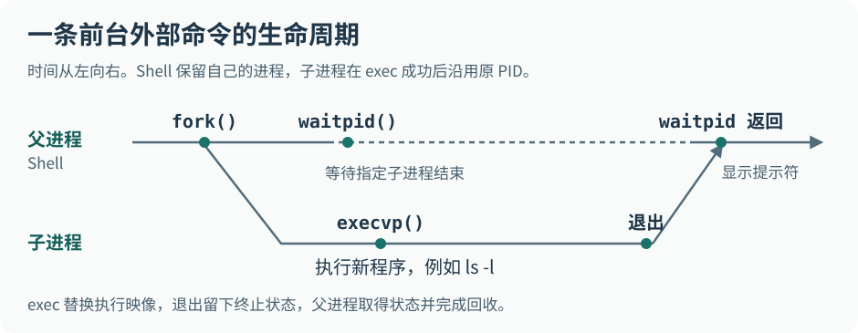
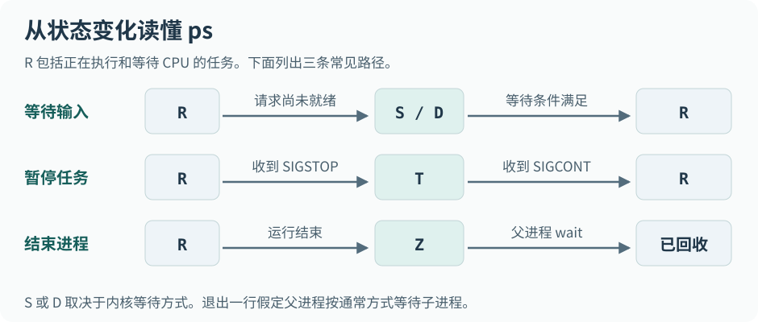
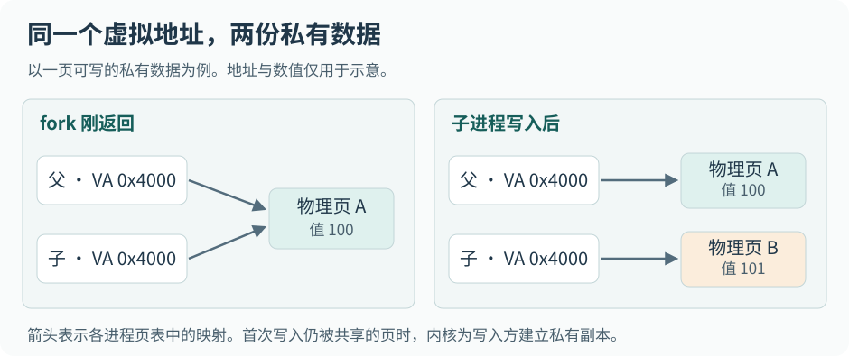

在交互式 Bash 里输入 `ls -l`，目录内容一行行打印出来，随后又出现了熟悉的提示符。刚才运行 `ls` 的是谁？如果是原来的 Shell，为什么它还能回来接收下一条命令？

前台运行这个外部程序时，Shell 可以用 `fork` 创建子进程，把 `exec` 留给子进程去装入 `ls`，自己用 `waitpid` 等待。这样，从输入命令到重新出现提示符，经历了**两个进程、一次程序替换和一次回收**。屏幕上的文件列表由标准输出传递，命令成功与否则由退出状态传递。



## Table of contents

## 一条命令怎样用上 CPU、内存和设备

在终端输入 `cat report.txt` 并按下回车，屏幕上出现了文件内容。键盘、磁盘和显示器各有自己的工作节奏。一旦某个环节需要等待，Linux 就能把 CPU 交给另一个可以继续运行的任务。

### 处理器执行指令，设备传递数据

冯·诺依曼体系把计算机分为运算器、控制器、存储器、输入设备和输出设备。程序的指令和操作数都可以放在存储器中。CPU 的控制部分取指、译码并安排执行，运算部分对寄存器中的操作数进行计算。程序计数器保存指令流中的位置，顺序执行、调用函数和分支跳转都会影响下一步从哪里取指。

这里的存储器主要指主存。可执行文件可以长期放在 SSD 上，运行时需要用到的指令页和数据页进入内存后才供处理器访问。寄存器、片上缓存、主存和持久存储在容量、访问延迟与断电后是否保留数据上各有取舍。现代处理器通常先从缓存取得指令和数据，缺失时才继续向下一层请求。文件已经命中页缓存时，读文件的这一步也能省去实际磁盘 I/O。

以发送一份聊天附件为例，发送端读取文件内容，应用处理协议数据，内核网络栈将数据交给网卡，接收端再从自己的网络栈取得字节，交给应用显示或保存。输入键盘文字、读取磁盘文件、接收网卡数据都能向程序提供输入，显示、写文件和发送网络数据都是输出。同一台磁盘或网卡也可以同时承担两个方向的工作。

在这条数据路径上，CPU 可以通过内存映射 I/O 等机制读写设备寄存器，用来配置和启动设备。支持 DMA 的设备可以在驱动建立的映射下直接与内存交换成批数据。设备完成工作后，可通过中断等机制通知驱动。将主存作为数据交换的中心，能解释程序如何处理设备产生的数据。把硬件简化成这些角色时，还要给设备寄存器、DMA 和缓存留下位置。[Linux 内核的 DMA 说明](https://docs.kernel.org/core-api/dma-api-howto.html)

### 操作系统怎样管理一次文件读取

Linux 内核维护进程与调度、虚拟内存、文件系统和设备驱动。平时使用的一套 Linux 发行版还提供 Shell、系统库与命令行程序。运行 `cat` 时，Shell 解释命令，程序通过文件描述符读取字节，内核决定这次读取能否立即完成，必要时再由文件系统和驱动发起 I/O。

所谓“管理”，首先要有记录对象状态的地方。内核需要知道文件打开在什么位置、设备是否还有请求要处理、哪个任务正在等数据。随后再按用途组织这些记录。例如，设备完成一个请求时，内核沿相关等待关系找到应当唤醒的任务。调度器则从当前能够运行的候选任务中选择下一项工作。两个问题需要的索引和顺序各不相同。

用户程序借助系统调用请求内核服务，C 库提供了方便调用的接口。`read` 的 libc 包装进入内核读取字节，`fread` 则在标准 I/O 流的缓冲区上工作，一次调用可能直接满足于已有数据。`strlen` 这样的函数通常在用户态完成计算。区分这三种情况，才能解释为什么同样是一行 C 代码，有时一直占用 CPU，有时却要让出 CPU 等设备。[Linux 系统调用手册](https://man7.org/linux/man-pages/man2/syscalls.2.html)

## 同一份程序运行两次，系统怎样分清它们

假设在同一个终端连续执行两次 `sleep 60 &`。磁盘上只有一份可执行文件，两个实例却可以有不同的启动时刻、剩余等待时间和退出结果。**程序提供可执行的指令，进程则是一次具体执行及其资源和状态。** 从用户角度看，进程承接一次工作。从内核角度看，必须有对象记录这次工作使用的地址空间、打开的文件、运行位置和调度状态。

进程控制块（PCB）是操作系统原理中对这类记录的概括。Linux 让每个可调度任务拥有一个 `task_struct`。一个单线程进程对应一个这样的任务，多线程进程中的线程分别接受调度，并共享地址空间等进程资源。许多资源由任务结构中的指针关联，体系结构相关的状态还分布在内核栈、保存区等位置。

| 内核要回答的问题             | 为此维护的状态                                 |
| ---------------------------- | ---------------------------------------------- |
| 这个任务是谁，谁创建了它     | 进程和线程标识、父子关系、用户身份             |
| 现在能否运行，按什么策略运行 | 等待或停止状态、调度策略、优先级、CPU 亲和性   |
| 下次从哪里继续执行           | 指令位置、栈位置及需要恢复的寄存器状态         |
| 它看到什么内存、打开了什么   | 地址空间映射、文件描述符表、当前工作目录等引用 |
| 它工作了多久，最后如何结束   | CPU 用时等记账信息、资源限制以及退出状态       |

Linux 中常见的组织方法是把链接节点嵌入业务对象。举例说，一个 `struct job` 可以带有 `struct list_head all_jobs`，再带有另一个用于独立链表关系的成员。链表操作只需维护 `next` 和 `prev`。遍历得到成员地址后，`list_entry` 一类宏通过已知的宿主类型和成员偏移取得原对象。这里的偏移由类型布局决定，包含对齐带来的填充。这样，同一套链表代码就能用于不同类型和不同关系。[Linux 内核链表文档](https://docs.kernel.org/core-api/list.html)

从全局枚举进程、按 PID 查询、按线程组遍历、按调度条件选任务，是几种不同的访问方式。内核会为它们维护不同的关联结构。一个任务在等待输入时，仍然有 PID，仍然可以出现在进程列表中，只是此刻不参与 CPU 的普通可运行任务竞争。

### 把 PID、父进程和工作目录对应起来

在交互式 Bash 中，下面这组命令围绕一个刚启动的后台任务读取信息。`$!` 给出最近一个后台作业相关的 PID，在这个单命令例子中就是 `sleep` 的 PID。

```bash
sleep 60 &
pid=$!
ps -p "$pid" -o pid,ppid,pgid,sid,tpgid,stat,ni,etime,comm
readlink "/proc/$pid/exe"
readlink "/proc/$pid/cwd"
ls -l "/proc/$pid/fd"
```

`exe` 指向程序映像对应的可执行文件，`cwd` 指向进程当前工作目录。因此从不同目录启动同一个 `/usr/bin/sleep`，两者的 `exe` 可以相同，而 `cwd` 可以不同。程序执行 `fopen("log.txt", "a")` 时，普通相对路径从工作目录开始查找。进程随后可以用 `chdir` 改变这个起点。`fd` 目录则展示仍然打开的描述符，0、1、2 通常分别承担标准输入、标准输出和标准错误。

`/proc` 由内核按查询时的状态提供信息。`/proc/1` 描述当前可见 PID 命名空间中的 1 号进程，`/proc/<pid>/status` 提供较易阅读的任务状态及身份字段，`/proc/<pid>/stat` 提供较紧凑的统计记录。`ps` 给出一个采样瞬间的视图，`top` 定期刷新。短命令可能在下一次查询前已经退出，访问其他用户进程的部分字段还受权限与挂载配置限制。[Linux 内核的 procfs 文档](https://docs.kernel.org/filesystems/proc.html)

程序内部可以用 `getpid()` 取得所属进程的 PID，`getppid()` 取得当时的父进程 PID，接口通过 `<unistd.h>` 暴露。在 Linux 的多线程进程中，各线程的 `getpid()` 相同，任务本身还有自己的线程 ID。进程退出并被回收后，PID 数值可以被重新分配。同一个任务从不同 PID 命名空间观察，也可能具有不同编号。[getpid(2)](https://man7.org/linux/man-pages/man2/getpid.2.html) [pid_namespaces(7)](https://man7.org/linux/man-pages/man7/pid_namespaces.7.html)

Shell 连续启动的两个外部命令往往有相同的 PPID。即使它们执行同一份程序，也各有 PID，能独立地等待、恢复和退出。

## 程序还活着，为什么 CPU 用量是零

终端里的 `cat` 如果没有文件参数，会等你输入。只要终端暂时没有准备好数据，阻塞式 `read` 就可能睡眠。驱动和终端子系统维护等待条件，输入到达并满足条件后，内核唤醒任务。**被唤醒意味着重新获得竞争 CPU 的资格，真正执行还要等调度器选中它。** 这段间隔足以区分“正在等数据”和“数据有了，正在等 CPU”。

`ps aux` 中的 `a` 和 `x` 扩展选择范围，`u` 使用以用户为中心的显示格式。`ps axj` 则以作业控制格式观察 PPID、PID、进程组 PGID、会话 SID 和终端的前台组 TPGID。一个管道可以由多个进程组成，Shell 把整个作业放进进程组，终端按前台进程组交付交互信号。UID 标识进程所属用户，PID 与 PPID 分别标识自己和父进程。PGID 把同一作业中的进程归为一组，SID 标识该组所在的会话。`STAT` 的首字母描述主要状态，后面的 `+` 表示该任务位于其控制终端的前台组。后台任务、暂时在等待的任务、被停止的任务分别描述不同方面。[ps(1)](https://man7.org/linux/man-pages/man1/ps.1.html)

| 状态      | 当前发生了什么                                   | 一个常见场景                                       |
| --------- | ------------------------------------------------ | -------------------------------------------------- |
| `R`       | 正在某个 CPU 上执行，或已经可以被调度            | 计算中的任务、刚被唤醒并等候 CPU 的任务            |
| `S`       | 可中断睡眠，等待事件或定时器                     | 等终端输入的 `cat`、等待时间到期的 `sleep`         |
| `D`       | 不可中断等待，常见于某些内核 I/O 路径            | 等待底层存储请求完成                               |
| `T` / `t` | 前者通常为停止信号所致，后者为被跟踪时的调试停止 | 交互式作业被暂停，或者调试器通过 `ptrace` 控制任务 |
| `Z`       | 已终止，仍保留供父进程收集的退出信息             | 子进程先结束，父进程还未回收                       |
| `X` / `I` | 前者是极短暂的死亡状态，后者用于某些空闲内核线程 | `X` 在常规采样中极少见                             |



状态名与展示方式可以查 [/proc/PID/stat 字段说明](https://man7.org/linux/man-pages/man5/proc_pid_stat.5.html)。这些字母是用户空间的报告格式。内核内部还区分运行/睡眠标志与退出状态，位定义会随版本演进。对于 `D` 状态，即使发送 `SIGKILL`，也可能要等到任务走出相关等待路径，才能完成终止。单看字母无法断定具体设备或原因。

对自己启动的后台任务，`kill -STOP "$pid"` 会请求暂停它，`kill -CONT "$pid"` 会请求继续。`kill` 在这里负责发送指定的信号。在启用作业控制的终端中，Ctrl+Z 通常发送 `SIGTSTP`。这和内存回收又是两回事。内存压力大时，内核可以丢弃可重新读取的干净文件页，也可以把部分匿名页换出到 swap。任务随后访问缺页时，再从文件或交换空间取回。反复换入换出会拖慢系统，内存严重不足时还可能触发 OOM 处理。现代 Linux 以页为单位回收内存，观察到 `T` 并不能推出整个进程已经移到磁盘。[Linux 内存管理概念](https://docs.kernel.org/admin-guide/mm/concepts.html)

### 僵尸与孤儿，分别看谁先结束

假设一个子进程工作 5 秒后以状态 7 退出，父进程过一会儿才调用 `waitpid`。在通常的退出处理方式下，这段时间内子进程可以呈现 `Z`。它已停止执行，用户地址空间等大部分资源已经释放。内核留下 PID、退出状态和必要的记账信息，父进程才能知道刚才的工作由谁完成、是正常退出还是被信号终止。

给僵尸发送终止信号没有机会让它“再退出一次”。相应的操作是让负责的父进程回收退出状态。在一个长期运行的服务里，反复派生子进程却不回收，会积累占用进程表/PID 资源的记录，最终妨碍创建新任务。显式忽略 `SIGCHLD` 或设置 `SA_NOCLDWAIT` 等策略会改变退出记录的保留方式，编写需要收集结果的父进程时也要考虑这一点。[wait(2)](https://man7.org/linux/man-pages/man2/waitpid.2.html)

如果轮到父进程先结束，仍在工作的子进程就成了孤儿，它完全可以继续运行。Linux 会把它交给合适的接收者，可能是最近的存活子收割者（subreaper），也可能是相应 PID 命名空间的 init。接收者此后承担等待和回收职责。从这两个时序看，一个运行中的任务可以更换 PPID，而一个仍在 `ps` 中的任务可能早就停止执行了。

## 当两个进程都想用 CPU，Linux 怎样选择

读取输入的任务睡眠时，正在计算校验和的任务可以利用这段 CPU 时间。当输入就绪，两者再次竞争。假设只有一个逻辑 CPU，两项工作在一段时间内交错推进，就形成了**并发**。若它们在不同逻辑 CPU 上同时执行，就出现了**并行**。进程隔离了各自的私有地址空间，但仍可能竞争处理器、磁盘或内存带宽，也可以通过明确打开的文件和共享映射交换数据。

### nice 值调整什么

假设终端里启动的压缩任务正在和桌面应用争用 CPU，可以给压缩任务较高的 nice 值，让它在一般公平调度策略下获得较低的相对权重。普通任务的 nice 值范围是 -20 到 19，值越小通常权重越高。只有双方都能运行、争用同一调度资源时，这个相对权重才会明显影响 CPU 分配。提高一个正在等磁盘的任务的权重，本身不会加快磁盘请求。

`ps -l` 会列出进程所属用户 UID、PID、PPID，以及 `PRI` 和 `NI` 等列，还可以显式选择要比较的字段。

```bash
ps -p "$pid" -o pid,ppid,uid,cls,rtprio,pri,ni,stat,comm
```

`NI` 是 nice 值，`PRI` 的显示还取决于工具及格式。不能将某次输出中的 `PRI` 当成基数，反复代入一个“旧 PRI 加 nice”的公式推算下一项运行的任务。Linux 按调度类别和策略作决定。普通公平类考虑权重等因素，实时策略 `SCHED_FIFO`、`SCHED_RR` 有各自的实时优先级和队列规则。即使面对同一个 nice 值，不同 CPU、调度组、亲和性限制与系统负载也会改变实际分配。[sched(7)](https://man7.org/linux/man-pages/man7/sched.7.html)

启动较低权重的后台计算可以写 `nice -n 10 command`，其中 `10` 是相对当前 nice 值的增量。修改已有任务可以使用 `renice`，例如在常见 util-linux 实现中，`renice 10 -p PID` 将指定任务设为 nice 10。`top` 的交互命令 `r` 也提供修改入口。通常普通用户可以降低自己任务的优先程度，提高优先程度则受权限和 `RLIMIT_NICE` 等限制。程序可通过 `getpriority(PRIO_PROCESS, ...)` 和 `setpriority` 查询与设置。由于 -1 本身也是有效 nice 值，判断 `getpriority` 是否出错需要结合 `errno`。[getpriority(2)](https://man7.org/linux/man-pages/man2/getpriority.2.html)

CPU 亲和性规定了线程**允许在哪些 CPU 上运行**。缩小这个集合可以减少迁移、改善局部性，也可能让可用的 CPU 空转而任务仍在排队。到底能否改善吞吐或响应时间，取决于负载与拓扑。[sched_setaffinity(2)](https://man7.org/linux/man-pages/man2/sched_setaffinity.2.html)

### 上下文切换保存了什么

当解压程序正在进行一次加法，所需的中间值、返回地址和栈位置分散在寄存器与内存中。如果此时轮到编辑器运行，处理器寄存器很快就会承载编辑器的值。要让解压程序稍后从原处继续，内核必须为它保存足够的执行现场，再恢复下一项任务的现场。程序计数器解决“下一条从哪里取指”，栈指针帮助找到当前执行栈，其他寄存器保留未完成计算需要的值。具体保存位置与时机由体系结构、进入内核的方式和内核实现决定，可以涉及内核栈、任务数据和专用保存区。

这类切换可能来自主动等待，也可能来自抢占。任务因 `read` 缺少数据而睡眠，会放弃当前 CPU。另一项任务变得可运行，或调度器决定当前任务应让出机会，也可能发生切换。一次系统调用只是从用户态进入内核态，它完全可以由同一任务处理完后返回。只有实际改为执行另一项任务时，才发生任务间上下文切换。

切换到不同进程还可能要求切换地址空间映射，并影响地址转换缓存和数据缓存的局部性。同进程线程共享地址空间，切换线程仍需要保存各自的执行现场。每个逻辑 CPU 各有自己的当前任务和待运行候选，多 CPU 系统还要在迁移成本、亲和性与负载平衡之间取舍。

### 历史上的 O(1) 调度器怎样选出下一项任务

早期 Linux 2.6 的 O(1) 调度器给每个 CPU 设置运行队列。以 2.6.18 为例，`rq` 记录当前与空闲任务、运行任务数、保护队列的锁和负载统计。它还维护两组形状相同的优先级数组，由 `active` 和 `expired` 指针分别指定当前组以及下一轮候选组。

每组 `prio_array` 有该组任务数 `nr_active`、优先级链表数组和非空位图。常见配置中，索引 0–99 的内部优先级区间保留给实时任务，普通任务使用 100–139，数值较小的内部索引先被选择。这是历史实现的内部编号，用户通过接口指定实时优先级时使用的是另一套数值约定。

假设活动组中只有索引 105 和 120 的链表非空。任务入队时设置对应的位，取下某个队列的最后一个任务时清除相应的位。选择时先找位图中最低的置位位置 105，再从该链表头取任务。位图长度由固定的优先级数决定，在 32 位机器上，140 个等级加一个边界位用五个 32 位字就能容纳。索引是优先级的直接映射，同级任务如何重新入队则服从对应策略。寻找非空队列的代价不随系统中的进程数线性增加，这就是这里的 **O(1)** 所指的操作。

普通任务时间片耗尽时，内核重新计算相应时间片与优先级，再根据交互性与防止饥饿的条件决定重新入活动组还是过期组。活动组清空时交换两根指针，过期组整批取得下一轮资格，无须把每个节点重新搬一次。对实时 FIFO 任务则不能套用“时间片用完自动轮换”的规则。完整决策及指针交换可见 [Linux 2.6.18 调度器源码](https://github.com/torvalds/linux/blob/v2.6.18/kernel/sched.c)。

这段实现说明了队列和位图为什么有用，但普通任务的选择算法后来发生了变化。Linux 2.6.23 引入 CFS，以权重折算的虚拟运行时间跟踪各任务得到的 CPU 份额。从 6.6 起，Linux 的公平调度逐步采用 EEVDF，在有资格获得 CPU 时间的候选中选择虚拟截止期最早的一项。这里的截止期属于调度计算，与应用声明的真实完成期限是两回事。分析一台实际系统时，每 CPU 运行队列、任务就绪和负载均衡这些概念仍然适用，具体选取规则则要结合内核版本和调度类别。[CFS 设计](https://docs.kernel.org/scheduler/sched-design-CFS.html) [EEVDF 设计](https://docs.kernel.org/scheduler/sched-eevdf.html)

## 一条命令怎样变成 `main` 的参数

在同一个目录里执行下面两条命令，`cat` 都能读到同一份文件，收到的参数却不同。

```sh
cat report.txt
cat < report.txt
```

第一条命令把 `report.txt` 作为参数交给 `cat`，由 `cat` 打开文件。第二条命令由 Shell 解释 `<`，打开文件并把它接到标准输入。启动后的 `cat` 没有收到文件名参数，于是从文件描述符 0 读取字节。两者的输出看起来相同，负责打开文件的程序、传递信息的方式以及打开失败时报告错误的一方都不同。

C 程序通常用下面这个入口接收命令行参数。

```c
int main(int argc, char *argv[])
```

假设执行 `./scan -n "error code" server.log`。Shell 处理引号后，通常会向程序提供下列内容。

```text
argc = 4
argv[0] ──► "./scan"
argv[1] ──► "-n"
argv[2] ──► "error code"
argv[3] ──► "server.log"
argv[4] = NULL
```

`argv` 是一个指针数组，每个有效元素指向一个以 `'\0'` 结尾的字符串。引号是 Shell 语法，因此传给程序的第三个字符串含有空格，外侧没有引号。即使一个参数只有一个字母，它也以字符串形式传入。参数个数已经包含通常位于 `argv[0]` 的程序调用名。遍历所有参数的条件是 `i < argc`，取特定选项前也要先检查 `argc`。数组末尾还有一个空指针 `argv[argc]`，它和每个字符串内部的结束字节各有作用。

`-n` 到底表示“显示行号”还是“只显示数字”，由 `scan` 的选项解析代码决定。Shell 负责准备参数。同样，IDE 的调试配置也能把一组参数交给被调试的程序。对于 Linux 的 `execve(path, argv, envp)`，实际加载哪个文件由 `path` 决定，`argv[0]` 只是调用者按约定提供的字符串。需要确认运行文件的身份时，不能把这个字符串当作凭证。[execve(2)](https://man7.org/linux/man-pages/man2/execve.2.html)

### 为什么 `./scan` 能运行，`scan` 却提示找不到命令

`./scan` 中含有斜杠，Shell 按路径查找当前目录下的文件。直接写 `scan` 时，以 Bash 为例，Shell 先按自己的命令解析规则处理别名、函数和内建命令。对需要查找的外部命令，则按 `PATH` 列出的目录依次搜索。新编译的程序虽然已经在磁盘上，只要它所在目录不在这条搜索路径中，直接输入名字仍可能得到 `command not found`。

`PATH` 的值是一串用冒号分隔的目录名。可以一直用相对或绝对路径启动程序，也可以把常用程序安装到已经列入 `PATH` 的个人目录。例如，将工具放进 `$HOME/bin` 后，如果这个目录尚未被搜索，可以在当前 Shell 里把它加入 `PATH`。

```sh
export PATH="$HOME/bin:$PATH"
```

这里把个人目录放在前面，因此同名程序会优先命中那一份。使用 `type -a scan` 可以看到 Bash 对该名称识别到的候选项。若排查时发现 `echo`、`pwd` 能用而新安装的外部工具找不到，也要留意内建命令。Bash 可以直接执行自己的 `echo` 或 `pwd`，磁盘上还可能同时存在同名的可执行文件。`cd` 和 `export` 更需要在当前 Shell 中生效，因为它们改变的是这个 Shell 的工作目录或后续传给子进程的环境。

`PATH` 是环境配置的一个例子。`HOME` 通常保存用户的主目录，例如普通用户可能是 `/home/lin`，root 可能是 `/root`。在 Bash 中，单独的 `~` 通常据此展开，不带参数的 `cd` 也使用 `HOME`。`pwd` 显示的则是此刻的工作目录，执行 `cd /tmp` 后二者自然可以不同。`SHELL` 往往来自登录设置，表示用户首选的 Shell。即使在 Bash 中又启动了另一个解释器，继承下来的 `SHELL` 也可能仍然是 `/bin/bash`。`LANG` 或 `LC_ALL` 可影响程序的区域设置，前提是程序读取并采用了这些配置。这些变量各有消费者，能解释命令搜索的 `PATH`，并不能直接解释头文件、链接库或运行时共享库的搜索路径。

### 导出与继承的边界

假设刚打开的 Bash 会话尚未定义 `SCAN_MODE`，可以分四步观察它何时对程序可见。

```sh
SCAN_MODE=brief
printf '%s\n' "$SCAN_MODE"

export SCAN_MODE
./scan server.log

SCAN_MODE=quiet ./scan server.log
unset SCAN_MODE
```

第一行创建 Shell 变量，第二行由 Shell 展开它，所以能显示 `brief`。`export SCAN_MODE` 把这个变量标为导出，随后启动的 `scan` 才能在环境中读到它。给单次外部命令加上前缀 `SCAN_MODE=quiet`，只为那次启动提供 `quiet`。`unset` 删除本 Shell 中的变量。早已运行的进程仍拥有自己的环境。若一个名字原先就已导出，之后只写 `SCAN_MODE=brief` 也会更新导出的值，是否能继承取决于该变量已有的导出属性。

这种传递沿进程创建和程序启动发生。在 `fork` 产生的子进程中，父进程已有的环境属于继承的地址空间内容。子进程接下来执行 `execve` 时，调用者还可以原样传入环境、删减条目或重新构造整张表。因此，一个从终端启动的工具、一项由服务管理器拉起的服务和另一位用户登录后的 Shell，完全可能得到三套不同的环境。子进程修改自己的变量也不会反向修改父 Shell。若希望后续新的 Bash 会话采用某个值，要选择与启动方式匹配的初始化文件。交互式非登录 Bash 通常读取 `~/.bashrc`，登录 Bash 则按规则读取登录配置，例如 `~/.bash_profile`。后者是否再读取 `~/.bashrc` 取决于其内容。

在 Bash 中，`echo "$HOME"` 显示展开后的值，`env` 显示传给外部程序的环境，`export -p` 显示当前 Shell 标记为导出的变量。`set` 的范围更广，在通常的 Bash 模式下还列出本地 Shell 变量和函数。`echo`、`set`、`export`、`unset` 通常可由 Shell 内建实现，`env` 则通常是外部工具。看到 `set` 中有某一项，仅凭这一点还不能判断另一个程序是否收到了它。

### C 程序拿到的是一张字符串表

每个环境条目形如 `NAME=value`。和 `argv` 类似，条目字符串以 `'\0'` 结尾，指针数组以 `NULL` 结尾。环境没有单独传入的元素计数，遍历时依靠最后这个空指针。Linux 中常能见到第三个入口参数 `int main(int argc, char **argv, char **envp)`。这是常见实现提供的形式。使用 POSIX 接口的程序也可以声明 `extern char **environ;`，通过 `environ` 访问进程当前的环境。两者在启动时往往指向同一张表，库函数改变环境之后，最初的 `envp` 不宜继续用作当前环境的权威入口。[environ(7)](https://man7.org/linux/man-pages/man7/environ.7.html)

若只关心一个名字，直接用 `getenv` 即可。下面的片段把“按参数选择配置项”和“按名字读取环境”连在一起。

```c
#include <stdio.h>
#include <stdlib.h>

int main(int argc, char **argv) {
    const char *name = argc > 1 ? argv[1] : "HOME";
    const char *value = getenv(name);

    if (value == NULL) {
        fprintf(stderr, "missing environment variable: %s\n", name);
        return 1;
    }
    printf("%s=%s\n", name, value);
    return 0;
}
```

未定义时 `getenv` 返回空指针。若一项存在但值为空，它返回指向空字符串的指针。这些查询和修改通常由 C 库在用户空间维护的环境表上完成。POSIX 的 `setenv` 复制传入的名字和值，`unsetenv` 删除指定项。`putenv` 会把传入的 `NAME=value` 字符串本身纳入环境，调用者要保证其存储持续有效。把函数内的临时字符数组交给 `putenv` 后立即返回，就可能让环境表保留一个悬空指针。

## 从 ELF 文件到进程地址空间

启动程序之前，磁盘上的 ELF 文件已经记录了一些稳定的信息，例如哪些字节是机器指令、哪些属于初始数据、程序入口在哪里。启动之后，某个指针所表示的具体地址，还要结合 **当前进程的虚拟地址空间** 才有意义。即使十个进程执行同一个 ELF 文件，它们也分别拥有各自的启动参数、栈和可修改的数据。

从链接器视角看，目标文件按节（section）组织，常见名称有 `.text`、`.rodata`、`.data`、`.bss`。装载 ELF 可执行文件时，系统主要根据程序头中可装载段（`PT_LOAD`）的虚拟范围、文件范围、对齐与权限建立映射。多个节可以归入一个可装载段。若段的内存长度大于文件中的数据长度，多出来的部分在内存中初始化为零，这使大块零初始化静态数据无需在可执行文件里逐字节存零。动态链接程序还会由解释器和动态链接器完成共享库映射及必要的重定位。[elf(5)](https://man7.org/linux/man-pages/man5/elf.5.html)

下面的函数同时使用静态变量、局部数组、字符串字面量和动态分配的空间。

```c
#include <stdlib.h>

static int requests;         /* 初始值为 0，常见于 .bss */
static int batch_size = 8;   /* 非零初值，常见于 .data */

void handle(void) {
    int slots[4] = {0};
    const char *label = "ready";
    int *items = malloc(16 * sizeof *items);
    if (items == NULL) return;
    /* ... */
    free(items);
}
```

`requests`、`batch_size` 都具有静态存储期，在这个程序映像的整个执行期间存在。函数内部的 `static` 局部变量也具有这种存储期，只是名字的作用域不同。`slots` 是本次调用的自动对象，实现往往把它放入栈帧，编译器也可能消除对象或让某些局部值留在寄存器。`label` 是局部指针，它所指的字符串字面量则具有静态存储期，通常位于只读映射。两个指针可以指向同一串文字，编译器也可能合并相同的字面量。写入字符串字面量属于 C 的未定义行为，在常见 Linux 布局下还可能触发保护错误。需要修改时应使用可写数组，如 `char label[] = "ready";`。

`items` 和 `&items` 回答的是不同问题。前者是分配器返回的内存块地址，成功时这块内存可以容纳 16 个 `int`。后者是指针变量自身的地址，取地址时它通常位于当前函数的栈帧。如果调用 `malloc` 失败，程序需要先处理空指针，再使用该内存块。实现可从现有分配区提供空间，也可通过扩展进程堆或新建匿名映射获得更多空间，所以连续两次分配的地址没有必须相邻或递增的要求。

### 一张地址图里有哪些区域

对于常见的 Linux 用户进程，从低地址向高地址观察，会看到主程序的指令、只读数据和可写数据，管理动态分配的传统堆，文件映射、共享库和其他匿名映射，以及靠近用户地址上端的初始线程栈。程序刚进入用户态时，Linux 按平台 ABI 在初始用户栈上安排参数、环境字符串及其指针，还提供描述运行环境的辅助向量。运行库从这份信息出发，把 `argc` 和 `argv` 交给 `main`。之后程序可以修改参数内容并扩展环境，新增环境条目的存储位置也可能改变。

传统 `brk` 堆在常见架构上向较高地址扩展。以 x86 为例，函数调用产生的栈帧通常向较低地址延伸。**栈的增长方向与数组的元素排列是两件事。** 即使 `slots` 位于向低地址增长的栈中，`&slots[1]` 依然比 `&slots[0]` 高出一个元素的大小。不同局部变量之间的顺序则由编译器布局决定。

经典 32 位 x86 的整个线性地址范围有 $2^{32}$ 个字节地址，即 4 GiB。一种历史上的 Linux 内核配置将低 3 GiB 留给用户、高 1 GiB 留给内核。这个切分取决于架构和配置，更不等于进程启动就获得了 3 GiB 的物理内存。64 位进程的可用范围由体系结构、内核和 ABI 决定，映射之间也可以存在很大的空洞。可执行文件若采用位置无关方式构建，配合地址空间布局随机化（ASLR），不同启动之间连主程序映射的基址都可能改变。

Linux 通过 `/proc/<pid>/maps` 暴露一个具体进程当时的映射区间。每行给出起止虚拟地址、读写执行权限、私有或共享属性、文件偏移及可能的文件名。`r-xp` 常见于私有的可执行代码映射，`rw-p` 常见于可写私有映射，最后一位 `s` 表示共享映射。`[heap]` 与 `[stack]` 帮助辨认传统堆和初始线程栈，未标记的匿名映射也可以服务于内存分配。映射的权限和范围能从这里读出，某个页此刻是否占有物理页框，还需要其他信息。[proc_pid_maps(5)](https://man7.org/linux/man-pages/man5/proc_pid_maps.5.html)

## 内核怎样描述地址，CPU 又怎样找到字节

假设要访问虚拟地址 `0x400023`。在页大小为 4 KiB 的例子里，可以把它拆成虚拟页号 `0x400` 与页内偏移 `0x23`。若当前进程的页表把这一页映射到物理页框 `0x31`，对应物理地址就是 `0x31023`。换一个进程，相同的虚拟页号完全可以映射到另一页框。相邻的两个虚拟页也可以落在互不相邻的物理页框上。页大小取决于系统配置，Linux 也支持大页。

翻译一个地址要用到页表，而解释这段内存为何存在，则要看它所属的映射区间。

| 层次                | 描述什么                                                                           | 访问时用在哪里                                                                      |
| ------------------- | ---------------------------------------------------------------------------------- | ----------------------------------------------------------------------------------- |
| 虚拟内存区域（VMA） | 一整段虚拟地址的起止范围、允许的访问方式、私有或共享属性，以及可能关联的文件和偏移 | 内核判断这个范围为何存在、是否允许此次访问、发生缺页时怎样取得内容                  |
| 页表                | 虚拟页的映射状态、页框位置及硬件需要的访问限制等                                   | CPU 的内存管理单元（MMU）依据当前地址空间翻译地址并检查权限，TLB 缓存近期的翻译结果 |

普通用户线程的 `task_struct` 通过 `mm` 指向内存描述符 `mm_struct`，其中包括页表根和管理虚拟区间所需的信息。同一进程的线程通常共享一个 `mm_struct`，各自保留自己的调度上下文和用户栈。纯内核线程的 `mm` 通常为空。调度实现可借助 `active_mm` 保存执行上下文涉及的地址空间引用，这与拥有一个普通用户进程的私有地址空间是两种情况。

`mm_struct` 从整体记录代码、数据、初始堆边界、初始栈位置和参数及环境字符串的范围，例如 `start_code/end_code`、`start_brk/brk` 和 `arg_start/arg_end`。一个个 VMA 再按半开区间 `[vm_start, vm_end)` 描述具体映射。VMA 的功能还可由 `vm_flags`、`vm_ops`、`vm_file` 与 `vm_pgoff` 等信息区分。历史内核用链表组织遍历、用红黑树加速区间查找。这是同一组 VMA 的不同访问方式。当前内核文档描述的结构使用 Maple Tree 索引 VMA。这里索引的是 **一个地址空间中的映射区间**。[Linux 内核：Process Addresses](https://docs.kernel.org/mm/process_addrs.html)

访问一个字节时，如果翻译已在 TLB 中，处理器可以直接利用缓存。在常见的 x86 系统上，TLB 未命中时硬件先查页表。如果目标页尚未建立有效映射，或这次访问违反页级权限，处理器会触发缺页异常，内核再结合 VMA 判断原因。合法的文件映射可以从页缓存取得目标页，必要时从文件读取。新建的可写匿名映射可以在首次实际使用时得到相应页面。若地址无合法映射，或者程序试图向只读代码写入数据，内核无法按原请求完成访问，常见结果是向进程发送 `SIGSEGV`。换句话说，一次缺页有时只是正常装入，有时才意味着程序出错。如果一次越界写恰好落在同一可写页内，硬件的页级检查可以通过，相邻的 C 对象仍然会被破坏。

### 为什么要保留虚拟地址这一层

假设小程序需要一段连续的 8 MiB 内存，但物理内存里剩下的空闲页分散在多个位置。借助分页，内核可以给程序一段连续的虚拟区间，按需把其中各页映射到分散的页框。程序依靠稳定的虚拟地址访问数组。内核则能调配页框、回收不再需要的文件缓存页，或在配置允许时换出匿名页。可重新从文件取得的页可以在下次访问时重新装入，回收也能够以页为单位进行。无需因几个页面暂时闲置而把整个进程搬出内存。

同样的机制还把进程与内核、不同进程之间的内存访问隔开，并允许受控共享。程序启动可以先建立地址空间和文件映射，等取指或访问数据时再按需装入页面。`malloc` 或 C++ 的 `new` 交出一块空间之后，这块空间的物理页是否早已就绪，取决于分配器复用、映射类型、访问历史和系统策略。申请了多大的虚拟范围、此刻有多少页驻留、实际消耗多少独占物理内存，是三个不同的量。

## 一次 fork，两个执行流从同一处继续

Shell 已经是一个正在运行的进程。用户输入 `ls -l` 时，它还得保留自己的工作目录和命令循环，等 `ls` 结束后继续接收输入。Linux 把这件事拆成两个动作。`fork()` 先创建子进程，随后子进程可以运行父程序已有的一段逻辑，也可以装入另一个程序。实际服务也会采用第一种方式，例如父进程接收请求，子进程负责处理某个连接。

```c
pid_t child = fork();
```

调用成功时，内核为子进程分配 PID，建立任务和内存管理等结构，准备好可运行的执行上下文。父子都从 `fork()` 之后继续。区别在于，父进程的 `child` 得到新子进程的 PID，子进程的 `child` 得到 0。父进程可能创建多个孩子，要靠各自的 PID 区分它们。子进程可通过 `getpid()` 查询自己，通过 `getppid()` 查询当前父进程。**返回值 0 是让子进程识别自己的分支，子进程本身有独立的 PID。** 失败时只有原进程返回，值为 -1，此时应检查 `errno`。[fork(2)](https://man7.org/linux/man-pages/man2/fork.2.html)

为什么同一条赋值能得到两个结果？设想父进程调用前有一个局部变量 `child`。子进程拥有对应的栈和寄存器上下文，父子各自从内核返回，在各自的上下文中完成赋值。从这一步开始，两个执行流可能并发运行。先写在源码里的父分支没有调度优先权，等待协议也不能靠猜哪一行输出先出现。

### 哪些状态各自一份，哪些状态仍有关联

| 对象                             | fork 后能观察到的行为                                                          |
| -------------------------------- | ------------------------------------------------------------------------------ |
| 普通全局变量、栈和堆中的私有数据 | 父子开始时看见相同内容，一方修改私有数据时，另一方仍读到自己的值               |
| 私有内存映射                     | Linux 通常先共享物理页，通过写时复制维持私有写入的语义                         |
| 显式共享映射                     | `MAP_SHARED` 等共享内存可以让修改对双方可见，访问时仍需相应同步                |
| 已打开的文件描述符               | 父子各有描述符表，对应项指向同一个打开文件描述，可以共享文件偏移和打开状态标志 |
| 标准 I/O 的待输出内容            | libc 缓冲区属于进程内存，尚未提交的字节可能被复制进子进程                      |
| 多线程程序                       | 子进程初始只有调用 `fork` 的线程，内存中却可能保留其他线程留下的锁状态         |

文件描述符遵循另一套规则。父子分别关闭自己表中的某个 fd，只会减少相应引用。若双方交替对同一个可定位的普通文件执行 `read`，共享偏移可能使读到的数据相互衔接。套接字、管道也会留下引用，例如多留一端管道的写描述符，就可能让读端一直等不到 EOF。[fork(2)](https://man7.org/linux/man-pages/man2/fork.2.html)

多线程父进程中消失的线程无法在子进程里释放自己持有的锁。因此，POSIX 对子进程从 `fork` 到 `exec` 之间可安全做的工作有明确限制，应只调用异步信号安全的函数。本文的 C 示例和微型 Shell 均采用单线程。历史接口 `vfork()` 的限制更严格。Linux 会让调用它的父线程暂停，子进程在成功 `exec` 或 `_exit` 前临时共享父进程地址空间，包括栈。此期间子进程不能返回到调用者、调用 `exit` 或任意修改父程序数据。需要直接启动另一个程序时，也可以考虑 `posix_spawn()`。[vfork(2)](https://man7.org/linux/man-pages/man2/vfork.2.html)

创建失败同样属于接口设计的一部分。`EAGAIN` 可能来自用户的任务数限制、系统线程数上限、可分配 PID 或 cgroup 的 `pids.max` 等约束。`ENOMEM` 可能表示内核分配必要结构时内存不足。循环创建子进程时，如果第三次失败，前两次成功创建的进程仍然要有人回收。实际服务会限制并发度，把待处理任务排队。需要重复执行短任务时，也可预先创建一组工作进程，通过管道或套接字分派任务，摊薄反复创建进程的成本。

### 写时复制怎样解释 `fork` 后“地址一样、值不同”

考虑一个单线程程序。父进程的私有全局变量 `count` 初始为 100，`fork` 成功后由子进程把它加 1。下面让父进程等待子进程退出，从而固定两次报告的相对顺序。

```c
#define _POSIX_C_SOURCE 200809L
#include <errno.h>
#include <stdio.h>
#include <sys/wait.h>
#include <unistd.h>

static int count = 100;

int main(void) {
    pid_t pid = fork();
    if (pid < 0) {
        perror("fork");
        return 1;
    }
    if (pid == 0) {
        ++count;
        int written = dprintf(STDOUT_FILENO, "child:  %p -> %d\n",
                              (void *)&count, count);
        _exit(written < 0 ? 1 : 0);
    }

    int status;
    while (waitpid(pid, &status, 0) < 0) {
        if (errno == EINTR) continue;
        perror("waitpid");
        return 1;
    }
    if (!WIFEXITED(status) || WEXITSTATUS(status) != 0) return 1;
    printf("parent: %p -> %d\n", (void *)&count, count);
    return 0;
}
```

在这次由同一父进程派生出的两个进程中，`&count` 保留相同的虚拟地址。子进程输出 101，随后父进程仍输出 100。这个先后关系由 `waitpid` 建立，输出能说明两个进程的私有变量彼此独立。至于两个虚拟页在某一时刻是否映射到同一物理页框，程序打印的指针没有提供这项信息。

在 Linux 常见的写时复制（copy-on-write，COW）实现中，`fork` 建立子进程的地址空间描述与页表，使许多已有的私有页暂时引用同一物理页框。可写的私有映射在区间语义上允许写入，父子页表里的相应页却可以暂时被写保护。当父子中的任何一方首次写入一个仍共享的私有页，MMU 触发保护异常，内核根据 VMA 和页面状态识别这种写入，通常会复制该页，把写入方的映射改指向新的可写页框，然后继续原指令。若原页已经可以独占，内核有时只需恢复写权限。地址数字全程不变，改变的是翻译后的物理页和页面内容。[fork(2)](https://man7.org/linux/man-pages/man2/fork.2.html)



只读代码页可以继续共享，私有数据页随写入逐渐分开。显式建立的共享可写映射（例如 `MAP_SHARED`）则保留共享语义，其他映射同一对象的进程可以观察相应修改。这使创建成本与后续用途有关。如果子进程紧接着 `execve` 时，许多旧页根本来不及被复制。若父子都大量修改继承的私有数据，真实物理开销则会随着被写过的页增加。

## exec 保留进程身份，装入新的程序映像

负责读取输入的 Shell 创建孩子后，两者最初都运行同一份程序。假如输入 `ls -l`，子进程需要把自己的执行内容换成 `ls`。这一步涉及按路径读取可执行文件、解释 ELF 或脚本头、重建用户地址空间及启动上下文等工作，只能由内核实施。Linux 的 `execve` 提供这个接口。内核建立新的映射，并准备包括 `argv`、`envp` 等在内的初始数据。可执行文件的代码页可以按需调入，无需先把整份文件逐字节读进物理内存。

替换成功后，控制流进入新映像的启动入口，原来的堆、栈、全局数据和函数返回地址失去作用。PID 与父子关系继续保留，工作目录也继续有效。通常，已经打开且未设置 `FD_CLOEXEC` 的文件描述符会保留，因此 Shell 可在替换前布置重定向或管道，新的程序一开始就具有所需的标准输入输出。旧程序安装的捕获型信号处理函数等属性会按规则重置。成功的 `exec` 调用不会回到原调用点。通常只有失败才返回 -1 并设置 `errno`。[execve(2)](https://man7.org/linux/man-pages/man2/execve.2.html)

对照两个过程来看，`fork` 之后是两个进程，各自有执行上下文。子进程 `exec` 成功之后仍然是这两个进程，只是子进程运行了新的程序。若在 Shell 本身调用 `exec`，原命令循环也会随旧映像消失。

### 看函数名选择参数与环境的传法

Linux 上的常见接口以 `execve` 为核心。函数名中的 `l` 表示逐个列出参数，`v` 表示提供指针数组，`p` 表示在文件名不含斜杠时按 `PATH` 搜索，`e` 表示显式提供环境数组。没有 `p` 时给出可执行文件路径，可以是绝对路径，也可以是相对于工作目录的路径。没有 `e` 的这些接口从调用者环境构造新程序的环境。[exec(3)](https://man7.org/linux/man-pages/man3/exec.3.html)

| 接口                                          | 可执行文件如何选择  | 参数与环境           |
| --------------------------------------------- | ------------------- | -------------------- |
| `execl(path, arg0, ..., (char *)NULL)`        | 指定路径            | 逐项列参数，继承环境 |
| `execlp(file, arg0, ..., (char *)NULL)`       | 按文件名搜索 `PATH` | 逐项列参数，继承环境 |
| `execle(path, arg0, ..., (char *)NULL, envp)` | 指定路径            | 逐项列参数，显式环境 |
| `execv(path, argv)`                           | 指定路径            | 参数数组，继承环境   |
| `execvp(file, argv)`                          | 按文件名搜索 `PATH` | 参数数组，继承环境   |
| `execve(path, argv, envp)`                    | 指定路径            | 参数数组，显式环境   |

例如，将 `argv` 构造成 `{"ls", "-l", "/tmp", NULL}` 后调用 `execvp(argv[0], argv)`，新程序收到三个独立的参数。`argv[0]` 按惯例放程序名，数组尾部的空指针标记参数结束。环境数组类似，元素是 `"NAME=value"` 字符串，并以空指针结尾。`execle` 的空指针是可变参数的一部分，写成 `(char *)NULL` 可以保证传入正确的指针类型，其后才是 `envp`。

传给 `exec` 的每个参数已经是拆分完成的字符串，函数不会替调用者解析引号、变量、重定向符号或管道。需要 PATH 搜索且想显式提供环境的程序，还可能在 glibc 中遇到 GNU 扩展 `execvpe`。它搜索可执行文件时使用调用者环境里的 `PATH`，而传入的 `envp` 决定新程序看到的环境，两者可以不同。[exec(3)](https://man7.org/linux/man-pages/man3/exec.3.html)

## 子进程结束后，父进程究竟能知道什么

假设有个工具用来检查文件。文件有内容、文件为空、文件无法读取，可以由工具约定为几种不同的返回码。程序运行到预定出口并返回一个表示失败的值，仍属于**正常终止**。如果程序因非法访问收到 `SIGSEGV` 并按默认动作被终止，父进程得到的是终止信号。两者分别回答“程序报告了什么结果”和“程序以什么方式结束”。

### return、exit 和 _exit 的边界

从普通函数 `return`，控制流回到它的调用者。从 `main` 的初始调用 `return n`，运行时按 `exit(n)` 的语义结束程序。`exit` 声明在 `<stdlib.h>` 中，它执行通过 `atexit` 注册的退出处理，并处理标准 I/O 流的刷新和关闭。glibc 还提供 `on_exit` 等扩展。`_exit` 声明在 `<unistd.h>` 中，它直接结束进程，跳过这些用户态处理。终止过程中内核会关闭描述符，等待中的设备 I/O 等因素仍可能影响耗时。[exit(3)](https://man7.org/linux/man-pages/man3/exit.3.html) · [_exit(2)](https://man7.org/linux/man-pages/man2/_exit.2.html)

`printf("ready")` 返回时，字节可能仍留在标准库缓冲区。在单线程程序中，如果父进程需要输出这段文字，可以在 `fork` 之前调用并检查 `fflush(stdout)`，让它只提交一次。反之，若调用时字节尚在缓冲区，父子各自正常退出时可能将同一段文字提交两遍。输出目标和缓冲策略会影响这个现象。若某个孩子本应执行新程序，但 `exec` 失败，常用 `_exit` 结束这个失败分支，防止运行从父程序继承的清理处理或重复刷新。`fflush` 放行的是 libc 缓冲中的数据，文件持久化另有要求。[Linux 基础 I/O](/blog/posts/linux-basic-io/)

### Shell 中的 $? 和信号状态

Shell 把最近一条前台命令的状态保存在 `$?`。若是管道，通常取最后一个命令的状态，开启 `pipefail` 等选项时规则会变。要保留它，需要在下一条命令覆盖它之前读取。0 常表示成功，非零的具体含义由程序自己约定，有些工具用它表达“没有匹配”这样的正常业务结果。`errno` 则用于特定系统调用或库接口报告失败原因，`strerror(errno)` 应在相应接口失败时解释该错误值。任意程序的退出码需要查它自己的约定。

对于 `exit(n)` 或 `_exit(n)`，父进程通过 `wait`、`waitpid` 解码后得到 `n` 的低 8 位。例如子进程执行 `_exit(257)`，解码后的退出码为 1。`_exit(-1)` 得到 255。退出值的范围适合报告少数明确的结果，较长的数据应通过管道、文件等传递。

在启用终端信号字符的交互终端中，按 `Ctrl-C` 通常使终端向**前台进程组**发送 `SIGINT`。进程可以在允许的情况下安装处理函数、忽略或暂时阻塞信号。`SIGKILL` 与 `SIGSTOP` 无法被捕捉、忽略或阻塞。`SIGTERM` 的默认行为是终止，服务也可以接住它进行有序退出。Bash 在命令因信号 `N` 终止时报告 `128 + N`，因此常见环境下会出现 130 或 143。单看数字 130 无法区分“被 `SIGINT` 终止”和“程序主动退出并返回 130”。父进程保留的原始等待状态可以区分。[signal(7)](https://man7.org/linux/man-pages/man7/signal.7.html) · [Bash 退出状态](https://man7.org/linux/man-pages/man1/bash.1.html#EXIT_STATUS)

## waitpid 既回收子进程，也解释终止原因

假设 Shell 启动的子进程退出了，状态记录还在内核中。父进程调用 `waitpid`，可以一次完成两件事，取回这条记录，并让内核释放保留的 PID 等资源。子进程先退出时，后到的等待也能取得已经就绪的结果。

`wait(&st)` 相当于 `waitpid(-1, &st, 0)`，可以等待任意一个符合条件的子进程。若只想领取刚启动的某个命令，使用 `waitpid(pid, &st, 0)`，其中 `pid > 0`。参数为 0 时匹配与调用者在调用时同进程组的子进程，小于 -1 时匹配进程组 ID 为该参数绝对值的子进程。这里的筛选都是针对调用者可以等待的子进程。传入 `NULL` 可只回收而不取状态。

`waitpid` 的返回值与它填入的状态字是两份信息。

| 返回值 | 含义与下一步                                                                                        |
| ------ | --------------------------------------------------------------------------------------------------- |
| 正数   | 收到了某个子进程的状态变化，返回值是该进程的 PID，此时可以解码状态字                                |
| 0      | 指定了 `WNOHANG`，有匹配的子进程，但目前没有符合所选条件的状态可取。暂时做别的事                    |
| -1     | 调用出错。`EINTR` 表示等待受到信号中断，可按程序策略重试。`ECHILD` 表示没有符合条件且可等待的子进程 |

应用程序用 `WIFEXITED(st)` 判断是否正常终止，条件为真才读 `WEXITSTATUS(st)`。`WIFSIGNALED(st)` 为真表示被信号终止，此时 `WTERMSIG(st)` 给出信号编号。在 Linux 的常见状态编码中，正常退出值位于高字节，信号终止时低 7 位编码信号号，另有 core 标志。于是退出码 1 对应的原始状态字常见为 256。这个布局便于读懂调试输出，跨平台代码应使用状态宏。支持 `WCOREDUMP` 的系统还可以在 `WIFSIGNALED` 为真时检查 core 标志。是否能在某个目录找到转储文件，还取决于系统策略。需要跟踪暂停、继续时，增加 `WUNTRACED`、`WCONTINUED` 等选项，再分别检查 `WIFSTOPPED`、`WIFCONTINUED`。默认前台命令的完成和作业控制中的暂停是两类事件。[waitpid(2)](https://man7.org/linux/man-pages/man2/waitpid.2.html)

### 父进程还要处理其他事件时

前台 Shell 可以阻塞等待指定孩子。服务进程往往同时处理多个连接，如果按创建顺序逐个等待，第一个慢任务会推迟其他已结束任务的回收。下面这个函数适合由统一管理所有子进程的事件循环调用。它把**目前可以取得**的终止状态依次交给调用者提供的回调。

```c
#include <errno.h>
#include <sys/wait.h>

/* finished 接收实际子进程 PID 和原始等待状态。 */
int reap_ready(void (*finished)(pid_t, int)) {
    for (;;) {
        int status;
        pid_t child = waitpid(-1, &status, WNOHANG);
        if (child > 0) {
            if (WIFEXITED(status) || WIFSIGNALED(status))
                finished(child, status);
            continue;
        }
        if (child == 0 || errno == ECHILD) return 0;
        if (errno == EINTR) continue;
        return -1;
    }
}
```

当 `waitpid` 返回 0，父进程可以回到原有的事件等待，或者处理已经就绪的日志、连接等任务。反复无间隔地调用 `reap_ready` 会浪费 CPU。常见做法是用 `SIGCHLD` 唤醒事件循环，再在普通执行上下文中回收。多个孩子的通知可能合并，因此每次都要取尽已就绪的状态。创建第三个孩子时即使 `fork` 失败，前两个成功创建的孩子仍需回收。若采用常驻工作进程池，单项业务结果通常通过管道或套接字传递，`waitpid` 观察的是工作进程本身的终止。

## 把这些接口接成一个前台 Shell

在终端输入 `ls -l`，按下回车，输出结束后又看到了提示符。现在可以把中间的分工写成程序了。Shell 把这一行拆成 `ls`、`-l` 两个词，子进程把它们作为 `argv` 交给目标程序，父进程等子进程结束后记录状态，再读取下一行。输入 `cd /tmp` 时，执行路径会在创建子进程之前分开。工作目录属于调用 `chdir` 的进程，要让下一条命令也从 `/tmp` 开始，Shell 得自己切换目录。

下面三段按顺序放在同一份 `minish.cpp` 中。代码使用 C++17 保存字符串和参数数组，进程控制仍然使用 Linux 的 POSIX 接口。为了能顺着代码看到每一步，这个小 Shell 只处理用空白隔开的参数、完整参数形式的 `$NAME` 和 `$?`，以及单条前台命令。输入示例中的命令时，使用这一小段语法即可。

### 提示符和参数怎样传给新程序

提示符中的目录从 `current_path` 取出，它反映当前进程的实际工作目录。`USER` 用来显示用户名，主机名由 `gethostname` 读取。输入重定向自文件时，用 `isatty` 判断并省去提示符，可以让同一份代码逐行读取命令文件。

```cpp
#include <cerrno>
#include <cstdio>
#include <cstdlib>
#include <filesystem>
#include <iostream>
#include <sstream>
#include <string>
#include <vector>
#include <sys/wait.h>
#include <unistd.h>

using Words = std::vector<std::string>;
namespace fs = std::filesystem;

static void prompt() {
    char host[256] = {};
    if (gethostname(host, sizeof(host) - 1) < 0) host[0] = '\0';
    const char *user = std::getenv("USER");
    std::error_code error;
    auto cwd = fs::current_path(error);
    auto leaf = cwd == cwd.root_path() ? cwd : cwd.filename();
    std::cout << '[' << (user ? user : "?") << '@' << (host[0] ? host : "?")
              << ' ' << (error ? "?" : leaf.string()) << "]$ " << std::flush;
}

static int run_external(Words& words) {
    std::vector<char *> args;
    for (auto& word : words) args.push_back(word.data());
    args.push_back(nullptr);

    std::cout.flush();
    pid_t pid = fork();
    if (pid < 0) {
        std::perror("fork");
        return 1;
    }
    if (pid == 0) {
        execvp(args[0], args.data());
        const int reason = errno;
        std::perror(args[0]);
        _exit(reason == ENOENT ? 127 : 126);
    }

    int status;
    for (;;) {
        if (waitpid(pid, &status, 0) < 0) {
            if (errno == EINTR) continue;
            std::perror("waitpid");
            return 1;
        }
        if (WIFEXITED(status)) return WEXITSTATUS(status);
        if (WIFSIGNALED(status)) return 128 + WTERMSIG(status);
    }
}
```

`args` 的最后一项是空指针。`execvp` 依靠它找到参数数组的末尾，然后让新程序得到自己的 `argc` 和 `argv`。`words` 中的字符串在调用期间仍然有效。程序约定以 127 表示找不到程序或其解释器，以 126 表示其他执行失败。对信号终止采用常见的 `128 + 信号编号` 约定。即使程序主动返回相同的数字，父进程收到的原始等待状态仍然能区分这两种终止原因。

### 为什么 cd 和 export 在父进程中执行

`cd` 有两个可观察的结果。`chdir` 改变内核为当前进程保存的工作目录，Shell 随后更新环境字符串 `PWD`。这里用 `current_path` 取得物理路径，所以经过符号链接时显示实际目录。`export` 改的是 Shell 自己的环境表，随后创建的子进程会继承它。若把这两个动作放进短命的子进程，子进程一结束，后续命令还是会看到父 Shell 原来的状态。

```cpp
static int change_dir(const Words& words) {
    const char *dir = words.size() == 1 ? std::getenv("HOME") : words[1].c_str();
    if (words.size() > 2 || !dir) {
        std::cerr << "usage: cd DIRECTORY (or set HOME)\n";
        return 2;
    }
    if (chdir(dir) < 0) {
        std::perror("cd");
        return 1;
    }
    std::error_code error;
    auto path = fs::current_path(error);
    if (error) {
        unsetenv("PWD");
        std::cerr << "cd: " << error.message() << '\n';
        return 1;
    }
    if (setenv("PWD", path.c_str(), 1) < 0) {
        std::perror("setenv PWD");
        unsetenv("PWD");
        return 1;
    }
    return 0;
}

static bool valid_name(const std::string& name) {
    const std::string letters =
        "_abcdefghijklmnopqrstuvwxyzABCDEFGHIJKLMNOPQRSTUVWXYZ";
    return !name.empty() && letters.find(name.front()) != std::string::npos
        && name.find_first_not_of(letters + "0123456789") == std::string::npos;
}

static int export_var(const Words& words) {
    if (words.size() == 2) {
        const auto pos = words[1].find('=');
        const auto name = words[1].substr(0, pos);
        if (pos != std::string::npos && valid_name(name)) {
            if (setenv(name.c_str(), words[1].c_str() + pos + 1, 1) == 0) return 0;
            std::perror("export");
            return 1;
        }
    }
    std::cerr << "usage: export NAME=VALUE\n";
    return 2;
}
```

如果 `chdir` 已经成功，而读取新路径或保存 `PWD` 失败，实际工作目录已经改变。此时程序报告错误并清掉过时的 `PWD`。这里直接用 `setenv` 维护本进程的环境表，所以 `execvp` 启动的命令会继承刚刚导出的值。如果选择单独维护环境数组，就要在装入目标时显式传递它，同时处理同名变量的替换、字符串的生命周期和数组末尾的空指针。

### 读取下一行，并保存上一条命令的结果

最后接上主循环。这里用输入流按空白取词，作用相当于在简单命令上反复调用 `strtok_r`。用 C 实现时，`strtok` 会在可写缓冲区中用 `'\0'` 替换分隔符，返回指向原缓冲区的指针。`strtok_r` 把分词位置放到调用者提供的变量里，便于分别处理多个输入。无论选哪一种，连续空白、空行、参数数组末尾和输入结束都需要单独处理。

```cpp
int main() {
    std::string line;
    int last = 0;
    for (;;) {
        if (isatty(STDIN_FILENO)) prompt();
        if (!std::getline(std::cin, line)) {
            if (std::cin.eof()) break;
            std::cerr << "cannot read command\n";
            return 1;
        }

        Words words;
        std::istringstream input(line);
        for (std::string word; input >> word; ) {
            if (word == "$?") {
                word = std::to_string(last);
            } else if (word.front() == '$' && valid_name(word.substr(1))) {
                const char *value = std::getenv(word.c_str() + 1);
                word = value ? value : "";
            }
            words.push_back(word);
        }
        if (words.empty()) continue;

        const auto& cmd = words.front();
        if (cmd == "exit" && words.size() == 1) break;
        if (cmd == "cd") {
            last = change_dir(words);
        } else if (cmd == "export") {
            last = export_var(words);
        } else if (cmd == "echo") {
            for (std::size_t i = 1; i < words.size(); ++i)
                std::cout << (i == 1 ? "" : " ") << words[i];
            std::cout << '\n';
            last = std::cout ? 0 : 1;
        } else {
            last = run_external(words);
        }
    }
    return last;
}
```

在 Linux 上可用 `c++ -std=c++17 minish.cpp -o minish` 编译。下面是一组输入，顺序决定了每一句在观察谁的状态。

```text
export TOPIC=process
echo $TOPIC
printenv TOPIC
cd /tmp
pwd
false
echo $?
exit
```

`echo $TOPIC` 由 Shell 自己展开并打印。`printenv TOPIC` 经过 `fork` 和 `execvp` 运行，可以从子进程的环境中读到同一个值。`env` 也可以作为外部命令列出整个环境。`cd /tmp` 成功后，`pwd` 从新的工作目录运行。`false` 以非零状态结束，下一行先把这个状态展开，再执行 `echo`，因此 `echo` 打印的是前一条命令的结果。

真正的 Shell 还要处理引用、转义、通配符、管道、重定向和作业控制。例如 `echo "a b"` 要保留一个含空格的参数，`echo hi > log` 则需要在执行命令前设置文件描述符。这里的分词器会把引号和重定向符按普通字符处理。示例 Shell 与它启动的命令也沿用同一前台进程组，交互中按 Ctrl+C 可能同时终止两者。Bash 的交互式作业控制会单独管理进程组和终端前台归属。在 Bash 中，`$?` 等参数展开也有规则决定的顺序和上下文。[Bash 的命令执行说明](https://man7.org/linux/man-pages/man1/bash.1.html#SIMPLE_COMMAND_EXPANSION)

回到最初的 `ls -l`。Shell 用参数和环境把输入传给另一个程序，用子进程的 PID 指定等待对象，再从终止状态取回一个小整数。这一点和函数调用传参数、用 `return` 交回结果很相似。差别在于，普通函数调用沿同一进程的调用栈返回，而这里有两个可独立调度的进程。`ls` 显示的文件列表走标准输出，表示成败的退出状态走 `waitpid`。区分这两条路径，也就能解释为什么屏幕上看见了文字，脚本仍然要检查 `$?`。
