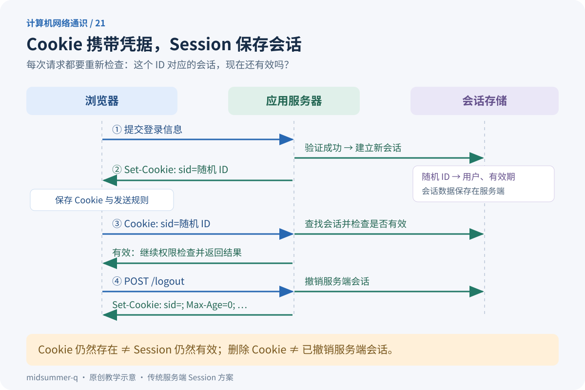

第一次打开网站，你输入账号密码；点进个人中心时，网站却没有再问一遍密码。过了一段时间，或者点击“退出登录”后，它又要求你重新登录。

网站究竟把“你已经登录”记在了哪里？为什么清除 Cookie 后会退出，但关闭一个标签页通常不会？为什么前端明明请求成功，后台却总说“未登录”？

这些现象可以沿着一条线理解：**浏览器保存并携带凭据，服务器根据凭据查找会话，再决定这次请求能做什么。** 本文先讲最常见的“Cookie 携带随机 Session ID、服务器保存会话数据”方案，再说明它与其他方案的区别。

如果“请求、响应、首部”还很陌生，可以先读[HTTP 基础](/blog/posts/understanding-http-requests-responses-and-caching/)。本篇的概念部分不需要编程基础，末尾实验只使用 Python 标准库。

## Table of contents

## HTTP 无状态，为什么网站仍然能记住人？

HTTP 的“无状态”是说：协议本身不替应用保存“上一条请求是谁登录的”这类业务上下文。它不禁止服务器存数据，也不禁止下一次请求带上识别信息。

假设服务器先后收到两条请求：

```http
GET /profile HTTP/1.1
Host: shop.example.com
```

只看这几行，应用不知道它们是否来自同一个已登录账号。IP 地址也不适合作为登录凭据：一家人可能共用一个公网出口，同一个人又可能从 Wi-Fi 切换到手机网络。

TCP 长连接解决的是复用传输连接的问题。连接重新建立后，登录状态仍然可以存在；一个账号也可能同时发起多条连接。**连接是否还在，与会话是否有效，是两个判断。**

应用需要在每次相关请求中拿到可验证的凭据。Cookie 是浏览器保存和发送这类数据的一种机制，Session 是应用把多次请求关联起来的一种会话机制。

## 三个名字，分别负责什么？

可以把传统 Session 登录想象成寄存行李：柜台保管行李和登记记录，你拿着一张取件凭证。每次取东西时，工作人员都要确认凭证对应的记录仍有效。

| 名称       | 在本文方案中是什么                             | 常见保存位置                      |
| ---------- | ---------------------------------------------- | --------------------------------- |
| Cookie     | 浏览器保存的小段名称和值，以及发送、过期规则   | 浏览器的 Cookie 存储              |
| Session ID | 用来查找会话的一段不可预测标识                 | 通常作为某个 Cookie 的值          |
| Session    | 包含用户标识、创建时间、有效期等信息的会话记录 | 服务端内存、数据库或 Redis 等存储 |

例如浏览器保存 `sid=随机字符串`，服务器保存一条类似下面的记录：

```text
随机字符串 → { user_id: 42, created_at: ..., expires_at: ... }
```

Cookie 不一定用于登录：`theme=dark` 可以只是主题偏好。Session 也不等于 Cookie：前者是应用层会话，后者负责浏览器侧的数据保存与携带。两者经常合作，并不是只能二选一。

这里的“服务端保存 Session”限定了本文讨论的实现。有些框架会把经过签名、甚至加密的会话数据放进 Cookie；那属于另一种设计，不能套用“所有会话数据都在服务器”的结论。Cookie 的基础交换机制见 [RFC 6265](https://www.rfc-editor.org/rfc/rfc6265.html)。

## 把一次登录拆成四轮交流



### 第一轮：提交登录信息

浏览器通过 HTTPS 向登录接口提交账号和密码。服务器验证成功后，用安全随机数生成新的 Session ID，并建立会话记录。

**Session ID 不是密码的编码，也不应直接使用用户名或递增用户编号。** 后续若仅凭这个 ID 就能调用已登录接口，拿到它的人可能无需再输入密码。因此它本身也要当作秘密保护。

### 第二轮：服务器让浏览器保存 Cookie

下面是简化的 HTTP/1.1 响应首部；`random-session-id` 只是占位符：

```http
HTTP/1.1 200 OK
Set-Cookie: __Host-sid=random-session-id; Path=/; Secure; HttpOnly; SameSite=Lax
Cache-Control: no-store
```

`Set-Cookie` 的意思是“请按这些规则保存一条 Cookie”。浏览器检查设置是否合法，接受后写入自己的 Cookie 存储。会话数据仍在服务器，响应没有把整个用户资料库交给浏览器。

这里没有设置 Cookie 的持久化期限，服务端却仍然应该为 Session 设置到期时间；这两个期限不是同一个东西。

### 第三轮：访问个人中心

当请求满足该 Cookie 的发送条件时，浏览器自动携带名称和值：

```http
GET /profile HTTP/1.1
Host: shop.example.com
Cookie: __Host-sid=random-session-id
```

注意请求里是 `Cookie`，响应里是 `Set-Cookie`。`Path`、`HttpOnly` 等属性不会作为这条请求 Cookie 的属性一起发回去，它们是浏览器保存和执行的规则。

服务器拿到 ID 后，还要检查记录是否存在、是否过期、是否已被撤销。确认会话有效后，再针对本次操作检查权限。例如账号登录成功，也不意味着它可以查看别人的订单。

### 第四轮：退出登录

传统服务端 Session 方案应完成两个动作：

1. 在服务端删除或撤销当前会话，让旧 ID 不能继续使用。
2. 返回清除 Cookie 的指示，让浏览器不再携带它。

```http
Set-Cookie: __Host-sid=; Path=/; Secure; HttpOnly; SameSite=Lax; Max-Age=0
```

清除时要匹配原 Cookie 的名称、路径和域范围。本例原本没有 `Domain`，删除时也不添加。

只清掉浏览器 Cookie，却不撤销服务端会话，已经泄露的旧 ID 仍可能有效；只撤销服务器记录，浏览器则可能继续带着一个无效 ID。前者涉及安全，后者会增加排查困惑。[MDN 的 Cookie 指南](https://developer.mozilla.org/en-US/docs/Web/HTTP/Guides/Cookies)提供了设置、更新和删除的对应示例。

## Cookie 的属性，是浏览器执行的规则

先读懂下面这条示例，再分别看每项限制：

```http
Set-Cookie: sid=random-value; Path=/; Max-Age=1800; Secure; HttpOnly; SameSite=Lax
```

| 属性                  | 主要作用                                      | 不要误解为                                |
| --------------------- | --------------------------------------------- | ----------------------------------------- |
| `Domain`              | 控制可以接收 Cookie 的域范围                  | 任意网站都可以给其他网站设置 Cookie       |
| `Path`                | 根据请求路径筛选是否携带                      | 服务端权限隔离机制                        |
| `Max-Age` / `Expires` | 控制浏览器侧的保存期限                        | 同时设置了服务端 Session 的有效期         |
| `Secure`              | 在正常 HTTPS 场景中限制经安全连接发送         | Cookie 值被单独加密，或脚本一定读不到     |
| `HttpOnly`            | 阻止页面脚本通过 `document.cookie` 等接口读取 | 浏览器不再自动发送它，或 XSS 已被彻底解决 |
| `SameSite`            | 按同站、跨站场景限制携带                      | 跨域资源共享 CORS 的替代品                |

没有 `Domain` 时，Cookie 通常只发给设置它的主机。由 `app.example.com` 设置的 host-only Cookie 不会自动发给 `api.example.com`。显式使用允许的父域会扩大范围；不应为了省事给登录凭据扩大到所有子域。

`Path=/account` 用于路径匹配，不能证明来自其他路径的代码就没有办法影响账号区域。应用的权限判断仍要在服务端执行。

`Max-Age=1800` 表示浏览器侧最多保留 1800 秒；同时设置 `Expires` 时，`Max-Age` 优先。没有两者时属于会话 Cookie，但浏览器可能恢复上次会话，所以不能保证“关掉浏览器就立刻失效”。

在支持名称前缀检查的浏览器中，`__Host-` 要求通过安全来源设置，带 `Secure`、`Path=/` 且不带 `Domain`。它有助于缩小域与路径配置带来的问题，但不会自动替你加上 `HttpOnly`。完整属性和兼容性以 [MDN：Set-Cookie](https://developer.mozilla.org/en-US/docs/Web/HTTP/Reference/Headers/Set-Cookie) 为准。

## “会话 Cookie”不等于“服务端 Session”

这两个词都带“会话”，却描述了不同层次：

- **会话 Cookie** 是一种浏览器保存期限分类，与持久 Cookie 相对。
- **服务端 Session** 是应用维护的会话记录，可以有自己的绝对期限、空闲期限和撤销状态。

想象浏览器 Cookie 保存 7 天，但服务器会话只有效 30 分钟。第 31 分钟浏览器仍可能发送 ID，服务器查到已过期，应该要求重新认证。

反过来，浏览器删除 Cookie 后，即使服务端记录还没清理，正常请求也已经没有原凭据了。这说明“客户端还存着什么”和“服务器还认可什么”要分别检查。

关闭标签页通常不会清除站点 Cookie；同一浏览器资料中的多个标签页往往共用它。这里也别与 `sessionStorage` 混淆：`sessionStorage` 是按来源和顶层浏览上下文划分的脚本存储，刷新通常保留，关闭对应标签页结束其页面会话，而且不会像 Cookie 一样自动放进 HTTP 请求。[MDN：sessionStorage](https://developer.mozilla.org/en-US/docs/Web/API/Window/sessionStorage)解释了这些生命周期差别。

## SameSite：先分清“跨站”与“跨源”

日常说“跨域”容易把两套规则混在一起。

**源（origin）** 通常由协议、主机、端口组成；**站点（site）** 在现代浏览器的相关判断中通常看协议与可注册域，涉及公共后缀规则，并不是机械地截取域名最后两段。

| 两个地址                                                        | 是否同源     | 是否同站                 |
| --------------------------------------------------------------- | ------------ | ------------------------ |
| `https://app.example.com` 与 `https://api.example.com`          | 否，主机不同 | 是                       |
| `https://app.example.com:443` 与 `https://app.example.com:8443` | 否，端口不同 | 是                       |
| `http://app.example.com` 与 `https://app.example.com`           | 否，协议不同 | 否，按包含协议的站点判断 |
| `https://app.example.com` 与 `https://other.test`               | 否           | 否                       |

同站不代表 Cookie 就会发送：目标主机还要匹配 Cookie 的域规则。例如 host-only Cookie 仍不能在表格第一行的两个子域间随意共享。站点定义可参考 [MDN：Site](https://developer.mozilla.org/en-US/docs/Glossary/Site)。

显式设置的 `SameSite` 常见取值如下，均以其他 Cookie 条件也满足为前提：

- `Strict`：限制在同站请求中携带。从外站链接首次进入时，可能暂时呈现未登录状态。
- `Lax`：同站请求可以携带；跨站时通常只允许顶层导航加安全方法，例如点击链接触发的 GET。跨站 `fetch` 和普通跨站 POST 表单不属于这个放行范围。
- `None`：允许参与跨站请求，但必须配合 `Secure`，并且仍可能受第三方 Cookie 策略等限制。

不要把“没写 SameSite”与显式 `Lax` 完全等同：一些浏览器的默认行为存在兼容性例外。这里讲明确配置的规则，具体浏览器行为应通过开发者工具验证。

## 前后端分开部署，为什么总是“未登录”？

假设页面在 `https://app.example.com`，接口在 `https://api.example.com`。它们跨源但同站。即使 Cookie 的域和 SameSite 规则都允许，前端请求还需要正确配置凭据模式：

```javascript
const response = await fetch("https://api.example.com/profile", {
  credentials: "include",
});
```

`fetch` 默认使用 `same-origin` 凭据模式；`include` 允许跨源请求使用符合条件的 Cookie，**不会绕过 SameSite、Secure 或浏览器隐私策略**，也不会把页面主机的 Cookie 强行转交给 API 主机。

要让页面 JavaScript 读取这类凭据请求的响应，API 还需返回匹配的 CORS 首部，例如：

```http
Access-Control-Allow-Origin: https://app.example.com
Access-Control-Allow-Credentials: true
Vary: Origin
```

允许来源应来自服务端维护的可信名单，不应无条件反射任意 `Origin`。凭据响应不能用 `Access-Control-Allow-Origin: *`；需要预检的请求，还要通过预检。

另一个细节是：**页面读不到响应，不代表服务器一定没收到请求。** 某些不触发预检的跨源请求可以先发出去，随后浏览器才阻止脚本读取响应。因此不能把 CORS 当作完整的 CSRF 防护。相关流程见 [MDN：Using Fetch，Including credentials](https://developer.mozilla.org/en-US/docs/Web/API/Fetch_API/Using_Fetch#including_credentials)。

## 登录安全的重点，是保护凭据与校验每次请求

### HttpOnly 降低窃取风险，但不消除 XSS

XSS 指攻击者让恶意脚本在受害站点的页面环境中执行。`HttpOnly` 能挡住脚本直接读取相应 Cookie，但脚本仍可能利用用户浏览器发起请求，而浏览器照常附带 Cookie。

所以还需要正确处理不可信输入和输出、采用框架的安全渲染方式，并结合内容安全策略等防线。不要把 `HttpOnly` 理解为“页面可以随便执行不可信代码”。

### 浏览器自动带 Cookie，也就需要防 CSRF

CSRF 指攻击者诱导浏览器向目标站点发出用户没有授权的操作请求。如果浏览器恰好携带有效登录 Cookie，而服务器仅凭 Cookie 判断这次操作可信，就可能误执行。

状态变更接口应使用适当的方法，结合框架的 CSRF Token、来源检查及 SameSite 等措施；不要让 GET 链接直接完成转账、删除等操作。CSRF Token 是服务端验证请求来源意图的一层校验，不是用户密码，也不应简单等同于 Session ID。具体方案参考 [OWASP：CSRF Prevention](https://cheatsheetseries.owasp.org/cheatsheets/Cross-Site_Request_Forgery_Prevention_Cheat_Sheet.html)。

### 登录时更新 ID，退出时撤销记录

如果登录前后沿用攻击者已知的会话 ID，即使密码验证成功，也可能留下会话固定攻击的机会。登录成功或权限提升时应更新 ID，并按框架机制处理旧会话。

服务端还要执行过期检查：空闲超时限制多久未活动，绝对超时限制从建立会话起最多持续多久。不能只依赖浏览器删除 Cookie，因为客户端可以自己构造请求。不要把完整 Session ID 写进公开日志，也不要放进 URL，让它随历史记录和分享链接传播。这些原则见 [OWASP：Session Management](https://cheatsheetseries.owasp.org/cheatsheets/Session_Management_Cheat_Sheet.html)。

## 可运行实验：看见登录、过期与退出的区别

下面的程序启动一个仅监听 `127.0.0.1` 随机端口的教学服务，再用带 CookieJar 的客户端访问。CookieJar 会从响应保存 Cookie，并在后续合适的请求中自动携带，因此不需要手工复制 ID 才能完成正常登录流程。

保存为 `cookie_session_demo.py`。Windows 终端运行 `py cookie_session_demo.py`，macOS / Linux 可运行 `python3 cookie_session_demo.py`；也可以用已经指向 Python 3 的 `python` 命令。不需要安装第三方包。

> [!WARNING]
> 这是机制实验，`/demo-login` 直接扮演“密码已经验证成功”的步骤，没有真实账号认证。程序只用本机 HTTP，示例 Cookie 因此没有 `Secure`，也未实现浏览器场景的完整 CSRF 防护；不要把它部署为真实登录服务。Python CookieJar 也不模拟浏览器的 SameSite、CORS 等全部规则。

```python
import secrets
import time
from http.cookiejar import CookieJar
from http.cookies import SimpleCookie
from http.server import BaseHTTPRequestHandler, HTTPServer
from threading import Thread
from urllib.error import HTTPError
from urllib.request import HTTPCookieProcessor, Request, build_opener


class Handler(BaseHTTPRequestHandler):
    def session_id(self):
        cookies = SimpleCookie()
        cookies.load(self.headers.get("Cookie", ""))
        return cookies["sid"].value if "sid" in cookies else None

    def reply(self, status, message, cookie=None):
        body = message.encode("utf-8")
        self.send_response(status)
        self.send_header("Content-Type", "text/plain; charset=utf-8")
        self.send_header("Content-Length", str(len(body)))
        self.send_header("Cache-Control", "no-store")
        if cookie:
            self.send_header("Set-Cookie", cookie)
        self.end_headers()
        self.wfile.write(body)

    def do_POST(self):
        sid = self.session_id()
        if self.path == "/demo-login":
            self.server.sessions.pop(sid, None)
            sid = secrets.token_urlsafe(32)
            self.server.sessions[sid] = {
                "user": "alice",
                "expires": time.monotonic() + 60,
            }
            self.reply(200, "logged in", (
                f"sid={sid}; Path=/; HttpOnly; SameSite=Lax; Max-Age=600"
            ))
        elif self.path == "/logout":
            self.server.sessions.pop(sid, None)
            self.reply(200, "logged out", (
                "sid=; Path=/; HttpOnly; SameSite=Lax; Max-Age=0"
            ))
        else:
            self.reply(404, "not found")

    def do_GET(self):
        if self.path != "/me":
            self.reply(404, "not found")
            return
        sid = self.session_id()
        session = self.server.sessions.get(sid)
        if not session or session["expires"] <= time.monotonic():
            self.server.sessions.pop(sid, None)
            self.reply(401, "not logged in")
            return
        self.reply(200, "hello " + session["user"])

    def log_message(self, *args):
        pass


server = HTTPServer(("127.0.0.1", 0), Handler)
server.sessions = {}
worker = Thread(target=server.serve_forever, daemon=True)
worker.start()
base = f"http://127.0.0.1:{server.server_port}"
jar = CookieJar()
client = build_opener(HTTPCookieProcessor(jar))


def visit(opener, path, method="GET", headers=None):
    request = Request(base + path, method=method, headers=headers or {})
    try:
        response = opener.open(request, timeout=3)
    except HTTPError as error:
        response = error
    with response:
        print(response.status, response.read().decode())


try:
    visit(client, "/me")
    visit(client, "/demo-login", "POST")
    visit(client, "/me")

    # 仅在实验中直接调整服务端记录，模拟到期，避免等待 60 秒。
    current_sid = next(cookie.value for cookie in jar if cookie.name == "sid")
    server.sessions[current_sid]["expires"] = 0
    print("cookie remains:", any(cookie.name == "sid" for cookie in jar))
    visit(client, "/me")

    visit(client, "/demo-login", "POST")
    old_sid = next(cookie.value for cookie in jar if cookie.name == "sid")
    visit(client, "/logout", "POST")
    print("cookie cleared:", not any(cookie.name == "sid" for cookie in jar))
    visit(client, "/me")

    # 独立客户端手工重放已退出的旧 ID，验证服务器是否撤销会话。
    visit(build_opener(), "/me", headers={"Cookie": f"sid={old_sid}"})
finally:
    server.shutdown()
    server.server_close()
    worker.join()
```

预期输出：

```text
401 not logged in
200 logged in
200 hello alice
cookie remains: True
401 not logged in
200 logged in
200 logged out
cookie cleared: True
401 not logged in
401 not logged in
```

这里有三组值得对照的证据：

1. 登录前是 401，登录后是 200：客户端自动带回 Cookie，服务器查到了对应会话。
2. `cookie remains: True` 后仍是 401：浏览器侧期限与服务端期限彼此独立，有 ID 不代表会话仍有效。
3. 退出后重放旧 ID 仍是 401：登录状态的失效由服务端确认，不只是客户端忘记了一串字符。

`HttpOnly` 不会阻止本机 Python 程序查看自己 CookieJar 中的值，它约束的是浏览器向页面脚本暴露 Cookie 的接口。想理解 CookieJar 的保存与携带机制，可读 [Python 官方文档](https://docs.python.org/3/library/http.cookiejar.html)。

## 不写代码时，怎样在浏览器里观察？

在你自己有权使用的登录站点中，按 `F12` 打开开发者工具，先打开 Network，再进行登录。找到登录响应，检查是否有 `Set-Cookie`；再找后续已登录请求，检查是否带 `Cookie`。不同站点可能采用其他认证方案，未出现这些字段并不一定是故障。

在 Chrome / Edge 的 Application → Cookies 中查看 Cookie 的域、路径、期限、Secure、HttpOnly 和 SameSite。`HttpOnly` Cookie 能在开发者工具中看到，不代表页面 JavaScript 也能读到；前端脚本通常也不能通过 `response.headers.get("Set-Cookie")` 读取被浏览器过滤的这个响应首部。

排查“登录后马上又未登录”时，按以下顺序缩小范围：

| 观察到哪里                    | 重点检查                                                 |
| ----------------------------- | -------------------------------------------------------- |
| 响应没有设置预期 Cookie       | 登录是否成功、响应是不是来自预期接口                     |
| 响应有 `Set-Cookie`，但没保存 | 浏览器拒绝原因、域是否合法、Secure / SameSite 组合       |
| 已保存，但下次请求没携带      | 目标主机、路径、协议、SameSite、fetch 凭据模式及隐私策略 |
| 请求已经带上 ID，仍然 401     | 服务端记录、过期与撤销状态、请求是否到了另一台服务器     |
| 已认证，但操作被拒绝          | 具体资源权限、CSRF 校验及业务规则                        |

不要把真实账号的 Cookie 值粘贴到截图、公开问题单或在线测试站点。观察字段是否存在及属性是否正确，通常已经足以完成第一轮排查。

## 从一台服务器到多台，Session 放在哪里？

假设第一次请求由服务器 A 接收，A 把 Session 放在自己的内存；下一次负载均衡把请求交给 B，而 B 没有这条记录。即使浏览器携带完全正确的 Cookie，B 仍可能认为没有登录。

```text
浏览器携带 sid → 负载均衡 → A 或 B → 共享会话存储 → 校验有效期和用户
```

共享数据库或 Redis 等会话存储可以让多台实例读取同一份记录，但还要设计有效期、故障处理与撤销一致性。粘性会话把同一客户端尽量送到同一实例，也不能自动解决实例重启后内存丢失的问题。这与前面的[负载均衡专题](/blog/posts/understanding-proxies-load-balancers-and-cdns/)正好接在一起。

再往前一步，JWT 经常被拿来与 Session 比较。需要先拆开问题：**Cookie 是保存和携带机制，JWT 是令牌格式，服务端 Session 是管理会话的一种方案。** JWT 可以放进 Cookie，也可以通过其他约定携带。

签名能用于验证数据完整性，不等于加密；常见签名 JWT 的载荷可以被解码阅读。即使不用逐次查询 Session 记录，也仍需正确验证签名、有效期和应用所需声明，并考虑退出、撤销与权限变更。因此“换成 JWT 就没有状态管理问题”并不成立。令牌格式定义见 [RFC 7519](https://www.rfc-editor.org/rfc/rfc7519.html)。

## 读完后，用自己的话试着解释

**问题一：Cookie 还在，为什么服务器说登录过期？**

<details>
<summary>展开参考答案</summary>
<div class="mt-4 leading-7">Cookie 的保存期限由浏览器执行，Session 的有效性由服务器判断。服务器记录可以提前过期、被撤销或丢失。请求带着 ID，只说明客户端提供了一个凭据，并不保证服务端仍然认可。</div>
</details>

**问题二：设置 HttpOnly 后，为什么还需要防范 XSS 和 CSRF？**

<details>
<summary>展开参考答案</summary>
<div class="mt-4 leading-7">HttpOnly 限制页面脚本读取 Cookie，但浏览器仍会在满足条件时自动发送它。XSS 脚本可能借浏览器执行操作，CSRF 也可能利用自动携带凭据的请求。脚本执行安全、请求来源校验和会话管理分别负责不同的防线。</div>
</details>

**问题三：退出后删掉 Cookie 就够了吗？**

<details>
<summary>展开参考答案</summary>
<div class="mt-4 leading-7">对本文的服务端 Session 方案，还必须撤销服务端会话。否则，其他地方已经保存的旧 ID 仍可能访问接口。实验最后一次请求就是检查旧 ID 是否真的失效。</div>
</details>

上一篇：[网络不通或很慢，应该从哪里开始查？](/blog/posts/a-layered-guide-to-network-troubleshooting/)

基础回顾：[HTTP 请求与响应](/blog/posts/understanding-http-requests-responses-and-caching/) · [HTTPS 与 TLS](/blog/posts/how-https-and-tls-establish-trust/)

[浏览完整计算机网络专栏](/blog/series/计算机网络通识/)
