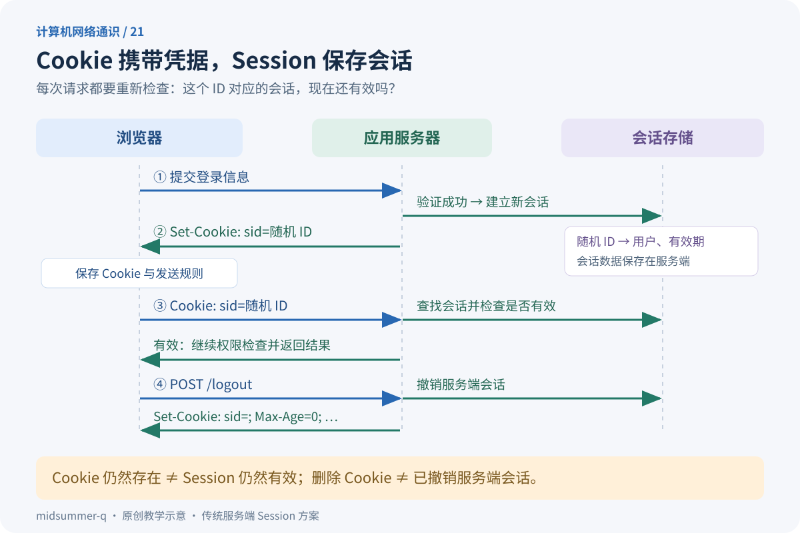

在日常使用各种网站或移动应用时，我们早已习惯了这样一种自然的体验：
我们在登录页面输入一次用户名与密码，点击登录成功。随后，我们在网站里浏览商品、加入购物车、发表评论、点击个人中心，整个过程中**网站再也没有向我们索要过一次密码**。

甚至，当我们关掉电脑，第二天再次打开网页时，右上角依然挂着我们熟悉的头像与昵称。

然而，我们在第 11 篇中曾经确立过一条至高无上的网络协议铁律：

> **HTTP 协议是一个天然完全“无状态（Stateless）”的通信协议！**
>
> 在 HTTP 的设计中，每一个独立的请求之间在逻辑上是**完全孤立、互不关联的**。
> 服务器处理完你的第一个请求并断开连接后，当你的第二个请求到达时，**服务器根本记不住你到底是谁，在它眼中你和一个刚从火星来的新访客没有任何区别！**

面对这样一个完全没有记忆的无状态协议，**网站究竟是依靠怎样的技术机制，在无序的网络世界中安全、精准地记住你的身份的？**

- 为什么把用户的账号、密码或 VIP 等级直接保存在客户端的 Cookie 里是极其业余且致命的做法？
- **Cookie** 和 **Session** 是如何像“门票”与“保险柜”一样协同分工的？
- 浏览器的黑客攻击两大梦魇——**XSS（跨站脚本攻击）** 和 **CSRF（跨站请求伪造）**，是如何被 `HttpOnly` 与 `SameSite` 属性在底层安全防御体系中化解的？
- 当后端架构从单体应用走向多台服务器组成的微服务集群时，传统的 Session 是如何演变为 **分布式 Redis 共享** 以及基于密码学自包含的 **JWT（JSON Web Token）** 的？

作为整套《计算机网络通识》专栏的**终章压轴之作**，本文将全面解开现代 Web 身份认证与会话保持的底层物理时序，带你洞悉状态管理的架构演进。

## Table of contents

## 第一章：无状态协议下的会话困境与破局哲学

在探究技术细节之前，我们先来推导：为什么在 HTTP 体系中维系“状态（State）”是一件如此棘手的事情。

### 1. 为什么 HTTP 必须被设计为无状态？

HTTP 协议诞生于学术论文共享时期。

- **无状态的巨大架构红利**：服务端不需要为每一个来访者在内存中开辟长期的状态空间。无论几千万人并发访问，服务器处理完一个请求立刻释放上下文，**具备极其恐怖的轻量级与水平无状态弹性扩容能力！**
- **商业化时代的痛苦矛盾**：然而，随着互联网走向商业化，电子商务（购物车、收银台）、社交网络（个人主页、私信）的爆发，**业务强依赖于“知道每一次点击背后具体是哪一个人”！**

### 2. 破局之道：医院病历卡与游乐园手环比喻

如何在保持协议本身无状态的前提下，让应用具备记忆力？

> **生活化生动比喻**：
>
> 想象你去一家大型综合三甲医院看病：
>
> - 医院里的坐诊专家每天要看上千个病人，**医生的大脑本身是“无状态”的**。他根本不可能单凭肉眼记住昨天上午看过的第三个病人叫什么名字、吃了什么药；
> - **解决方案**：
>   1. 你第一次去医院，前台护士为你建立一份**纸质病历档案（服务端 Session）**，锁在医院的档案室里，并在档案上贴上一个条形码编号：`#9527`；
>   2. 护士把一张印有条形码编号 `#9527` 的塑料手环或者就诊卡（**客户端 Cookie**），戴在你的手腕上；
>   3. 随后，你去内科、外科、拍片、化验。**每一次进诊室，你不需要向医生背诵一遍你的生辰八字，你只需把手环上的条形码让医生扫一下**；
>   4. 医生拿着 `#9527` 去档案室调出你完整的病历记录，看完病在档案里写下新诊断，把手环还给你；
>   5. 医生依然不需要在大脑中记住你，整座医院依托**“手环上的编号 + 档案室的病历”**，实现了跨科室、跨时间的精准状态追踪！

```text
[浏览器 (患者)]                                        [Web 服务器 (医院)]
手腕上保存的临时就诊卡 (Cookie)                           内部档案室保管的完整病历 (Session)
┌─────────────────────────────────┐                    ┌─────────────────────────────────┐
│ session_id = "SID_9527"         │ ─── 每次请求带上 ───>│ 查找 SID_9527 对应的数据:       │
│ (只存放一个无意义的高随机防伪代号)   │                      │ 用户名: 张三                     │
│                                 │ <─── 响应结果 ────── │ 余额: 1000 元                   │
└─────────────────────────────────┘                    │ 角色: VIP 会员                  │
                                                       └─────────────────────────────────┘
```

**核心设计哲学**：

- **Cookie（手环卡片）**：存放在用户的**浏览器端**，轻量、公开，**只负责存放一个随机、不可预测的唯一会话标识符（Session ID）**；
- **Session（真实病历）**：存放在**服务器端的受控内存/数据库**中，安全、隔离，负责记录用户的真实敏感数据（用户 ID、登录时间、购物车商品、角色权限）。

---

## 第二章：Cookie 与 Session 的完整交互时序

一次完整的用户登录与身份保持，在底层遵循严格的 HTTP 报文往返时序：



```text
浏览器客户端                                                      Web 服务器端
     │                                                                 │
     │ ──── 1. POST /login (携带用户名张三 + 密码明文/哈希) ──────────────> │
     │                                                                 │ 2. 服务端校验账密正确！
     │                                                                 │    • 在服务端内存/Redis 开辟 Session 空间
     │                                                                 │    • 填充用户信息: { uid: 1001, role: "admin" }
     │                                                                 │    • 生成一个极其复杂的随机 Session ID:
     │                                                                 │      "sid_a1b2c3d4e5f6..."
     │                                                                 │
     │ <─── 3. HTTP 响应报文 (附带 Set-Cookie 响应头) ─────────────────── │
     │      Set-Cookie: sid=sid_a1b2c3d4e5f6; Path=/; HttpOnly; Secure │
     │                                                                 │
     ▼ 4. 浏览器接收到响应，自动将该 Cookie 写入本地专属安全数据库!        │
     │                                                                 │
     │ ──── 5. 后续任意请求 (如 GET /user/profile) ─────────────────────> │
     │      ⭐️ 浏览器在底层自动拦截并附加 Cookie 请求头:                  │ 6. 服务端提取 Cookie 中的 sid:
     │      Cookie: sid=sid_a1b2c3d4e5f6                              │    从 Redis 中秒级检索对应的 uid: 1001！
     │                                                                 │    无需再次询问密码，判定用户已登录！
     │                                                                 │
     │ <─── 7. 返回个人中心私有数据 ───────────────────────────────────── │
```

### 1. `Set-Cookie` 响应头的装配

服务器如果想要给浏览器种下 Cookie，必须在响应头中使用 **`Set-Cookie`** 字段：

```http
HTTP/1.1 200 OK
Set-Cookie: session_id=sid_a1b2c3d4e5f6; Path=/; Domain=example.com; Max-Age=86400; HttpOnly; Secure; SameSite=Lax
Content-Type: text/html
```

### 2. 浏览器的自动附带机制

一旦被种下 Cookie，只要后续请求的目标 URL 符合该 Cookie 规定的作用范围（Domain 和 Path），**浏览器会在操作系统底层自动、静默地把该键值对拼接进请求头的 `Cookie:` 字段中**！前端甚至不需要写一行 JavaScript 代码！

---

## 第三章：防守的艺术——Cookie 核心安全属性深度解密

如果 Cookie 仅仅是一个普通的键值对，那么在充满黑客嗅探与脚本注入的公网环境中，它随时可能沦为账号被盗的罪魁祸首。

IETF 在 HTTP 规范中为 Cookie 量身定制了**四大顶级安全防御属性**：

| 安全属性              | 默认值                 | 针对的致命安全威胁             | 核心工作原理与工业级防御标准                                                                                                                                         |
| :-------------------- | :--------------------- | :----------------------------- | :------------------------------------------------------------------------------------------------------------------------------------------------------------------- |
| **`HttpOnly`**        | `false`                | **XSS（跨站脚本攻击）**        | **开启后，严禁任何前端 JavaScript（如 `document.cookie`）读取该 Cookie！**<br/>即便黑客成功在你的网页里注入了恶意 JS 脚本，他也绝对无法偷走你的 Session ID！         |
| **`Secure`**          | `false`                | **中间人网络嗅探（Sniffing）** | **声明该 Cookie 只能在 HTTPS 加密信道中传输！**<br/>如果用户误点了一个非加密的明文 HTTP 链接，浏览器坚决拒绝发送该 Cookie，防止在公共 Wi-Fi 中被路由器直接抓包截获！ |
| **`SameSite`**        | `Lax` (现代浏览器默认) | **CSRF（跨站请求伪造）**       | **限制第三方跨站网站在发起请求时是否允许自动携带该 Cookie！**<br/>彻底斩断黑客诱导用户点击恶意链接、伪造用户身份向银行发起转账请求的黑手！                           |
| **`Domain` & `Path`** | 当前主机与路径         | **跨域/跨目录作用域污染**      | 严格限制该 Cookie 能够被发送给哪些具体域名和子目录。子域名可以访问父域名 Cookie，但父域名无法访问子域名 Cookie。                                                     |

### 深度剖析：`SameSite` 的三大防伪模式

- **`SameSite=Strict`（极度严格）**：
  只要请求是从别的网站跨站跳转过来的（甚至仅仅是你在微信里点击了一个知乎链接），浏览器**绝对不发送任何该站 Cookie**！安全级别最高，但可能导致用户每次点外部链接都要重新登录一次，体验较差；
- **`SameSite=Lax`（现代黄金平衡）**：
  对于常规的、安全的导航式跨站访问（如在第三方网页点击 `<a href="...">` 超链接导航），允许携带 Cookie；**但严禁一切通过 POST 表单提交、图片加载（``）或 `iframe` 发起的跨站操作携带 Cookie！** 完美消灭了 99% 的 CSRF 跨站伪造攻击；
- **`SameSite=None`**：
  允许在任何第三方跨站场景下携带，但**强制必须同时开启 `Secure` 属性**！常用于跨域微服务单点登录（SSO）与第三方嵌入组件。

---

## 第四章：分布式架构下的演进困境与现代解决方案

在单台服务器时代，`Session` 存放在单机的运行内存中运行良好。

然而，随着互联网业务规模爆发，后端必然演进为由我们在第 14 篇讲过的**负载均衡器（Nginx）+ 成百上千台业务服务器组成的微服务集群架构**！

```text
[浏览器] ───(第一次登录: 打到业务节点 A) ───> [业务服务器 A (内存保存了 Session)]
   │
   ▼ (用户点击查看订单: 负载均衡轮询分流到了业务节点 B)
[业务服务器 B (内存中根本没有这个用户的 Session!)] ───> 💥 误判用户未登录! 强行踢回登录页!
```

传统的单机内存 Session 遭遇了致命的**“分布式会话不同步”**危机！

工业界由此演化出了两大主流技术分支：

### 分支一：分布式集中式会话中心（Redis 共享集群）

- 所有的业务服务器（节点 A、B、C）内部**坚决不保存任何 Session 状态**；
- 将所有的 Session 统一存储在一个独立的高性能内存数据库集群（**Redis Cluster**）中；
- 任何一个节点收到用户的 `session_id`，统一向 Redis 集群发起毫秒级查询。即使单台业务服务器崩溃宕机，用户的登录状态完全不受任何影响！

### 分支二：彻底去中心化的无状态革命——JWT（JSON Web Token）

如果连 Redis 的网络往返开销都想省去，现代云原生架构推行了颠覆性的 **JWT 架构**：

> **JWT 的设计哲学：不在服务端存任何状态，把加密签名的数据直接让客户端带在身上！**

```text
JWT 字符串的由点号隔开的三部分:
[Header (头部: 算法类型)] . [Payload (载荷: 用户 ID, 角色, 过期时间)] . [Signature (防伪数字签名)]
```

1. 用户登录成功，服务端根据用户信息生成一段加密签名的 **JWT 字符串** 下发；
2. 客户端后续请求时，在请求头中附带：`Authorization: Bearer <JWT字符串>`；
3. **服务端任何节点收到请求，完全不需要查询任何数据库或 Redis！**
   服务端只需使用自己手中的安全密钥（Secret），对该 Token 的签名做一次纯 CPU 的数学哈希比对！只要签名通过，当场直接从 Payload 中解密出用户的 `uid` 与 `role` 并予以信任！
4. **代价权衡**：JWT 体积相对 Cookie 较大；且由于服务端不存状态，**在过期时间到达之前，服务端很难单方面强行主动撤销或注销某个已发出的 JWT（Token 吊销难题）**。

---

## 总结与全专栏二十一部曲大圆满

至此，整套《计算机网络通识》专栏全套二十一篇大作已全部圆满落成。

我们共同完成了一场波澜壮阔的计算机网络全景奥德赛之旅：

```text
                     《计算机网络通识》全景知识大闭环
                                     │
   【宏观篇】01. 打开网页的全景数据流与协议栈时序贯通
                                     │
   【链路与路由】02. 以太网物理帧与 ARP ──> 03. IP 寻址与子网掩码 ──> 04. 路由器逐跳转发与 ICMP
                                     │
   【命名与分用】05. DNS 全球树状域名系统 ──> 06. 端口分用与 Socket 抽象
                                     │
   【传输层可靠性】07. TCP 三次握手 ──> 08. 序列号与滑动窗口 ──> 09. 带宽时延积与拥塞控制 ──> 10. 四次挥手与 TIME_WAIT
                                     │
   【Web 应用层】11. HTTP/1.1 报文与双层缓存 ──> 12. HTTPS 与 TLS 1.3 信任链 ──> 13. HTTP/1.1 到 HTTP/3 QUIC 演进
                                     │
   【现代边缘基础设施】14. 反向代理、负载均衡与 CDN ──> 15. NAT 穿透前置原理 ──> 16. IPv6 架构变革
                                     │
   【虚拟网络进阶】17. 什么是 VPN ──> 18. Tailscale 现代架构 ──> 19. NAT 穿透终极指南
                                     │
   【排障与状态闭环】20. 分层网络排障法典与 curl 拆解 ──> 21. Cookie 与 Session 会话安全终章
```

1. **从物理到逻辑**：我们从最底层的网线电信号、以太网帧、MAC 地址自学习，一路推导到 IP 最长前缀匹配与 TTL 环路防死锁；
2. **从端点到会话**：我们解构了 Socket 在操作系统内核中的独立双向缓冲区，透视了三次握手、滑动窗口自适应、四次挥手 2MSL 的物理精妙；
3. **从明文到加密**：我们从纯文本 HTTP、强缓存与协商缓存，跨越到混合加密、CA 数字证书防伪与 TLS 1.3 极速 1-RTT 革命；
4. **从边缘到演进**：我们洞悉了反向代理、负载均衡、CDN 边缘调度以及 HTTP/3 拥抱 QUIC/UDP 彻底终结队头阻塞的壮举；
5. **从排障到安全**：我们确立了自底向上的分层排障法典，并最终在 Cookie、Session、SameSite 防御与分布式 JWT 的会话世界中完成了大圆满的闭环！

愿这二十一篇深扎物理现实与协议内核的长文，成为你技术生涯中最坚实、最可靠的网络底层罗盘！

---

## 延伸阅读

- [RFC 6265：HTTP 状态管理机制（HTTP State Management Mechanism, Cookie 规范）](https://datatracker.ietf.org/doc/html/rfc6265)
- [OWASP 官方安全指南：跨站脚本攻击（XSS）与跨站请求伪造（CSRF）防御](https://owasp.org/www-community/attacks/csrf)
- [RFC 7519：JSON Web Token（JWT）架构与数据格式规范](https://datatracker.ietf.org/doc/html/rfc7519)
