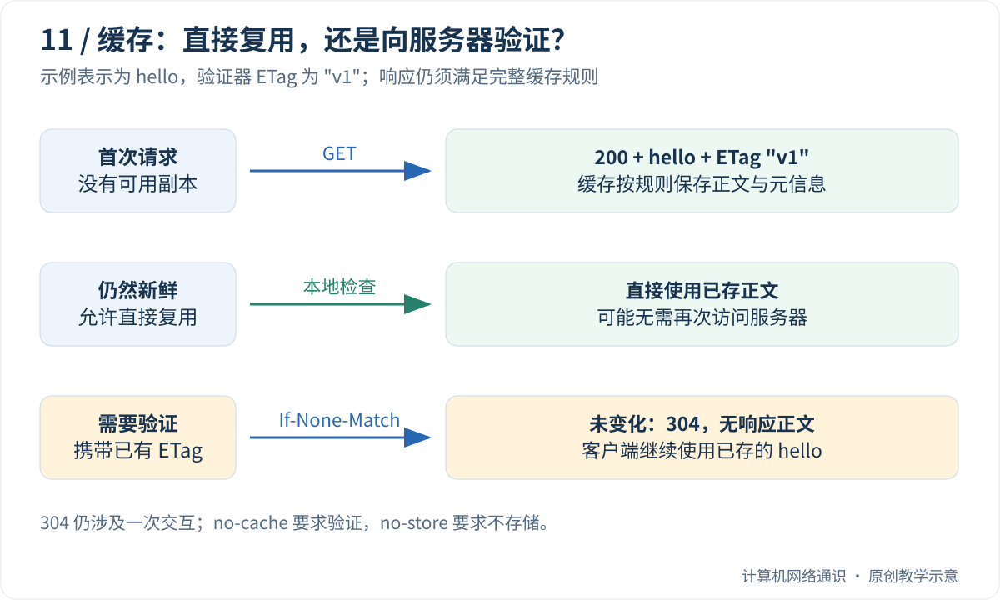

在前几篇中，我们穿越了底层光纤与传输层的复杂迷宫。TCP 已经向我们郑重承诺：只要信道建立，字节流就会毫无差错、按序到达。

然而，TCP 是一个完全面向裸字节的协议，它根本不知道“网页”、“图片”、“JSON 数据”是什么东西。

真正赋予这串字节以丰富人类世界业务含义的，正是现代互联网最核心的通用语言——**超文本传输协议（HyperText Transfer Protocol，简称 HTTP）**。

- 当浏览器弹出 `404 Not Found` 时，这代表网线拔了吗？
- 为什么在控制台看到大量 `304 Not Modified`，前端架构师反而会喜笑颜开？
- 动态生成的万字长文在无法预知文件总大小的情况下，HTTP 是如何依靠 **`Transfer-Encoding: chunked` 分块编码** 精准裁决消息边界的？
- 现代 Web 性能优化的核心支柱——**强缓存（Cache-Control）** 与 **协商缓存（ETag / 304）**，是如何在底层让全球 CDN 节约下数以百 PB 计的骨干网带宽的？

本文将全面解构 HTTP/1.1 报文的纯文本格式，梳理状态码与方法语义，并深度推导现代 Web 双层缓存协商的物理执行流水线。

## Table of contents

## 第一章：纯文本的力量——HTTP/1.1 报文结构解剖

HTTP 诞生之初最令人惊叹的特性，在于它的**完全人类可读性（Human-Readable）**。它没有复杂的二进制私有编解码，所有的指令全部是由最朴素的 ASCII 文本拼装而成的。

### 1. HTTP 请求报文四部曲

客户端向服务器发出的请求报文，在结构上严格包含四个部分：

```text
+---------------------------------------------------------------------------------+
| 请求行 (Request Line):  GET /index.html HTTP/1.1                                |
+---------------------------------------------------------------------------------+
| 请求头 (Headers):       Host: example.com                                       |
|                         User-Agent: Mozilla/5.0 ...                             |
|                         Accept: text/html,application/xhtml+xml                 |
+---------------------------------------------------------------------------------+
| 空行 (CRLF: \r\n):      ⭐️ 核心定界符！宣告所有键值对头部彻底结束！               |
+---------------------------------------------------------------------------------+
| 请求数据 (Body):        (可选，GET 请求通常无 Body，POST 请求存放表单或 JSON 数据) |
+---------------------------------------------------------------------------------+
```

- **请求行**：由三部分构成，中间严格用空格隔开：
  `请求方法（Method） + 请求资源路径（URI） + 协议版本（HTTP Version）`；
- **空行（`\r\n`，即连续两个字符 `0x0D 0x0A`）**：
  这是 HTTP 协议中最关键的物理边界！解析器在底层单字节扫描，只要撞见连续的 `\r\n\r\n`，立刻断定所有的元数据 Headers 已经全部接收完毕，紧随其后的便是纯粹的业务载荷（Body）！

### 2. HTTP 响应报文四部曲

服务器处理完毕后，回送的响应报文结构完全对称：

```text
+---------------------------------------------------------------------------------+
| 状态行 (Status Line):   HTTP/1.1 200 OK                                         |
+---------------------------------------------------------------------------------+
| 响应头 (Headers):       Content-Type: text/html; charset=UTF-8                  |
|                         Content-Length: 1256                                    |
|                         Cache-Control: max-age=3600                             |
+---------------------------------------------------------------------------------+
| 空行 (CRLF: \r\n):      宣告响应头结束                                          |
+---------------------------------------------------------------------------------+
| 响应正文 (Body):        真实的 HTML 页面、PNG 图片二进制流或 JSON 字符串          |
+---------------------------------------------------------------------------------+
```

- **状态行**：
  `协议版本 + 3位状态码（Status Code） + 状态描述短语（Reason Phrase）`。

---

## 第二章：核心方法与状态码五大家族

### 1. 核心请求方法的语义学边界

HTTP 的方法设计，高度契合 RESTful 架构风格：

| 请求方法     | 核心业务语义                           |            安全性（Safe）            |             幂等性（Idempotent）             | 典型应用场景                         |
| :----------- | :------------------------------------- | :----------------------------------: | :------------------------------------------: | :----------------------------------- |
| **`GET`**    | 获取由 Request-URI 指定的资源          | **是**（只读操作，不改变服务器状态） |    **是**（执行一次与执行 10 次效果一致）    | 浏览网页、拉取商品详情、下载静态文件 |
| **`POST`**   | 向指定资源提交数据，通常创建新子资源   |      **否**（会改变服务器数据）      |    **否**（多次提交可能生成多个重复订单）    | 提交用户注册表单、完成支付下单       |
| **`PUT`**    | 全量覆盖替换目标资源（若不存在则创建） |                **否**                |  **是**（多次上传同一份头像，状态保持一致）  | 用户全量资料更新、文件上传覆写       |
| **`DELETE`** | 删除指定的物理或逻辑资源               |                **否**                | **是**（删一次和删多次，资源均处于已删除态） | 注销账号、删除购物车条目             |

### 2. 状态码（Status Code）五大家族全景

状态码是一个 3 位的整数，首位数字直接锚定了响应的宏观性质：

```text
1xx (信息提示): 协议握手中继 ────> 101 Switching Protocols (协议升级，如握手转为 WebSocket)
2xx (成功响应): 业务圆满达成 ────> 200 OK, 204 No Content, 206 Partial Content (断点续传)
3xx (重定向态): 资源发生位移 ────> 301 永久重定向 (SEO 权重转移), 302 临时重定向, 304 缓存未修改
4xx (客户端错): 前端参数有误 ────> 400 Bad Request, 401 未认证, 403 权限拒绝, 404 资源不存在
5xx (服务端错): 后端系统崩溃 ────> 500 内部异常, 502 Bad Gateway (网关宕机), 504 Gateway Timeout
```

#### 经典工业级排障辨析：502 vs 504

这是后端高并发运维中最著名的两对兄弟报错：

- **`502 Bad Gateway`**：边缘反向代理（如 Nginx）还活着，但当它尝试把请求转发给后端的业务应用（如 Java Spring Boot 或 Python Gunicorn）时，**发现后端的进程已经由于 OOM 崩溃宕机，或者网络套接字被拒绝**！代理无法连接上游，立刻抛出 502！
- **`504 Gateway Timeout`**：代理成功连接上了后端的业务进程，但**后端业务代码正在执行疯狂的全表扫描慢查询、或者陷入死锁**，代理苦苦等待了 60 秒依然没有收到一个字节的回复，最终代理耗尽耐心超时放弃，抛出 504！

---

## 第三章：消息边界的物理裁决——Content-Length 与 Chunked

我们在第 8 篇深入推导过：TCP 是一个无边界的自来水式字节流。
那么，在长连接（`Connection: keep-alive`）复用同一个 TCP 连接传输多个 HTTP 请求的场景下，**浏览器在读完第一个网页的 HTML 后，怎么知道“当前这个响应到哪里算彻底结束”，从而不会错误地把下一个响应的开头吞进去？**

HTTP/1.1 提供了两套终极裁决方案：

### 方案一：`Content-Length`（定长提前宣告）

如果服务端在发送前，就已经完全知道了内容的精确大小（例如静态硬盘文件）：

```http
Content-Length: 1256
```

浏览器在读取完 `\r\n\r\n` 空行后，**严格向后计数读取刚好 1256 个字节**！多一个不要，少一个继续等。计数一满，当前响应立刻宣告闭环截断！

### 方案二：`Transfer-Encoding: chunked`（分块传输编码）

如果服务端正在处理动态数据（例如边查数据库边流式返回几百万条流水报表），或者执行大模型 Token 流式打字机输出：
**服务端在开始输出时，根本无法预知总大小是多少！如果等全算完再填 `Content-Length`，用户就要在空白屏幕前死等数分钟！**

> **分块传输（Chunked）的物理机制**：
>
> 服务端声明：`Transfer-Encoding: chunked`，不再提供 `Content-Length`！
> 随后，数据被拆解为一个接一个的独立小数据块输出，每一块的格式严格遵循：
>
> $$\text{当前分块长度的十六进制表示} + \text{\textbackslash r\textbackslash n} + \text{当前分块的数据内容} + \text{\textbackslash r\textbackslash n}$$
>
> **终结哨兵标记**：
> 当整个动态数据彻底流式发射完毕时，服务端最后发送一个**长度为 0 的特殊分块**：
> `0\r\n\r\n`！
> 浏览器读到长度为 0，立刻断定流式会话圆满结束！

---

## 第四章：现代 Web 性能引擎——双层缓存机制（强缓存 vs 协商缓存）

如果在每次打开网页、每次看到网站 Logo 时，浏览器都要重新发送一次完整的 HTTP 网络请求，全球的互联网骨干网早就会被重复流量冲垮。

HTTP 构建了人类软件工程中最精妙的**双层缓存体系**：



### 1. 第一层防线：强缓存（Cache-Control）——完全不发网络请求！

强缓存是最彻底的性能优化。浏览器在命中强缓存时，**根本不会向服务器发送任何网络报文，直接从本机内存或磁盘读取数据，响应状态码显示为 `200 OK (from memory cache)`，耗时为 0 毫秒！**

- **现代标准标配：`Cache-Control`**：
  ```http
  Cache-Control: max-age=31536000, public
  ```
  `max-age` 明确规定了该资源在本地能够生存的秒数（如 1 年）。在倒计时结束前，浏览器坚决直接读缓存！
- **易混淆指令深度剖析**：
  - **`no-cache`**：**并不代表“不缓存”！** 它的真正含义是：可以在本地缓存，**但每次使用前，必须向服务端发送请求进行“协商缓存验证”！确认未修改才能用！**
  - **`no-store`**：**这才是真正的“绝对不缓存”！** 严禁任何浏览器、CDN 节点在任何磁盘或内存中保留该内容的备份（专用于高敏感银行账单、密码通信）。

---

### 2. 第二层防线：协商缓存（Conditional Request）——轻量级 304

当强缓存的倒计时归零过期时，浏览器并不一定必须重新全量下载整个几十兆的大文件。
因为这个文件在服务器端**可能根本没有发生过任何改动！**

浏览器会携带当前缓存文件的特征标记，向服务器发起一次**条件请求（Conditional Request）**：

#### 机制 A：基于最后修改时间（Last-Modified / If-Modified-Since）

1. 服务器当初响应时，提供字段：`Last-Modified: Wed, 21 Oct 2026 07:28:00 GMT`；
2. 缓存过期后，浏览器发起请求，自动带上：
   `If-Modified-Since: Wed, 21 Oct 2026 07:28:00 GMT`；
3. 服务器比对文件实际修改时间。若没变，服务器**直接回复极简的 `304 Not Modified`，不带任何正文数据！** 浏览器继续复用本地旧文件！

**局限性**：时间精度只到秒级；且如果文件被打开保存但内容没变，修改时间变了会导致缓存失效。

#### 机制 B：基于内容指纹哈希（ETag / If-None-Match）⭐️ 强一致性王者

1. 服务器根据文件的物理内容做哈希（如 MD5 / SHA-1），生成专属的“内容指纹”并返回：
   `ETag: "686897696a7c876b7e"`；
2. 缓存过期后，浏览器发送条件请求：
   `If-None-Match: "686897696a7c876b7e"`；
3. 服务器比对当前最新文件的哈希值：
   - **内容完全一致**：服务器**秒级返回 `304 Not Modified`**，响应头仅有几十字节，极速刷新！
   - **内容发生改动**：服务器返回标准的 `200 OK`，并将最新的文件载荷与全新 ETag 重新全量下发！

---

## 总结与专栏全局视野

在本篇《计算机网络通识（十一）》中，我们解开了应用层 Web 交互的全部密码：

1. **纯文本协议解构**：推导了请求行、状态行、Headers 与以 `\r\n\r\n` 作为终极分界线的物理构造；
2. **状态与语义大盘**：厘清了核心方法的幂等安全边界，透视了从 200、304 到 404、502/504 的分层排障法眼；
3. **流式分帧双轨**：掌握了静态内容 `Content-Length` 与动态流式大模型输出 `Transfer-Encoding: chunked` 的定界艺术；
4. **性能双层护城河**：深入剖析了强缓存 `Cache-Control` 零网络消耗秒开，以及协商缓存通过 `ETag` 与 `304` 实现全网带宽极致节约的底层运转逻辑。

然而，HTTP/1.1 虽然直观易读，却有一个致命的阿喀琉斯之踵：**它是完全明文传输的！**

- 任何人只要在路由器上挂载一个抓包程序，你的账号密码、聊天记录全部在光纤中裸奔；
- **HTTPS 是如何利用非对称加密的数学奇迹、对称加密的高性能，以及 CA 数字证书链的信任背书，在充满敌意的互联网中构筑起防窃听、防篡改的坚固壁垒的？**

让我们正式迈向专栏的第十二篇核心力作：**[《HTTPS 怎样让通信变得可信？》](/blog/posts/how-https-and-tls-establish-trust/)**！
