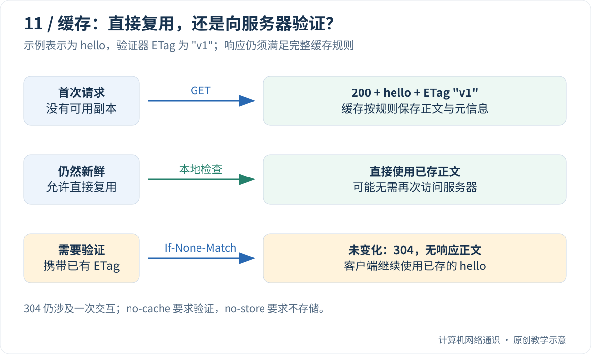

浏览器向网站要一篇文章，服务器怎样知道你要哪篇？找到了怎样回答，找不到又怎样回答？这些问题由 HTTP 这套应用层约定来表达。

前几篇讲“把字节送过去”，本篇开始讲“送过去的字节是什么意思”。我们先把请求和响应翻译成日常句子，再逐行读消息，最后观察缓存。没有编程基础也可以直接用浏览器完成主要练习。

## Table of contents

## HTTP 交流的基本单位：请求和响应

**HTTP** 是浏览器与网站广泛使用的协议。**应用层** 表示它面向程序要完成的任务，例如获取文章、提交表单；它不负责替代网线、IP 寻址或 TCP 的字节顺序。

客户端主动发出的消息叫请求，服务器对请求作出的消息叫响应。先看没有语法细节的一轮交流：

```text
请求：请给我 /notes/network 这份资源，我希望收到文字。
响应：找到了；内容是文字，共 5 字节；正文为 hello。
```

**资源** 不一定是磁盘上的同名文件。`/weather` 可能由程序即时生成天气数据；`/avatar.png` 可能读取图片；同一个入口也可能按查询参数返回不同结果。URL 里的路径是应用解释的标识，不必等于服务器真实文件夹路径。

**消息体或正文** 是消息携带的实际内容。**首部字段** 则是描述这次消息的附加说明，例如内容类型、长度、缓存规则。你可以把“这是一张 PNG 图片”看作说明，把图片字节看作正文。

## 请求里的三个问题：做什么、对什么做、还有什么条件？

假设请求第一行写 `GET /notes/network?lang=zh HTTP/1.1`：

- `GET` 是方法，表示请求取得资源的表示。这里可以先理解为“请给我内容”。
- `/notes/network?lang=zh` 指明目标；路径后面的查询参数可以表达应用约定的条件，例如语言。
- `HTTP/1.1` 是协议版本，告诉对方这条消息按什么格式解释。

接下来的 `Host: example.com` 指明目标主机。一个服务器入口可能承载多个网站，所以即使已连到同一个 IP，也还需要知道你要访问哪个网站。`Accept: text/plain` 表达客户端愿意接收的内容类型，不是强迫服务器必须接受这项要求。

空行表示首部结束。某些请求还会带正文，例如提交表单；但后面那个 GET 示例没有正文。我们用 HTTP/1.1 的文本形式学习语义，HTTP/2、HTTP/3 不会原样逐行在网上发送这段文本。

## 看到状态码，先问服务回答了什么

响应里的三个数字叫 **状态码**。它把处理结果用机器可以判断的形式表达出来。先记常见的几种，不必背完整清单：

| 状态      | 读成一句话                           | 下一步先看什么             |
| --------- | ------------------------------------ | -------------------------- |
| 200       | 本次请求成功处理，按响应语义读取内容 | 正文及应用结果是否符合预期 |
| 301 / 302 | 需要到其他位置继续请求               | 响应的 Location 字段       |
| 401 / 403 | 身份认证或访问许可有问题             | 登录、凭据与权限           |
| 404       | 响应者没有提供这个目标资源           | 域名、路径与路由配置       |
| 500       | 服务器处理时发生内部错误             | 服务端日志                 |

收到 404 与根本收不到服务器回应完全不同。前者像工作人员明确答复“没有这份材料”，后者像电话迟迟没有人接；二者不应使用同一套排查步骤。

不过响应也可能来自代理，状态码还不是整条请求链的完整证据。200 也只表达 HTTP 层的结果，某些业务会在正文里另写自己的错误码。

## 缓存从头演示：同一份文章为什么不必总下载？

**缓存** 是把已经得到的结果暂存，后续满足规则时复用。浏览器缓存放在用户这一侧；代理缓存可以服务多人。是否允许复用，必须看响应指示和请求条件，不能只因为两个网址长得一样就随意共用。

设一篇文章的正文是 `hello`，服务器给它标记版本 `"v1"`，并声明新鲜期 60 秒。

1. 第一次访问：浏览器没有副本，发请求，得到 200 和正文，保存正文与版本信息。
2. 20 秒后再次访问：若其他规则也允许，副本仍够新，浏览器可以直接复用，不必重新下载。
3. 70 秒后再次访问：副本已经不在新鲜期内，但不代表一定变了。浏览器可问“我有 v1，你那里还一样吗？”
4. 若仍一样：服务器返回 304，浏览器继续使用保存的正文。304 没有把 `hello` 再发一次，所以它省的是正文，不是这次询问的往返。
5. 若已变：服务器返回新的 200、正文和验证信息，浏览器更新副本。

**ETag** 就是一种版本验证器；`If-None-Match` 用来把已保存的标记带回询问。它不必是人能读懂的版本号，也不一定是文件哈希。

## 名字最容易误导的两个缓存指令

`no-cache` 不等于“完全不存”。它要求复用之前进行验证。`no-store` 才是要求不存储相应消息。把二者混用，会造成完全不同的网络行为。

`private` 则涉及谁可以保存：通常限制共享缓存，而仍可能允许用户自己的私有缓存。想象个人账单，不能因为缓存能提速，就让一个人的响应被其他人复用。

下面进入精确消息和方法表。看见“幂等”时，把它读成“相同请求重复执行，预期效果与执行一次相同”；它不要求每次响应一字不差。第一次可先跳过分块编码，直接做缓存观察。

## 一次请求在问什么？

考虑一条教学请求，实际 HTTP/1.1 行结束使用 CRLF：

```http
GET /notes/network?lang=zh HTTP/1.1
Host: example.com
Accept: text/plain

```

`GET` 是方法，`/notes/network?lang=zh` 是请求目标，`Host` 帮助服务器区分目标主机。空行结束字段部分；这个请求没有消息体。URL 中的 `#fragment` 一般留给浏览器处理，不会放进这里的请求目标。

服务器可能返回：

```http
HTTP/1.1 200 OK
Content-Type: text/plain; charset=utf-8
Content-Length: 5
Cache-Control: max-age=60
ETag: "v1"

hello
```

这里示意消息体是恰好五个 ASCII 字节 `hello`，不包含展示排版带来的末尾换行。`Content-Type` 表达内容类型，`Content-Length` 以字节为单位描述长度，ETag 则是表示版本的验证器，不必一定是文件哈希。

同样是 `200`，正文可以是图片、HTML 或 JSON。状态码告诉客户端如何解释这次 HTTP 处理结果，不代替业务内容的完整协议。

## 方法描述语义，不只是接口命名风格

| 方法   | 常见语义                              | 容易误解的地方                               |
| :----- | :------------------------------------ | :------------------------------------------- |
| GET    | 获取选定资源的表示                    | 不应把它设计成执行扣款等用户请求的状态变更   |
| HEAD   | 获取与 GET 对应的响应元信息，不传正文 | Content-Length 可以描述 GET 本来会返回的长度 |
| POST   | 将内容交给资源按自身规则处理          | 不天然保证幂等，也不天然更安全               |
| PUT    | 创建或替换目标资源的状态              | 重复执行的预期效果应符合幂等语义             |
| DELETE | 请求移除目标资源的关联                | 两次响应码可以不同，不否定幂等性             |

“安全方法”在 HTTP 中是语义术语，指客户端没有请求改变资源状态；不表示绝无日志、计数等副作用，更不表示传输加密。“幂等”关注重复请求的预期效果，不要求每次返回完全相同的状态码或时间戳。相关定义见 [RFC 9110](https://www.rfc-editor.org/rfc/rfc9110.html)。

因此，重试要结合方法语义、应用实现和请求标识。即便方法通常幂等，也仍需考虑权限、资源版本和并发修改。

## 状态码是分层排障的线索

收到正常可解析的 404，至少说明某个 HTTP 响应者已经回答；它可能是源站，也可能是代理或 CDN。此时优先检查路径、主机名和路由规则，比重新检查网线更有针对性。

| 类别 | 大致含义               | 示例               |
| :--- | :--------------------- | :----------------- |
| 2xx  | 请求成功处理           | 200、201、204      |
| 3xx  | 重定向或其他进一步处理 | 301、302、304      |
| 4xx  | 请求存在相关问题       | 400、401、403、404 |
| 5xx  | 服务端或网关处理失败   | 500、502、503、504 |

304 有特殊用途：对于条件 GET 或 HEAD，服务端说明选定表示没有变化，客户端可以复用已有内容。它不是“拿到一份空白页面”，也不应该被浏览器当成需要直接展示的正文。

某个业务接口把错误写进 200 的 JSON 中，是应用设计选择；这不意味着所有 200 都能证明业务成功。观测时应同时记录 HTTP 状态和应用错误字段。

## 进阶：长连接怎样知道上一条响应结束了？

如果一条 TCP 连接可以传多次 HTTP 交互，就不能总依赖断开连接来划分消息。HTTP/1.1 有自己的边界规则，例如有效的 `Content-Length`，或适用情况下的分块传输编码。

```http
Transfer-Encoding: chunked

5
hello
0

```

这是省略了其他字段的教学片段；分块长度用十六进制，真实行结束仍是 CRLF。终止块以及可能的 trailer 部分有专门规则，不能仅搜索一个字符 `0` 就判断结束。

不同方法和响应状态也会影响正文是否存在。实现解析器必须遵守 [RFC 9112](https://www.rfc-editor.org/rfc/rfc9112.html)的优先规则，不能把“遇到空行后都是正文”或“永远相信 Content-Length”当成通用算法。实际开发应使用成熟 HTTP 库，不在几行字符串切分代码上承载生产入口。

HTTP/1.1 默认可以使用持久连接，但服务端、客户端或中间设备仍可关闭它。连接池保留的连接也可能已经失效；连接复用不意味着无限期存活。

## 缓存要分成“够新吗”和“变了吗”

缓存首先考虑能否直接复用：例如响应仍在 `max-age` 指定的新鲜期内，且满足其他缓存规则，可能无需再次访问服务器。

需要验证时，客户端可以带上 `If-None-Match: "v1"`。若表示仍匹配，服务端返回 304；若变化，则返回新的 200 和正文。前者省下的是正文传输，不是所有网络往返。



[MDN 的缓存指南](https://developer.mozilla.org/en-US/docs/Web/HTTP/Guides/Caching)特别适合对照几个容易混淆的字段：`no-cache` 允许存储，但复用前需要验证；`no-store` 要求不存储；`private` 限制共享缓存存储，仍可能允许用户自己的私有缓存。

如果同一 URL 根据 `Accept-Language` 产生不同语言，缓存还需要知道响应在哪些请求字段上变化，`Vary` 就用于表达这种选择维度。把不同用户的个性化内容错误地放入公共共享缓存，比缓存命中率低更严重。

## 不写代码的观察：在浏览器里读一次响应

用 Chrome 或 Edge 打开本博客，按 `F12` 打开开发者工具，选“网络 / Network”，再刷新页面。点击主文档或某张图片的一行，在“标头 / Headers”中寻找请求方法、状态码和 `Content-Type`。

再留意 `Cache-Control`、`ETag`、`Last-Modified` 等字段。并非每个资源都提供全部字段；没有 ETag 不等于没有任何缓存机制。刷新一次，记录是重新取得 200、出现 304，还是显示来自内存或磁盘缓存。

不同站点和浏览器动作会改变结果，因此这个观察不要求一定出现 304。下面的本机程序才是专门制造 200→304 这组条件的确定性演示。

## 可选编程实验：本机观察 200 和 304

保存为 `http_cache.py`，运行方式见[Python 准备说明](/blog/posts/understanding-ports-and-sockets/#可选编程实验的准备怎样运行本系列的-python-代码)。先不用逐行理解类和线程，只抓执行顺序：启动本地服务；发第一次请求并保存正文与 ETag；带着 ETag 发第二次；收到 304 后复用第一次的正文；最后停止服务。

代码中 `Handler` 描述服务器如何答复，`HTTPConnection` 扮演客户端，`Thread` 让服务能在后台接待请求。这些编程结构不是 HTTP 协议要求每个程序都必须照用的写法。

下面程序只监听回环地址，由客户端显式发送条件请求。它不是完整缓存实现，也不会自动下载外部内容。

```python
from contextlib import closing
from http.client import HTTPConnection
from http.server import BaseHTTPRequestHandler, ThreadingHTTPServer
from threading import Thread


class Handler(BaseHTTPRequestHandler):
    protocol_version = "HTTP/1.1"

    def do_GET(self):
        unchanged = self.headers.get("If-None-Match") == '"v1"'
        self.send_response(304 if unchanged else 200)
        self.send_header("ETag", '"v1"')
        self.send_header("Cache-Control", "max-age=0")
        if not unchanged:
            self.send_header("Content-Type", "text/plain")
            self.send_header("Content-Length", "5")
        self.end_headers()
        if not unchanged:
            self.wfile.write(b"hello")

    def log_message(self, *args):
        pass


server = ThreadingHTTPServer(("127.0.0.1", 0), Handler)
worker = Thread(target=server.serve_forever, daemon=True)
worker.start()
try:
    with closing(HTTPConnection(*server.server_address, timeout=2)) as client:
        client.request("GET", "/")
        first = client.getresponse()
        saved_body = first.read()
        etag = first.getheader("ETag")
        print(first.status, saved_body)

        client.request("GET", "/", headers={"If-None-Match": etag})
        second = client.getresponse()
        print(second.status, second.read())
        if second.status == 304:
            print("reuse:", saved_body)
finally:
    server.shutdown()
    server.server_close()
    worker.join()
```

预期输出：

```text
200 b'hello'
304 b''
reuse: b'hello'
```

第一次正文被保存，第二次响应没有正文，我们显式复用旧内容。若把请求中的 ETag 改成 `"different"`，这个教学服务会重新返回 200。

该服务没有通用的资源选择、认证、弱验证器解析或完整条件请求逻辑。它只演示本例的一个 ETag；真实服务应由框架实现完整规则，缓存行为以 [RFC 9111](https://www.rfc-editor.org/rfc/rfc9111.html)为准。

## 在浏览器里把概念接起来

打开自己的网站，在开发者工具 Network 面板检查方法、状态、协议和字段。先观察正常刷新，再开启 Disable cache 做对照；注意该选项的生效条件与浏览器有关。

内存缓存、磁盘缓存、Service Worker 和网络 304 不是同一种来源。不要看见“页面瞬间出来”就认定没有网络，也不要看见 304 就把缓存命中理解成完全不访问服务端。

最后回到开头的问题：404 说明收到了 HTTP 层回应；304 需要结合已有缓存解释；长连接则允许多次请求复用传输连接。三个现象属于不同机制，分开观察才不会互相误导。

## 读完后，用自己的话试着解释

收到 304 后，为什么浏览器还能显示完整文章？它是否意味着这次完全没有网络往返？

<details>
<summary>展开参考答案</summary>
<div class="mt-4 leading-7">浏览器已有保存的正文，304 告诉它相应表示未改变，可以按规则复用。这个条件请求仍经历了询问与响应，只是没有重复传输正文。</div>
</details>

上一篇：[TCP 连接怎样结束](/blog/posts/how-tcp-connections-close/)

下一篇：[HTTPS 怎样让通信可信](/blog/posts/how-https-and-tls-establish-trust/)

## 参考与延伸阅读

- [RFC 9110](https://www.rfc-editor.org/rfc/rfc9110.html)——HTTP 语义。
- [RFC 9112](https://www.rfc-editor.org/rfc/rfc9112.html)——HTTP/1.1 消息格式与边界。
- [RFC 9111](https://www.rfc-editor.org/rfc/rfc9111.html)——缓存规则。
- [MDN：HTTP caching](https://developer.mozilla.org/en-US/docs/Web/HTTP/Guides/Caching)——新鲜度、验证和缓存控制的实例。
