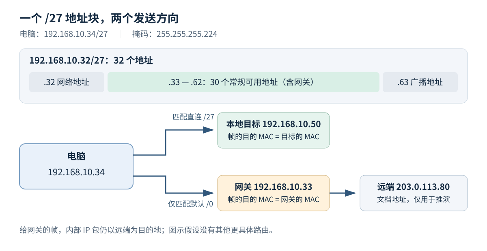

网络设置里的“IP 地址、子网掩码、默认网关”看上去都是几组数字，很容易被当作必须照抄的密码。它们其实分别在说明：接口使用什么地址、哪些地址通常在本地、去其他地方可以先交给谁。

本篇从最容易看懂的 `/24` 开始，再走到 `/27`。不会二进制也可以读，下面会用八个位置一步步算。我们只在纸上和程序中验证，不需要修改你的真实网络设置。

## Table of contents

## 第一遍先看 /24，不急着背公式

假设你的电脑配置如下：

```text
本机地址：192.168.10.34
子网掩码：255.255.255.0
默认网关：192.168.10.1
```

在这个简单配置中，掩码表示前 24 个二进制位属于网络前缀，也就是前三组数字用于确定网络。因此，`192.168.10.50` 与本机在同一个 `/24` 地址范围，`192.168.11.50` 则在另一个范围。

把地址与前缀长度合写，就得到 `192.168.10.34/24`。斜线后面的 24 不是端口、设备数量，也不是除法，它是在说“前面多少位属于网络前缀”。

如果本机只有通常的本地路由和默认路由，访问前者可尝试本地交付；访问后者则交给默认网关。这只是帮助理解的最小配置，真正选择路径时，系统仍以路由表为准。

**默认网关** 是默认路由指向的下一站，通常是路由器在你这个本地网络里的接口地址。它不是 DNS 服务器，也不是互联网的总地址。家里的盒子可能同时提供多种服务，但各字段的含义仍不同。

## 为什么每组数字最多是 255？

IPv4 使用 32 个二进制位表示地址，每 8 位分成一组，于是显示为四组十进制数。二进制只使用 0 和 1；一个 8 位数，从右到左每个位置的权重依次是 1、2、4、8、16、32、64、128。

```text
从左向右的权重：128  64  32  16   8   4   2   1
数字 34 的各位：  0   0   1   0   0   0   1   0
把为 1 的权重相加：32 + 2 = 34
所以 34 写成八位二进制：00100010
```

八位全为 0，值是 0；八位全为 1，值是 `128+64+32+16+8+4+2+1=255`。因此四组中的每组都只能在 0 到 255 之间。点号只是显示时的分隔符，地址内部仍然是连续的 32 位。

同样，255 写成 `11111111`，224 写成 `11100000`。后面计算掩码时就会用到这两个数字。

## 掩码怎样把网络部分“留下来”？

可以拿一张写着八个 0 或 1 的透明纸作比喻：纸上为 1 的位置保留原地址那一位，为 0 的位置全部清零。这对应按位与运算，英文 AND。

| 原地址这一位 | 掩码这一位 | 结果 |
| ------------ | ---------- | ---- |
| 0            | 0          | 0    |
| 1            | 0          | 0    |
| 0            | 1          | 0    |
| 1            | 1          | 1    |

例如 `/24` 的掩码有连续 24 个 1，后面 8 个 0，写成 `255.255.255.0`。它保留地址的前三组，把最后一组清零，因此 `192.168.10.34` 对应的网络地址是 `192.168.10.0`。

**网络地址** 用来表示整个地址块；**接口地址** 是配置给具体接口使用的地址。不要把计算出的网络地址填成电脑地址。本篇讨论的普通 IPv4 广播子网，还通常保留地址块最后一个地址作为广播地址。

## 从 /24 缩小到 /27，发生了什么？

`/24` 给块内编号留下 8 位，共有 `2^8=256` 种组合。`/27` 多拿走 3 位作为网络前缀，只给块内编号留下 `32-27=5` 位，共有 `2^5=32` 种组合。指数的意思只是“连续乘”：`2^5=2×2×2×2×2`。

因此，一个 `/24` 地址块可以划成八个 `/27` 地址块。最后一组的范围依次是：

```text
  0—31      32—63      64—95       96—127
128—159    160—191    192—223     224—255
```

地址 `.34` 落在第二块，`.50` 也落在第二块，`.70` 则已经进入第三块。这里不需要猜测，也不需要背“192 开头是什么类地址”，只要看给定前缀。

这也解释了一个看似反常的结论：**前缀数字越大，单个地址块越小。** 因为固定的位置越多，可变化的位置越少。`/27` 比 `/24` 描述的范围更具体。

接下来把这套方法应用到 `192.168.10.34/27`，再讨论网关。可以一边读一边用纸写下“本机地址、网络范围、下一站”三行，避免把三者混在一起。

## 先把地址看成接口的配置

IPv4 地址有 32 位。为了方便阅读，我们每 8 位分成一组，写成四个十进制数，例如 `192.168.10.34`。每组的取值是 0 到 255。

日常说“这台电脑的 IP”，是一种简写。更准确地说，地址配置在网络接口上：有线网卡、无线网卡、VPN 虚拟接口，都可能拥有自己的地址；一个接口也可以配置多个地址。电脑换个网络，地址可能变化，因此 IP 不能当作设备终身不变的身份证。

只知道 `192.168.10.34`，还不能知道它所在网络有多大。我们还需要一个前缀长度：

```text
192.168.10.34/27
              ↑ 前 27 位作为网络前缀，剩下 5 位在块内编号
```

`192.168.10.34/27` 是接口地址及其前缀长度；稍后算出的 `192.168.10.32/27` 才是它所属的网络前缀。两种写法含义不同，不能把电脑自己的地址直接当成网络地址。

## 掩码不是另一台机器的地址

前缀长度 `/27` 可以写成子网掩码 `255.255.255.224`。它的二进制形式为：

```text
11111111.11111111.11111111.11100000
└──────────── 前 27 位为 1 ────────────┘
```

掩码里的 1 表示保留网络位，0 表示清除主机位。把地址与掩码逐位做 AND（按位与），就能得到网络地址。AND 的规则很简单：两位都是 1，结果才是 1。

前面三个字节在本例中全部保留，只需要展开最后一个字节：

```text
地址最后一组： 34 = 00100010
掩码最后一组：224 = 11100000
按位与结果：  32 = 00100000
```

所以网络地址是 `192.168.10.32`。同一前缀内的地址，前 27 位相同，后 5 位可以变化；把后 5 位全部置 1，就得到广播地址 `192.168.10.63`。

[Cloudflare 的子网入门页](https://www.cloudflare.com/learning/network-layer/what-is-a-subnet/) 适合用来建立“一个大网络可以划分为更小网络”的直觉。这里需要补充一个阅读提醒：不要把其中的历史分类解释当成今天推算掩码的规则。

现代配置使用 CIDR，也就是无类别域间路由所采用的前缀表示法。**看到 192 开头，不能直接断言它的掩码一定是 `/24`。** 历史上的 A、B、C 类地址可以帮助理解演进过程，但实际网络边界要看明确给出的前缀长度。[RFC 4632 第 3.1 节](https://www.rfc-editor.org/rfc/rfc4632.html#section-3.1) 说明了这一表示方法。

## 亲手算出一个 /27 网络

`/27` 留下 5 位，因此整个地址块包含 `2^5 = 32` 个地址。最后一个字节中的块边界依次是 0、32、64、96……`34` 落在 32 到 63 这一块。

| 项目             | 本例的结果                      | 含义                           |
| ---------------- | ------------------------------- | ------------------------------ |
| 接口地址         | `192.168.10.34/27`              | 分配给这台电脑的接口           |
| 子网掩码         | `255.255.255.224`               | 前 27 位是网络位               |
| 网络前缀         | `192.168.10.32/27`              | 表示整个地址块                 |
| 广播地址         | `192.168.10.63`                 | 本子网的定向广播地址           |
| 常规可用主机范围 | `192.168.10.33`—`192.168.10.62` | 共 30 个地址，网关也占其中一个 |

不能因为这里的网关用了 `.33`，就认为网关必须使用第一个可用地址。它也可以使用 `.62`，只要路由器、主机配置和网络规划一致。家用网络经常使用 `.1`，只是习惯，不是协议规定。



图中的地址块表示逻辑范围，箭头表示本例的发送选择；并不代表所有配置了相同前缀的设备都物理连在一起。

> [!NOTE]
> `2^(32-n) - 2` 是常见 IPv4 广播子网的可用主机数算法，不能套用到所有场景。按 [RFC 3021](https://www.rfc-editor.org/rfc/rfc3021.html)，`/31` 可以用于点对点链路，两端的两个地址都可用；`/32` 表示单个地址，常见于主机路由。IPv6 的地址规则也不按这套广播减二算法处理。

## 同网段直达，跨网段交给谁

先假设这台电脑只有一个参与通信的网卡，没有 VPN，也没有额外配置的特殊路由。它的路由表可以简化成两条：

| 目标前缀           | 下一跳          | 从哪里发出 |
| ------------------ | --------------- | ---------- |
| `192.168.10.32/27` | 直接连接        | 本地网卡   |
| `0.0.0.0/0`        | `192.168.10.33` | 本地网卡   |

这张表是教学示意，真实系统通常还有回环、广播和接口地址等路由。

### 目标是 192.168.10.50

`.50` 落在 `.32` 到 `.63` 内，匹配直连的 `/27` 路由。主机会把它视为链路上的目标，查询邻居缓存，必要时用 ARP 找到 `.50` 的 MAC，然后发送以太网帧。

这次，IP 包的目的地址是 `.50`，帧的目的 MAC 也是 `.50` 对应接口的 MAC。普通交换机可以在二层转发这个帧，不需要先让默认网关做三层转发。

### 目标是 203.0.113.80

这个示意目标不在本地 `/27` 中，表里也没有其他更具体的路由，于是匹配 `0.0.0.0/0`：默认路由。它把包的下一跳指定为 `192.168.10.33`。

电脑接下来解析的是 **网关的 MAC**，不是远端服务器的 MAC。发出的帧可以拆成两层来看：

```text
以太网帧：源 MAC = 电脑的 MAC，目的 MAC = 网关的 MAC
内部 IP 包：源 IP = 192.168.10.34，目的 IP = 203.0.113.80
```

将包交给网关，不等于把 IP 目的地址改成网关。网关收到之后，才能根据仍然保留的远端目的地址继续查路由。这里展示的是从电脑发出的第一跳；后续若经过 NAT，地址可能按 NAT 规则发生改写，那是另一项机制。

### “比较一下是不是同网段”是简化后的理解

操作系统真正做的是查路由表。上面的“同网段直接发送，否则给网关”，来自那两条简单路由，而不是一条适用于所有网络的硬编码规则。

例如连接 VPN 后，系统可能新增指向某个远端网段的路由；它比默认路由更具体，就会优先使用。多网卡、策略路由等情况还会引入更多选择条件。下一篇会展开其中最关键的最长前缀匹配。

在本例这种普通以太网配置中，网关地址还必须能通过本地链路到达。把网关随意写成一个远方地址，并不能让电脑凭空走到那里。反过来，即使配置看起来属于同一个网段，若两台设备被 VLAN、无线客户端隔离或防火墙分开，也不代表它们一定能互通。

## 不写代码也能做的自测

请先遮住答案：电脑是 `192.168.10.34/27`，目标 `.62` 与 `.64` 哪个属于同一地址块？如果访问远方网站，发出的 IP 包目的地址应该写网关，还是写网站地址？

<details>
<summary>展开答案与推理</summary>
<div class="mt-4 leading-7">该地址块是 <code>.32</code> 到 <code>.63</code>，所以 <code>.62</code> 在块内，<code>.64</code> 不在。普通广播子网中 <code>.63</code> 是广播地址，不能因为它在范围内就把它当成普通主机地址。去远方网站时，IP 目的地址仍是网站；当前以太网帧的目的 MAC 才是网关的 MAC。这样网关拆开帧后，还能知道最终目的地。</div>
</details>

## 可选实验：用 Python 验证手算结果

第一次运行 Python 可先看[保存与运行代码的说明](/blog/posts/understanding-ports-and-sockets/#可选编程实验的准备怎样运行本系列的-python-代码)。本节只做地址算术；暂时没有编程环境，可以直接把输出与前面的手算表逐项对照。

下面的代码只使用 Python 标准库，不访问网络，也不修改系统配置。将其保存为 `subnet_demo.py`，再执行 `python subnet_demo.py`：

```python
from ipaddress import ip_address, ip_interface, ip_network

interface = ip_interface("192.168.10.34/27")
network = interface.network
hosts = list(network.hosts())

print("IP:", interface.ip)
print("mask:", network.netmask)
print("network:", network)
print("broadcast:", network.broadcast_address)
print("hosts:", hosts[0], "to", hosts[-1], "count:", len(hosts))

for target in ("192.168.10.50", "192.168.10.70", "203.0.113.80"):
    print(target, "in subnet:", ip_address(target) in network)

for prefix in ("192.168.10.32/31", "192.168.10.34/32"):
    print(prefix, "hosts:", [str(ip) for ip in ip_network(prefix).hosts()])
```

以上代码已实际运行核对，输出如下：

```text
IP: 192.168.10.34
mask: 255.255.255.224
network: 192.168.10.32/27
broadcast: 192.168.10.63
hosts: 192.168.10.33 to 192.168.10.62 count: 30
192.168.10.50 in subnet: True
192.168.10.70 in subnet: False
203.0.113.80 in subnet: False
192.168.10.32/31 hosts: ['192.168.10.32', '192.168.10.33']
192.168.10.34/32 hosts: ['192.168.10.34']
```

注意 `.34` 和 `.70` 的前三组数字完全相同，仍然不属于同一个 `/27`。这正是只盯着前三组数字容易出错的地方。

这个程序验证的是地址计算和集合归属，不是在模拟操作系统的路由选择，更不能证明某个目标可达。这里的小网段可以列出全部主机；处理 `/8` 等大块时，不要为了数地址而把所有地址都展开到列表。

## 在自己的电脑上读懂这些字段

Windows PowerShell 可以用以下只读命令查看配置和 IPv4 路由：

```powershell
Get-NetIPConfiguration
Get-NetRoute -AddressFamily IPv4 |
  Select-Object DestinationPrefix, NextHop, InterfaceAlias, RouteMetric
```

Linux 可以使用：

```bash
ip -4 addr show
ip -4 route show
```

对照阅读时，先找当前使用的接口和地址前缀，再找默认路由。Linux 常以 `default via ... dev ...` 显示默认路由，Windows 则可在 `DestinationPrefix` 为 `0.0.0.0/0` 的条目里查看下一跳。

本节命令供读者在自己的环境观察，未在这里执行真实网络配置采集。你的输出会与前面的自拟地址不同。也不要为了让结果“长得一样”而照抄修改 IP：地址、掩码和网关需要符合所在网络的规划。

一个很有用的判断是：没有默认路由，不代表所有通信都失败。如果同网段的直连路由仍然存在，本地通信仍可能正常；它只是缺少了去往其他未明确列出目的地的兜底路径。

## 私网地址与可达性要分开看

`192.168.10.34` 属于私有地址。常见的三个 IPv4 私有地址块是 `10.0.0.0/8`、`172.16.0.0/12`、`192.168.0.0/16`；它们可以被不同机构重复使用，但在需要互通的范围内仍要避免冲突。定义见 [RFC 1918 第 3 节](https://www.rfc-editor.org/rfc/rfc1918.html#section-3)。

这里还有两个容易混淆的判断。第一，私网地址不等于安全：同网段里的其他设备、配置了互通的 VPN、开放的转发入口，都可能带来访问路径，访问控制仍需要单独设计。第二，拥有公网地址不保证服务可达：还要有正确路由、回程路径、允许通信的防火墙规则，以及实际监听的应用程序。

因此，排查问题时可以按顺序提出三个具体问题：我的接口属于哪个前缀？路由表为目标选择了哪个下一跳？这个下一跳是否真的可达？这些问题比“为什么我的 IP 不通”更容易得到可验证的答案。

## 继续阅读

本文的二进制计算、示意拓扑和 Python 实验均围绕自拟地址编写；Cloudflare 页面用于入门对照，协议边界分别链接到对应 RFC，未复刻第三方图表。

理解了电脑怎样把第一个包交出去，下一步就是沿着这个包往前走：路由器收到它以后，怎样决定下一个出口？

- 上一篇：[两台电脑在同一个局域网里，怎样找到彼此？](/blog/posts/how-devices-communicate-on-a-lan/)
- 下一篇：[一个数据包怎样跨越多个路由器？](/blog/posts/how-packets-travel-across-routers/)
