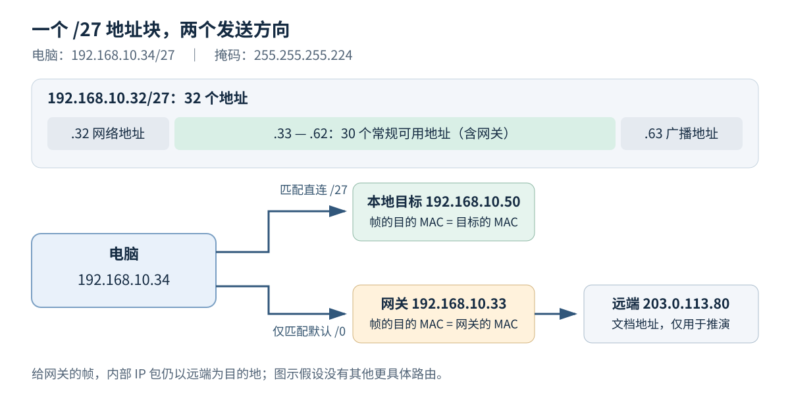

在给电脑配置静态网络时，操作系统的网络设置面板总会强硬地要求我们填写三组并排出现的神秘数字：

1. **IP 地址（IP Address）**
2. **子网掩码（Subnet Mask）**
3. **默认网关（Default Gateway）**

只要有一组填错，电脑要么当场断网，要么只能访问局域网内的打印机却上不了互联网。

在上一篇中，我们掌握了局域网内依靠 MAC 地址与 ARP 广播找到邻居的底层机理。然而，一个更具战略性的前置命题摆在面前：

- 当你在浏览器输入一个 IP 时，电脑网卡**怎么知道对方“就在我身边的同一个局域网”，还是“远在千里之外的另一家数据中心”？**
- 为什么子网掩码不能随便乱填？`/24`、`/27` 这些斜杠记法究竟在数学层面上锁定了什么？
- 电脑在判定目标非本地时，是如何在万分之一秒内做出决策，把数据包精准上缴给**默认网关（Default Gateway）**的？

本文将从 IPv4 的二进制物理结构切入，手把手推导 CIDR 无类编址与子网掩码的按位与（Bitwise AND）运算，并解密主机在本地直连与跨网路由之间的分水岭决策。

## Table of contents

## 第一章：IPv4 地址的解构与有类编址的破灭

在 TCP/IP 协议栈中，网络层（Layer 3）的核心使命是：**在极其错综复杂的全球网状互联拓扑中，寻找一条从源主机通往目标主机的端到端逻辑路径。**

### 1. 32 位二进制的物理现实

我们日常看到的 `192.168.1.1`，只是为了迎合人类记忆习惯而创造的**点分十进制表示法（Dotted Decimal Notation）**。

在操作系统网络栈和路由器的芯片硬件中，**一个 IPv4 地址严格就是一个纯粹的 32 位（4 字节）无符号二进制正整数**！

```text
点分十进制:         192     .     168     .      1      .      1
                    │             │            │             │
32 位二进制:    11000000      10101000     00000001      00000001
               └── 字节 1 ──┘ └── 字节 2 ──┘ └── 字节 3 ──┘ └── 字节 4 ──┘
```

32 位二进制所能表达的最大地址总量为：
$$2^{32} = 4,294,967,296 \text{（约 42.9 亿个）}$$

### 2. 传统有类编址（Classful Addressing）的破灭

在互联网诞生初期（RFC 791），设计者按照前几个比特将 IPv4 地址僵硬地划分为 A、B、C 三类：

- **A 类网络**：前 8 位为网络号，后 24 位为主机号（单个网络可容纳 $2^{24} \approx 1677$ 万台主机！）；
- **B 类网络**：前 16 位为网络号，后 16 位为主机号（单个网络可容纳 $2^{16} = 65536$ 台主机）；
- **C 类网络**：前 24 位为网络号，后 8 位为主机号（单个网络仅能容纳 $2^8 - 2 = 254$ 台主机）。

**历史必然的破灭**：
这种粗放式的划分造成了极其惨烈的不均衡与空间浪费！
一家拥有 500 台电脑的中型企业，申请 C 类地址不够用（254 台上限），申请 B 类地址却会白白浪费掉 65000 多个公网 IP！全球 B 类地址在 1990 年代初濒临彻底枯竭。

---

## 第二章：CIDR 与子网掩码——灵活划分的数学手术刀

为了拯救地址枯竭危机，1993 年互联网工程任务组（IETF）发布了 **无分类域间路由（CIDR，Classless Inter-Domain Routing，RFC 1519）**，彻底废除了僵化的 A/B/C 类划分，并引入了现代网络的基石——**子网掩码（Subnet Mask）**。

### 1. 网络号与主机号的双层结构

在 CIDR 体系中，任意一个 IP 地址被拆解为两个部分：

$$\text{IPv4 地址} = \text{网络号 (Network ID)} + \text{主机号 (Host ID)}$$

- **网络号（前缀，Prefix）**：标识这台主机归属于全球互联网的**哪一个特定子网（网段）**，在路由选择中用于宏观寻路；
- **主机号**：标识这台主机在当前子网内部的**具体设备编号**。

### 2. 子网掩码的本质与斜杠记法（Slash Notation）

那么，一个 32 位的 IP 地址，到底前多少位是网络号、后多少位是主机号？

**必须由子网掩码进行精确圈定！**

> **子网掩码的数学定义**：
>
> **子网掩码同样是一个 32 位二进制数，其特点是：前面全部是连续的 `1`，后面全部是连续的 `0`！**
>
> - **掩码中所有二进制为 `1` 的位**：对应 IP 地址中的**网络号**；
> - **掩码中所有二进制为 `0` 的位**：对应 IP 地址中的**主机号**。

例如，常见的子网掩码 `255.255.255.0` 展开为二进制：
`11111111 11111111 11111111 00000000`（前 24 位全是 1）。

**CIDR 斜杠记法**：直接在 IP 地址后加上斜杠和连续 1 的个数：
`192.168.1.100/24` $\implies$ 等价于 IP 为 `192.168.1.100`，子网掩码为 `255.255.255.0`。

---

## 第三章：硬核手算推导——以 `192.168.10.34/27` 为例

为了把子网划分的数学逻辑彻底融会贯通，我们以一个具体的非典型子网配置展开教科书级的手算演练。

假设我们在某台工控设备上看到如下配置：
**`192.168.10.34/27`**

### 1. 推导子网掩码的点分十进制

`/27` 代表子网掩码的高 27 位全部是连续的 `1`，剩余 $32 - 27 = 5$ 位是连续的 `0`：

```text
二进制掩码: 11111111 . 11111111 . 11111111 . 11100000
对应十进制:    255   .    255   .    255   .    224
```

因此，该网段的子网掩码为 **`255.255.255.224`**。

### 2. 计算网络地址（Network Address）

> **网络地址核心推导公式**：
>
> $$\text{网络地址} = \text{IP 地址} \ \& \ \text{子网掩码 (按位与运算)}$$

我们将第四个字节单独展开做二进制 **按位与（AND）** 运算（前三字节由于掩码全为 255，按位与后保持 `192.168.10` 不变）：

```text
  IP 地址末字节 (34):  0 0 1 0 0 0 1 0
& 子网掩码末字节 (224): 1 1 1 0 0 0 0 0
----------------------------------------
  网络号末字节 (32):  0 0 1 0 0 0 0 0
```

得出结论：该主机所属的子网网络地址为 **`192.168.10.32`**！
_(注意：网络地址的主机位全为 0，代表整个子网本身，绝对不能分配给任何真实网卡！)_

### 3. 计算广播地址（Broadcast Address）

> **广播地址核心推导公式**：
>
> **将网络地址的主机位全部置为 `1`！**

主机位共有 5 位，将网络地址末尾的 5 个 0 全部翻转为 1：

```text
网络号末字节 (32): 0 0 1 0 0 0 0 0
将后 5 位置 1:    0 0 1 1 1 1 1 1  ===> 十进制为 32 + 31 = 63
```

得出结论：该子网的直接广播地址为 **`192.168.10.63`**！
_(注意：广播地址用于向该子网内的所有主机同时喊话，同样绝对不能分配给具体主机！)_

### 4. 计算可用主机 IP 范围与容量

- **可用主机总数**：
  主机位为 5 位，除去全 0 的网络地址和全 1 的广播地址，真实可用主机数为：
  $$2^5 - 2 = 32 - 2 = 30 \text{ 台}$$
- **可用 IP 地址范围**：
  **`192.168.10.33` $\sim$ `192.168.10.62`**（共 30 个合法 IP）。

我们的目标主机 `192.168.10.34` 正好稳稳坐落在这一合法区间内！

---

## 第四章：分水岭决策——本地 ARP 直连还是上缴默认网关？

现在，我们揭开全篇最核心的技术机密：**电脑在向一个目标 IP 发送数据包时，底层的路由判定算法究竟是如何运转的？**



假设主机 A（`192.168.10.34/27`，默认网关配为 `192.168.10.33`）准备向另外两个目标发送数据：

- **目标 1**：`192.168.10.40`
- **目标 2**：`8.8.8.8`（远端公共 DNS）

### 1. 场景一：通信目标在同一子网（本地交付）

1. 主机 A 的操作系统内核提取【目标 1 的 IP：`192.168.10.40`】；
2. **核心数学比对**：内核拿【目标 1 的 IP】与【**主机 A 自己的子网掩码 `255.255.255.224`**】进行按位与运算：
   `192.168.10.40 & 255.255.255.224 = 192.168.10.32`；
3. 内核将计算结果与【主机 A 自己的网络号 `192.168.10.32`】进行比对；
4. **比对完全一致！** 操作系统宣告：“**目标就在我身边的同一个局域网内！**”；
5. **后续动作**：主机 A 直接在本地局域网内广播 ARP 查询 `192.168.10.40` 的 MAC 地址，并在以太网帧头填入对方的真实 MAC，**直连交付，完全不经过路由器！**

### 2. 场景二：通信目标在跨网段远端（网关代发）

1. 主机 A 提取【目标 2 的 IP：`8.8.8.8`】；
2. 内核拿 `8.8.8.8` 与本机的子网掩码进行按位与：
   `8.8.8.8 & 255.255.255.224 = 8.8.8.0`；
3. 计算结果与本机的网络号 `192.168.10.32` **截然不同！**
4. 操作系统斩钉截铁地下达裁决：“**目标在远方异地，我无法通过二层局域网直接触达对方！**”；
5. **后续关键动作**：
   - 主机 A **绝对不会在局域网内盲目广播寻找 `8.8.8.8` 的 MAC**（公网 IP 根本没有局域网 MAC）；
   - 主机 A 翻阅自身的本地路由表，命中了 **默认路由（`0.0.0.0/0`）**；
   - 默认路由指示：将数据包无条件托付给 **默认网关（Default Gateway：`192.168.10.33`）**！
   - 主机 A 触发对**网关 IP 的 ARP 解析**，在以太网帧头填入**网关路由器的物理 MAC 地址**，将数据帧递交给网关，由网关代表本机跨越广域网层层接力转发！

---

## 第五章：私网 IP 保留段与特殊地址家族

为了防止全人类在小型局域网内随意占用有限的公网 IP，国际互联网数字分配机构（IANA）在 **RFC 1918** 中专门圈出了三大**私有地址空间（Private IP Addresses）**：

| 私网网段范围                               | CIDR 前缀            | 包含的 IP 数量             | 典型应用场景                                    |
| :----------------------------------------- | :------------------- | :------------------------- | :---------------------------------------------- |
| **`10.0.0.0` $\sim$ `10.255.255.255`**     | **`10.0.0.0/8`**     | $2^{24} \approx 1677$ 万个 | 大型企业内网、云计算 VPC 虚拟专用网络底层       |
| **`172.16.0.0` $\sim$ `172.31.255.255`**   | **`172.16.0.0/12`**  | $2^{20} \approx 104$ 万个  | 常见于 Docker 容器默认网桥网络、中型园区网      |
| **`192.168.0.0` $\sim$ `192.168.255.255`** | **`192.168.0.0/16`** | $2^{16} = 65536$ 个        | 全球几乎所有家用 Wi-Fi 路由器、中小办公室局域网 |

> **私网 IP 的铁律**：
>
> **三大私网 IP 段绝对严禁在公网骨干路由器上被路由！**
>
> 任何公网骨干路由器一旦收到目的地址属于私网段的数据包，硬件直接强制就地丢弃！私网主机想要访问互联网，必须由出口网关路由器执行 **NAT（网络地址转换）**，将源 IP 动态伪装为合法的公网 IP。

### 常见的特殊保留地址家族

- **`127.0.0.1`（环回地址，Loopback）**：`127.0.0.0/8` 网段全部属于本机环回测试，数据包根本不走物理网卡；
- **`0.0.0.0`**：在服务端监听时代表“绑定本机所有物理网卡的所有 IP”；在路由表中代表“默认路由（匹配任意未知目标）”；
- **`169.254.0.0/16`（APIPA 自动专用 IP）**：当你的电脑开启了自动获取 IP（DHCP），但局域网路由器故障没有响应时，Windows/macOS 会自动为网卡分配一个 `169.254.X.X` 的临时地址。看到这个 IP，说明你的主机根本没连上路由器！

---

## 总结与专栏全局视野

在本篇《计算机网络通识（三）》中，我们从二进制数学视角解构了网络寻址的物理规则：

1. **IP 的物理现实**：理解了 32 位二进制的本质，认清了早期 A/B/C 类有类编址由于极度浪费而走向必然崩塌的历史；
2. **CIDR 与掩码手术刀**：推导了网络号与主机号的分工，掌握了子网掩码连续 1 与斜杠记法的严密逻辑；
3. **硬核数学演算**：手算推导了 `192.168.10.34/27` 的网络地址、广播地址与 30 台可用主机范围；
4. **分水岭路由算法**：深刻剖析了主机通过“按位与掩码”在万分之一秒内裁决同网段 ARP 本地直连 vs 异地跨网交由默认网关的底层执行逻辑；
5. **地址生态规范**：梳理了 RFC 1918 三大私网保留段与公网阻断机制。

现在，数据包已经被主机成功交给了默认网关（路由器）。

然而，更大的世界在等待着它：

- 当路由器收到这个数据包后，它面对着连接向四面八方的几千条光纤接口，是如何依靠**路由表的最长前缀匹配算法（LPM）**挑选出最佳下一跳的？
- 数据包在跨越一个又一个路由器时，**IP 报头里的 TTL（生存时间）** 是如何递减防止全网死锁的？
- 著名的 **`ping`** 和 **`traceroute`** 是如何利用 ICMP 报文在黑暗中精准探测出沿途所有路由器的真实 IP 的？

让我们正式迈向专栏的第四篇深度大作：**[《一个数据包怎样跨越多个路由器？》](/blog/posts/how-packets-travel-across-routers/)**！
