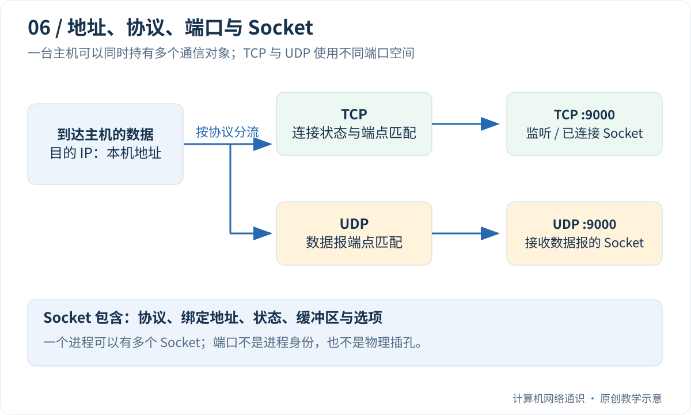

在同一台电脑上，你的浏览器正在并发加载数十个网页标签页，后台的微信正在接收好友的语音消息，网盘正在全速上传文件，终端里还挂着一个连接服务器的 SSH 会话。

所有的这些网络流量，全部共享同一张物理网卡、同一个公网 IP 地址。

当物理网卡收到一串密密麻麻的电信号二进制报文时，操作系统内核究竟凭什么能够以绝对的精度判定：**这串数据属于微信，那串数据属于浏览器，而另外那串属于 SSH，绝不会发生半点张冠李戴？**

在网络层（IP 协议）中，寻址的粒度仅仅停留于**“主机到主机（Host-to-Host）”**。而真正发起网络请求、消费数据字节的，是运行在操作系统用户态的**“进程（Process）”**！

将通信精度从“主机级”推进到“进程级”的物理桥梁，正是 **端口（Port）** 与 **套接字（Socket）**。

本文将深入操作系统内核，解构端口的分配体系、会话五元组、Socket 的物理内核结构，以及基于 TCP/UDP 的系统调用生命周期。

## Table of contents

## 第一章：端到端分用——端口（Port）的本质

在操作系统中，每一个运行的程序都有一个独立的数字身份证——**PID（进程号）**。那么，为什么网络通信不直接使用 PID 作为寻址标志，非要多此一举发明一个“端口号”呢？

> **架构解耦哲学：为什么不能用 PID 代替端口号？**
>
> 1. **进程生命周期的易变性**：在操作系统中，进程是动态创建和销毁的。每次重启 Apache 或 Nginx，操作系统为它分配的 PID 是随机浮动的（今天可能是 1024，明天重启变成 4096）。如果全球网民访问网站必须填写 PID，只要服务器重启一次，全人类就必须重新获知新的 PID，这在工程上是不可行的；
> 2. **网络协议与操作系统的解耦**：PID 是特定操作系统内核（Linux、Windows、macOS）的内部私有实现机制。网络协议是全球通用的通信标准，必须独立于具体操作系统的进程管理机制。
>
> **端口号（Port），正是操作系统专门为网络通信开辟的、独立于 PID 的“虚拟网络通信槽位”！**

```text
物理网卡 (单一物理 IP: 192.168.1.10)
      │
      ▼ (操作系统传输层: 依据端口解复用 Demultiplexing)
  ┌───┴───────────────┬───────────────────┐
  ▼                   ▼                   ▼
端口: 80           端口: 22            端口: 3306
  │                   │                   │
  ▼                   ▼                   ▼
Web 服务 (Nginx)   远程终端 (SSHD)     数据库服务 (MySQL)
(PID: 1205)         (PID: 880)          (PID: 2410)
```

### 1. 16 位端口号的空间划分

在 TCP 和 UDP 的报头中，源端口与目的端口均占用严格的 **16 位（2 字节）二进制空间**。因此，端口号的取值范围为：
$$0 \sim 2^{16} - 1 \quad \implies \quad 0 \sim 65535$$

全球互联网将这 65536 个槽位严格划分为三大区间：

| 端口号区间                 | 官方命名                             | 访问与分配规则                                                             | 经典知名服务代表                                                         |
| :------------------------- | :----------------------------------- | :------------------------------------------------------------------------- | :----------------------------------------------------------------------- |
| **`0` $\sim$ `1023`**      | **知名端口（Well-Known Ports）**     | 绑定受特权保护，通常**必须拥有 root 超级管理员权限**才能 `bind` 监听       | HTTP (`80`), HTTPS (`443`), SSH (`22`), FTP (`21`), DNS (`53`)           |
| **`1024` $\sim$ `49151`**  | **已注册端口（Registered Ports）**   | 普通用户进程可自由申请绑定，用于特定应用服务                               | MySQL (`3306`), Redis (`6379`), Tomcat (`8080`), Nginx 常用自定义端口    |
| **`49152` $\sim$ `65535`** | **动态/私有端口（Ephemeral Ports）** | **临时端口**：客户端发起向外连接时，由操作系统的内核网络栈自动随机挑选分配 | 你的浏览器每次打开一个网页标签页时，内核临时为你分配的一个五位数出口端口 |

### 2. 经典考点：TCP 端口与 UDP 端口会发生冲突吗？

如果在同一台服务器上，已经有一个 Nginx 占用了 **TCP 80** 端口，此时我们编写一个基于 **UDP 协议** 的服务，也去监听 **UDP 80** 端口，系统会报错冲突吗？

> **底层内核真相**：
>
> **绝对不会冲突！**
>
> 在操作系统内核中，**TCP 协议栈和 UDP 协议栈是两套完全独立的内部哈希调度表！**
> 操作系统识别一个输入报文时，首先根据 IP 报头中的“协议号（Protocol ID：TCP 为 6，UDP 为 17）”分流，再各自去自己的端口表中查找目标进程。因此，TCP 80 与 UDP 80 井水不犯河水，完全可以由两个不同的程序同时监听！

---

## 第二章：会话的唯一基石——网络通信五元组

我们在浏览器中同时打开两个百度搜索页面，本地 IP 相同，目标 IP 都是百度的服务器，目标端口都是 443，甚至本地源 IP 也完全相同。

操作系统凭什么将两个百度的回包分别准确递交到两个不同的标签页中？

```text
通信会话的物理坐标: 五元组 (5-Tuple)
+---------------------------------------------------------------------------------+
| { 源 IP,  源端口,  传输层协议 (TCP/UDP),  目的 IP,  目的端口 }                  |
+---------------------------------------------------------------------------------+
```

> **五元组定理**：
>
> **在整个全球互联网中，任何一个点对点的通信会话（Connection），在任意时刻都由一个“五元组”唯一且排他性地锚定！**

当你的浏览器打开第一个标签页时，操作系统为你动态分配了源端口 `51234`；打开第二个标签页时，分配了源端口 `51235`。
虽然目的 IP 和目的端口完全一致，但由于**本地源端口不同，构成了两个截然不同的五元组**！当百度的回包返回时，内核只需比对五元组，就能在纳秒级内将其精准送入对应的进程套接字中！

---

## 第三章：Socket（套接字）的物理内核真相

在程序员的代码里，Socket 往往被简写为一个极其朴素的整型数字：

```c
int sockfd = socket(AF_INET, SOCK_STREAM, 0);
```

而在 Linux 操作系统内核深处，这个数字绝对不仅仅是一个“代号”，它是一套**庞大而精密的复合数据结构体矩阵**！



### 1. 从文件描述符到内核 `struct sock`

我们在上一篇基础 I/O 中学过：**Linux 一切皆文件，`sockfd` 本质上就是当前进程文件描述符表（`fd_array`）的一个数组下标！**

1. 进程手持整数 `sockfd`，内核索引到对应的 `struct file`；
2. 在该 `struct file` 的私有数据指针中，坚决绑定着一个内核级的 **`struct socket`** 结构体；
3. `struct socket` 向下连接着专门管理传输层网络协议的核心中枢——**`struct sock`（或 `struct tcp_sock`）**！

### 2. 双向独立缓冲区设计

在 `struct sock` 内部，每一个 Socket 都物理拥有**两个完全解耦的独立内存缓冲区**：

```text
                          内核中的 Socket 对象
+-----------------------------------------------------------------------+
|  发送缓冲区 (Send Buffer / sk_write_queue):                           |
|  应用层 write() 将数据拷贝至此，由 TCP 协议栈自主决定切分与发包时机     |
+-----------------------------------------------------------------------+
|  接收缓冲区 (Receive Buffer / sk_receive_queue):                      |
|  网卡硬件中断接收报文并组装于此，等待应用层 read() 将其安全拷入用户态  |
+-----------------------------------------------------------------------+
|  等待队列 (Wait Queue): 当缓冲区空或满时，将调用进程安全挂起与唤醒    |
+-----------------------------------------------------------------------+
```

- **全双工通信（Full-Duplex）的物理底座**：
  因为发送缓冲区和接收缓冲区在物理内存上完全分离，所以在同一个 Socket 上，**发送数据的同时可以毫无阻塞地接收数据**，两端互不干扰！
- **`write()` 返回的真实含义**：
  在网络编程中，调用 `write(sockfd, buf, len)` 成功返回，**绝对不代表数据已经飞到了对方电脑上，甚至不代表数据已经流出了网卡！**
  它仅仅代表：**用户态内存中的字节，已经被安全地拷贝进了操作系统内核的发送缓冲区中！** 至于何时发包、怎么重传，全权交由内核网络协议栈调度！

---

## 第四章：系统调用生命周期——TCP 与 UDP 的分道扬镳

面向两种截然不同的传输协议，操作系统向上暴露了两种经典的系统调用编排管线。

### 1. UDP 系统调用流水线（面向数据报，无连接）

UDP 是一种极其轻量、朴素的协议：它没有连接状态，不维持序号，保留消息边界。

```text
[UDP 服务端]                                  [UDP 客户端]
socket(AF_INET, SOCK_DGRAM)                   socket(AF_INET, SOCK_DGRAM)
      │                                             │
bind(本地 IP + 端口)                                 │ (通常无需手动 bind，首次发送由内核隐式分配端口)
      │                                             │
recvfrom() [阻塞挂起等待数据报到达] <──(UDP 数据报)── sendto(指定目标 IP + 端口)
      │                                             │
sendto(指定客户端 IP + 端口) ────────(UDP 数据报)──> recvfrom()
```

- **数据报保留边界**：发送方调用 `sendto` 发出 100 字节，接收方调用 `recvfrom` 必须以完整的 100 字节整包接收，**绝不会发生 TCP 那样的粘包与分包问题！**
- **UDP 的特殊技巧：调用 `connect()`**：
  UDP 也可以调用 `connect(sockfd, &addr, len)`！但此时底层**完全不发生任何网络三次握手**。它所做的全部工作仅仅是在内核 Socket 中**记录下目标对端的 IP 和端口**。后续可以直接使用 `read`/`write` 代替传参繁琐的 `recvfrom`/`sendto`，并能捕获到操作系统回传的 ICMP 端口不可达异步差错！

### 2. TCP 系统调用流水线（面向字节流，可靠连接）

```text
[TCP 服务端]                                  [TCP 客户端]
socket(AF_INET, SOCK_STREAM)                  socket(AF_INET, SOCK_STREAM)
      │                                             │
bind(本地 IP + 端口)                                 │
      │                                             │
listen(backlog) [将套接字转为被动监听模式]           │
      │                                             │
accept() [阻塞等待三次握手就绪连接] <──(三次握手)── connect() [主动发起 SYN 握手]
      │                                             │
      ├─────────────────────── 通信双向信道建立 ──────┤
      ▼                                             ▼
read() / write()                              read() / write()
```

#### 经典工程考点：监听套接字 vs 已连接通信套接字

在服务端，必须深刻区分两类完全不同的 Socket：

1. **监听套接字（`listen_fd`）**：
   - 由 `socket()` 创建并执行 `bind` 和 `listen`；
   - 形象比喻：**“豪华酒店大门口的迎宾门童”**。它从来不带客人进房间消费，它唯一的职责就是守在大门口，监听外界的三次握手请求；
2. **已连接通信套接字（`conn_fd`）**：
   - 当三次握手完成，内核从全连接队列中提取就绪连接，由 **`accept()` 系统调用实例化返回一个全新的文件描述符**！
   - 形象比喻：**“迎宾门童为你专属分配的包厢私人服务员”**。后续所有的数据收发（`read`/`write`），全部由这个新生成的 `conn_fd` 专属负责！而大门口的迎宾门童（`listen_fd`）继续回到大门前，微笑等待下一个新客人的叩门。

---

## 总结与专栏全局视野

在本篇《计算机网络通识（六）》中，我们把目光推进到了主机操作系统的核心腹地：

1. **解耦的必然性**：明晰了为什么不能用易变的 PID 作为网络通信标志，推导了 16 位端口空间的划分哲学与知名特权端口；
2. **协议隔离性**：证明了 TCP 端口表与 UDP 端口表在内核中完全独立，互不冲突；
3. **会话唯一性**：确立了由“源 IP、源端口、协议、目的 IP、目的端口”构成的五元组绝对定位模型；
4. **内核物理现实**：解构了 Socket 在进程文件描述符表与内核 `struct sock` 间的双向独立收发缓冲区映射；
5. **编程范式分水岭**：梳理了 UDP 极简数据报与 TCP 监听套接字/通信套接字分离的系统调用生命周期。

既然 TCP 能够提供面向连接的稳定可靠服务，那么一切的起点，都必须始于那段著名的连通仪式。

- 为什么 TCP 建立连接**必须进行三次握手？两次握手到底会埋下怎样致命的安全与资源隐患？**
- 著名的 **SYN 泛洪拒绝服务攻击（SYN Flood）** 是如何通过恶意发包把服务器的半连接队列打满击垮的？
- 操作系统底层配置中的 **`listen(backlog)`** 与 `somaxconn` 到底是如何控制并发连接队列的物理容积的？

让我们正式迈向专栏的第七篇硬核大作：**[《TCP 为什么要三次握手？》](/blog/posts/why-tcp-needs-a-three-way-handshake/)**！
