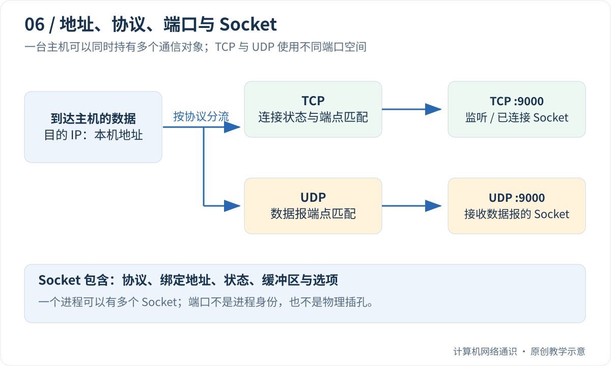

电脑一边播放音乐，一边打开网页，一边接收聊天消息。网卡收到数据以后，怎么知道应该交给哪个程序？

IP 地址帮助把包送到目标网络接口；到了设备内部，还需要协议、端口和操作系统共同找到接收入口。本篇先用浏览器和聊天软件的例子解释这件事，最后才看代码。没有编程基础，可以先读到纸上练习，代码实验作为第二遍的可选内容。

## Table of contents

## 程序、进程和操作系统，先认清三者

浏览器是一种程序。你打开它以后，操作系统让它运行起来；运行中的程序实例称为 **进程**。现代浏览器可能启动多个进程，但现在先把“运行中的浏览器”当成需要联网的参与者即可。

操作系统负责管理内存、文件和网卡等资源。程序需要联网时，会调用操作系统提供的接口，意思类似“请给我一个通信对象”“把这些字节发出去”“取回收到的数据”。这些接口统称为 API，可以理解为软件之间约定好的操作入口。

**Socket**，中文常译为套接字，就是程序用来进行这种通信的对象。它不是网线插孔，也不是一台远端机器；程序借助它向操作系统提出收发请求。一个进程可以拥有多个 Socket，就像浏览器可以同时下载不同网站的内容。

## 端口是数字标签，和网线插孔不同

先设一个纸上场景：你的电脑地址是 `192.168.10.20`，网站地址是 `203.0.113.80`。服务器上的网站程序等待访问，常用的 HTTPS 入口是 443；浏览器则由系统选择一个临时端口，例如 53024。

```text
浏览器这一端：192.168.10.20 : 53024
网站这一端：  203.0.113.80  : 443
```

冒号左边是 IP，右边是端口。**端点** 就是一次通信的一端，把地址和端口放在一起，才知道这端具体使用哪个入口。还要指明 TCP 或 UDP，因为两种协议有不同的端口空间。

发送请求时，浏览器端是来源，网站端是目的地；返回结果时，两者交换方向。源端口不是多余数字，它给回复提供了返回入口。临时端口也不是一次会话中每发一个包就换一次，而是用于相应的通信对象或连接。

| 同一请求的方向 | 源地址与端口          | 目的地址与端口        |
| -------------- | --------------------- | --------------------- |
| 请求去网站     | `192.168.10.20:53024` | `203.0.113.80:443`    |
| 响应回浏览器   | `203.0.113.80:443`    | `192.168.10.20:53024` |

表格暂不考虑 NAT；经过地址转换时，外部看到的源端点可能变化，后面的专门文章会接上这一步。

## TCP 与 UDP，是两套不同的交付约定

本篇会同时出现两个名字，先给它们一个最小定义。

**TCP** 让两端先建立连接状态，再把数据作为有顺序的字节流交付。中间丢失的数据可以尝试重传；无法恢复时仍可能报错。连接是双方保存的通信状态，不是铺了一条专用网线。

**UDP** 让应用一份一份地发送数据报。**数据报** 可以理解成一次有边界的消息：发两份，就有两个消息单位。UDP 自身不承诺送达、按序或重传。应用可以另外设计可靠性机制，因此不能把使用 UDP 的所有软件都说成“必然丢文件”。

先不要用“TCP 慢、UDP 快”记忆它们。你更应该问：这个应用需要什么交付规则，哪些规则由协议提供，哪些由程序自己实现？

## 一个服务器端口，怎样接待许多人？

假设两位读者同时访问网站：

```text
读者甲：192.0.2.10:51001 → 203.0.113.80:443
读者乙：192.0.2.11:52002 → 203.0.113.80:443
```

服务器本地地址和端口相同，但远端地址和端口不同。在普通 TCP 情况下，操作系统可以根据两端地址与端口区分连接。它不需要因为来了第二个人，就把网站改为监听 444。

**监听** 是“准备接待新连接”，不是一直偷听网络里的所有数据。服务器持有监听 Socket，接受一次连接后得到另一个用于这次读写的 Socket；原监听对象仍然可以接待别人。

这就解释了“端口”和“Socket”为什么不是同义词：同一个监听端口可以关联许多已连接 Socket，而每个 Socket 还具有自己的状态、缓冲区和对端信息。

## 先用纸上问题检查理解

设浏览器新建两条到同一网站的 TCP 连接，网站端都是 443。它们在同一网络上下文、同一本机 IP 下，怎样避免成为完全相同的连接？

<details>
<summary>展开答案</summary>
<div class="mt-4 leading-7">通常会使用不同的本地临时端口，使“本地 IP、本地端口、远端 IP、远端端口”四个字段的组合不同。这里讨论的是两条 TCP 连接；浏览器也可能只建一条连接，在应用协议里复用多个请求，不能把一个标签页机械对应为一条连接。</div>
</details>

下文再把 `bind`、`connect`、`listen` 等英文接口与这些动作对应起来。第一次不需要记拼写，只要能认出“指定本地地址、发起连接、准备接待、接受连接”各在做什么。

## 一个 IP，为什么还要配一个端口？

假设电脑的 IPv4 地址是 `192.168.10.20`。浏览器访问网页时，某条连接的端点可能是：

```text
本地：192.168.10.20:53024
远端：203.0.113.80:443
传输协议：TCP
```

这些地址只是文档示例。冒号后面的数字是端口，不是网卡上的物理插孔。TCP 和 UDP 首部中都有 16 位端口字段，可以表达 `0` 到 `65535`；但“字段能表达”不等于每个数字都适合给普通应用绑定。端口 0 在绑定 API 中常被用来请求操作系统分配可用端口。

目的端口回答“希望访问哪个传输层服务端点”，源端口则使对方能够把回复发回来。HTTPS 常使用 TCP 443，不过端口只是惯例和配置：在 8443 上也可以部署 HTTPS，在 443 上也不能仅凭数字断定收到的内容一定合法。

| 看到的字段 | 能帮助回答的问题           | 不能单独证明的事     |
| :--------- | :------------------------- | :------------------- |
| 目的 IP    | 数据送往哪个网络地址       | 具体由哪个进程处理   |
| 目的端口   | 在该传输协议下寻找哪个端点 | 程序身份、用户身份   |
| TCP / UDP  | 采用哪种传输语义与端口空间 | 应用层协议一定是什么 |
| 应用消息   | 请求什么资源或操作         | 对方是否已经完成业务 |

TCP 443 和 UDP 443 属于不同的协议空间。HTTP/3 常使用 UDP 443，它与 TCP 上的 HTTPS 并不互相“抢同一个端口”。

## Socket 是对象，不是一个端口的别名

程序调用 `socket()` 创建对象，再通过它请求操作系统收发数据。这个对象还保存协议类型、绑定地址、状态、缓冲区和各种选项。进程中的文件描述符或 Python 对象，是程序访问它的句柄。

因此，下面几组概念不能简单画等号：

- 进程不等于端口：一个进程可以持有许多 Socket。
- Socket 不等于 TCP 连接：UDP Socket 也存在，监听 Socket 也没有对应某一条已建立连接。
- 端口不等于唯一进程：共享监听、继承句柄和端口复用受操作系统规则与选项影响。

理解程序时，应该追踪“谁持有哪个 Socket、它绑定了什么地址、处于什么状态”，而不是只问“哪个程序占了这个数字”。



## bind、connect 和 listen 分别做什么？

这几个名字看起来都像“建立连接”，实际职责不同。

`bind()` 指定本地端点。绑定 `127.0.0.1` 表示仅使用 IPv4 回环地址；绑定 `0.0.0.0` 是监听所有适用的本地 IPv4 地址的通配方式，**不是让客户端把数据发往 0.0.0.0**。网络是否能访问到服务，还取决于路由、防火墙等条件。

对于 TCP，`listen()` 把 Socket 置于被动监听状态；客户端 `connect()` 发起连接；服务器 `accept()` 取出一个已建立连接，得到另一个 Socket。原监听对象继续接待后续连接。

对于 UDP，通常不需要 `listen()` 或 `accept()`。`sendto()` 指明本次数据报的目标，`recvfrom()` 同时返回内容和来源端点。UDP 也能调用 `connect()`，但这主要是设置默认对端和关联收发行为，不会因此出现 TCP 的三次握手或可靠字节流。

[Python socket 文档](https://docs.python.org/3/library/socket.html)描述了这些接口；底层行为仍受操作系统影响。客户端不显式 `bind()` 时，系统通常会在发送或连接过程中选择合适的本地地址和临时端口。

## UDP 保留消息边界，但不保证送达

假设程序分别发送 `cat` 和 `elephant` 两个 UDP 数据报。接收方使用足够大的缓冲区时，会按数据报读取，而不是自动把它们拼成 `catelephant`。

这个边界很有用，但 UDP 本身不提供重传、顺序交付和重复消除。如果只收到了第二条，应用不能认为第一条“肯定在路上”。接收缓冲区过小也不能指望下一次调用接着读剩余半条：可能截断或报错，具体表现依平台和接口而异。

[UDP 规范 RFC 768](https://www.rfc-editor.org/rfc/rfc768.html)定义了这种较小的传输层机制。需要可靠交付的应用，可以在 UDP 上另外设计确认、重传、拥塞控制和加密；QUIC 就是一套远比“裸 UDP”丰富的协议。不能据此把“UDP 不可靠”误读为“使用 UDP 的应用必然不可靠”。

对应用开发者而言，真正的问题是：**缺少的语义由谁提供，代价由谁承担？** 游戏中的过期位置更新可能宁愿丢弃，文件传输中的缺失字节则必须补齐。两者的目标不同。

## 可选编程实验的准备：怎样运行本系列的 Python 代码

Python 是一种编程语言。本系列实验只使用 Python 3 自带的模块，不要求安装第三方包，也不要求先学会完整的 Python 语法。**暂时不想安装编程环境，可以直接读执行步骤和预期输出，主线内容不依赖运行成功。**

如果你的电脑已经装有 Python 3，可以按下面操作：

1. 新建一个容易找到的练习文件夹，例如桌面上的 `network-practice`。
2. 用纯文本编辑器创建文件，把下面完整的 Python 代码复制进去。保留每行开头的空格，它们表示代码层次。文件名使用 `udp_loopback.py`，不要误存为 `udp_loopback.py.txt`。
3. 在文件夹中打开终端。Windows 可以在资源管理器地址栏输入 `powershell` 后回车；终端是一种让你输入命令并读取文字结果的窗口。
4. 先输入 `python --version`。看到 `Python 3...` 后再输入 `python udp_loopback.py`。部分 Windows 安装使用 `py`，macOS/Linux 常使用 `python3`，对应替换命令开头即可。
5. 如果提示“找不到命令”，说明解释器未安装或未加入命令搜索路径；如果提示“找不到文件”，先检查终端所在文件夹和扩展名，不要因此怀疑网络协议。

后文的 `127.0.0.1` 叫 **回环地址**，表示本机。数据由本机操作系统处理，不会因为出现 IP 地址就自动发到互联网。端口写 0 表示请系统分配可用本地端口，不是要连接“0 号网站”。

代码中的 `b"hello"` 是字节内容，`print()` 在终端显示结果，`with` 代码块结束时会释放相应对象。`settimeout(2)` 最多等待约两秒，避免一直卡住；它不提供重传。

## 动手：在本机交换一个 UDP 数据报

把下面代码保存为 `udp_loopback.py`，使用 Python 3 执行。两个 Socket 都只绑定本机回环地址，端口由系统分配。这里把收发双方写进同一进程，方便观察；它们仍通过操作系统的 UDP 接口通信。

```python
import socket

with socket.socket(socket.AF_INET, socket.SOCK_DGRAM) as server:
    server.bind(("127.0.0.1", 0))
    server.settimeout(2)

    with socket.socket(socket.AF_INET, socket.SOCK_DGRAM) as client:
        client.bind(("127.0.0.1", 0))
        client.settimeout(2)
        destination = server.getsockname()
        client.sendto(b"hello", destination)

        payload, peer = server.recvfrom(1024)
        print("server received:", payload)
        print("source matches client:", peer == client.getsockname())
        server.sendto(payload.upper(), peer)

        reply, source = client.recvfrom(1024)
        print("client received:", reply)
        print("reply source matches server:", source == destination)
```

输出应为：

```text
server received: b'hello'
source matches client: True
client received: b'HELLO'
reply source matches server: True
```

这里验证了四件事：系统可以分配端口；一个程序可以同时持有多个 Socket；接收接口能告诉我们对端地址；回复要发给收到的数据报所携带的来源端点。

按执行顺序重新读代码：先创建接收端 `server`，让它绑定本地地址；再创建发送端 `client`。`getsockname()` 取回系统实际分配的地址和端口，`sendto()` 把 `hello` 发往接收端，`recvfrom()` 取得内容以及来源。

接收端把内容变成大写，再发回刚才的来源端点。最后两次比较输出 `True`，意思是“收到的来源确实与预期端点相同”。这份示例中 server、client 都在一个 Python 进程里；名字表示收发角色，不表示两台不同电脑。

如果出现超时，记录停在哪次接收，检查是否完整复制代码以及本机安全策略。不要为了这个回环实验去设置路由器端口映射；两者不是同一条通信路径。

这个实验没有制造丢包，也没有跨越网卡、交换机或 NAT。一次本机成功通信不构成 UDP 可靠性的证据。`settimeout(2)` 只是防止示例无限等待，不会让内核替 UDP 补发数据。

还可以把 `b"hello"` 改成 `b""`：零长度 UDP 数据报是合法消息。不要照搬 TCP 中“`recv()` 返回空字节串表示读到 EOF”的规则来理解 UDP。

## 为什么浏览器可以同时连接同一个服务器？

浏览器可以创建多条连接，操作系统为它们分配不同的本地端点。即便远端都是 `203.0.113.80:443`，本地端口也可能不同。对于普通 TCP 连接，在同一网络上下文中，源 IP、源端口、目的 IP、目的端口共同区分连接；把协议一起写出来，就是常见的五元组表达。

服务器不必为每个客户端开放一个全新的监听端口。监听 443 的服务接受连接后，可以得到许多本地端口仍为 443、远端端点各不相同的连接 Socket。这正是下一篇需要拆开的“监听”和“连接”。

若程序提示地址已被占用，先确认发生在 `bind()`、`connect()` 还是其他调用，检查具体本地地址、协议和复用选项。仅凭“443 被用了”不足以解释完整原因。

## 留一个检查理解的问题

一台机器上存在一个 UDP 9000 服务和一个 TCP 9000 服务，为什么不一定冲突？如果 UDP 客户端没有收到回复，能否直接判断服务器程序已经退出？

前者要从协议空间区分；后者需要继续考虑数据报丢失、地址写错、服务处理失败、接收超时等可能性。端口帮助找到入口，但入口之后仍有一整条处理链。

上一篇：[DNS 怎样工作](/blog/posts/how-dns-resolution-works/)

下一篇：[TCP 为什么要三次握手](/blog/posts/why-tcp-needs-a-three-way-handshake/)

## 参考与延伸阅读

- [Beej：What is a socket?](https://beej.us/guide/bgnet/html/split/what-is-a-socket.html)——从程序接口理解套接字。
- [Python：socket](https://docs.python.org/3/library/socket.html)——本文使用的 API 与跨平台边界。
- [RFC 768](https://www.rfc-editor.org/rfc/rfc768.html)——UDP 的报文格式和基本语义。
