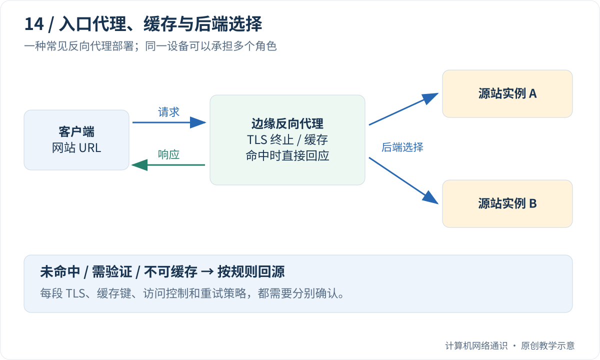

在初学网络时，很多人的脑海中依然保留着一个朴素的单机模型：
浏览器通过 DNS 拿到了一个 IP，随后直接通过 TCP 连上那个 IP 对应的物理服务器，这台服务器直接从硬盘读取文件返回给用户。

然而，在任何一家稍微具有一定规模的现代化互联网公司中，**这种单机直连的模式几乎是绝对不存在的！**

当我们在北京打开一个部署在深圳的视频网站时，数据经历的真实路径往往是一场眼花缭乱的接力跑：

```text
浏览器 ──> 局域网出口网关 ──> CDN 边缘缓存节点 ──> 四层负载均衡 (LVS) ──> 七层反向代理 (Nginx) ──> 后端业务微服务集群
```

- 为什么同样被称为“代理”，**正向代理（Forward Proxy）** 和 **反向代理（Reverse Proxy）** 服务的对象有着截然相反的物理立场？
- **四层负载均衡（L4）** 和 **七层负载均衡（L7）** 到底是在哪一层协议切开数据包的？为什么前者每秒能抗下数百万并发，而后者却能做到智能灰度分流与 TLS 证书集中卸载？
- **内容分发网络（CDN）** 是如何利用全球智能 DNS 解析（GSLB），把几百兆的高清视频切片推送到你家楼下 5 公里以内的边缘机房的？
- 生产环境常见的 **`502 Bad Gateway`** 与 **`504 Gateway Timeout`**，究竟是在哪一条链路的断裂处被抛出的？

本文将全面解开现代网络边缘基础设施的神秘面纱，深度解构代理、负载均衡与 CDN 的协同体系。

## Table of contents

## 第一章：正向与反向——代理（Proxy）的立场之决

在网络架构中，“代理”一词指的是**处于客户端与真实目标服务器之间的中介软件/硬件实体**。

但根据它所站的物理立场，它被坚决划分为两大阵营：



### 1. 正向代理（Forward Proxy）——“客户端的代言人”

> **生动心智模型**：
>
> 正向代理好比**“替租客出面租房的职业中介”**。
>
> - 你（客户端）想从房东（目标服务器）手里租房，但你出于某种原因不能直接露面（比如公司内网安全审计限制访问外网，或者需要突破地域限制访问海外资源）；
> - 你找到中介（正向代理），对中介说：“帮我把房东手里的房子租下来！”；
> - 中介亲自去联系房东办手续，拿到钥匙再交给你。
> - **在房东看来，从头到尾和他打交道的只有中介！房东根本不知道背后的真实租客到底是谁！**

- **核心特征**：正向代理**架设在客户端一侧**，代表客户端去向外网发起请求；
- **核心价值**：**隐藏真实的客户端 IP 地址**、实现企业内网员工上网行为安全审计、加速内部访问缓存。

### 2. 反向代理（Reverse Proxy）——“服务端的门面担当”

> **生动心智模型**：
>
> 反向代理好比**“大型企业或豪华餐厅的统一前台总机”**。
>
> - 外部顾客（客户端）给华为或腾讯打电话，大家拨打的都是公开的官方 400 统一总机号码（反向代理统一入口 IP）；
> - 总机接线员接听电话后，根据你的具体业务诉求，内部转接到研发部门张工、或财务部门李工的私人分机工位上；
> - **在外部顾客看来，他只知道自己是在和前台总机通话！他根本不需要知道、也完全无法获知背后的具体工位在机房的哪一个房间、哪一台物理服务器上！**

- **核心特征**：反向代理**架设在服务端集群的统一最前端**，代表整个后端集群去迎接公网的全部并发流量；
- **核心价值**：
  1. **隐藏后端真实服务器集群的物理内网拓扑**，杜绝黑客直接发起针对后端数据库或应用服务器的定向渗透；
  2. 集中处理全站的安全防护（WAF Web应用防火墙、防 DDoS 流量清洗）；
  3. 充当统一调度中心，实现**负载均衡与流量分流**。

---

## 第二章：集群的调度大脑——四层与七层负载均衡（Load Balancing）

一台顶级高配服务器的单机物理算力总是有极限的（单台机器最多插几块网卡、几十核 CPU）。
当一个系统的并发访问量突破单机极限，或者为了防止单点故障引发全盘宕机，**必须将成百上千台普通服务器组装成一个“集群（Cluster）”**。

负责将来自全网的海量请求均匀、科学分摊到各个后端节点上的调度核心，就是 **负载均衡器（Load Balancer，简称 LB）**。

### 1. 四层负载均衡（L4）：极速的传输层流水线

- **代表技术**：Linux 内核级 **LVS（Linux Virtual Server）**、硬件级 F5、HAProxy（TCP 模式）；
- **工作层级**：**OSI 第四层（传输层，TCP / UDP）**。

> **四层负载均衡的物理机制**：
>
> **它在底层仅仅审视数据包的“IP + 端口五元组”！它绝对不解开、也根本看不懂任何应用层的 HTTP 报文内容！**
>
> 当一个 TCP 握手数据包到达 LVS 时：
>
> 1. 它甚至不需要在用户态解析任何字符串，直接在 Linux 内核层通过极速的算法（如 DR 模式直接路由、或 DNAT 修改目的 IP/MAC）；
> 2. 像流水线工人一样，将数据帧的硬件目的地址修改为后端某个空闲的真实服务器（Real Server）IP，直接在网卡间高速旁路转发！

- **核心优势**：**性能巅峰！** 单台 LVS 在普通 x86 服务器上轻松跑出**数百万级并发连接**，CPU 消耗极低；
- **局限性**：由于看不懂 HTTP 报文，无法进行基于 URL 路径、请求头或 Cookie 的智能业务分流，也无法执行 TLS 证书卸载。

### 2. 七层负载均衡（L7）：聪慧的应用层调度官

- **代表技术**：**Nginx**、HAProxy（HTTP 模式）、云原生 Envoy；
- **工作层级**：**OSI 第七层（应用层，HTTP / HTTPS）**。

> **七层负载均衡的物理机制**：
>
> 它必须在用户态**完整终结并解开 TCP 连接与 TLS 加密！**
>
> 它会完整读取整个 HTTP 报文的每一个细节：解析出 `GET /api/v2/pay` 路径、查看 `Cookie` 中的用户信息、提取 `User-Agent` 判断客户端是手机还是电脑。

- **核心杀手锏功能**：
  1. **智能内容路由**：将以 `/api/pay` 开头的请求转发给高安全的支付服务集群，将以 `/static` 开头的请求转发给静态资源集群；
  2. **TLS 证书集中卸载（TLS Termination）**：将昂贵费算的非对称加密解密算力全部收拢在 Nginx 边缘节点统一完成！后端数百台业务服务器之间只需跑极速的内网明文 HTTP，彻底解放业务容器的算力；
  3. **灰度发布与 A/B 测试**：根据 Header 或 Cookie 中的特定白名单标签，精准将 5% 的特定用户流量无感导向全新部署的试验版本服务。

---

## 第三章：天涯若比邻——内容分发网络（CDN）的物理奇迹

如果你的源站服务器部署在深圳的机房，一位远在冰岛雷克雅未克的用户打开你的网页下载一张 5MB 的图片。
正如我们在第 9 篇推导过的光速物理极限：数据每跨越半个地球，光纤 RTT 就要增加上百毫秒，再加上国际公网链路拥塞，下载速度必然惨不忍睹。

为了打破光速与物理距离的地理宿命，现代互联网构建了一套全球覆盖的边缘缓存网络——**内容分发网络（Content Delivery Network，简称 CDN）**。

```text
全球用户分布                        CDN 边缘网络 (Edge Nodes)                  中心源站 (Origin Server)
[北京用户] ──(5ms 局域光纤)──> [北京边缘节点 (已缓存 Logo 图片)] ── 直接秒级返回!
                                          │
[冰岛用户] ──(3ms 局域光纤)──> [冰岛边缘节点 (Cache Miss 未命中!)] ── 仅在首次回源 ──> [深圳核心数据中心]
```

### 1. 核心运转机制：智能就近调度（GSLB）

当你访问一个使用了 CDN 加速的域名（如 `static.bilibili.com`）时：

1. 网站在权威 DNS 中配置了一条 **`CNAME` 别名记录**，将域名指向 CDN 厂商的全球负载均衡调度系统（**GSLB，Global Server Load Balancing**）；
2. GSLB 识别出你当前发来请求的 Local DNS 来源 IP 位于北京市朝阳区中国电信；
3. **算法精准匹配**：GSLB 在全网数千个机房中，挑选出一个**物理距离你家最近、且当前网络最通畅的电信边缘机房 IP** 返回给你的浏览器；
4. 你的浏览器连接的，根本不是遥远的深圳源站，而是就在你家楼下几公里外的边缘缓存服务器！

### 2. 缓存命中与回源机制（Cache Miss & Origin Fetching）

- **缓存命中（Cache Hit）**：
  如果这个资源之前已经有其他北京电信的用户访问过，或者 CDN 预先进行了热点推流，边缘服务器直接从自己的本地 NVMe SSD 甚至内存中提取数据，**在 5 毫秒内瞬间秒开返回**！整个过程源站服务器毫不知情；
- **未命中与回源（Cache Miss）**：
  如果该边缘节点上从未缓存过该文件（或者上一篇讲过的强缓存过期了），边缘节点化身为客户端，**代表用户向你的深圳中心源站发起一次“回源拉取（Origin Fetch）”**；拉回数据后，一边将数据交还给用户，一边将数据保存在本地边缘，造福后续所有该区域的访问者！

---

## 第四章：全链路排错实战——502 与 504 的架构判决

当浏览器弹出报错时，我们如何在复杂的 Nginx 与后端微服务集群中，用 10 秒钟快速定责？

```text
[浏览器] ───(正常)───> [Nginx 反向代理] ───(下游到上游链路)───> [后端应用服务器 (如 Tomcat/Go)]
```

### 1. `502 Bad Gateway`（错误的网关）

- **案发现场证据**：Nginx 成功接收了用户的请求，并尝试连接后端的业务端口（如 `127.0.0.1:8080`）；
- **故障根因**：**后端的 8080 端口根本没有进程在监听！**
  - 后端 Java 进程发生 OutOfMemoryError（OOM）被 Linux 内核 OOM-Killer 物理击毙了；
  - 后端 Python/Go 服务崩溃重启中；
  - Nginx upstream 配置中的 IP 或端口打错了；
- **判决**：**上游服务压根没起来！立刻去后端服务器检查服务进程是否存活！**

### 2. `504 Gateway Timeout`（网关超时）

- **案发现场证据**：Nginx 成功与后端应用建立了 TCP 连接，并把 HTTP 请求送了过去；
- **故障根因**：**后端应用接下了活，但迟迟交不出结果！**
  - 后端业务代码正在执行一条包含几千万行关联的慢 SQL，数据库死锁卡死；
  - 业务代码正在同步等待一个超时的第三方外部接口调用；
  - Nginx 内部配置的 `proxy_read_timeout`（如默认 60 秒）倒计时归零，Nginx 彻底放弃等待，主动向用户抛出 504；
- **判决**：**后端业务卡死了！立刻通过 `SHOW FULL PROCESSLIST;` 排查数据库慢查与死锁，或者查看后端应用的慢日志与线程调用栈！**

---

## 总结与专栏全局视野

在本篇《计算机网络通识（十四）》中，我们解开了现代互联网工业级系统的宏观拓扑：

1. **立场的解耦**：透视了正向代理作为“客户端代言人”隐藏客户端、反向代理作为“服务端门面总机”守护并分发集群流量的根本差异；
2. **调度的层级**：明晰了四层负载均衡（L4）依靠五元组在内核网卡级实现数百万吞吐的极致性能，以及七层负载均衡（L7）解析 HTTP 报文实现智能路径路由与集中 TLS 证书卸载的高阶智慧；
3. **光速的妥协**：深入解密了 CDN 依靠 GSLB 智能调度与边缘节点缓存，将全球天涯海角的远距离传输压缩为本地几公里内 5 毫秒秒开的物理奇迹；
4. **排障法眼**：确立了 502（上游死绝无法建连）与 504（上游慢查卡死超时）在微服务调用链上的定责红线。

现在，我们可以把整个现代 Web 体系的宏观架构与微观协议融会贯通了。

然而，在这一切繁华的背后，还有一个所有局域网设备都无法回避的底层物理樊篱：

- 为什么你在家里电脑上开了一个本地 Web 服务，远在异地的朋友却**根本无法直接在浏览器里访问你的电脑？**
- 著名的 **NAT（网络地址端口转换）** 和 **有状态防火墙** 究竟是如何在你的路由器里，构筑起一道只准“往外走”、严禁“往里钻”的单向铁幕的？

让我们正式迈向专栏的第十五篇底层力作：**[《为什么你能访问外网，外网却访问不了你？》](/blog/posts/why-inbound-connections-fail-behind-nat/)**！
