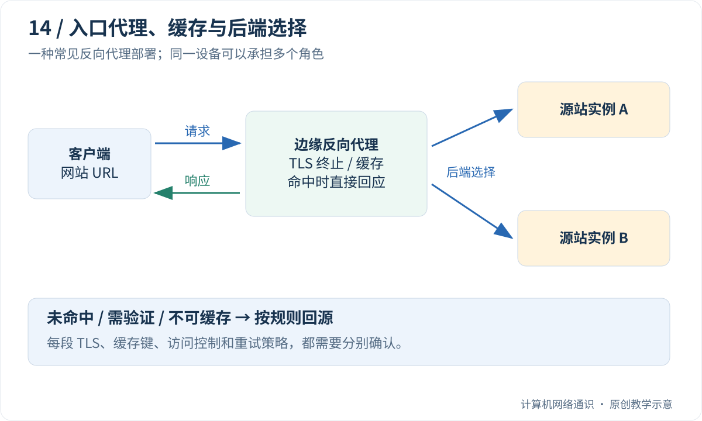

你以为浏览器直接访问了网站的那台服务器，实际路径却可能是：浏览器 → 公司代理 → CDN 边缘 → 负载均衡器 → 应用实例。一次请求经过多个角色，但这些名字并不是互相排斥的产品类别。

一台反向代理可以同时做 TLS 终止、缓存与负载均衡；CDN 边缘也可以具备这些能力。**先按它在当前请求中承担的职责划分，再看产品名称，会更清楚。**

[Cloudflare 的代理说明](https://www.cloudflare.com/learning/cdn/glossary/reverse-proxy/)和 [CDN 入门文章](https://www.cloudflare.com/learning/cdn/what-is-a-cdn/)适合建立角色地图。下面使用虚构站点的请求路径，区分“替谁转发”“选哪个后端”和“能否复用内容”。

## Table of contents

## 正向与反向，是从谁的配置立场说的？

正向代理通常代表客户端访问外部服务。客户端或其环境知道代理入口，代理再替客户端联系目标。企业出口策略、调试代理和特定访问环境都可能使用这种形式。

反向代理则位于服务入口，代表后端接收请求。访问者使用网站地址，不必了解背后有多少个应用实例。服务方可以在入口统一处理路由、证书、限流等逻辑。

| 角色     | 谁通常主动配置它       | 当前请求中关注什么             |
| :------- | :--------------------- | :----------------------------- |
| 正向代理 | 客户端或客户端所在网络 | 如何代表客户端访问目标         |
| 反向代理 | 服务提供方             | 如何把外部请求交给内部服务     |
| 负载均衡 | 服务提供方或基础设施层 | 从候选后端中选择哪个           |
| CDN      | 内容服务方             | 从分布式入口服务内容，何时回源 |

“反向”不是把 TCP 数据倒着发送。两个方向照样都有请求和响应；差别在部署关系和代理职责。

## TLS 在哪里结束，明文就在哪里出现

假设浏览器与 CDN 使用 HTTPS，CDN 再与源站建立另一条 HTTPS 连接。此时存在两段独立的 TLS 会话，CDN 是第一段的终点，也是第二段的起点，因此可以处理 HTTP 明文。

如果采用不终止 TLS 的四层转发方式，转发设备一般不能直接按加密后的 URL 路径路由。某些设备能利用未加密握手信息或其他元数据，但那不等于已经获得完整 HTTP 内容。

正向代理处理 HTTPS 时也有不同方式。CONNECT 可以建立到目标的字节隧道；如果代理要解密检查内容，则还涉及客户端信任配置和不同的 TLS 终止边界。不能仅凭“经过代理”判断它一定能或一定不能读到正文。

## 四层和七层负载均衡，选择依据不同

四层负载均衡通常围绕地址、端口、协议和连接状态分配流量，关注传输端点。实现可能采用 NAT、直接转发或代理等不同路径，不能画成唯一结构。

七层负载均衡理解 HTTP 等应用协议，可以依据主机名、路径、字段或应用规则选择后端。例如 `/images/` 交给图片服务，`/api/` 交给应用集群。

轮询只是最简单的选择方式之一。最少连接、权重、哈希和地域策略各有用途；请求数相同也不代表 CPU 工作量相同。一个长查询与一次内存命中，对后端的代价可能相差很大。

健康检查同样有边界。端口能建立连接，只证明入口接受了传输连接；`/health` 返回 200，也未必覆盖数据库、队列和全部业务路径。检查应该与服务的接流能力对应，同时避免探测本身给系统增加过大负担。

## 一次 CDN 命中和一次回源差在哪里？



对可缓存内容，如果边缘保存了符合规则的有效副本，可以直接返回，减少访问源站的延迟和负载。未命中、过期需要验证或响应不允许缓存时，则可能回源。

CDN 并不是把网站所有内容永久复制到全世界。不同对象、区域、缓存策略和访问热度会形成不同状态；一个边缘节点命中，不代表另一个节点也命中。

“就近”也不必等于地图上直线距离最短。路由、互联质量、服务策略和节点健康会影响选择。对一个很少访问的动态请求，边缘还需要回源，收益就不能只用“离用户更近”解释。

## 缓存键决定哪些请求被当成同一个

假设 `/greeting?lang=zh` 返回“你好”，`/greeting?lang=en` 返回“hello”。如果缓存键只保留路径、忽略查询参数，两个本来不同的表示就可能被错误地合并。

缓存键还可能涉及主机名、协议、查询、指定请求字段等维度。实际产品支持什么、默认如何构造，应查具体文档，例如 [Cloudflare Cache Keys](https://developers.cloudflare.com/cache/how-to/cache-keys/)。不能把某家产品的可配置项当成 HTTP 标准要求所有 CDN 默认启用的内容。

维度越少，命中率可能越高，但错误复用风险也更高；维度越多，区分更准确，却可能让相同内容分散成很多副本。正确目标是识别真正影响表示的输入。

涉及登录状态、个人数据和授权响应时，必须同时遵守响应的缓存控制语义。不能仅靠把某个用户标识加入键，就认为任何私有内容都适合长期共享存储。

## 动手：一个错误缓存键怎样串语言？

以下纯内存实验只处理固定的公开示例，不访问真实网站，也不模拟生产 CDN 的完整规则。

```python
from urllib.parse import urlsplit, parse_qs


def origin(url):
    lang = parse_qs(urlsplit(url).query).get("lang", ["en"])[0]
    return "ni hao" if lang == "zh" else "hello"


def fetch(url, cache, key_function):
    key = key_function(url)
    if key not in cache:
        cache[key] = origin(url)
    return cache[key]


urls = ["https://example.com/greeting?lang=zh",
        "https://example.com/greeting?lang=en"]
for label, key_function in [
    ("path only", lambda url: urlsplit(url).path),
    ("full URL", lambda url: url),
]:
    cache = {}
    print(label, [fetch(url, cache, key_function) for url in urls])
```

输出应为：

```text
path only ['ni hao', 'ni hao']
full URL ['ni hao', 'hello']
```

第二种键修正了本例，但“永远使用原始完整 URL”也不是所有系统的最佳方案。例如无意义的追踪参数可能降低命中率；如果内容还依赖请求字段，仅加入完整 URL 仍然不够。这个实验说明的是键必须覆盖相关输入，而不是推荐一条万能配置。

## 缓存之外，代理还改变了哪些观察？

源站看到的 TCP 对端通常是代理，不一定是原始访客。代理可以通过约定字段传递原地址，但应用只应信任受控代理写入的来源信息；任意客户端自行发送的 `X-Forwarded-For` 不能自动成为真实身份。

一个请求还可能在代理处重试。对于非幂等操作，后端已经处理但响应丢失时，透明重试可能造成重复效果。负载均衡提高可用性，并不会替业务自动完成幂等设计。

会话状态也需要考虑：如果登录信息只保存在某个应用实例内存里，下一次被分配到另一个实例就可能失效。粘性会话能缓解部分问题，但还会引入容量与故障恢复约束；共享状态或无状态令牌各有自己的条件。

## 遇到 502 和旧内容，先记录哪一层的证据？

502 说明某个网关认为上游响应有问题，但无法仅凭状态码确定是后端崩溃、协议不匹配还是连接中断。504 通常与网关等待上游超时有关，也需要对照网关和源站日志。

对于“更新后仍是旧内容”，先记录 URL、请求字段、缓存相关响应字段、时间与实际连接入口。浏览器缓存、边缘缓存和应用自身缓存都可能参与，清除其中一层不一定改变另一层。

在自己的环境可以用 `curl -I` 查看 HEAD 响应，但有些服务对 HEAD 与 GET 的处理不同；若要核对实际 GET 字段，可以使用 `curl -sS -D - -o /dev/null URL`，Windows 的丢弃路径改为 `NUL`。响应字段是线索，不是证明整条链路状态的万能证书。

读完这一篇，再画自己的部署结构时，给每一段标上协议、TLS 终点、缓存位置和后端选择点，通常比只画一朵“云”更能帮助排障。

上一篇：[HTTP/1.1 到 HTTP/3](/blog/posts/from-http1-to-http3/)

下一篇：[NAT 与外网访问](/blog/posts/why-inbound-connections-fail-behind-nat/)

## 参考与延伸阅读

- [Cloudflare：Reverse proxy](https://www.cloudflare.com/learning/cdn/glossary/reverse-proxy/)——代理角色比较。
- [Cloudflare：What is a CDN?](https://www.cloudflare.com/learning/cdn/what-is-a-cdn/)——边缘内容服务与回源。
- [Cloudflare Cache Keys](https://developers.cloudflare.com/cache/how-to/cache-keys/)——具体产品的缓存键设计。
- [RFC 9111](https://www.rfc-editor.org/rfc/rfc9111.html)——共享缓存的标准语义。
