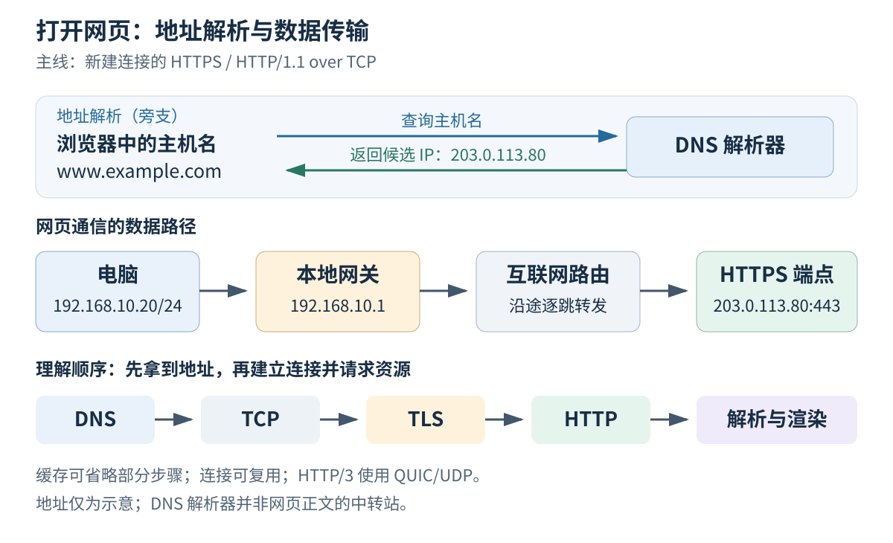

在浏览器地址栏输入 `https://example.com/index.html` 并按下回车，短短几百毫秒内，屏幕上便优雅地呈现出图文并茂的网页。

这个看似寻常的动作，如果发生故障，终端却会吐出一连串截然不同的报错：

- 有时提示 `DNS_PROBE_FINISHED_NXDOMAIN`（域名不存在）；
- 有时提示 `ERR_CONNECTION_TIMED_OUT`（连接超时）；
- 有时弹出刺眼的红屏警告 `NET::ERR_CERT_COMMON_NAME_INVALID`（数字证书不匹配）；
- 有时页面赫然显示 `404 Not Found` 或 `502 Bad Gateway`。

为什么同样是“网页打不开”，背后的排查思路却天差地别？

答案在于：**计算机网络从来不是一个单体黑盒，而是一套高度精密、严格分层的协议协作体系。** 从键盘按下到像素点亮的瞬间，数据包经历了一场跨越应用层、传输层、网络层、数据链路层与物理光纤的壮丽远征。

本文作为《计算机网络通识》专栏的总纲地图，将沿着一次真实 Web 请求的完整时序，剖析数据包在协议栈中的逐层封装与拆解，为你建立起一张全景式的网络心智模型。

## Table of contents

## 第一章：全局时序鸟瞰——从 URL 到屏幕渲染的六大里程碑

当用户在浏览器输入网址按下回车时，整套系统在毫秒级内依次跨越六大核心里程碑：



```text
1. 域名解析 (DNS): 把人类可读的域名解析为机器寻址的 IP 地址
      │
      ▼
2. 传输连接 (TCP): 经过三次握手，建立端到端的双向可靠字节流信道
      │
      ▼
3. 安全握手 (TLS): 校验服务器数字证书身份，协商对称会话密钥 (HTTPS)
      │
      ▼
4. 应用交互 (HTTP): 浏览器发送 GET 请求报文，服务器响应数据与缓存头
      │
      ▼
5. 链路穿透 (IP & 以太网): 路由器最长前缀匹配逐跳转发，交换机 MAC 自学习交付
      │
      ▼
6. 客户端呈现 (Rendering): 浏览器解析 HTML/CSS 构建 DOM 树与渲染树，加载子资源并绘制
```

任何一个阶段出现故障，都会在特定层级抛出专属的错误。接下来，我们以显微镜般的精度拆解这一链路。

---

## 第二章：里程碑一与二——寻找目的地与建立可靠信道

### 1. 域名解析（DNS）：网络的电话本

浏览器拿到的 URL 包含了域名 `example.com`。然而，互联网路由器在 IP 协议层只能识别类似于 `93.184.216.34` 的二进制 IP 地址。

1. **本地多级缓存先验检索**：
   浏览器并不会立刻发送网络报文，而是沿着缓存链层层检索：
   - 浏览器自身缓存 $\to$ 操作系统 DNS 缓存（Linux 下由 `nscd` 或 `systemd-resolved` 维护） $\to$ 本地 Hosts 静态映射表（`/etc/hosts`）。
2. **递归查询与迭代查询**：
   若本地无缓存，操作系统向本地网络配置的 **递归 DNS 服务器（如局域网网关或 `8.8.8.8`）** 发起请求。递归服务器代表客户端向全球根域名服务器、顶级域（.com）服务器、权威域名服务器逐级发起**迭代查询**，最终取得目标 IP 地址并缓存返回。

### 2. 传输层连通：TCP 三次握手

拿到 IP 地址与目标端口（HTTPS 默认为 `443`，HTTP 默认为 `80`）后，操作系统内核的网络栈登场，调用 `connect()` 系统调用向服务端发起 **TCP 三次握手**：

```text
客户端 (Client)                                   服务端 (Server)
      │                                                │
      │ ─── 1. SYN (seq=x) ──────────────────────────> │ (服务端进入 SYN_RCVD)
      │                                                │
      │ <── 2. SYN + ACK (seq=y, ack=x+1) ──────────── │ (同步双向初始序列号)
      │                                                │
      │ ─── 3. ACK (ack=y+1) ────────────────────────> │ (连接建立: ESTABLISHED)
```

**为什么不能是两次握手？**
三次握手的物理本质，是**在不可靠的物理网络之上，可靠地同步双向的初始序列号（ISN），并确认双方都具备正常的数据收发能力**。同时，第三次握手防止了网络中因延迟迷途的旧连接请求突然到达服务端，导致服务端凭空建立废弃死连接而消耗系统资源。

---

## 第三章：里程碑三与四——安全加固与业务数据流转

### 1. 安全握手（TLS 1.3）：构筑防窃听与防篡改防线

连接建立后，如果是明文的 HTTP，黑客可以在途经的任意路由器上进行窃听和篡改。现代 Web 标配 HTTPS（HTTP over TLS）。

在 TLS 1.3 握手中：

1. **身份认证**：服务器向浏览器出示经过国际权威 CA 机构数字签名的 X.509 证书。浏览器通过内置的根证书公钥链，逐级递归验证服务器身份的真实性（防中间人钓鱼攻击）；
2. **密钥协商**：利用 ECDHE 椭圆曲线算法，在公开的网络信道上安全协商出一套临时对称加密密钥（具备前向保密性，即便未来私钥泄露也无法破解历史报文）；
3. **加密传输**：后续所有 HTTP 报文全部使用该对称密钥进行 AES-GCM / ChaCha20 加密与 MAC 消息完整性校验。

### 2. 应用层交互：HTTP 报文与双层缓存

在加密信道内部，浏览器按照 HTTP 规范组装出请求报文：

```http
GET /index.html HTTP/1.1
Host: example.com
User-Agent: Mozilla/5.0 ...
Accept: text/html,application/xhtml+xml
Accept-Encoding: gzip, deflate, br
Connection: keep-alive
```

服务端接收并解析请求，返回对应的响应报文：

```http
HTTP/1.1 200 OK
Content-Type: text/html; charset=UTF-8
Content-Length: 1256
Cache-Control: max-age=3600
ETag: "686897696a7c876b7e"

<!DOCTYPE html>
<html>...</html>
```

浏览器在此处会处理**双层缓存协商机制**：

- **强缓存（Cache-Control）**：如果在有效期（`max-age=3600`）内，下次用户访问直接读取内存/磁盘缓存，根本不需要发送任何网络请求；
- **协商缓存（ETag / If-None-Match）**：缓存过期时，浏览器携带 `If-None-Match: "686897..."` 询问服务端文件是否改变。若未变，服务端直接返回轻量的 `304 Not Modified`，避免重复传输相同的内容。

---

## 第四章：物理穿透——协议栈逐层封装与路由器逐跳转发

很多初学者容易将上述过程想象为“浏览器与服务器在空中直接喊话”。在操作系统的真实网络栈中，每一次数据发出，都经历了一场严密的**俄罗斯套娃式封装（Encapsulation）**与网关逐跳转发。

### 1. 协议栈逐层封包流水线

我们在应用层生成的仅仅是一串包含 HTML 的数据载荷（Payload）。数据向下流经操作系统内核时，每一层协议都会为其戴上一顶“帽子”：

```text
[应用层 (HTTP)]     │ HTTP 文本请求 / 响应报文
                    ▼
[传输层 (TCP)]      │ [TCP 报头 (源端口, 目的端口, Seq, Ack)] + [HTTP 数据]
                    ▼
[网络层 (IP)]       │ [IP 报头 (源 IP, 目的 IP, TTL)] + [TCP 报文段]
                    ▼
[链路层 (以太网)]   │ [以太网帧头 (源 MAC, 目的 MAC)] + [IP 数据报] + [FCS 校验尾]
                    ▼
[物理介质]          │ 转换为网线高低电平 / 光纤光脉冲 / Wi-Fi 电磁波
```

### 2. 逐跳转发的“变与不变”

当以太网帧从本机网卡发出，经过多级家用路由器、运营商交换机、核心网骨干路由时：

> **网络路由黄金铁律**：
>
> - **不变的是逻辑终点**：在整个公网转发过程中，数据报中的 **源 IP 地址** 和 **目的 IP 地址** 始终保持恒定不变！
> - **变化的是物理单跳**：数据每跨越一个路由器接口，**以太网帧头都会被剥离重写**！帧头中的 **源 MAC** 会被修改为当前路由器的出口 MAC，**目的 MAC** 会被修改为下一跳（Next Hop）网关的物理 MAC！
> - **生存时间防死锁**：IP 报头中的 **TTL（Time to Live）** 每经过一个路由器自动减 1。当减为 0 时报文被丢弃并返回 ICMP 超时通知，彻底防止由于路由环路导致网络堵死。

---

## 第五章：分层视角下的网络排错指南

理解了全流程的协议栈分工，当面对网络异常时，我们就能拥有外科手术般的定位能力，告别盲目刷新：

| 故障现象与报错信息            | 发生阶段与层级         | 底层根本诱因                                                              | 针对性排查抓手                                      |
| :---------------------------- | :--------------------- | :------------------------------------------------------------------------ | :-------------------------------------------------- |
| `DNS_PROBE_FINISHED_NXDOMAIN` | 命名解析阶段（L7/DNS） | 域名未注册、权威服务器无记录或本地 DNS 污染                               | `nslookup domain` 或 `dig @8.8.8.8 domain` 测试解析 |
| `ERR_CONNECTION_REFUSED`      | 传输层（L4/TCP）       | 目标服务器在线，但对应端口没有服务在 `listen` 监听，服务端回送 `RST` 报文 | 检查服务端进程是否存活、端口是否被防火墙阻断        |
| `ERR_CONNECTION_TIMED_OUT`    | 网络层/传输层（L3~L4） | 数据包在途经路由被静默丢弃，或服务器未回包导致三次握手 SYN 重传超时       | `ping` 检查连通性，`traceroute` 定位断点跳数        |
| `NET::ERR_CERT_DATE_INVALID`  | 安全握手阶段（TLS）    | 服务器证书过期，或客户端本机系统时间严重偏差                              | 检查证书有效期限，核对本地系统时钟 NTP              |
| `HTTP 502 Bad Gateway`        | 应用基础设施层（L7）   | 边缘反向代理（如 Nginx）正常，但背后的后端业务上游进程崩溃宕机            | 检查后端应用服务器运行状态与上游套接字配置          |
| `HTTP 504 Gateway Timeout`    | 应用基础设施层（L7）   | 代理已建立连接，但后端业务代码执行数据库慢查或死锁，超时未回包            | 优化后端业务性能、排查慢查询与连接池                |

---

## 总结与后续篇章指引

输入网址按下回车，这看似寻常的一瞬间，凝聚了人类通信工程半个多世纪的智慧积淀：

- 每一层协议都只专注于解决自己的核心命题（DNS 管名字、TCP 管可靠、IP 管寻址、以太网管单跳传输、TLS 管安全、HTTP 管业务内容）；
- 各层协议通过严格标准化的接口层层组装，构建起了整座互联互通的信息大厦。

在建立了这张宏观全景地图之后，从下一篇开始，我们将自底向上逐层攻克网络世界的每一个核心堡垒：

- 在同一个办公室的局域网里，两台电脑没有路由器又是如何通过 MAC 地址与 ARP 广播找到彼此的？请阅读：**[《两台电脑在同一个局域网里，怎样找到彼此？》](/blog/posts/how-devices-communicate-on-a-lan/)（专栏第 2 篇）**！
