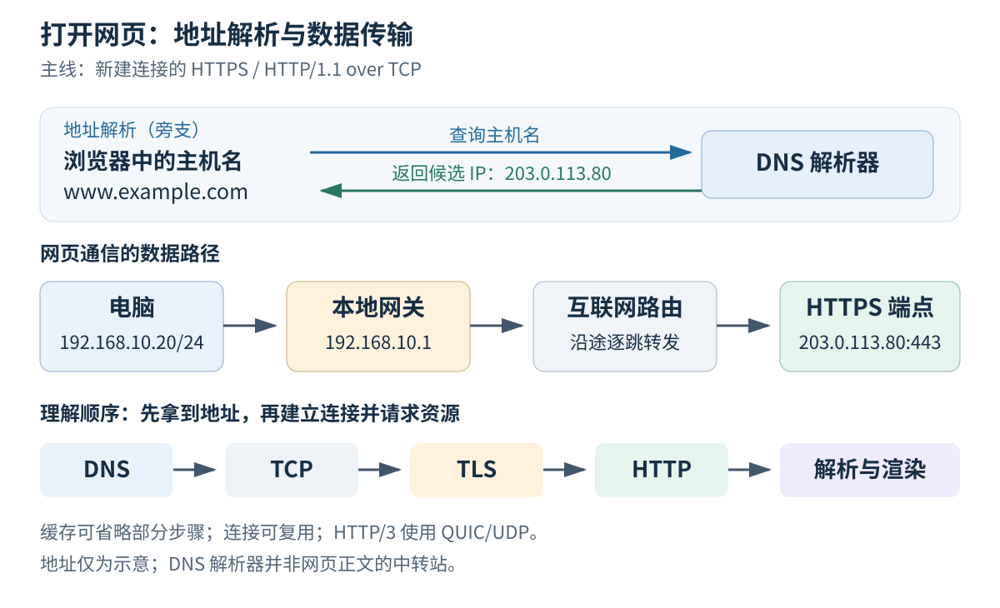

你在浏览器里输入一个网址，按下回车，几秒后看到了文字和图片。看起来像是“网页自己出现了”，实际上是你的电脑向别的电脑请求数据，再把收到的数据画到屏幕上。

这一篇从这里出发，不要求你懂编程、二进制或任何网络缩写。第一次阅读只需要能说清楚：**谁在请求、向谁请求、数据经过哪里、收到后由谁显示。** 后半篇再把这些动作对应到协议名称。

## Table of contents

## 从零开始：我们到底在连接什么？

### 电脑里运行程序，程序才是通信的参与者

电脑、手机是设备；浏览器、聊天软件是设备上运行的程序。操作系统是管理设备和程序的基础软件，例如 Windows、Linux、Android。程序想使用网卡发送数据，通常要请操作系统帮忙，不能凭一句“发给对方”就把文字送到空气中。

**网络** 是让设备之间可以交换数据的一套连接和规则。两台电脑用合适的网线和配置连接起来，可以组成很小的网络。家里的电脑、手机和打印机也可以组成网络。许多网络再通过路由器相互连接，形成我们日常使用的互联网。

网页只是互联网的一种用途。视频通话、联网游戏、文件传输也使用网络；所以“浏览器打不开网页”与“所有网络通信都失效”不能直接画等号。

### 数据、比特、字节：图片怎么变成能传输的东西？

计算机不会把一张照片作为一张小纸片塞进网线。它按约定把文字、图片、声音表示成数字，再把数字表示成一连串 0 和 1。一个二进制位叫 **比特**，英文 bit；8 个比特组成一个 **字节**，英文 byte。

例如，按常见的 ASCII 编码，英文字母 `A` 可以表示成数字 65，再写成 8 位二进制 `01000001`。中文字符在 UTF-8 编码中通常需要多个字节，因此“一个字符”不等于“一个字节”。本系列提到文件大小和传输长度时，说的通常是字节数。

网线上传播的是电信号，光纤里是光信号，无线网络里是无线电信号。设备把数字转换成信号，对端再按规则还原。初学时不必掌握电路原理，但要知道：**真正移动的是代表数据的信号，接收方按同样的规则解释它们。**

### 协议是什么？为什么双方不能各说各话？

假设你和朋友约定：先发一个数字表示后面有几个字，再发文字。如果你发 `3猫来了`，朋友就知道接下来读三个字。若朋友把第一个数字理解成“消息编号”，同一段内容就会被误解。

这种“如何组织消息、各字段代表什么、收到后怎样回应”的共同约定，就叫 **协议**。网络协议更严格，还会规定长度单位、错误处理等细节。后面出现的 HTTP、TCP、IP 都是协议名称；不用先背全称，先记它们分别解决什么问题。

### 客户端与服务器，是一次交流中的角色

你想看一篇文章，浏览器主动提出请求，扮演 **客户端**。远端有程序等待请求并返回文章，扮演 **服务器程序**。承载这个程序的电脑，也常被简称为“服务器”。这里的服务器不一定是特别巨大的机器，你自己的电脑也能运行服务器程序。

一次最小交流可以写成：

```text
你的浏览器：请把首页发给我。        ← 请求
远端程序：找到了，这是首页的数据。 ← 响应
你的浏览器：解释这些数据并显示。
```

“客户端”和“服务器”描述分工，不是永远固定的设备身份。一台提供网页的服务器，也可能作为客户端向另一台数据库服务器请求数据。

## 先不用缩写，跟着一次请求走完全程

想象你要访问一家图书馆的网站。这次访问先做五件事：

1. **认清你写的名字。** 网址里既有网站名称，也有文章路径。先知道要去哪一家，再知道要找哪一篇。
2. **找到网络地址。** 人容易记名称，网络需要可用于寻址的数字地址。查询名称对应地址的机制叫 DNS。
3. **把数据交出去。** 电脑先把数据交给身边的设备，再由沿途设备逐站转发。这不是电脑与网站之间的一条直达网线。
4. **准备并保护这次交流。** 在本文选择的场景里，TCP 帮双方维护数据传送的顺序与进度，TLS 保护传输并验证网站身份。
5. **发出具体请求，接收结果。** HTTP 规定浏览器怎样说“我要这篇文章”，服务器怎样说“找到了”或“没有找到”。

最后浏览器把文档、样式和图片组合成页面。HTML 可以先理解为“描述页面结构的文字”，CSS 是样式规则，JavaScript 是浏览器可以执行的程序。它们不是新的网线，也不是新的地址。

## 给后面反复出现的词安排位置

| 词语    | 零基础理解                           | 本次访问中的例子           |
| ------- | ------------------------------------ | -------------------------- |
| 域名    | 方便人记忆的网络名称                 | `www.example.com`          |
| IP 地址 | 网络用来寻址的数字地址               | 教学地址 `203.0.113.80`    |
| 端口    | 同一传输协议下区分通信入口的数字     | HTTPS 常用 443             |
| 路由器  | 在不同网络之间转发数据的设备         | 家里的路由器是第一站之一   |
| 数据包  | 带有控制信息的一块数据               | 包中有目的地址等字段       |
| 缓存    | 把取得的结果暂存起来，之后按规则复用 | 已下载的图片、已查到的地址 |

“包”是入门时的宽泛叫法。后面会按所处层次区分以太网帧、IP 包、TCP 段。现在先想成一份较大内容会分成许多可运输的小块，每块需要附上帮助交付的信息；不必一下记住所有格式。

第一次看下图时，只跟着“电脑 → 本地网络 → 路由器 → 网站”这条主线。DNS 旁边的箭头表示查地址；网站正文并不会因为查过 DNS，就必须绕到 DNS 服务器那里。

> [!TIP] 这一篇怎样读
> 先读到“最后一步”建立全景，再做浏览器观察即可。首部字段、命令计时和现实分支用于第二遍阅读。后续第 2—5 篇拆解地址与转发，第 6—10 篇拆解传输，第 11—14 篇拆解网站协议和服务架构。

## 这个系列怎样循序阅读

| 学习阶段           | 文章                                                                                                                                                        | 先能回答的问题                               |
| ------------------ | ----------------------------------------------------------------------------------------------------------------------------------------------------------- | -------------------------------------------- |
| 建立全景           | 第 1 篇，本文                                                                                                                                               | 一次访问由谁参与、经过哪些步骤？             |
| 认识地址与道路     | [第 2 篇局域网](/blog/posts/how-devices-communicate-on-a-lan/)到[第 5 篇 DNS](/blog/posts/how-dns-resolution-works/)                                        | 地址怎样取得，第一跳交给谁，后面怎样转发？   |
| 理解程序之间的传输 | [第 6 篇端口](/blog/posts/understanding-ports-and-sockets/)到[第 10 篇关闭连接](/blog/posts/how-tcp-connections-close/)                                     | 数据交给哪个程序，怎样编号、补齐和结束？     |
| 理解网站交流       | [第 11 篇 HTTP](/blog/posts/understanding-http-requests-responses-and-caching/)到[第 14 篇 CDN](/blog/posts/understanding-proxies-load-balancers-and-cdns/) | 请求表达什么，如何认证，入口如何分工？       |
| 跨越网络边界       | [第 15 篇 NAT 基础](/blog/posts/why-inbound-connections-fail-behind-nat/)与[第 16 篇 IPv6](/blog/posts/ipv6-is-more-than-longer-addresses/)                 | 内外地址为何不同，新协议改变了哪些机制？     |
| 阅读技术译文       | 第 17—19 篇 VPN、Tailscale、NAT 穿透                                                                                                                        | 用前面的概念理解真实系统设计；三篇保留原译文 |
| 综合使用           | [第 20 篇排障](/blog/posts/a-layered-guide-to-network-troubleshooting/)                                                                                     | 看到一个错误后，下一步应该收集什么证据？     |

每篇先读生活场景、术语和逐步例子，再对照图。标为“进阶”的细节和 Python 实验可留到第二遍。文末自测先尝试自己回答，再展开答案；不必为了“读完”而一次记住所有缩写。

## 从具体网址开始，把刚才的五件事展开

考虑这个网址：

```text
https://www.example.com/articles/network?lang=zh#tcp
└─协议  └────主机名────┘└──────路径─────┘└查询┘└片段
```

浏览器不会把这一整串文字直接交给 DNS。

| 部分                | 在本次访问中的用途                                         |
| :------------------ | :--------------------------------------------------------- |
| `https`             | 选择使用安全的 HTTP 通信；没有显式端口时默认端口为 443     |
| `www.example.com`   | 标识要访问的主机名，需要获得可连接的地址                   |
| `/articles/network` | 告诉 HTTP 服务要请求哪个资源                               |
| `?lang=zh`          | 作为查询字符串交给服务端处理                               |
| `#tcp`              | 通常由浏览器定位页面片段，不包含在发送给服务端的请求目标中 |

URL 的这几部分承担不同职责：[MDN 的 URL 说明](https://developer.mozilla.org/en-US/docs/Learn_web_development/Howto/Web_mechanics/What_is_a_URL)分别介绍了协议、主机、端口、路径、查询和片段。这里最值得记住的是：**域名用于寻找服务入口，路径用于请求入口后面的资源。**

同一个域名可以解析出多个地址；同一个 IP 地址也可以承载多个网站。把“域名”“IP”“网页”当成一一对应的关系，后面遇到负载均衡和虚拟主机就会困惑。

## 第一步：拿到可以连接的地址

IPv4 和 IPv6 是两种 IP 协议版本，地址的写法和长度不同。这里先用四组十进制数字的 IPv4 举例；第 16 篇再解释带冒号的 IPv6 地址。

浏览器可能先利用已有的解析结果，也可能通过系统解析服务或自己的 DNS 机制发起查询。我们暂时只关心查询的目标：获取主机名对应的 IPv4 或 IPv6 地址。

假设本次得到一个示意地址 `203.0.113.80`，浏览器便拥有了一个候选通信端点：

```text
服务地址：203.0.113.80
服务端口：443
```

这还不能说明网站一定能打开。地址可能不可达，443 端口可能没有服务，也可能在后面的证书校验或 HTTP 处理中失败。

DNS 自己也需要网络通信。这里把 DNS 写在 TCP 前面，是按照“先获得服务地址，再连接该服务”的依赖关系叙述；DNS 查询本身同样要经过网络接口、路由器和相应的传输协议。

我们将在[第 5 篇：DNS 解析](/blog/posts/how-dns-resolution-works/)里展开解析器、根服务器、权威服务器和缓存之间的关系。

## 第二步：知道目的地之后，先决定交给谁

先给几个即将出现的词作最小解释：**子网** 是按地址前缀划出的网络范围；**默认网关** 是缺少更具体路由时交给的下一站；**MAC 地址** 用于当前本地链路上的交付；**ARP** 帮 IPv4 主机查询本地下一站的链路地址。**帧** 则是这一层装载内容的传输单位。第 2—4 篇会把这些关系分别展开。

假设电脑的 IPv4 地址是 `192.168.10.20/24`，默认网关是 `192.168.10.1`。目标地址 `203.0.113.80` 不属于这个本地子网。

操作系统查询路由表，选择出接口和下一跳。在这个简化场景中，下一跳就是默认网关。接下来，如果使用以太网且邻居缓存没有对应记录，主机需要通过 ARP 获得网关接口的 MAC 地址，才能构造发往这一跳的以太网帧。

注意这里的两个目的地：

```text
IP 层的目的地：203.0.113.80 —— 我要与哪个远端端点通信
本地帧的目的地：网关的 MAC —— 这一跳先把数据交给谁
```

主机不需要事先知道远端服务器的 MAC 地址，也不需要掌握沿途每个路由器的完整清单。它只要根据本地转发表选好下一跳；后续路由器再各自做下一次选择。

家庭网络通常还有 NAT，进入互联网时源地址可能被转换。这个变化不影响我们先建立“远端目的地”和“当前下一跳”两个概念，NAT 会在后面的专题中展开。



_图为原创示意。DNS 解析器提供地址信息，不是网页正文必须经过的中转站。_

## 第三步：TCP 建立一条可用的字节流

“字节流”就是按顺序读取的一串字节。后面的 SYN 表示开始同步序列号，ACK 表示确认；这篇先认识它们是建立连接时的控制消息，第 7 篇再逐个解释数字。

浏览器通过操作系统创建连接，本地通常分配一个临时端口，例如 `53124`。在源地址尚未被 NAT 改写的观察位置，这条 TCP 连接可以用四元组描述：

```text
192.168.10.20:53124 → 203.0.113.80:443
```

新连接通常先经历三次握手：

```text
客户端                         服务端
   | ---------- SYN ----------> |
   | <------- SYN + ACK -------- |
   | ---------- ACK ----------> |
```

握手让双方建立连接状态，并同步后续通信所需的初始序列号等信息。TCP 随后提供的是 **可靠、有序的字节流**；应用程序不需要自行把收到的乱序 TCP 数据重新排好，但仍然必须处理连接中断、读写错误和超时。

[RFC 9293](https://www.rfc-editor.org/rfc/rfc9293.html)给出了 TCP 的规范。对于刚开始学习的读者，先抓住一个边界：TCP 负责字节传送，不理解 HTML、HTTP 状态码，也不会替应用程序判断“这次业务已经成功”。

此外，一次 `send()` 并不承诺在对端对应一次 `recv()`。应用协议需要自己规定消息边界。这个问题会在 TCP 专题里通过小程序演示。

## 第四步：TLS 验证身份，并保护连接中的数据

建立 TCP 连接不等于已经建立安全连接。HTTPS 还需要 TLS。密钥是保护通信使用的参数；证书把名称与公钥等信息关联起来；私钥是持有者必须保护的秘密。第 12 篇会从这些概念开始讲，这里先理解三个保护目标。

以现代 TLS 1.3 的常见证书认证流程为例，客户端与服务端协商参数、完成密钥交换，服务端证明自己拥有与证书关联的私钥。浏览器检查证书链、有效期和主机名等条件；满足要求后，双方使用协商出的密钥保护应用数据。[RFC 8446](https://www.rfc-editor.org/rfc/rfc8446.html)定义了 TLS 1.3。

可以用三个问题理解这一步：

- **身份**：连接的对方是否有权代表这个域名？
- **机密性**：旁路观察者能否直接读出 HTTP 内容？
- **完整性**：数据在传输途中被修改，接收方能否发现？

保护的边界是 TLS 的两个端点。如果浏览器连接的是 CDN 边缘节点，浏览器这一段 TLS 就终止在该节点；边缘节点到源站的连接，需要另外考察。

HTTPS 也不会让所有网络信息消失。通信地址、流量大小和时序仍可能被观察；DNS 是否加密是另一个问题。判断“谁看得到什么”，必须先标明观察位置。

## 第五步：HTTP 才开始表达“我要哪个网页”

握手完成后，浏览器才能在这条连接上发送受 TLS 保护的 HTTP 请求。在我们选定的 HTTP/1.1 场景中，请求解密后的逻辑形式大致如下：

```http
GET /articles/network?lang=zh HTTP/1.1
Host: www.example.com
Accept: text/html

```

这里没有 `#tcp`。路径和查询参数进入请求目标，主机名则由 `Host` 等机制帮助服务端识别请求的目标站点。

服务端可能直接读取一个静态文件，也可能让应用程序查询数据库后生成响应；还可能返回重定向或错误。比如：

```http
HTTP/1.1 200 OK
Content-Type: text/html; charset=utf-8
Content-Length: 13

<h1>Hello</h1>
```

这是一段自拟的最小响应，正文恰好是 13 个 ASCII 字节。真实页面会有更多首部和更大的正文。

HTTP 定义请求、响应和资源操作的语义，具体规定可查阅 [RFC 9110](https://www.rfc-editor.org/rfc/rfc9110.html)。这里可以立刻得到一个排障结论：**看到 HTTP 404，说明已经有 HTTP 服务给出了响应，不能简单归类为“网络完全不通”。** 这个响应也可能来自代理或边缘节点，仍需确认是谁返回的。

## 同一份内容，为什么会有这么多层包装？

在主线场景中，数据交给下层时，各层会附上完成自身任务所需的信息：

```text
HTTP 消息
  ↓ TLS 保护
TLS 记录中的密文
  ↓ TCP 传送字节
TCP 段
  ↓ IP 寻址与转发
IP 数据包
  ↓ 通过当前链路发送
以太网帧 → 物理介质上的信号
```

这是职责示意，不意味着“一条 HTTP 消息 = 一个 TLS 记录 = 一个 TCP 段 = 一个帧”。实际传输中，数据会被分段、合并或拆分，不同层的边界并不一一对应。

| 层次或机制 | 主要关心的问题             | 可以观察的线索       |
| :--------- | :------------------------- | :------------------- |
| HTTP       | 请求哪个资源，返回什么结果 | 方法、路径、状态码   |
| TLS        | 如何认证并保护通信         | 证书、握手、加密记录 |
| TCP        | 哪个连接，哪些字节已经收到 | 端口、序列号、确认号 |
| IP         | 目标地址是什么，往哪里转发 | IP 地址、路由、TTL   |
| 链路层     | 当前链路上交给哪个邻居     | MAC 地址、以太网帧   |

学习分层的价值，是把责任定位清楚。排查证书名称不匹配时，反复修改子网掩码通常无济于事；分析 DNS 超时时，也不能只盯着网页 JavaScript。

## 最后一步：收到字节，浏览器还要把它变成页面

HTML 到达后，浏览器解析文档，并按需请求样式、脚本、字体和图片。随着资源到达，它继续执行样式计算、布局与绘制。[MDN 的浏览器工作流程](https://developer.mozilla.org/en-US/docs/Web/Performance/Guides/How_browsers_work)把导航、响应、解析和渲染分开讨论，适合在这一点上继续阅读。

浏览器可以在整个页面下载完之前开始解析和显示部分内容。反过来，网络请求都结束了，也不意味着页面一定已经流畅可用：主线程可能还在执行脚本。

所以“网页慢”至少可能指三种不同现象：连接建立慢、服务器迟迟不回首字节、数据到达后浏览器处理慢。把它们混在一起，很容易选错优化方向。

## 动手观察：把抽象过程放进时间轴

先完成一个完全不需要代码的观察。准备 Chrome 或 Edge 浏览器即可。这里的 `example.com` 是供文档举例使用的网站；实际访问仍依赖你所在网络。本文后面的 `203.0.113.80` 则只是纸上推演地址，不要拿它做连通性测试。

### 用浏览器看请求

在 Windows 上，先按 `F12`，或从浏览器菜单进入“更多工具 → 开发者工具”。如果面板没有展开，试 `Ctrl+Shift+I`。选择“网络 / Network”标签，再访问网站或按 `Ctrl+R` 刷新。**必须先打开面板再刷新**，它才会记录这次请求。

列表中的一行通常代表一次资源请求，不是一个网络数据包。一张网页可能有很多行，因为文档、图片和脚本可以分别请求。点击主文档的一行，右侧的“标头 / Headers”显示请求和响应的说明信息，“响应 / Response”显示内容，“时间 / Timing”显示各阶段用时。先看这三个区域，不需要安装抓包软件。

如果看不到某个英文标签，留意浏览器的中文对应项，或展开面板右侧的更多标签菜单。页面能打开但列表为空，先确认正在录制，然后重新刷新。

在 Chrome 或 Edge 中打开开发者工具的 Network 面板，然后访问 `https://example.com/`：

1. 找到类型为 Document 的主文档请求，查看请求方法、状态码和远端地址。
2. 显示 Protocol 列，观察本次使用的是 HTTP/1.1、h2 还是 h3。
3. 打开 Timing，区分 DNS、连接、TLS、等待响应和下载阶段。
4. 再次刷新，对比哪些阶段缩短或没有单独显示。

Network 面板的字段和操作可对照 [Chrome DevTools 文档](https://developer.chrome.com/docs/devtools/network/reference)。阶段为空或显示为零，可能因为连接或解析结果被复用，不是协议突然不需要这些机制。

面板里的 Disable cache 主要用于关闭 HTTP 缓存，不能把它当成“清空所有 DNS 缓存、连接池和 TLS 会话”的按钮。

### 可选进阶：用 curl 看累计时间

curl 是在终端中发送请求并显示结果的工具，暂时不熟悉命令行可以跳过。本命令中的 `--http1.1` 选定协议版本，`-o NUL` 丢弃下载正文，`-sS` 隐藏进度但保留错误，`-w` 指定要打印的统计字段；两个 timeout 参数限制连接与整个操作的等待时间。它不会修改你的网络配置。

Windows PowerShell：

```powershell
curl.exe --http1.1 -o NUL -sS --connect-timeout 10 --max-time 30 -w "dns=%{time_namelookup}s connect=%{time_connect}s tls=%{time_appconnect}s first_byte=%{time_starttransfer}s total=%{time_total}s\n" https://example.com/
```

Linux/macOS 使用同一命令时，将 `curl.exe` 改为 `curl`、`NUL` 改为 `/dev/null`。参数含义来自 [curl 手册](https://curl.se/docs/manpage.html)。

这些时间大多是从请求开始算起的 **累计时间**。下面只是用于练习阅读的示意结果，不是性能测试数据：

```text
dns=0.012s connect=0.040s tls=0.090s first_byte=0.140s total=0.145s
```

在一次简单、无代理、无重定向的新连接中，可以粗略拆成：

- DNS：`0.012 s`；
- 建立 TCP 的增量：`0.040 - 0.012 = 0.028 s`；
- TLS 的增量：`0.090 - 0.040 = 0.050 s`；
- TLS 完成至首字节：`0.140 - 0.090 = 0.050 s`。

最后一个差值包含请求传输、服务端处理和响应返回，不能直接称作“服务器计算耗时”。代理、连接复用和网络环境也会影响这些数值。

## 现实访问会走哪些分支？

现在可以给最初的主线加上几个分支，而不必推翻已经建立的模型：

- **命中 HTTP 缓存**：可能直接使用本地响应，也可能发起条件请求。
- **复用已有连接**：不一定再次执行完整的 TCP、TLS 握手。
- **使用 HTTP/2**：仍可在 TCP 与 TLS 上承载，但多个请求可以共享连接中的不同流。
- **使用 HTTP/3**：承载在 QUIC 上，通常通过 UDP 通信，不应再画成“先 TCP 三次握手”。QUIC 的基础定义见 [RFC 9000](https://www.rfc-editor.org/rfc/rfc9000.html)。
- **使用代理或 CDN**：浏览器实际连接的端点可能是代理或边缘节点，后面还存在另一段通信。

再遇到“从输入 URL 到页面显示发生了什么”这个问题，就可以先说明场景，再沿依赖关系讲清楚每一步，而不是背一条永远不变的流水线。

下一篇把范围收回到同一个局域网，研究其中最先要解决的事情：[两台电脑怎样找到彼此，并把帧交到对方手里？](/blog/posts/how-devices-communicate-on-a-lan/)

## 读完后，用自己的话试着解释

DNS 已经返回地址，但浏览器显示 404。DNS、TCP、HTTP 三者中，哪个已经给出了与你看到的错误直接相关的结果？

<details>
<summary>展开参考答案</summary>
<div class="mt-4 leading-7">是 HTTP 响应者给出了 404。DNS 返回地址不保证目标路径存在；404 本身说明拿到了 HTTP 回应，还需要确认是网站、代理还是其他入口返回。</div>
</details>

## 参考与延伸阅读

- [Cloudflare：How does the Internet work?](https://www.cloudflare.com/learning/network-layer/how-does-the-internet-work/)——互联网与网页访问的入门视角。
- [Practical Networking：Packet Traveling](https://www.practicalnetworking.net/series/packet-traveling/packet-traveling/)——沿数据包路径组织知识的系列。
- [MDN：What is a URL?](https://developer.mozilla.org/en-US/docs/Learn_web_development/Howto/Web_mechanics/What_is_a_URL) 与 [How browsers work](https://developer.mozilla.org/en-US/docs/Web/Performance/Guides/How_browsers_work)——URL 结构及浏览器处理过程。
- [RFC 9293：TCP](https://www.rfc-editor.org/rfc/rfc9293.html)、[RFC 8446：TLS 1.3](https://www.rfc-editor.org/rfc/rfc8446.html)、[RFC 9110：HTTP Semantics](https://www.rfc-editor.org/rfc/rfc9110.html)、[RFC 9000：QUIC](https://www.rfc-editor.org/rfc/rfc9000.html)——对应协议的规范依据。
- [Chrome DevTools Network](https://developer.chrome.com/docs/devtools/network/reference) 与 [curl 手册](https://curl.se/docs/manpage.html)——动手观察时的工具说明。
