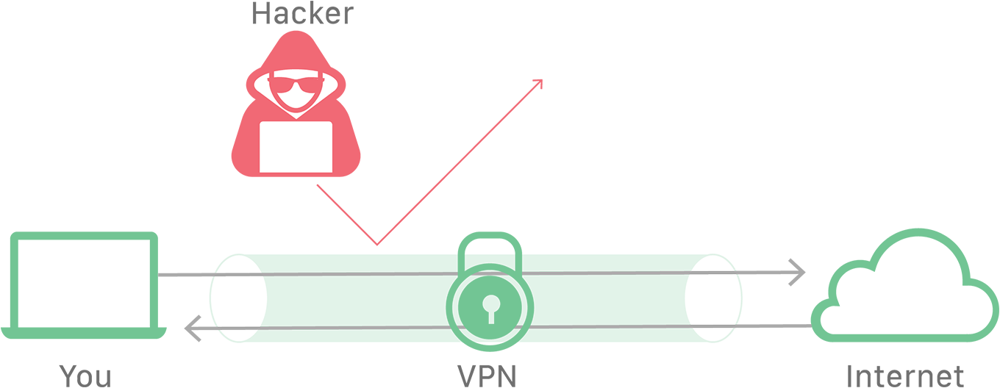
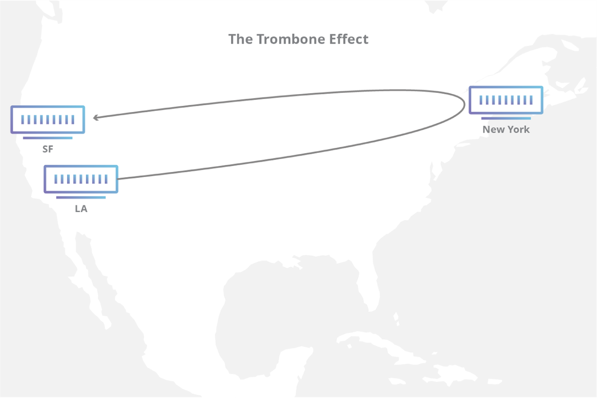

> [!NOTE] 专栏导读
> 本文翻译与深度整理自全球顶级边缘云与网络安全基础设施巨头 Cloudflare 的权威知识库 [《Cloudflare Learning Center: What is a VPN?》](https://www.cloudflare.com/learning/access-management/what-is-a-vpn/)。
>
> 在本专栏的前面两篇文章中，我们已经深度探讨了新一代点对点 Mesh VPN（[《Tailscale 是如何工作的》](/blog/posts/how-tailscale-works/)）以及其最核心的底层打洞黑魔法（[《NAT 穿透是如何工作的》](/blog/posts/how-nat-traversal-works/)）。
>
> 但对于刚接触计算机网络的初学者来说，**VPN（Virtual Private Network，虚拟专用网络）** 本身究竟是什么？它为什么要叫“虚拟”？它为什么能骗过操作系统、隐藏你的真实 IP 并防范窃听？传统中心化 VPN 又存在哪些致命性能与安全瓶颈？
>
> 本文将作为《计算机网络通识》专栏关于虚拟组网的**基石开篇**，结合 Cloudflare 官方原版图解，为你系统拆解 VPN 的底层机理与现代演进。

---

## Table of contents

---

## 核心速览（Article Summary）

* **加密隧道与隐私保护**：虚拟专用网络（VPN）通过在客户端与远端服务器之间建立一条**端到端加密的专用网络隧道**，有效隐藏用户的真实公网 IP 地址，保护敏感数据免遭互联网服务提供商（ISP）、恶意黑客以及局域网嗅探者的窥探。
* **流量中继与地理伪装**：通过将用户的全部网络请求经由远端服务器转发，VPN 能够绕过本地网络审查与地理封锁（Geo-restrictions），实现位置匿名性并访问全球互联网。
* **企业级痛点与架构演进**：企业广泛利用 VPN 实现员工远程接入内网。然而，传统 VPN 依赖极其脆弱的 **“城堡与护城河（Castle-and-Moat）”** 边界安全模型，在现代云原生架构下极易引发横向移动渗透。如今，网络架构正在向以 **SASE（安全访问服务边缘）** 和 **零信任（Zero Trust / ZTNA）** 为代表的新一代范式全面演进。

---

## 什么是 VPN？（What is a VPN?）

**虚拟专用网络（Virtual Private Network, 简称 VPN）** 是一种网络连接与安全服务，它允许用户像直接接入了某个私有物理局域网一样，去安全地访问互联网或企业内网资源。

VPN 最核心的能力在于两点：**提供强加密通信** 以及 **提供高度的身份与位置匿名性**。

在日常生活与工程实践中，人们使用 VPN 的最常见场景包括：
1. **防范公共 Wi-Fi 窃听**：在星巴克、机场、酒店等不受信任的开放网络环境下保护密码与个人隐私；
2. **连接企业内部网络**：让远程办公或居家办公的员工安全访问机房内的私有 Git 仓库、数据库与内网系统；
3. **绕过地理限制与审查**：突破特定网络对特定网站的访问限制，保护言论自由。



---

## VPN 是如何工作的？（How does a VPN work?）

要理解 VPN 为什么安全，我们必须先看清楚**没有 VPN 时，普通互联网通信究竟有多么脆弱**。

### 普通网络请求的“裸奔”全流程

在通常情况下，互联网上的大部分基础连接是完全公开且未经端到端专用隧道保护的。当你打开浏览器访问一个网站时，数据包的流转通常经历以下路径：

```
[用户电脑/手机] 
       | (1. 本地 Wi-Fi / 网线广播，明文元数据暴露)
       v
[宽带运营商 (ISP)] 
       | (2. 运营商解析你的 DNS 查询，记录你访问了哪个 IP)
       v
[公网互联网路由器群 (Backbone)] 
       | (3. 沿途数个甚至数十个路由节点转发数据包)
       v
[目标网站服务器]
```

在这条链路的每一个环节，你的个人信息都在向外界裸奔：
* **IP 地址暴露无遗**：你的真实公网 IP 和地理物理位置对目标服务器和沿途所有节点完全公开；
* **上网行为被全程记账**：你的宽带运营商（ISP）和中间路由节点可以轻而易举地记录你的全部上网习惯、访问频率与域名（甚至将其打包出售给广告商）；
* **中间人攻击风险**：在公共 Wi-Fi 等未受控环境下，黑客可以利用 ARP 欺骗轻易发起**在路径攻击（On-Path Attack，即中间人攻击）**，嗅探或篡改你的通信内容。

---

### VPN 接入的四步工作流

相反，当用户通过 VPN 客户端接入网络时，通信被套上了一层坚不可摧的铠甲。整个连接过程被精确划分为以下 **4 个步骤**：

1. **建立加密握手**：用户设备上的 **VPN 客户端软件**（VPN Client）首先向宽带运营商（ISP）发起连接，但在数据离开网卡之前，客户端已将其高强度加密；
2. **运营商盲转发**：宽带运营商（ISP）只负责把这段加密密文路由转发给远端的 **VPN 服务器（VPN Server）**。虽然数据穿过了运营商的网络，但因为所有有效载荷全被加密，运营商只能看到你连接了某台 VPN 服务器，根本无法窥视你实际传输的具体内容；
3. **中继解密与公网访问**：VPN 服务器收到密文后，在受保护的机房内将其解密为原始网络请求，随后**由 VPN 服务器代替你**向真正的目标网站服务器发起访问；
4. **回包封装与隧道返回**：目标网站将响应返回给 VPN 服务器，VPN 服务器将回包重新加密，顺着这条被称为 **“VPN 隧道（VPN Tunnel）”** 的专用通道，安全护送回你的设备。

最终达成的防御效果极其显著：
* **对宽带运营商（ISP）**：它只能看到你正在向一台 VPN 服务器发送加密的乱码流，对你访问的具体网址、网页内容一无所知；
* **对目标网站服务器**：它在访问日志里记录下的访问者 IP，**只是那台 VPN 服务器的公网 IP**，完全查不到你真实的本地物理位置与设备信息！

---

## 为什么说 VPN 不只是为了“隐藏不可告人的秘密”？

在网络安全科普中，经常有人戴着有色眼镜看待 VPN，误以为它只是黑客或非法网络活动的隐匿工具。

事实恰恰相反，在现代数字社会中，VPN 是一项**极其正当且不可或缺的基础数字防御工具**：

### 1. 公共开放 Wi-Fi 的防弹衣
在咖啡馆、商场或机场连接无需密码的开放 Wi-Fi 时，任何接入同一局域网的恶意攻击者，都可以使用 Wireshark、ARP 投毒等唾手可得的黑客工具抓包嗅探你的通信。如果你开启了 VPN，黑客就算抓下你网卡发射出的全部无线电波，也只能看到一串由 AES 或 ChaCha20 加密的混乱密文，根本无法提取你的登录凭证或 Session Cookie。

### 2. 现代企业远程办公（Remote Work）的生命线
跨国企业与现代科技公司普遍允许员工居家办公。通过企业级 VPN，员工能够以受控且强加密的方式，跨越公共互联网接入内网核心机房，访问内部 ERP、代码托管仓库以及私有开发测试环境，同时避免将敏感内部系统直接暴露给公网。

### 3. 规避网络审查与地理限制
在世界上的许多地区，互联网访问受到严苛的内容过滤与地域封锁。通过 VPN 连接至不受限制地区的服务器，能够帮助记者、学者与普通公民自由获取公共资讯，践行基本的信息访问权利。

### 4. 捍卫个人隐私免遭数据贩卖
许多国家的宽带运营商（ISP）会将用户的上网行为数据汇总脱敏后打包出售给大数据分析与精准广告推送巨头。使用受信任的 VPN，能够从根本上阻断 ISP 对你上网痕迹的数据采集。

---

## 传统 VPN 的硬伤与阿喀琉斯之踵（What are the downsides of a VPN?）

尽管 VPN 功勋卓著，但如果盲目信任它，也会带来严重的误区。作为全球最大的边缘网络基础设施厂商，Cloudflare 直截了当地指出了传统 VPN 的致命缺陷：

### 1. 信任转移风险（你真的能信任 VPN 提供商吗？）
**开启 VPN 并不等于绝对安全，你只是把对运营商的信任，完全转移给了 VPN 厂商！**

商业 VPN 服务商拥有能够完整解密你出口流量的能力。如果一家 VPN 供应商心怀叵测，或者在后台偷偷保留用户访问日志（Log），他们完全有可能转手将你的全套隐私卖给出价最高的第三方，甚至沦为黑客攻击的跳板。因此，**审慎选择拥有无日志审计（No-Logs Audit）报告的受信任提供商至关重要**。

### 2. 企业级“城堡与护城河”模型的致命缺陷

在企业安全领域，传统 VPN 正在迅速被时代所抛弃。

传统 VPN 采用的是经典的 **“城堡与护城河（Castle-and-Moat）”** 安全哲学：
* 企业的内部网络就是一座豪华的**城堡**；
* 外界的公共互联网就是危险的荒原；
* VPN 网关就是城堡唯一的一道**吊桥**。

```
              【外部荒原】                   【企业内网城堡】
         (黑客、恶意扫描、公共互联网)      (数据库、财务系统、源代码)
                     \                         /
                      \                       /
                       v                     v
                 +---------------------------------+
                 |  VPN 网关 (唯一的吊桥与护城河)  |
                 +---------------------------------+
                                 |
              [一旦通过 VPN 身份验证跨过吊桥]
                                 |
                                 v
       【默认信任所有内部流量！缺乏细粒度边界隔离！】
```

这种模型的致命漏洞在于：**全有或全无（All-or-Nothing）的过度盲目信任！**

只要任何一名员工的笔记本电脑被钓鱼邮件植入了木马，或者某位外包开发者的 VPN 账号密码被窃取，攻击者一旦越过“护城河”，就会被整个内网**默认视为可信人员**！黑客可以在内网随意横向移动（Lateral Movement），在毫无阻拦的情况下渗透整个机房的内部数据库和高危资产。

为了解决这一顽疾，现代企业网络架构正在全面抛弃传统 VPN，转向 **安全访问服务边缘（SASE, Secure Access Service Edge）** 与 **零信任网络访问（ZTNA, Zero Trust Network Access）**——不再信任任何内网边界，对每一次服务访问都基于身份和设备健康状态进行持续性的动态细粒度鉴权。

---

## 性能损耗与“长号效应”（The Trombone Effect）

很多初学者在使用 VPN 时最直观的感受就是：**网速变慢了、游戏延迟飙升了。**

这背后的物理根源主要来自两方面：

1. **加解密开销与网关带宽瓶颈**：每一个经过网卡的数据包都需要进行复杂的对称密码学运算，如果 VPN 网关服务器的 CPU 算力或出口网络带宽被海量并发用户挤爆，所有人的网速都会断崖式下跌。
2. **长号效应（The Trombone Effect / 伸缩喇叭效应）**：这是网络路由拓扑中最反常识的物理延迟来源。

当 VPN 服务器的物理地理位置，同时远离**客户端用户**和**目标网站服务器**时，数据包将不得不像长号的伸缩管一样，在地球两端跑一段极其夸张的冤枉路！



如上图所示：
* 假设一名工程师正坐在**旧金山**的办公室里；
* 他要访问的目标服务器正好也位于**旧金山**机房（物理直线距离只有几英里，直连原本只需 2 毫秒）；
* 但由于他开启了公司配置在**东京**的 VPN 集中器；
* 他的每一个数据包，都必须**先横跨太平洋飞到东京解密，再从东京调头飞回旧金山的目标服务器，回包再反向跑一遍**！

一个原本只需 2ms 的本地请求，硬生生被拉长成了 300ms 的跨洋长跑！这就是为什么传统中心化集中器 VPN 在跨地域协作中体验极其痛苦的根本原因。

---

## 知识拓展：VPN 与代理（Proxy）有什么本质区别？

很多读者经常把 VPN 和 SOCKS5 / HTTP 代理混为一谈。从计算机网络体系结构的角度来看，它们有着本质的水岭：

| 对比维度 | 虚拟专用网络（VPN） | 网络代理（Proxy） |
| :--- | :--- | :--- |
| **OSI 工作层级** | **网络层（Layer 3，IP 层）** | **传输层 / 应用层（Layer 4 ~ Layer 7）** |
| **底层实现机制** | 在操作系统内部注册 **虚拟网卡（TUN/TAP）** | 运行在用户态的普通网络端口中继进程 |
| **系统接管范围** | **全局强制接管**：全电脑所有软件流量自动分流进隧道 | **应用独立配置**：只有手动配置了代理的软件才生效 |
| **协议支持度** | 支持一切基于 IP 的协议（TCP、UDP、ICMP/Ping 等） | 通常仅支持特定应用协议（如 HTTP、HTTPS、SOCKS5） |
| **底层性能与开销** | 涉及内核虚拟网卡中断与路由表覆写，开销相对严密 | 纯应用层 Socket 转发，轻量灵活 |

---

## 总结：从传统 VPN 走向现代虚拟网络

通过 Cloudflare 权威教程的系统拆解，我们可以清晰地建立起关于 VPN 的完整心智模型：

1. **VPN 的本质**：是运行在第 3 层的端到端加密管道，通过虚拟网卡拦截系统全局流量，借道第三方服务器实现 IP 匿名与密文防窥；
2. **传统 VPN 的局限**：中心化网关容易引发长号效应（Trombone Effect）导致高延迟，且“城堡与护城河”的边界模型难以抵御现代内网横向移动渗透；
3. **架构的进阶之路**：
   * 如果你需要解决**长号效应与中心瓶颈**，请阅读本专栏第 2 篇：[《Tailscale 是如何工作的：从零构建现代 Mesh VPN 架构》](/blog/posts/how-tailscale-works/)；
   * 如果你想搞懂**深处防火墙后的两台设备如何不借助中心服务器直接打洞握手**，请精读本专栏第 3 篇：[《NAT 穿透是如何工作的：技术原理与终极指南》](/blog/posts/how-nat-traversal-works/)。
