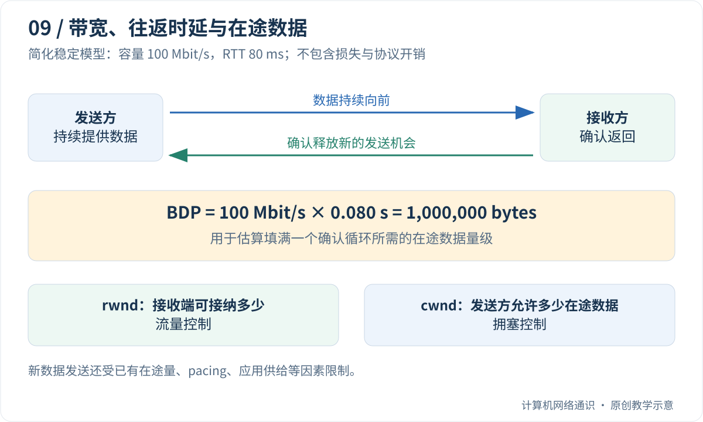

很多家庭在将宽带从 100M 升级到 1000M 千兆光纤之后，都会经历一种奇妙的幻灭感：

- 在国内测速软件上，指针瞬间拉满，下载速度狂飙至 110 MB/s；
- 但是，当你尝试从国外的 GitHub 下载一个源代码压缩包，或者通过跨国链路同步海外服务器的数据时，**下载速度却往往只有可怜的几百 KB/s，甚至几十 KB/s！**

许多人第一反应是怀疑运营商偷工减料，或者怀疑路由器硬件缩水。

然而，在网络工程的物理视界中：**高带宽绝对不等于高下载速度！**

- 为什么在物理上，跨越半个地球的传输速度，首先受到的是 **爱因斯坦光速上限** 的死死钳制？
- 什么是 **带宽时延积（BDP，Bandwidth-Delay Product）**？为什么它决定了我们在整个物理光纤信道中能够同时“飞翔”的最大数据容量？
- 限制发送端发包速度的两大核心刹车片——**流量控制接收窗口（`rwnd`）** 与 **拥塞控制拥塞窗口（`cwnd`）** 是如何在纳秒级内调节全网水龙头阀门的？
- 经典的拥塞控制四部曲（慢启动、拥塞避免、拥塞发生、快恢复）究竟是如何在网络的惊涛骇浪中维持脆弱的平衡的？

本文将全面拆解网络性能的三维物理空间，解构滑动窗口算法与拥塞控制引擎的底层运行逻辑。

## Table of contents

## 第一章：性能的三维解构——带宽、时延与吞吐量

要看清网络性能的本质，我们必须先破除日常口语中将“网速”混为一谈的模糊概念，将网络性能解耦为三个完全独立的物理维度：

```text
+---------------------------------------------------------------------------------+
| 1. 带宽 (Bandwidth): 水管的最大物理截面口径 (传输能力上限, 如 1000 Mbps)          |
+---------------------------------------------------------------------------------+
| 2. 往返时延 (RTT): 水滴从水龙头流到终点、再折返流回的总时长 (受光速限制, 毫秒级)  |
+---------------------------------------------------------------------------------+
| 3. 吞吐量 (Throughput): 单位时间内接收端真实消费、落盘的有效数据流速 (实际下载速度) |
+---------------------------------------------------------------------------------+
```

### 1. 光速的物理诅咒：往返时延（RTT）

在光纤中，光信号在二氧化硅玻璃介质中的传播速度约为真空光速的 $\frac{2}{3}$，即：
$$v_{\text{光纤}} \approx 200,000 \text{ km/s} \quad \implies \quad 200 \text{ km / ms}$$

从中国上海到美国加州旧金山的物理直线光纤距离超过 10,000 公里。
即使没有任何路由器排队、没有任何网络拥塞，一个数据包单程飞奔过去，物理极限就需要 $50\text{ ms}$；对方收到后回复确认包再飞回来，**物理往返时延（RTT）底线绝对不可能低于 $100\text{ ms}$！** 加上真实骨干网节点的逐级路由转发与光电转换，中美跨洋链路的典型 RTT 恒定在 **$150 \sim 250\text{ ms}$** 之间。

### 2. 带宽时延积（BDP）——飞翔在光纤里的在途数据

这是整个网络传输性能优化中**最核心、最震撼的物理公式**：

$$\text{带宽时延积 (BDP)} = \text{物理链路带宽 (Bandwidth)} \times \text{往返时延 (RTT)}$$

> **极其生动的物理比喻**：
>
> 把从你电脑通往远程服务器的整条网络链路，想象成一根**横跨太平洋的超长自来水管道**：
>
> - **带宽（Bandwidth）**：是这根水管的**横截面积**（代表单位时间内能注入多少水流）；
> - **时延（RTT）**：是这根水管的**物理长度**；
> - **带宽时延积（BDP）**：就是**这根长长的水管如果被完全灌满，其内部在任意时刻所容纳的“正在光纤中飞翔传播的数据总容量（Flight Data）”！**

**数值推导实测**：
假设我们拥有一根 **1000 Mbps（125 MB/s）** 的千兆跨洋链路，RTT 为 **200 ms（0.2 秒）**：
$$\text{BDP} = 1000 \text{ Mbps} \times 0.2 \text{ s} = 200 \text{ Mb} = 25 \text{ MB}$$

> **颠覆性结论**：
> 想要把这条千兆跨洋光纤的物理带宽 100% 跑满，发送端必须在等待接收端第一个确认包返回的这 200 毫秒空窗期内，**像机关枪一样源源不断地向光纤中连续泼洒灌入整整 25 MB 的数据！**
>
> 如果发送端受限于某种机制，发了 64 KB 就必须被迫停下来等对方确认，那么这条能容纳 25 MB 的千兆水管绝大部分物理空间都在白白空转，你的真实下载速度就会被瞬间打回几十 KB 的史前时代！

---

## 第二章：第一个刹车片——流量控制与接收窗口（`rwnd`）

那么，是谁在阻止发送端向网络疯狂灌水？
第一个核心限制来自于通信的接收端——**流量控制（Flow Control）**。



### 1. 接收窗口（Receive Window，`rwnd`）的物理机制

我们在第 6 篇学过，接收端操作系统的 Socket 拥有一个固定容量的 **接收缓冲区（Receive Buffer）**。

- 如果发送端发得太快，而接收端的应用进程（如受限于硬盘写入速度）读得太慢，接收缓冲区就会迅速堆满；
- 一旦缓冲区彻底溢出，后续到达的报文只能被硬件无情丢弃，引发惨烈的恶性重传。

> **流量控制的协商**：
>
> 在每一个发送回来的 TCP 报头中，都有一个 16 位的 **`Window` 字段（窗口大小）**。
> 接收端通过这个字段实时向发送端宣告：“**我的接收缓冲区现在还剩多少字节的空闲空间（`rwnd`），你最多只能给我发这么多！**”

发送端的发送窗口大小必须严格受限：
$$\text{发送窗口} \le \text{rwnd}$$

### 2. 窗口缩放选项（Window Scale Option）——突破 64 KB 的桎梏

细心的读者会发现一个致命的数学矛盾：

- TCP 报头中的 Window 字段只有 16 位，其能表示的最大数值仅为：
  $$2^{16} - 1 = 65535 \text{ 字节} \approx 64 \text{ KB}$$
- 但根据我们前面的推导，跨洋千兆链路的 BDP 高达 **25 MB**！
- 如果窗口大小被死死卡在 64 KB，哪怕千兆光纤再宽，发送端发满 64 KB 就会被迫熄火等待确认，光纤利用率连千分之一都不到！

> **RFC 1323 的救赎：窗口扩大因子（Window Scale）**
>
> 在三次握手阶段，双方可以在 TCP 选项字段中协商一个 **移位比例因子（Scale Factor，如设为 14）**。
> 后续报头中的 16 位窗口数值，在接收到后直接向左进行二进制位移：$\text{实际窗口} = \text{Window} \times 2^{14}$！
> 窗口上限瞬间被暴力拉升突破至 **1 GB**！现代超高速长肥网络（LFN，Long Fat Networks）终于获得了释放潜能的通行证。

---

## 第三章：第二个刹车片——网络拥塞控制与拥塞窗口（`cwnd`）

就算接收端拥有海量的内存缓冲区（宣告了 `rwnd = 100 MB`），发送端就可以放开手脚全速狂轰滥炸了吗？

**绝对不行！** 因为通信双方的中间，还横亘着数千台由全人类共享的**公网路由器与中继交换机**！

如果中间某台核心路由器的排队队列已经不堪重负，两端还在全速灌水，这台路由器就会发生剧烈的丢包塌方。

发送端在内核中维护了一个专门感知全网拥塞程度的自适应控制阀门——**拥塞窗口（Congestion Window，简称 `cwnd`）**！

> **发送端最终发包的终极物理上限**：
>
> 发送端在任意时刻能够向网络发送的最大在途数据量，严格由通信双方与全网状态共同裁决，取两者的**最小值**：
>
> $$\text{真正发送窗口} = \min(\text{rwnd}, \ \text{cwnd})$$
>
> - 接收端太慢，由 `rwnd` 踩刹车（流量控制）；
> - 中间网络太挤，由 `cwnd` 踩刹车（拥塞控制）！

---

## 第四章：经典拥塞控制四部曲——从慢启动到快恢复

发送端面对深不可测的外部网络，没有任何上帝视角的仪表盘。它必须依靠精密的数学算法，去试探网络的底线。

经典的 TCP 拥塞控制算法由四大核心动作构成：

```text
       拥塞窗口 cwnd (以 MSS 为单位)
          ▲
       16 │                                 ┌─── (线性增长: 拥塞避免)
          │                                ┌┘
        8 │                     ┌──── 阈值 ssthresh (触发拐点)
          │                   ┌─┘
        4 │                 ┌─┘ (指数爆炸增长: 慢启动阶段)
        2 │               ┌─┘
        1 │             ┌─┘
          └─────────────┴─────────────────────────> 时间 (RTT)
```

### 1. 慢启动（Slow Start）——并不缓慢的指数爆炸

刚建立连接时，发送端根本不知道中间路由器的承载上限。

- 初始阶段，发送端将 `cwnd` 设为极小的数值（通常为 1 ~ 10 个 MSS，最大报文段大小，约 1.5 KB ~ 15 KB）；
- **规则**：**每收到一个确认 ACK，`cwnd` 就增加 1 个 MSS**！
- **数学物理推论**：
  在一个往返时延（RTT）周期内，发出的所有包收到全部确认后，**`cwnd` 会在每一个 RTT 内呈现 $2^n$ 的指数级爆炸式翻倍增长（$1 \to 2 \to 4 \to 8 \to 16 \dots$）！**
  它一点都不“慢”，它是在以极具侵略性的速度快速试探网络的最大承载上限！

### 2. 拥塞避免（Congestion Avoidance）——如履薄冰的加法增大

指数增长极其危险，很容易在一瞬间把中间路由器撑爆。
系统在内核中设置了一个安全警戒线——**慢启动阈值（`ssthresh`，Slow Start Threshold）**。

- **当 `cwnd >= ssthresh` 时**，系统立刻踩下一脚刹车，退出慢启动，转入**拥塞避免阶段**；
- **规则**：告别指数爆炸，转为极其克制的 **加法增大（Additive Increase）**：
  **每经过一个完整的 RTT，`cwnd` 仅仅线性递增 1 个 MSS**！小心翼翼地向上触探带宽的天花板。

### 3. 拥塞发生（Congestion Occurs）——惨烈的断崖式暴跌

如果在攀爬过程中，中间路由器排队溢出，发生了**数据丢包**：

- 如果丢包极其严重，发送端迟迟收不到确认，触发了我们上一篇讲过的 **超时重传（RTO 归零）**！
- 此时，TCP 认定网络已经彻底瘫痪，启动**乘法减小（Multiplicative Decrease）的断崖式急刹车**：
  1. 将慢启动阈值腰斩：$\text{ssthresh} = \frac{\text{cwnd}}{2}$；
  2. **将拥塞窗口 `cwnd` 暴力清零砸回初始值 1 个 MSS！**
  3. 重新开启从头开始的慢启动！
  4. 这种断崖式的暴跌，在网络吞吐曲线上表现为断崖式的锯齿深坑。

### 4. 快恢复（Fast Recovery）——优雅的半速续航

如果丢包并没有导致超时，而是触发了上一篇讲过的**收到 3 个冗余 ACK（快速重传）**：
说明虽然丢了一个包，但后序报文依然能够平安穿过网络到达对方，网络并没有彻底瘫痪！
此时 TCP 不会粗暴地把 `cwnd` 砸回 1：

1. 将阈值减半：$\text{ssthresh} = \frac{\text{cwnd}}{2}$；
2. **将 `cwnd` 直接设置为减半后的新阈值：$\text{cwnd} = \text{ssthresh}$**；
3. 直接跳过从 1 开始的慢启动，**就地直接进入线性的拥塞避免阶段**！
   这就是著名的 **AIMD（加法增大、乘法减小）** 算法模型，它在保证全网公平性的同时，极大地平滑了网络的传输吞吐量。

---

## 第五章：现代算法演进——从基于丢包到基于延迟的 BBR 革命

上述经典算法（如 TCP Reno、Cubic）统治了互联网数十年，但它们有一个共同的底层缺陷：**将“丢包”作为网络拥塞的唯一信号！**

然而在现代网络中，路由器拥有极其巨大的深层内存缓冲区（**缓冲膨胀 Bufferbloat**）：
数据包在路由器内存里排了足足几百毫秒的长队，网络延迟已经高得令人发指，但因为没有发生真实丢包，Cubic 依然在盲目地增大 `cwnd`！

2016 年，Google 提出了颠覆性的 **BBR（Bottleneck Bandwidth and RTT）拥塞控制算法**：

- BBR 彻底抛弃了“不见丢包不撒手”的原始思想；
- 它在后台通过持续测量**链路的最大物理瓶颈带宽（BtlBw）** 与 **最小物理往返时延（RTprop）**；
- 将网络在途数据量精确锁定在真正的黄金平衡点 **$\text{BDP} = \text{BtlBw} \times \text{RTprop}$** 上！
- **战果**：既彻底榨干了物理带宽，又保持了最低的排队延迟，在全球跨洋链路和弱网高丢包环境下实现了数倍至数十倍的性能飞跃！

---

## 总结与专栏全局视野

在本篇《计算机网络通识（九）》中，我们解开了带宽与实际流速之间的全部物理真相：

1. **三维解耦**：彻底分清了物理管道口径（带宽）、光速物理极限（时延 RTT）与真实业务流速（吞吐量）的本质界限；
2. **在途数据容量**：推导了带宽时延积 $\text{BDP} = \text{Bandwidth} \times \text{RTT}$，看清了水管内部在途飞翔数据的物理极限；
3. **两大约束阀门**：理解了保护接收端的流量控制（`rwnd`）与保护全网路由器的拥塞控制（`cwnd`）的 $\min$ 取小规则；
4. **自适应四部曲**：解构了从指数级慢启动、线性拥塞避免，到 AIMD 乘法减小的数学演化图谱，掌握了突破 64 KB 的窗口缩放黑科技与现代 BBR 算法的核心思想。

可靠的传输需要建立连接，也需要平滑受控地调度。

那么，当一段数据彻底传输完毕之后：

- 为什么 TCP 结束一段通信需要进行**“四次挥手”**？它为什么不能像三次握手那样合为三次？
- 主动关闭方在挥手完成后，为什么必须在内存中强制挂起长达数十秒的 **`TIME_WAIT`** 状态？
- 生产服务器上如果出现了几万个卡死的 **`CLOSE_WAIT`** 状态，到底意味着后端业务代码犯下了怎样低级的致命错误？

让我们正式迈向专栏的第十篇核心力作：**[《TCP 连接怎样结束：FIN、RST 与 TIME_WAIT》](/blog/posts/how-tcp-connections-close/)**！
