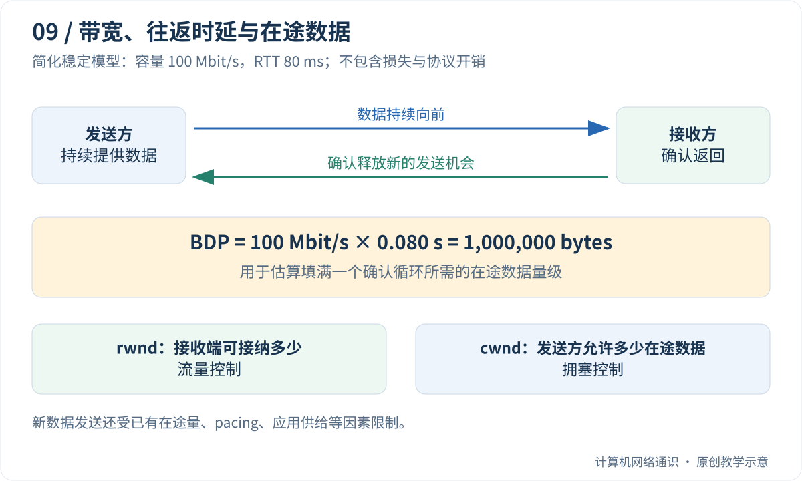

办理了“100 兆宽带”，下载器却显示十几 MB/s，是不是少了一位数？视频能流畅播放，游戏却有明显延迟，又该怪哪一个指标？

这篇先拆单位，再用送货和确认的例子理解带宽、时延与窗口。你只需要会乘除法；公式中的每个量都会先说明含义。

## Table of contents

## 先别比较数字，先看数字后面的单位

网络速率常用 **bit/s**，意思是每秒多少比特。文件大小常用字节，**1 byte = 8 bit**。大写 B 常表示字节，小写 b 常表示比特，二者相差八倍。

因此“100 兆宽带”若明确指 100 Mbit/s，按十进制单位就是每秒 1 亿比特。除以 8，得到每秒 1250 万字节，也就是 12.5 MB/s。这还是没有扣除协议开销的换算值，不是下载器必须稳定显示的承诺。

另外，`1 MB = 1,000,000` 字节，`1 MiB = 1,048,576` 字节。一些软件显示方式不同，比较时先确认单位，不能只看数值是否相同。

做一道小题：一个 25 MB 文件，若持续有效下载速率是 12.5 MB/s，纯传输部分需要 `25÷12.5=2` 秒。若建立连接和服务器准备还花一秒，总等待就至少约三秒，而不是两秒。

## 带宽像车道容量，时延像行驶时间

可以用运输作有限的类比：路宽决定单位时间可以通过多少货，路长影响第一批货多久到达。加宽路面不会让已经在路上的同一辆车瞬间跨越远距离。

**带宽或链路容量** 描述可传输的速率尺度；**时延** 描述等待多久；**吞吐量** 描述实际传过多少。**RTT** 是往返时间：发出一段信息并得到相应回应，走一来一回的时间尺度。

RTT 为 80 ms，表示 0.08 秒，不是每秒 80 个包。数据与确认的处理、沿途排队等都会影响它，不能只看地理距离。下载大量内容主要关心持续吞吐，点一次按钮要等多久则可能更受往返次数影响。

运输类比也有边界：网络共享链路，包可能排队、丢失和重传，协议还会限制发送节奏；不是给每个用户分配一条永久固定的专用车道。

## 整条路径里，最窄的地方可能不在你家

设本地宽带有 100 Mbit/s，远端服务器给这次下载只提供 20 Mbit/s。即使其他部分都够快，持续速率也不能越过远端这个限制。若中间共享链路正忙，可分到的容量还可能进一步下降。

反过来，测速通常访问某个特定目标，可能同时建立多条连接。一次测速很好，说明那次测试条件下表现不错，并不能替另一个国家的某个文件服务器作担保。

因此排查慢时要记录“从哪里向哪里、单连接还是多连接、持续多久”。没有这些条件，只比较两个测速数字很难定位原因。

## 窗口为什么会让有空余的链路停下来？

**在途数据** 指已经发出、但还没得到相应确认的数据。TCP 不会无限把新内容推出去，而会限制同时允许有多少在途数据，这种数量上的限制可以用“窗口”理解。

先设一个非常简单的发送规则：最多有 10 KB 未确认数据，往返需要一秒。发送方发满 10 KB 后，只能等待确认腾出空间。即使网线还能承载更多，它也暂时不能继续。稳定条件下，每秒只周转这批量，速度量级就是 `10 KB÷1 s=10 KB/s`。

真实 TCP 会持续随确认推进，不是严格一批批停等；这个小例子只用于理解为什么“允许在途多少”和“多久得到确认”必须一起看。

## 接收窗口与拥塞窗口，是两种限制

接收方会说：“我的缓冲区还装得下多少。”这对应 **接收窗口 rwnd**。程序读得慢，空闲缓冲变少，允许对方继续发的空间就可能缩小。

发送方还要根据路径反馈判断：“网络现在适合同时承载多少未确认数据。”这对应 **拥塞窗口 cwnd**。拥塞是需求超过网络当时可处理能力而形成排队、丢弃等现象；它不等于接收程序内存不足。

若前者允许 200 KB，后者只允许 80 KB，可保持的在途量不能仅按 200 KB 算；若已经有 60 KB 在途，新数据的空间也不是又多出完整的 80 KB。先找更紧的限制，再考虑已有占用。

接下来使用 100 Mbit/s 和 80 ms 的算例。图中的 **BDP，带宽时延积**，就是“目标速率乘一个往返时间”得到的数据量级，帮助估计要维持这种速率需要多少未确认数据空间。

## 先分清四个容易混在一起的量

| 名称             | 常见单位      | 本文中的含义                                   |
| :--------------- | :------------ | :--------------------------------------------- |
| 带宽或链路容量   | bit/s         | 某段链路能够传输数据的速率尺度                 |
| 吞吐量           | bit/s、byte/s | 一段时间内实际传过了多少数据                   |
| 有效吞吐 goodput | byte/s        | 应用真正得到的有用数据速率，不计重传等额外开销 |
| RTT              | ms            | 一个往返所经历的时间尺度                       |

运营商常用 Mbit/s，下载器常用 MB/s 或 MiB/s。8 bit 才是 1 byte；十进制 MB 与二进制 MiB 又不同。即便完全忽略协议开销，100 Mbit/s 也只对应约 12.5 MB/s，而不是 100 MB/s。

RTT 还不是单纯的地理距离。传播、排队、协议处理和对端响应方式都可能影响测量。ICMP ping 的 RTT 也不能保证等于目标应用 TCP 连接在同一时刻的 RTT。

## 发送以后要等确认，但不是每发一个包就停

如果一发送就等待一个 RTT，链路大部分时间都会空闲。TCP 使用窗口，允许一批尚未确认的数据同时处于在途状态。ACK 推进后，窗口继续向前滑动，发送方可以补入新的字节。

用一条简化模型看问题：如果平均只能保持 64 KiB 在途，RTT 为 80 ms，那么受窗口限制的速率尺度是：

$$
\frac{65536\times 8}{0.08}\approx 6.55\ \text{Mbit/s}
$$

这不是一条完整的 TCP 性能预测公式。它假设持续发送、稳定 RTT，忽略了损失、协议开销、节奏控制和应用停顿。但它足够说明：**链路即使还有容量，窗口过小也会让发送方等确认。**

## 带宽时延积：链路需要多少在途数据？

要在 100 Mbit/s、RTT 80 ms 的路径上持续填满传输机会，所需在途数据的量级可用带宽时延积估算：

$$
BDP=100\times10^6\times0.08=8\times10^6\ \text{bit}=1\ \text{MB}
$$



这里使用 RTT 来估算一个确认循环中的在途数据需求。网络内部某条单向链路在物理上容纳多少比特，是另一个需要结合单向时延的问题。

BDP 也不是建议把所有缓冲区无限调大的理由。排队本身会抬高 RTT；过大的队列可能把拥塞表现从丢包变成高延迟。游戏、语音和交互式操作尤其容易因此变得迟钝。

## rwnd 和 cwnd：两种不同的“别发太多”

**接收窗口 rwnd** 主要表达接收端还能接纳多少数据。应用如果读取太慢，缓冲区被占满，接收端可能缩小窗口，甚至通告零窗口。这是流量控制：避免把接收端压垮。

**拥塞窗口 cwnd** 是发送方控制在途数据的机制，依据确认、丢失、时延或其他反馈调整。它关心路径能承受多少负载，而不只是对端有多少空闲内存。

对于理解传统窗口限制，可以先记住：可维持的在途数据同时受 `rwnd` 与 `cwnd` 约束。新一轮还能发送多少，还要扣除已经在途的字节，并受发送缓冲、应用数据供给和 pacing 等因素影响。

把服务端接收缓冲区调大，不会自动修复中间链路拥塞；把拥塞控制算法换掉，也不会让一个停止读 Socket 的应用突然释放缓冲区。两种瓶颈要分别找证据。

传统 TCP 首部的窗口字段有限，窗口扩大选项可以在握手中协商更大的接收窗口尺度，具体见 [RFC 7323](https://www.rfc-editor.org/rfc/rfc7323.html)。这不是把 16 位字段直接改成更宽，而是协商解释方式。

## 慢启动为什么有时增长得很快？

“慢启动”相对于一开始就按未知路径的最大速率发送而言。经典算法先从受限窗口出发，随着确认到达逐步增加发送许可；在理想化情况下，每轮 RTT 的窗口增长可以很快。

达到阈值、遭遇损失或其他拥塞信号以后，增长和回退规则会变化。[RFC 5681](https://www.rfc-editor.org/rfc/rfc5681.html)描述了经典慢启动、拥塞避免与恢复框架。实际系统可能采用 CUBIC、BBR 等不同算法，初始窗口、增长轨迹和响应方式不能套用一张固定锯齿图。

理解这些规则不等于认为“每次丢包都是拥塞”。无线误码、路径变化等也可能造成损失；拥塞控制只能根据可见反馈进行判断。不同算法对这些信号的解释不同，不能不看工作负载和网络条件就宣布某一种算法永远最快。

队列管理是另一层问题：[RFC 8289 的 CoDel 算法](https://www.rfc-editor.org/rfc/rfc8289.html)以控制持续排队时延为目标。发送端拥塞控制与网络设备的队列管理会相互作用，但它们不是同一个组件。

## 可选计算实验：窗口限制下的速率上界

先用计算器做一行：64 KiB 是 `64×1024=65536` 字节，换成比特要乘 8；RTT 80 ms 换成秒是 0.08；所以速率为 `65536×8÷0.08=6,553,600 bit/s`，即约 6.55 Mbit/s。每次计算先统一单位，才能避免差 8 倍或 1000 倍。

代码把同样的算式重复三次。保存为 `window_speed.py`，运行方式见[Python 准备说明](/blog/posts/understanding-ports-and-sockets/#可选编程实验的准备怎样运行本系列的-python-代码)。其中 `min(a, b)` 取两者较小值，表达“受最紧约束限制”。

这是离线算术实验，不读取网卡，也不运行测速。改变 RTT 和窗口，观察模型中的瓶颈如何迁移。

```python
capacity_bps = 100_000_000
rtt_seconds = 0.080
bdp_bytes = capacity_bps * rtt_seconds / 8
print(f"BDP: {bdp_bytes:.0f} bytes")

for window in [64 * 1024, 256 * 1024, 1024 * 1024]:
    window_bps = window * 8 / rtt_seconds
    upper_bps = min(capacity_bps, window_bps)
    print(f"window={window:7d}: {upper_bps / 1e6:6.2f} Mbit/s")
```

输出为：

```text
BDP: 1000000 bytes
window=  65536:   6.55 Mbit/s
window= 262144:  26.21 Mbit/s
window=1048576: 100.00 Mbit/s
```

最后一行只说明在这个模型里，窗口已不再比 100 Mbit/s 的容量更紧。它**不能证明真实连接一定达到 100 Mbit/s**。将 RTT 改成 `0.010`，再计算一次，会看到同样窗口支持的速率明显提高；这也是就近服务和减少往返有价值的原因之一。

## 下载慢时，应该观察什么？

先判断是“建连和首字节慢”，还是“持续传输慢”。一个小文件下载了两秒，绝大多数时间可能在解析、连接、TLS 和服务端处理上；此时继续增加最后一段链路的带宽，不一定明显缩短总时间。

对持续传输，再逐项核对：

1. 应用是否持续供给数据，磁盘和 CPU 是否成为瓶颈。
2. 远端是否限速，是否存在连接或账号级策略。
3. RTT、接收窗口、重传以及吞吐是否同时变化。
4. 单连接和多连接结果是否不同，测量是否使用同一目标和同一时段。

Linux 可用 `ss -ti` 查看已有 TCP 连接的一些状态，字段含义取决于内核与工具版本。不要仅凭一个瞬时 `cwnd` 就计算整个下载期间的表现。[ss 手册](https://man7.org/linux/man-pages/man8/ss.8.html)说明了 TCP 内部信息选项。

多连接可能绕过单连接窗口限制，也可能只是更激进地争夺共享资源。测得多连接更快，不等于应用设计应无限开连接，更不能据此推断对其他用户没有影响。

## 留一个检查理解的问题

同一条 100 Mbit/s 链路，RTT 从 10 ms 增加到 100 ms，在窗口保持不变时，速率上界可能怎样变化？如果当前已经受链路容量限制，是否一定下降十倍？

窗口项会变小十倍，但实际取决于哪个约束原本更紧。先算出每一项，再找最小值，比背“延迟越高速度越慢”更有解释力。

上一篇：[丢包、乱序与 TCP 恢复](/blog/posts/how-tcp-recovers-lost-and-reordered-data/)

下一篇：[FIN、RST 与 TIME_WAIT](/blog/posts/how-tcp-connections-close/)

## 参考与延伸阅读

- [HPBN：Building Blocks of TCP](https://hpbn.co/building-blocks-of-tcp/)——窗口、RTT 与浏览器网络性能。
- [RFC 5681](https://www.rfc-editor.org/rfc/rfc5681.html)——经典拥塞控制框架。
- [RFC 7323](https://www.rfc-editor.org/rfc/rfc7323.html)——窗口扩大与高性能扩展。
- [Linux ss(8)](https://man7.org/linux/man-pages/man8/ss.8.html)——观察本机 Socket 状态。
