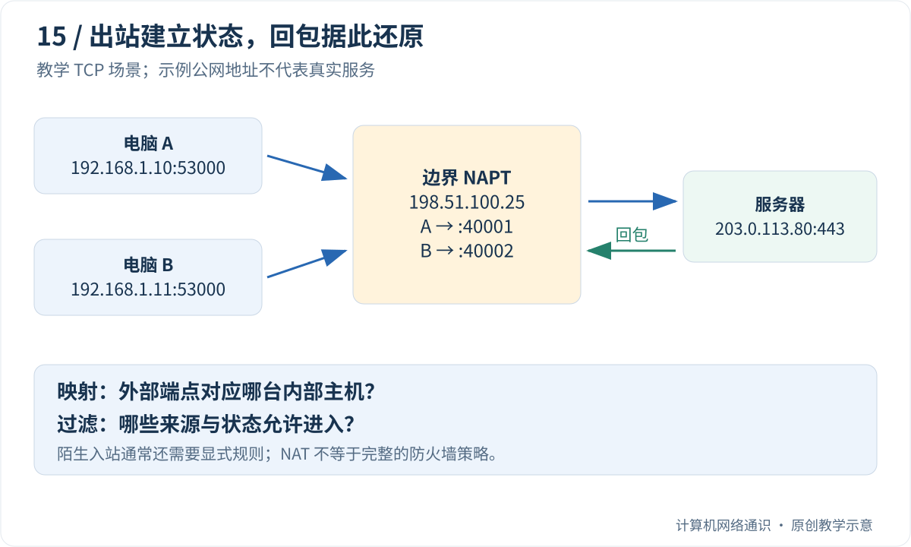

在日常生活中，几乎所有人都经历过一个极度反直觉的现象：

你坐在家里的电脑前，可以毫无阻碍地打开百度看新闻、上 B 站刷 4K 视频、从 Steam 下载游戏，网络畅通无阻。
但是，如果你在自己的电脑上搭建了一个个人博客网站，或者开了一个 Minecraft 联机游戏房间，兴奋地把自己的 IP 地址 `192.168.1.100:8080` 发给住在隔壁小区的同学时：
**对方无论怎么刷新浏览器，都只会收到冷冰冰的“连接超时”或“无法访问此网站”！**

很多初学者第一反应是：“通信不应该是对称的双向互联吗？为什么我能摸得到全世界，全世界却根本摸不到我？”

答案背后，是整个 IPv4 时代最庞大、最精密的“网络伪装术”与“安全防护铁幕”：

- 为什么你在家里查到的 `192.168.X.X`，在公网路由器眼中根本就是一个**毫无寻址意义的“内部暗号”**？
- **网络地址端口转换（NAPT）** 是如何在路由器内存中，依靠一张动态流转的**映射表（NAT Table）**，让全家人共用一个公网 IP 冲浪的？
- 当外网的朋友主动向你的路由器发送连接请求时，为什么路由器会在万分之一秒内毫不留情地将其**直接抛弃进数据黑洞**？
- **有状态防火墙（Stateful Firewall）** 究竟制定了怎样严苛的单向通行法典？

本文将全面拆解 NAT 与防火墙的底层运作机理，推导双向报文改写全流程，为你理解后续的 **VPN 虚拟专用网络** 与 **P2P NAT 穿透技术** 奠定最坚实的物理前置基石。

## Table of contents

## 第一章：暗号与公网——私网 IP 的路由阻断

在探究路由器如何转换之前，我们必须首先面对一个残酷的物理事实：**你的电脑根本没有合法的“公网身份”！**

我们在第 3 篇推导过，整个 IPv4 的全球地址总量只有区区 42.9 亿个。除去科研、军用和特殊保留地址，能够分配给全人类的公网 IP 远远不足以做到“人手一个”。

为此，国际互联网工程任务组在 **RFC 1918** 中划分出了著名的三大私网地址段：

- `10.0.0.0/8`
- `172.16.0.0/12`
- **`192.168.0.0/16`**（全球数十亿台家用路由器的默认出厂网段）

```text
[你家客厅]                                                [全世界其他家庭/公司]
电脑网卡: 192.168.1.100                                   电脑网卡: 192.168.1.100 (重名!)
手机 Wi-Fi: 192.168.1.101                                 手机 Wi-Fi: 192.168.1.101 (重名!)
           │                                                         │
           └──────────────────> [ 互联网公网骨干网 ] <─────────────────┘
                                       ▲
                                       │ ⭐️ 核心铁律:
                                       │ 全球骨干网路由器一旦看到目标 IP 是 192.168.X.X,
                                       │ 硬件芯片直接强制就地丢弃! 绝对不予路由!
```

> **私网 IP 的两大物理宿命**：
>
> 1. **全网极度重名，缺乏全局唯一性**：全世界有数以亿计的家庭电脑，网卡上绑定的都是 `192.168.1.100`。这个数字只是你家路由器局域网内部的一个局部暗号，它在公网上根本没有任何唯一的地理定位能力；
> 2. **公网路由器的强行阻断**：全球所有的核心公网路由器，其路由表里坚决不包含任何私网网段。任何目的 IP 为私网的数据包，一旦企图流入公网，**直接被路由器在硬件层物理销毁！**

---

## 第二章：移花接木——NAPT（网络地址端口转换）的动态生命周期

既然你的私网 IP 无法在公网上跑，那你是怎么把请求发送给百度服务器（如公网 IP `110.242.68.66`）并收到回复的？

这全凭你家里的这台家用路由器，在底层默默施展的“移花接木之术”——**NAPT（Network Address Port Translation，网络地址端口转换）**！



### 1. 出站源地址改写（SNAT，Source NAT）

当你的电脑 A（`192.168.1.100:54321`）在浏览器输入网址按下回车时：

1. **内网原包诞生**：
   电脑网卡生成一个原始的以太网帧送往网关路由器：
   `源 IP: 192.168.1.100, 源端口: 54321` $\to$ `目的 IP: 110.242.68.66, 目的端口: 443`；
2. **路由器的秘密登记（NAT 映射表建立）**：
   路由器是一个具有双重身份的节点：它的 LAN 口面向内网（私网 IP `192.168.1.1`），它的 WAN 口面向外部运营商（拥有一个宝贵的公网 IP，假设为 **`198.51.100.2`**）。
   路由器在内存中划出一张 **NAT 转换映射表（NAT Table）**，在里面登记一条全新记录：
   > `[内网会话: 192.168.1.100:54321]` $\Longleftrightarrow$ `[公网出口伪装: 198.51.100.2:40001]`
3. **报头物理伪装改写**：
   路由器挥起手术刀，**强行篡改该 IP 数据报的报头！**
   - 将 **源 IP** 改为路由器的公网 IP：`198.51.100.2`；
   - 将 **源端口** 改为路由器随机分配的公网临时端口：`40001`；
   - 重新计算并刷新 TCP 校验和与 IP 校验和；
   - 将这个被彻底伪装后的数据包，射向互联网公网！

在百度服务器看来，**世界上从来没有存在过 `192.168.1.100` 这台机器！它只知道刚才是一个名叫 `198.51.100.2:40001` 的公网节点在向它请求数据！**

---

### 2. 入站目的地址还原（DNAT，Destination NAT）

几毫秒后，百度服务器处理完毕，回送响应数据包：

1. **公网回包到达**：
   百度将数据包发回给它所认为的客户端：
   `源 IP: 110.242.68.66:443` $\to$ **`目的 IP: 198.51.100.2:40001`**；
2. **路由器查表寻亲**：
   数据包到达你家路由器的 WAN 口网卡。路由器提取报头：发现目的端口是 `40001`；
   路由器在自己的 NAT 转换表中飞速检索：
   **“命中表项！公网 40001 对应的是内网那台正在写代码的电脑 `192.168.1.100:54321`！”**
3. **报头逆向还原**：
   路由器再次挥起手术刀，将目的 IP 还原为 `192.168.1.100`，目的端口还原为 `54321`，通过局域网交换机准确无误地递交到你的电脑上！

你的浏览器成功渲染出了网页，从始至终毫无察觉自己的数据包在路由器肚子里经历了一场惊心动魄的掉包变形计！

---

## 第三章：核心真相揭密——为什么外网主动发起的连接彻底撞墙？

现在，我们终于可以回答最初的那个终极命题：
**为什么外网的朋友输入你的公网 IP 和端口，却死活连不上你的本地服务？**

假设你在电脑上搭建了一个 Web 服务（监听 `8080` 端口）。你把路由器当前的公网 IP `198.51.100.2` 和端口 `8080` 发给朋友：

```text
[外网朋友电脑] ──发来 TCP 握手 SYN 报文 (目标: 198.51.100.2:8080)──> [你家路由器 WAN 口]
                                                                        │
                                                                        ▼ (路由器内核查表)
                                                             "我的 NAT 表里根本没有 8080 端口的记录!"
                                                             "内网有 10 台设备，我到底该给谁?!"
                                                                        │
                                                                        ▼
                                                             直接将该数据包当场物理丢弃! ❌
```

> **外网主动访问失败的底层物理死穴**：
>
> **NAT 转换表是一个“由内部出站流量动态触发、临时建立”的单向状态机！**
>
> - 当外网主机**主动、未经邀约**地向你的路由器发送第一个连接报文（SYN）时，**你的路由器 NAT 表里是一片空白，根本没有任何由内网主动发起的历史映射条目！**
> - 此时，路由器面对着这串数据包陷入了彻底的迷茫：
>   “内网有一台爸爸的手机、一台妈妈的 iPad、一台我的电脑，你们谁也没告诉我谁要接收这个 `8080` 端口的数据啊！”
> - **路由器无法裁决，只能将其视为孤立未知流量，毫不犹豫地直接就地销毁丢弃！**
> - 朋友的电脑迟迟收不到回包，最终超时报错！

---

## 第四章：第二道铁幕——有状态防火墙（Stateful Firewall）

就算你用的是顶级企业专线，每一台电脑都拥有独立的真实公网 IP（完全没有 NAT 转换），外网依然大概率进不来。

因为边界设备上还横亘着第二道物理防线——**有状态防火墙（Stateful Firewall）**。

### 1. 单向通行的安全法典

防火墙的核心设计哲学是保护内网安全：

> **防火墙默认安全策略（Default Deny）**：
>
> 1. **出站连接（Outbound，内往外）**：**默认全面放行！** 允许内网设备自由向外探索互联网；
> 2. **入站连接（Inbound，外往内）**：**默认全盘阻断！** 严厉拒绝任何来自外部公网的主动叩门请求！

### 2. “有状态（Stateful）”的物理跟踪机理

防火墙为什么被称为“有状态”？
因为它在内核中维护了一张 **连接跟踪状态表（Connection Tracking Table，Linux 下的 `conntrack`）**：

- 当你的内网电脑主动向外部发起 TCP 三次握手发出第一个 SYN 报文时，防火墙的连接跟踪引擎会把这个会话标记为 **`NEW`** 并记录在案；
- 随后外部服务器回复的 SYN+ACK，由于在流表中能匹配到属于那个已发起的会话，被标记为 **`ESTABLISHED`（已建立连接）**，防火墙予以特批放行；
- **如果某一个数据包是从外网凭空主动发来的，流表中毫无任何前置状态，防火墙会直接将其判定为潜在入侵威胁，当场拉闸掐死！**

---

## 第五章：传统的破局之道及其工程局限

在企业和极客圈子里，为了让外网能够访问内网服务，诞生过几套传统的妥协方案：

### 1. 静态端口映射（Port Forwarding / 虚拟服务器）

登录家里的路由器后台，手动写死一条静态规则：

> _“凡是外部访问我 WAN 口 `8080` 端口的流量，无条件固定全盘转发给内网的 `192.168.1.100:8080`！”_

- **局限**：必须拥有路由器的最高管理权限；且现代很多宽带运营商连公网 IP 都不给了（分配的是 **CGNAT 运营商级大内网 IP**，前面还挡着运营商的几层大 NAT，改自己路由器根本无济于事）。

### 2. UPnP 协议（通用即插即用）

让局域网内部的软件（如迅雷、BT 下载软件、游戏客户端）通过局域网协议，自动指挥路由器在 NAT 表里动态为自己开辟一个端口映射。

- **局限**：存在严重的安全隐患（恶意木马也可以借助 UPnP 悄悄在你的路由器上打通外网后门），现代企业和高安全网络普遍强制关闭 UPnP。

---

## 总结与专栏全局承接

在本篇《计算机网络通识（十五）》中，我们解开了困扰无数人的“网络单向非对称访问”之谜：

1. **地址的阶级**：推导了 RFC 1918 私网地址缺乏全网唯一寻址能力、公网路由器坚决阻断丢弃的底层物理事实；
2. **NAPT 移花接木**：深入拆解了路由器在出站时执行 SNAT 修改源 IP 和端口建立映射表、入站时执行 DNAT 查表还原的全部改包时序；
3. **单向死穴剖析**：深刻揭示了外网主动发起连接时，因 NAT 表无前置映射、无法裁决目标主机而导致的必然丢包下场；
4. **防火墙铁幕**：理解了基于连接跟踪表（`conntrack`）实现的“内部出站默认放行、外部主动入站全盘阻断”的安全模型。

理解了 NAT 和防火墙这道无情的单向铁幕，我们就来到了现代网络世界最精彩、最刺激的分水岭：

- 如果我们有两个分别处于不同城市、都躲在各自家庭 NAT 和严格防火墙深处的小区电脑，**它们到底是如何在完全没有公网 IP 的绝境下，通过“打洞（Hole Punching）”与信令协调，实现端到端直接相连（P2P）的？**
  👉 请立刻无缝跳读保留的三大经典大作：
  - **[《什么是 VPN？虚拟专用网络的底层原理、工作流与现代演进》](/blog/posts/what-is-a-vpn/)（专栏第 17 篇）**
  - **[《Tailscale 是如何工作的：从零构建现代 Mesh VPN 架构》](/blog/posts/how-tailscale-works/)（专栏第 18 篇）**
  - **[《NAT 穿透是如何工作的：技术原理与终极指南》](/blog/posts/how-nat-traversal-works/)（专栏第 19 篇）**

而在这场绝妙的穿透史诗之前，还有一个更为根本的体系性方案正在彻底终结 NAT 的历史使命：

- 如果世界的 IP 地址足够多，多到可以给地球上的每一粒沙子都分配一个合法的公网 IP，所有的 NAT 是不是就再也没有存在的必要了？
- **最新的 IPv6 究竟带来了怎样颠覆性的架构变革？为什么说“IPv6 的真正威力，绝不仅仅是地址变长了”？**

让我们正式迈向专栏的第十六篇架构大作：**[《IPv6 带来的变化，为什么不只是地址变长？》](/blog/posts/ipv6-is-more-than-longer-addresses/)**！
