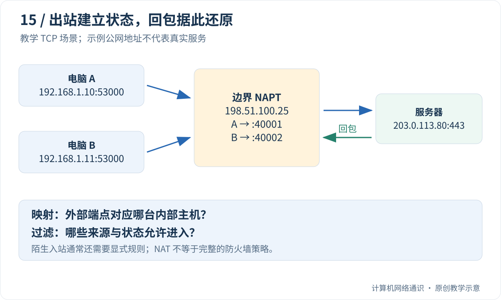

你能从家里访问网站，朋友却不能直接访问你电脑上的服务。你把电脑显示的 `192.168.1.10` 发给朋友，对方仍然打不开。这个地址到底属于谁，回复为什么可以进来，新访问为什么不行？

本篇从两户人家可以使用相同私有地址讲起，再逐笔记录一次出站和返回。不要求改路由器或开放端口，先在纸上理解路径与规则。

## Table of contents

## 内网与外网，是相对于某个边界说的

家里电脑、手机连接的网络，可以称为家庭内网；路由器通向运营商的一侧，经常标为 WAN，意为广域网侧。LAN 表示局域网侧。两者是相对于这台设备的连接方向，不表示 WAN 上一定已经拥有可从全球直接访问的地址。

**私有 IPv4 地址** 可以由不同家庭和机构重复使用。例如你家电脑叫 `192.168.1.10`，朋友家也可以有一台同名地址的电脑。两个家庭分别管理各自的网络时，这并不冲突。

但朋友要跨互联网访问你家，就不能仅说“去 192.168.1.10”。这个地址没有表达“是哪一家”的全球路由信息。私有地址通常不会被公共互联网当成可路由的目的地址。

常见私有地址块是 `10.0.0.0/8`、`172.16.0.0/12`、`192.168.0.0/16`。不需要背全部范围才读下去，先记住：内网里能用的地址，不自动成为外网的入口。

## NAT 在改什么？先只看一台电脑

**NAT** 是网络地址转换。家庭 IPv4 出口常见的是连端口一起转换的形式，叫 NAPT 或 PAT。为了讲清它，假设下面的地址都只是教学示例：

```text
内网电脑 A：192.168.1.10
出口地址：  198.51.100.25
网站地址：  203.0.113.80
```

A 发起到网站 TCP 443 的连接，本地临时端口为 53000。路由器收到包后，把外发包的来源改为 `198.51.100.25:40001`，并记住它原本对应 `192.168.1.10:53000`。

网站看到的来源是转换后的出口端点，不是 A 的私有端点。网站把响应发回出口的 40001，路由器查状态，再把目标还原到 A 的 53000。这样回复才能交到原来发起访问的程序。

转换不仅改变地址字段，还要维护相关校验等协议信息。本篇先用一张“内外对应表”理解核心职责，不把几行表格当成完整实现。

## 再加一台电脑，端口的作用就清楚了

电脑 B 也使用本地端口 53000 访问同一个网站。A 与 B 的内部 IP 不同，本来就不会冲突；但转换后它们共享同一个出口 IP，需要继续保留可区分的对应关系。

路由器可以给 A 使用外部 40001，给 B 使用外部 40002。回复的目的端口不同，就能配合协议和相关状态找到内部接收者。

```text
外部 40001 → 内部 A 的 53000
外部 40002 → 内部 B 的 53000
```

这些只是本例选的数字，真实设备不一定顺序分配，也不一定每次都改端口。你要理解的是“转换后仍需能把返回内容对应回原来的通信”。

## 回包与陌生新访问，缺了哪一步？

已有访问的回包能按状态返回。可朋友主动向出口的 49999 发送新连接请求时，路由器可能没有任何记录说明“49999 对应家里的哪台机器”。它不能凭空知道你希望找 A 还是 B。

这就像总机有一张现有通话记录，能把回复接回发起者，却不能仅凭一个没登记的分机号猜出接收人。类比到此为止：真实 NAT 的匹配还与协议、远端端点、设备行为有关。

因此“我能访问外网”只能证明某类出站和返回路径可用，不能证明任意新入站连接都可用。上网本来就需要接收数据，所以也不能说“内网收不到外部数据”。

## 地址转换与防火墙，拆成两个检查

**映射** 回答“这个外部端点对应哪个内部端点”。**过滤或防火墙策略** 回答“这份流量是否被允许”。同一个家用盒子常同时做两件事，才容易被混成一个概念。

即使存在映射，策略也可以拒绝某个来源；即使地址无需转换，防火墙仍可以阻止未授权入站。下一篇 IPv6 会再次用到这一区别。

**有状态** 表示设备会记住通信进度或相关信息，并据此处理后续包。状态会超时或被清理，并不永久存在。UDP 没有 TCP 那样的连接建立，但 NAT 和防火墙仍可以为 UDP 维护自己的通信状态。

## 如果上游还有一层，家里改规则为什么不够？

有些运营商也让多户共享出口地址，叫 **运营商级 NAT**，常缩写 CGN 或 CGNAT。此时逻辑路径可能是：

```text
你的电脑 → 家庭地址转换 → 运营商地址转换 → 互联网
```

家里的端口转发只配置你能管理的那一层，不能自动命令运营商也把流量转进来。判断前先画清边界，避免反复改家用路由器却始终找错位置。

后文给出普通回包表和端口映射的精确条件。这里不要求你实际开放服务；理解问题以后，再选择适合自己环境的连接方式。

## 私有地址为什么不能当作家门口的公网地址？

`192.168.1.10` 可以出现在许多互不相干的家庭和公司网络里。它只在相应的地址管理与路由范围内有意义。你朋友自己的路由器，也可能把这个地址交给了另一台设备。

私有地址空间允许组织重复使用，但通常不会作为全球公网的可路由目的地址。要跨越这些地址域，需要合适的路由、地址转换、代理或隧道等机制。私有地址也不等于“任何外部路径都不可能到达”，因为 VPN 或专门互联可以建立额外路由。

`100.64.0.0/10` 则是运营商共享地址空间，常见于 CGN 场景，和 RFC 1918 的三个私有地址块不是同一类定义。路由器 WAN 端出现这类地址时，可能说明上游还有一层转换；但完整判断仍应核对运营商网络与配置，不能仅看一个网页显示的出口 IP。

## 两台电脑怎样共用一个 IPv4 出口？

假设两台电脑都连接同一个示例服务器：

```text
电脑 A：192.168.1.10:53000 → 203.0.113.80:443
电脑 B：192.168.1.11:53000 → 203.0.113.80:443
```

路由器面向外部的示例地址是 `198.51.100.25`。为了让返回数据能区分 A 和 B，它可以建立这样的转换：

| 内部源端点         | 转换后的外部源端点  | 远端             |
| :----------------- | :------------------ | :--------------- |
| 192.168.1.10:53000 | 198.51.100.25:40001 | 203.0.113.80:443 |
| 192.168.1.11:53000 | 198.51.100.25:40002 | 203.0.113.80:443 |

这些端口是自拟值，不表示设备一定顺序分配，也不表示每次必然改写端口。地址加端口转换常称为 NAPT 或 PAT，是家庭出口 NAT 的常见形式；NAT 还包括不改变端口等其他形式，不能用这一张表穷尽所有类型。基础描述见 [RFC 3022](https://www.rfc-editor.org/rfc/rfc3022.html)。



## 回包为什么进得来，新连接却不一定进得来？

服务器给 `198.51.100.25:40001` 回包时，边界设备可以根据协议及相关状态，找到内部目标 A。对于 TCP，设备通常还会跟踪连接状态；UDP 则有自身的映射和超时行为。

但一个陌生来源直接向出口某端口发起新连接时，如果没有对应映射、转发规则或允许策略，边界设备既可能不知道应该交给哪台内网主机，也可能明确拒绝它。

这和“内网电脑收不到任何外部数据”不同。普通上网本来就需要接收回包；限制通常针对不符合已有状态或显式规则的入站通信。

还要区分两个问题：**映射决定外部端点怎样对应内部端点；过滤决定哪些来源的报文被允许使用这条映射。** [RFC 4787](https://www.rfc-editor.org/rfc/rfc4787.html)对 UDP NAT 的这些行为进行了区分。仅用“锥形/对称”两个标签，往往不足以预测复杂设备的全部行为。

## 可选实验：给回包查一次教学映射表

先用纸做三次查找：目的外部端口是 40001，应该交给 A；是 40002，应该交给 B；是 49999，本例没有映射。再加一条规则：只有示例网站的来源允许使用已有映射。这样你能分别看到“找不到对应关系”和“关系存在但不允许”两类失败。

保存代码为 `nat_table.py`，运行方法见[Python 准备说明](/blog/posts/understanding-ports-and-sockets/#可选编程实验的准备怎样运行本系列的-python-代码)。`state` 保存纸上的表，`inbound` 模拟一次查找；`del` 删除条目，用来人为演示状态失效。它不会读取或修改实际路由器。

这个离线程序只演示固定 TCP 场景中的查表与严格来源检查。表中两个内部端点都只允许示例服务器回包；它不是完整 NAT 实现，也不代表所有 NAT 都采用这一过滤策略。

```python
# 公共出口 IP 固定为 198.51.100.25；所有条目均假设为 TCP。
remote = ("203.0.113.80", 443)
state = {
    40001: (("192.168.1.10", 53000), remote),
    40002: (("192.168.1.11", 53000), remote),
}


def inbound(public_port, source):
    entry = state.get(public_port)
    if entry is None:
        return "no mapping"
    inside, allowed_source = entry
    if source != allowed_source:
        return "filtered by this model"
    return inside


print(inbound(40001, remote))
print(inbound(40002, remote))
print(inbound(49999, remote))
print(inbound(40001, ("203.0.113.99", 443)))
del state[40001]  # 人为模拟该条状态过期
print(inbound(40001, remote))
```

预期输出：

```text
('192.168.1.10', 53000)
('192.168.1.11', 53000)
no mapping
filtered by this model
no mapping
```

实验把“找不到映射”和“已有映射但过滤不允许”分别显示。真实设备还要处理校验和、连接状态、计时器、容量、分片等许多问题，不能把这个字典当成路由器模拟器。

## 端口映射解决哪一步？

显式端口转发可以约定：发往边界某个地址和端口的连接，交给内部某台机器的某个端口。但这只解决路径中的一部分。

要让服务真正可达，还需确认：

1. 程序在正确地址和协议上监听，而不是只绑定 `127.0.0.1`。
2. 目标主机和边界防火墙允许这类入站通信。
3. 请求能到达配置规则的那台边界设备。
4. 返回路径能够按预期经过相关状态或路由。

如果家庭路由器的上游还有 CGN，仅在家里添加转发规则，不会自动改变运营商那一层。对于同一家庭网络里的客户端，通过出口地址访问内部服务，还涉及 NAT 回环支持；外部可访问、内部通过公网名不可访问，并不矛盾。

本文不要求修改你的路由器规则。理解规则作用范围以后，再结合实际需求选择公网入口、受控反向连接、VPN 或其他方案。

## 有状态防火墙并不依赖 NAT 才能工作

即便设备拥有可路由的 IPv6 地址，防火墙仍可允许出站及相关返回流量，并拒绝未经请求的入站连接。反过来，NAT 也不能替代主机补丁、认证和最小权限。

把“没有 NAT”理解成“所有端口自动暴露”，会把寻址和访问控制混在一起。应分别检查地址、路由、监听和策略。下一篇 IPv6 会继续沿这条边界展开。

端口扫描结果也只是某个观察位置、时刻和协议条件下的证据。TCP 端口不通，不代表同号 UDP 服务不存在；一个地址能 ping 通，也不表示某个应用端口被允许。

## 为什么映射会消失，为什么会需要中继？

状态不能无限保留，否则设备会耗尽资源。空闲 UDP 映射可能过期，TCP 状态也有不同阶段和清理策略。保活可以在适用条件下维持某些状态，但增加流量和功耗，并不能让所有网络都永久允许直连。

两端都在 NAT 后面时，可以借助协调服务交换观察到的端点、尝试同时发送，并在条件允许时建立直连。若映射或过滤行为不配合，或者路径策略阻止通信，就可能需要中继。

STUN 帮助发现外部观测到的端点，不是一条保证穿透成功的隧道；中继则通过双方都能访问的服务器转发内容。详细过程可以继续读现有的 [NAT 穿透专题](/blog/posts/how-nat-traversal-works/)。

## 阅读后面三篇译文之前，先准备这几个词

**隧道** 是把原本的一份网络数据包装到另一种传输中送走，对端再取出内层数据。常见安全 VPN 使用加密隧道连接设备或网络；是否承载全部流量，要看路由和分流配置，不能仅凭“开了 VPN”判断。

**控制平面** 负责分发身份、密钥、公网端点和策略等协调信息；**数据平面** 负责实际业务数据传送。协调者存在，不代表每份文件正文都必须经过它。

**P2P** 表示端点之间直接交流的设计目标，**中继** 则是经双方都能访问的第三方节点转发。**STUN** 可以帮助了解外部观察到的映射端点，却不自动保证两端可以直连。**打洞** 是利用映射、过滤与主动发包等条件尝试建立通路，不是永久关闭防火墙。

带着这些职责再读 [VPN](/blog/posts/what-is-a-vpn/)、[Tailscale](/blog/posts/how-tailscale-works/) 和 [NAT 穿透](/blog/posts/how-nat-traversal-works/) 译文，遇到密集术语时可回到本节对照。这三篇保留原来的译文内容，本文这里只补阅读所需的基础。

## 用四个问题整理一次故障

当朋友连不上你的服务时，依次写清：他访问的目标地址是什么；数据能否到达你能管理的边界；该边界按什么规则交给内部主机；内部程序是否在正确位置监听并被允许接收。

这四个问题比“我有公网 IP，为什么还不行”更容易得到可验证答案。公网地址只是条件之一，不是可达性的充分证明。

## 读完后，用自己的话试着解释

NAT 表里存在某条映射，是否就保证任何来源都能访问对应内部服务？

<details>
<summary>展开参考答案</summary>
<div class="mt-4 leading-7">不保证。映射只是内外端点关系，还要满足过滤、路由、主机防火墙和服务监听等条件。映射存在与流量被允许是不同判断。</div>
</details>

上一篇：[代理、负载均衡与 CDN](/blog/posts/understanding-proxies-load-balancers-and-cdns/)

下一篇：[IPv6 不只是地址变长](/blog/posts/ipv6-is-more-than-longer-addresses/)

## 参考与延伸阅读

- [Tailscale：How NAT traversal works](https://tailscale.com/blog/how-nat-traversal-works)——从工程通信问题理解 NAT 与穿透。
- [RFC 3022](https://www.rfc-editor.org/rfc/rfc3022.html)——传统 NAT 与 NAPT。
- [RFC 4787](https://www.rfc-editor.org/rfc/rfc4787.html)——UDP NAT 映射与过滤行为。
- [RFC 6598](https://www.rfc-editor.org/rfc/rfc6598.html)——运营商共享地址空间。
