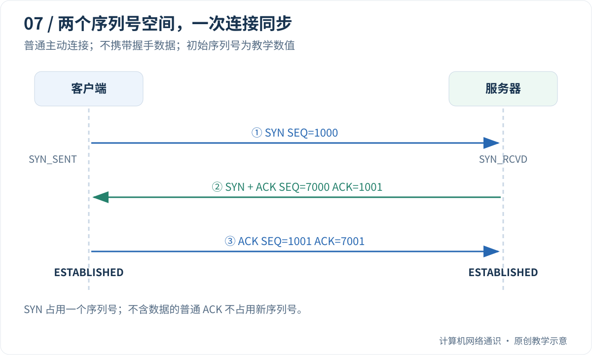

你知道朋友的电话号码，也不能一拿起电话就假设对方正在听。TCP 通信也需要先准备好双方的状态，不过它解决的问题比“喂，听得到吗”更具体：双方要约定本次数据编号从哪里开始，并确认收到对方这次的起点。

本篇先解释为什么要编号，再慢慢读三个箭头。图中的 SYN、ACK 不需要提前认识，下面会把它们翻译成具体动作。

## Table of contents

## 为什么“知道 IP 和端口”还不够？

IP 和端口告诉我们怎样寻找通信入口，但不能说明这次交流已经准备好。设你要发送一段文字，网络可能让不同部分延迟、丢失或重复到达。TCP 需要知道哪些字节属于这次连接、哪些已经收到、哪些还在等待。

因此，两端会保存一组记录，这叫 **连接状态**。它存在于操作系统的 TCP 实现中，而不是在所有中间路由器上预约一根专线。即使连接已经建立，沿途转发仍然是一个包接一个包地进行。

可以先把双方想成各自拿了一张进度纸：上面记着对方的地址、编号起点、已经连续收到的位置。三次握手就是让这两张纸按协议建立起一致的起始关系。

## 先弄懂“给字节编号”，再看握手

**字节** 是数据大小单位，8 个二进制位为一个字节。TCP 以字节为基础编号，编号叫 **序列号**。它不是数据包在列表中的第几行，也不是应用消息的条数。

为了便于演示，假如某方向第一批数据从 1001 开始，发出五个字节 `hello`，它们对应 1001、1002、1003、1004、1005。接收方连续收齐后，可以说“我下一步期待 1006”。这就是确认号的直觉。

两个方向要分别编号：客户端发给服务器的数据有一套序列号，服务器回给客户端的数据有另一套。否则双方同时说话时，很难仅用一个计数器区分是谁发送的哪段内容。

握手阶段双方先公布起点，接下来才有办法按正确的编号解释数据。真实初始序列号按实现选择，本篇的 1000、7000 只是方便心算。

## 把 SYN、ACK、SEQ 翻译成人话

| 缩写     | 在本篇怎么理解                                     |
| -------- | -------------------------------------------------- |
| SYN      | 表示正在同步序列号、准备建立连接的控制标志         |
| SEQ      | 这个 TCP 段的序列号字段                            |
| ACK 标志 | 表示确认号字段有效                                 |
| ACK 数字 | 本方向对对端数据的确认位置，通常表示下一期待序列号 |

同一个 ACK 字母会出现在“标志”和“数字”两个地方，这是初学者最容易混淆的点。“SYN+ACK”说的是两个标志；“ACK=1001”说的是确认号的数值。一个回复可以同时表达“我确认了你”和“这是我的起点”。

SYN 本身会消耗一个序列号。因此，如果起点是 1000，对方确认 SYN 后会期待 1001；不是因为 SYN 里面发送了一个字母。

## 先读一遍没有表格的三次对话

本篇先讨论最常见的一方主动连接、一方监听的情况，不带应用数据。

**第一步，客户端发 SYN。** 意思是“我想建立这次连接，我这一方向从 1000 开始”。服务器收到后，知道客户端提出了什么起点。

**第二步，服务器发 SYN+ACK。** 意思是“你的 1000 我收到了，期待你接着从 1001 开始；我这一方向从 7000 开始”。这一步把两个信息合并在同一回复中。

**第三步，客户端发 ACK。** 意思是“你的 7000 我也收到了，期待你接着从 7001 开始”。服务器收到这个有效回应，才知道客户端接收了自己这一次的同步信息。

为什么不是只回复第二步就结束？因为第二步只在服务器那里完成了“发出回应”这个动作，服务器还没有得到客户端对自己新起点的有效确认。网络中还可能有旧的、迟到的连接请求；后文会把这个情况单独演一遍。

这不是无限确认的游戏。协议约定在什么条件下推进状态，以及报文丢失后如何重试，并不追求用三句话证明网络永远不会坏。

## 读时序图的方法

图的左右两列是两个参与者，越往下表示时间越晚；横向箭头表示消息方向。先只沿三个箭头读中文含义，再对照 `SEQ` 与 `ACK` 数字。不要把图的横向距离当成真实物理距离，也不要把每段竖线长度当成经过严格测量的时间。

读完数字例子以后，做一个口头检查：第二个消息为什么同时有 SYN 和 ACK？能回答“既公布自己的起点，也确认对方起点”，就不必死背“三次是为了双方确认收发能力”这句笼统表述。

## TCP 连接到底是什么？

连接不是互联网中提前铺好的一根专线。中间路由器仍然逐跳转发 IP 数据包；TCP 端点在两侧保存通信状态，例如：

- 对端是谁，本地使用哪个地址和端口；
- 哪些字节已发送、哪些已得到确认；
- 下一步期待收到哪个序列号；
- 接收窗口和协商选项；
- 重传计时器及当前连接状态。

在同一网络上下文中的普通 TCP 通信里，四元组可以区分连接：

```text
(源 IP, 源端口, 目的 IP, 目的端口)
```

因此，服务器同一个 443 端口可以服务多个客户端。客户端地址或端口不同，对应的连接状态就不同。监听 Socket 负责等待新连接，已连接 Socket 负责某一条具体连接上的读写。

## 用一组数字走完三个箭头

为了便于计算，假设客户端选择初始序列号 `1000`，服务器选择 `7000`。真实实现不会总使用这两个固定数字。



| 步骤 | 方向            | 主要字段                     | 在同步什么                               |
| :--- | :-------------- | :--------------------------- | :--------------------------------------- |
| 1    | 客户端 → 服务器 | SYN，SEQ=1000                | 客户端宣布自己的起始序列号               |
| 2    | 服务器 → 客户端 | SYN、ACK，SEQ=7000，ACK=1001 | 确认客户端 SYN，同时宣布服务器起始序列号 |
| 3    | 客户端 → 服务器 | ACK，SEQ=1001，ACK=7001      | 确认服务器 SYN                           |

TCP 的两个方向拥有独立的序列号空间。SYN 各占一个序列号，因此确认数字会加一；普通不含数据的 ACK 不占用新的序列号。

完成这组同步以后，客户端第一个应用字节可以从 `1001` 开始，服务器第一个应用字节可以从 `7001` 开始。后续 ACK 的主要含义是“连续收到哪里、下一步期待哪个字节”，不是“这是第几个包”。

[现代 TCP 基础规范 RFC 9293](https://www.rfc-editor.org/rfc/rfc9293.html)把同步和旧重复连接请求的处理放在一起讨论。这里最重要的设计问题，是让双方对**当前连接的两个起点**形成一致认识。

## 如果只有两个消息，会留下什么问题？

想象客户端以前发送过一个 SYN，随后放弃了那次连接；这个 SYN 却迟到很久，才被服务器收到。

如果服务器收到 SYN、发出响应以后便认定连接已被对方接受，它就可能把一个已经失效的连接意图当成当前事实。第三次确认要求客户端对服务器这次选择的序列号作出有效回应：客户端确实接收并认可了当前这一轮同步信息。

这不意味着三个包可以神奇地证明网络永远正常。第三个报文本身也可能丢失。它提供的是协议所需的确认与状态推进规则，而不是一张“后续绝不掉线”的保证书。

同样，不应把第三次 ACK 说成“服务器确认客户端的确认”。那会诱导出永无止境的第四次、第五次确认。协议需要约定何时允许端点推进状态，以及信息丢失后怎样恢复；分布式通信不可能靠有限轮往返证明对方永远知道自己已经知道。

## 丢了其中一个报文，会怎样？

| 丢失位置      | 典型后果                                   | 排查时应避免的推断         |
| :------------ | :----------------------------------------- | :------------------------- |
| SYN 丢失      | 发起方等待后重传 SYN                       | 一次超时不等于服务器未启动 |
| SYN-ACK 丢失  | 客户端未完成同步，服务器也可能重发 SYN-ACK | 不能只观察单端就确定丢包点 |
| 最后 ACK 丢失 | 客户端可能已认为连接可用，服务器仍等待确认 | 两端状态在短时间内不必一致 |

若服务器重发 SYN-ACK，客户端可以再次确认；合法的后续带 ACK 数据也可能推动服务器完成连接建立。具体时序、重试次数和超时长度取决于实现与配置，不应把某次抓包中的秒数当成协议常数。

还要区分“收到有效 RST”和“什么都没收到”：前者表示这次交互被主动重置，后者只说明在观察期限内没有足够回应。防火墙、中间设备、路由和远端主机都可能影响结果。

## 进阶：握手完成，为什么服务器程序还没开始处理？

握手主要由操作系统的 TCP 栈处理。服务器应用会先 `listen()`，随后通过 `accept()` 取得连接。**应用还没有调用 accept，不代表操作系统不能完成握手。**

Linux 中常把相关等待过程区分为未完成握手的请求和已建立、待应用接受的连接。[Linux listen 手册](https://man7.org/linux/man-pages/man2/listen.2.html)说明，现代 Linux 的 `backlog` 主要影响后者；具体上限还受内核配置限制。不能把 `listen(128)` 理解成“服务器一共只能服务 128 个用户”。

[Cloudflare 的 SYN 处理文章](https://blog.cloudflare.com/syn-packet-handling-in-the-wild/)进一步讨论了队列、SYN cookies 和真实负载下的表现。那是 Linux 工程经验，不是所有操作系统必须照搬的结构。SYN cookies 也不意味着应用处理能力和所有资源上限都消失了。

一个常见瓶颈是：应用处理速度太慢，迟迟不接受新连接，等待队列堆积。此时盲目调大队列可能只增加等待时间；还需要观察处理线程、事件循环、下游依赖和到达速率。

## 可选实验：connect 之后才调用 accept

运行方法可参考[上一篇的 Python 准备说明](/blog/posts/understanding-ports-and-sockets/#可选编程实验的准备怎样运行本系列的-python-代码)。将本段保存为 `tcp_connect.py`，运行 `python tcp_connect.py`；若你的环境使用 `py` 或 `python3`，替换命令开头。

先读执行顺序：`bind` 指定本地地址，`listen` 准备接待；客户端 `connect` 发起连接；服务器 `accept` 接过已经建立的连接。我们故意把 `accept` 放在 `connect` 后，观察应用接待之前，系统是否已经能完成建立连接的工作。

以下单进程程序仅在回环地址上建立连接。监听端先准备好，但直到客户端 `connect()` 返回，才调用 `accept()`。

```python
import socket

with socket.socket(socket.AF_INET, socket.SOCK_STREAM) as listener:
    listener.bind(("127.0.0.1", 0))
    listener.listen(1)
    listener.settimeout(2)

    with socket.socket(socket.AF_INET, socket.SOCK_STREAM) as client:
        client.settimeout(2)
        client.connect(listener.getsockname())
        print("connect returned before accept")
        connection, peer = listener.accept()
        with connection:
            print("same server endpoint:",
                  connection.getsockname() == listener.getsockname())
            print("peer is client:", peer == client.getsockname())
            print("different socket objects:", connection is not listener)
```

应看到第一行先输出，随后三个比较均为 `True`。它验证监听对象和已连接对象不同，也验证操作系统可以先完成连接建立、再把连接交给应用。

这个程序没有抓包，因此它本身不能证明网络上恰好出现三份独立报文。若要看握手，可在自己的电脑上捕获回环接口，用 Wireshark 过滤 `tcp.flags.syn == 1`，找到连接后再使用 `tcp.stream == N` 查看整条流。Windows 的回环捕获取决于抓包驱动支持；不要选错成物理网卡后断言“没有握手”。

## 握手成功，不等于登录成功

TCP 不负责证明远端服务器证书可信，也不负责验证用户名密码。连接成功只代表传输层同步已经进行到允许通信的阶段。

之后还可能发生 TLS 证书错误、HTTP 401、请求格式错误，或者业务处理超时。排障时把这几层拆开，才能回答“已经连上了，为什么仍然不能使用”。

可以试着手算：如果客户端 SYN 的 SEQ 是 420，服务器 SYN 的 SEQ 是 900，第三次 ACK 的两个数字应该是多少？在本篇假设下是 `SEQ=421`、`ACK=901`。下一篇会把这种编号延伸到丢包与乱序。

上一篇：[端口和 Socket](/blog/posts/understanding-ports-and-sockets/)

下一篇：[TCP 怎样恢复丢失和乱序的数据](/blog/posts/how-tcp-recovers-lost-and-reordered-data/)

## 参考与延伸阅读

- [RFC 9293](https://www.rfc-editor.org/rfc/rfc9293.html)——TCP 连接建立与序列号同步。
- [Cloudflare：SYN packet handling in the wild](https://blog.cloudflare.com/syn-packet-handling-in-the-wild/)——Linux 中 SYN、队列和选项的工程观察。
- [Linux listen(2)](https://man7.org/linux/man-pages/man2/listen.2.html)——监听 API 与 backlog 的实现语义。
- [Beej：System Calls or Bust](https://beej.us/guide/bgnet/html/split/system-calls-or-bust.html)——连接、监听与接受连接的编程视角。
