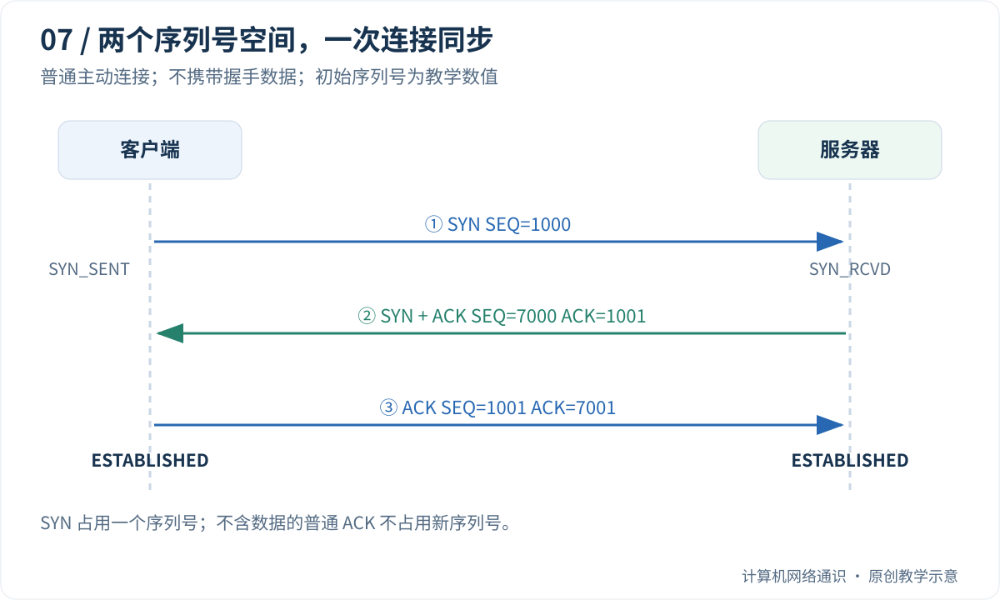

在几乎所有的软件开发技术面试中，“TCP 为什么要三次握手？两次握手行不行？”都是一道高频出现的经典考题。

很多人的回答往往停留在浅层的口诀背诵：“为了确认双方都具备收发数据的能力”。

然而，如果仔细推敲其底层机制，这个解释根本无法回答核心的技术死穴：

- 两次握手难道不能确认收发能力吗？客户端发了、服务端回了，服务端难道不知道客户端能发、客户端难道不知道服务端能收？
- 所谓的 **初始序列号（ISN，Initial Sequence Number）** 为什么要随机生成，为什么不能固定从 0 开始？
- 在网络发生拥塞、旧报文延迟到达的不可靠信道中，两次握手会如何让服务端陷入灾难性的**“单向半死连接与资源枯竭”**？
- 操作系统的内核参数 **`listen(sockfd, backlog)`** 到底控制了哪个队列的容量？当全连接队列被打满时，为什么新连接会陷入假死？著名的 **SYN Flood（泛洪拒绝服务攻击）** 又是如何通过数学奇迹 **SYN Cookie** 被化解的？

本文将全面深入 TCP 传输控制协议的连接管理腹地，拆解三次握手的状态演化时序，深入 Linux 内核的半连接与全连接队列，从物理现实与网络安全两个维度彻底讲透三次握手的必然性。

## Table of contents

## 第一章：握手的真正使命——状态建立与序列号同步

在探讨为什么是三次之前，我们必须先明确：**TCP 握手到底在“握”什么？**

UDP 协议是无连接的：它把数据装进数据报往网线上一丢，完全不需要知道对方是否在线、是否准备好。

而 TCP 是一个**面向连接的、可靠的、基于字节流的全双工通信协议**。在真正向对端发送哪怕 1 个字节的业务数据之前，双方必须在操作系统内核中**建立起一个确定的通信上下文状态**。

### 1. 同步初始序列号（ISN）

TCP 将数据拆分成一个个报文段，每一个字节都有一个唯一的 32 位编号——**序列号（Sequence Number，简称 Seq）**。

> **核心使命**：
>
> **三次握手的首要目标，是让通信双方可靠地交换并确认各自的“初始序列号（ISN）”！**

**为什么 ISN 绝对不能固定从 0 开始？**

1. **防止网络中历史残留旧连接的脏数据串话**：
   如果每次建立连接双方都从 `Seq = 0` 开始，假设上一个旧连接因网络阻塞有一段数据迟迟未到达，旧连接刚关闭，新连接又在相同的四元组上建立；此时那个迟到的旧报文突然飞到了，其序列号恰好落在了新连接的接收窗口内，接收端会错误地把上一段通信的死数据混入新数据中，造成致命的数据逻辑污染！
2. **防止针对序列号的盲打劫持攻击**：
   RFC 793 和现代 Linux 内核基于单调递增的时钟计数器与哈希算法动态生成 ISN，使得攻击者极难猜测当前连接的合法序列号，杜绝了 TCP 伪造报文攻击。

---

## 第二章：三次握手的完整时序与状态机演进

一次标准的 TCP 三次握手过程与两端操作系统内核的状态机演进如下：



```text
客户端 (Client)                                          服务端 (Server)
[状态: CLOSED]                                          [状态: LISTEN]
      │                                                        │
      │ ──── 1. SYN 报文 (SYN=1, seq=x) ─────────────────────> │ ──> 服务端进入 [SYN_RCVD] 状态
      │      (客户端进入 [SYN_SENT] 状态)                        │     (分配半连接资源入队列)
      │                                                        │
      │ <─── 2. SYN + ACK 报文 (SYN=1, ACK=1, seq=y, ack=x+1) ─ │
      │      (客户端进入 [ESTABLISHED] 状态, connect() 成功返回) │
      │                                                        │
      │ ──── 3. ACK 报文 (ACK=1, seq=x+1, ack=y+1) ──────────> │ ──> 服务端进入 [ESTABLISHED] 状态
      │      (此报文已允许携带客户端首批业务 Payload 数据)        │     (连接移入全连接队列, 等待 accept)
      ▼                                                        ▼
```

### 报头关键标志位详解

- **`SYN`（Synchronize，同步位）**：为 1 代表这是一个请求建立连接的握手报文；
- **`ACK`（Acknowledgment，确认位）**：为 1 代表报头中的确认序号（`ack`）有效；
- **消耗序号规则**：纯控制类的 `SYN` 报文虽然没有携带任何应用层数据载荷，但**在逻辑上强制占用 1 个序列号**！因此对方回复确认时，`ack` 必须是 `seq + 1`！

---

## 第三章：终极对决——两次握手到底会发生什么灾难？

现在我们来回答最直击灵魂的问题：**两次握手为什么不行？如果把第三次握手砍掉，系统会怎样崩溃？**

### 灾难推演：历史延迟迷途报文引发的单向死锁

在不可靠的 IP 网络中，数据包可能会在途经的某个路由器队列中发生严重的拥塞与滞留。

假设在只有两次握手的世界里：

```text
[场景还原: 两次握手下的致命灾难]
1. 客户端发出的第一个握手报文 SYN_1 在某个慢速链路上严重迷途堵车了；
2. 客户端在规定时间内迟迟未收到回复，触发超时重传；
3. 客户端发出第二个 SYN_2，与服务端顺利完成通信，双方四次挥手正常断开连接；
4. 悲剧发生：那份在网络深处迷途流浪了半分钟的旧 SYN_1，突然晃晃悠悠到达了服务端！
        │
        ▼ (服务端毫不知情，以为来了个全新的连接请求!)
5. 服务端立即向客户端回复 SYN + ACK，并根据两次握手协议，单方面宣布：
   "连接已经成功建立！(ESTABLISHED)"
        │
        ▼ (服务端在内核中立刻开辟套接字缓冲区、分配内存与控制块，静止等待客户端发送数据!)
6. 客户端收到服务端的这封回复，发现其确认的序列号是已经过期的老旧编号，
   客户端心知肚明这只是一场误会，冷冰冰地将其当成垃圾报文直接丢弃，根本不理睬服务端！
```

> **两次握手的致命死穴**：
>
> **服务端在没有收到客户端最终确认的情况下，单方面盲目进入 `ESTABLISHED` 状态！**
>
> 服务端以为连接已经通畅，在内存中死死挂起这个僵尸套接字，苦苦等待客户端发来数据；而客户端早就判定这是一段毫无意义的历史旧报文，直接弃之不理。
>
> 如果网络波动频繁，成千上万个延迟的旧 SYN 涌入服务端，**服务端会凭空建立起成千上万个单向半死的空头连接！服务器的内存、端口与并发连接数被彻底榨干消耗殆尽，整台系统瞬间陷入假死瘫痪！**

### 三次握手是如何破局的？

有了第三次握手，权力掌握在客户端手中：

- 客户端收到服务端的 SYN+ACK 时，比对确认号发现这是一个失效的旧连接，**客户端绝对不会发送第三次 ACK**；
- 客户端会主动向服务端回送一个 **`RST`（Reset，复位连接）** 报文！
- 服务端收到 `RST` 报文，立刻终止该连接并释放预分配的资源，**绝不建立任何死连接！**

---

## 第四章：内核深水区——半连接队列与全连接队列

在操作系统内核中，三次握手的流转过程严格依托两张底层的系统队列：

```text
                            Linux 内核 TCP 连接队列模型
+---------------------------------------------------------------------------------+
| 1. 半连接队列 (SYN Queue / incomplete connection queue):                        |
|    存放收到了客户端的第 1 次 SYN，服务端处于 [SYN_RCVD] 状态的“半成品”连接对象        |
+---------------------------------------------------------------------------------+
                                           │
                                           ▼ 收到客户端第 3 次 ACK 握手成功
+---------------------------------------------------------------------------------+
| 2. 全连接队列 (Accept Queue / completed connection queue):                       |
|    存放已经完成三次握手、处于 [ESTABLISHED] 状态，等待应用层 accept() 提取的“成品”连接 |
+---------------------------------------------------------------------------------+
                                           │
                                           ▼ 用户进程调用 accept(listen_fd)
                             从全连接队列头摘下一个已就绪连接，返回通信 conn_fd
```

### 1. `listen(int sockfd, int backlog)` 中 `backlog` 的真正含义

我们在网络编程中调用的 `listen(sockfd, 128)`，第二个参数 `backlog` 到底代表什么？

很多教科书模糊地解释为“最大并发连接数”，**这是完全错误的！**

> **底质真相**：
>
> **`backlog` 参数在现代 Linux 内核中，严格控制的是——全连接队列（Accept Queue）的长度上限！**
>
> Linux 内核全连接队列的实际最大容量计算公式为：
>
> $$\text{全连接队列上限} = \min\left(\text{backlog}, \ \text{/proc/sys/net/core/somaxconn}\right)$$

### 2. 全连接队列溢出（Accept Queue Overflow）排查

如果后端应用由于数据库慢查等原因，卡在业务逻辑中，**迟迟没有调用 `accept()` 来摘取队列中的就绪连接**，全连接队列就会被迅速填满打爆。

此时如果再有新连接完成三次握手到达，内核如何处理？受内核参数 `net.ipv4.tcp_abort_on_overflow` 控制：

- **`tcp_abort_on_overflow = 0`（默认策略）**：
  内核选择**静默丢弃客户端发来的第 3 次 ACK 报文**！服务端假装什么都没收到。此时客户端以为连接已经建立，而服务端由于未入全连接队列；客户端后续发送数据未收到响应，会触发指数退避重传。**为慢业务恢复争取了宝贵的缓冲时间**；
- **`tcp_abort_on_overflow = 1`**：
  内核直接粗暴地向客户端回发一个 `RST` 报文，强制拒绝切断该连接。

---

## 第五章：暗黑风暴与数学奇迹——SYN Flood 攻击与 SYN Cookie

理解了半连接队列，我们就能瞬间看清网络安全界最著名的拒绝服务攻击——**SYN Flood（SYN 泛洪攻击）** 的致命原理。

### 1. SYN Flood 的攻击本质

攻击者控制成千上万台肉鸡僵尸电脑，或者通过伪造随机虚假的公网源 IP：

1. 疯狂向目标服务器的 80/443 端口轰炸海量的 **第 1 次 SYN 报文**；
2. 服务端每收到一个 SYN，就在半连接队列中开辟一块物理内存，并向那些虚假不存在的源 IP 发送 SYN+ACK；
3. 由于源 IP 是伪造的，**世界上根本没有任何机器会向服务端发送第 3 次确认 ACK！**
4. 服务端由于收不到 ACK，只能在内存中苦苦挂起并触发多次超时重传；
5. **在短短几毫秒内，服务器的半连接队列被这些虚假的半成品连接彻底塞死打满！**
6. 随之而来的正常网民用户发起合法连接时，因为半连接队列满员，全部被内核无情拒绝抛弃！

### 2. 破局之道：SYN Cookie 的数学降维打击

面对没有成本的恶意攻击，Linux 内核设计出了堪称数学奇迹的防御方案——**SYN Cookie 机制（`net.ipv4.tcp_syncookies = 1`）**！

> **SYN Cookie 的核心设计哲学：不在内存中存状态，把状态加密写入序列号！**

```text
[正常模式]: 收到 SYN ───> 在内核分配内存控制块 ───> 容易被 SYN Flood 耗尽内存打爆
                             VS
[SYN Cookie 模式 (半连接队列满时自动激活)]:
收到客户端第 1 次 SYN ───> 坚决不分配任何内核内存！
                          │
                          ▼ (基于密码学哈希计算)
ISN = Hash(源 IP, 目的 IP, 源端口, 目的端口, 时间戳, 密钥)
                          │
                          ▼ 将计算出的特征值直接作为服务端的初始序列号回传！
发送 SYN + ACK 报文 (seq = ISN)
                          │
                          ▼ 等待客户端第 3 次 ACK
收到客户端 ACK (ack = ISN + 1)
                          │
                          ▼ (逆向数学验证)
提取 ack - 1，用完全相同的算法逆向校验哈希特征值！
只要校验通过，内核当场当场一次性直接为该连接分配全连接套接字！
```

**数学奇迹的降维打击**：
服务器面对海量的 SYN 攻击流量，**连一个字节的内核连接内存都无需分配**！攻击者以为把服务器内存占满了，其实服务器只是在 CPU 里做了一次瞬时哈希运算。
只有真正能回传合法第 3 次 ACK 的正牌客户端，系统才会在最后一刻分配内存完成连接！**彻底化解了半连接队列被物理耗尽的危机！**

---

## 总结与专栏全局视野

在本篇《计算机网络通识（七）》中，我们解构了 TCP 可靠世界的序曲：

1. **状态建立与 ISN 同步**：明晰了三次握手的首要任务是双向安全同步各自独立的 32 位初始序列号，防止网络历史残留报文串话；
2. **拒绝两次握手的物理真相**：推导了滞留迷途旧 SYN 报文在两次握手下必然导致服务端建立单向半死连接、榨干系统资源的灾难现场，确立了客户端第三次 ACK 的否决权价值；
3. **内核队列模型**：解剖了内核半连接队列（`SYN_RCVD`）与全连接队列（`ESTABLISHED`）的分工，澄清了 `listen(backlog)` 真正控制全连接队列上限的底层机理；
4. **攻防前沿**：深入剖析了 SYN Flood 泛洪攻击对半连接队列的饱和打击，掌握了基于特征哈希加密序列号的 SYN Cookie 降维破局之道。

握手已然礼成，可靠的双向信道已经构筑。

然而，在接下来的真实数据传输中，物理网络依然危机四伏：

- 真实的网线、光纤和无线电磁波会随时发生高频的**丢包、误码与跨路由器乱序**；
- 面对乱序飞来的数据，**TCP 究竟是如何依靠“序列号（Seq）与累计确认（ACK）”将其在接收缓冲区严丝合缝拼装复原的？**
- 什么是 **超时重传（RTO）**？为什么发生了丢包不能傻等超时，必须触发 **快速重传（Fast Retransmit）**？

让我们正式迈向专栏的第八篇核心力作：**[《数据包丢了、乱序了，TCP 怎样恢复？》](/blog/posts/how-tcp-recovers-lost-and-reordered-data/)**！
